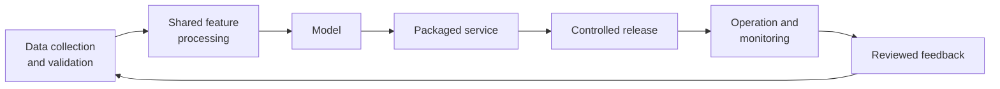
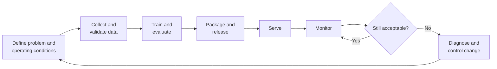
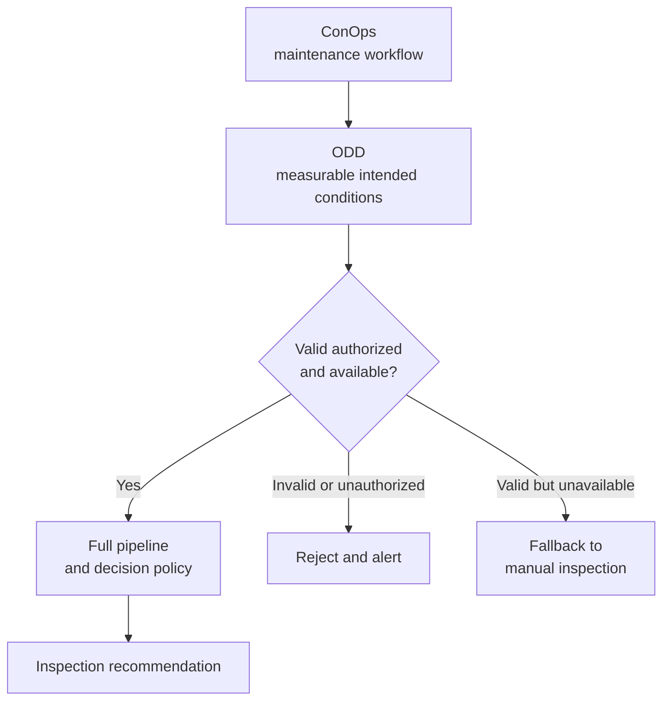
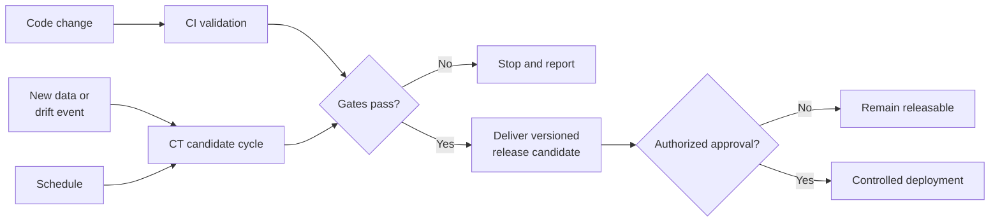
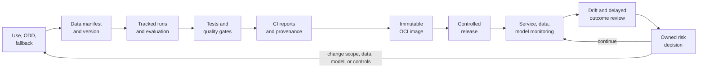

# Machine Learning Engineering & MLOps
### Course - From notebook to operational AI systems

**Clement Gicquel** - AI Solution Architect

---

## 0. Course Roadmap & Learning Objectives

> **Key Takeaway:** This three-day course turns familiar Python and ML knowledge into the engineering habits needed to operate a bounded, testable, and observable ML system on CPU-only open-source infrastructure.

Welcome. You already know how to fit and evaluate models; the new question is whether another engineer can reproduce, deploy, monitor, and safely stop your system when the world changes.

### Why This Course Exists

> **Key Takeaway:** A good validation score is model evidence, while production requires evidence about data, software, resources, users, and change over time.

A notebook is optimized for exploration: one author, a visible dataset, an interactive process, and rapid iteration. Production is an operating commitment: repeated inputs arrive without supervision, dependencies and data sources change, failures affect users, and every decision needs an owner and a fallback.

An **ML engineer** connects model development to dependable operation. The role does not replace data science, data engineering, platform engineering, security, or operations; it makes their interfaces explicit through reproducibility, tests, packaging, release controls, observability, and lifecycle evidence.

> **Intuition:** A notebook answers, "Can this approach work on this dataset?" ML engineering asks, "Under what conditions may this whole system keep making decisions?"

### Vocabulary for the Course

> **Key Takeaway:** MLOps operates ML lifecycles, ModelOps governs models across technologies, and this course uses AIOps as equivalent to ModelOps only where the competency framework does.

- **MLOps** is the discipline of versioning, testing, releasing, observing, and improving systems whose behavior depends on code, data, and learned parameters.
- **ModelOps** is the broader operational governance of models from development through approval, deployment, monitoring, and retirement, including models that are not necessarily machine learned.
- **AIOps**, in this course, is used equivalently to ModelOps where the competency framework uses that wording. In wider industry usage, AIOps often means applying AI to IT operations, such as event correlation or incident detection; always check the local definition.

These terms describe responsibilities and practices, not a mandatory organization chart or a single product.

### Roadmap and Learning Rhythm

> **Key Takeaway:** Across 24 attendance hours, the course follows one loop from operating scope to reproducibility, testing, delivery, observation, change management, and evidence-based architecture.

The format is **three consecutive days of eight attendance hours**. The roadmap follows the slide sequence closely:

| Day | Main journey |
|---|---|
| 1 | From notebook to production; reproducibility; experiment tracking; testing and CI |
| 2 | Packaging and serving; deployment strategies; observability and incident response |
| 3 | Drift and retraining; CPU constraints; architecture, trust, and project synthesis |

During the session, read the main narrative, run the guided practical blocks, and complete the core exercises with the instructor. In autonomy, finish any marked consolidation and adapt the red-thread deliverable to your project. Sections marked **Going further** are optional depth: they are useful after the core outcome is secure, but they are not hidden attendance work.

### Practical Environment

> **Key Takeaway:** The labs use CPU-only open-source tools in a reproducible OCI environment, with Podman as the default and documented local fallbacks when shared services are unavailable.

Bring a laptop with Python, Git, and a command line. Labs target **OCI containers**: use **Podman** by default; Docker Engine is compatible with the course container workflow; when neither runtime is available, use an isolated Python virtual environment (`python -m venv .venv`) and record that limitation. No GPU, Kubernetes cluster, paid cloud account, or proprietary tool is required.

A free GitLab.com account supports repository and CI exercises. Free-tier quotas, runner availability, and product conditions are mutable external constraints, not course guarantees; if they block a lab, run the same versioned job commands locally and retain their reports as the fallback evidence. Never commit credentials: inject secrets through the runtime or CI secret store, validate service inputs on the server, and authorize requests with a deny-by-default policy.

### A Project Preview

> **Key Takeaway:** The project will progressively turn a small CPU prediction use case into a bounded service with reproducible evidence, explicit fallback behavior, and an operating story.

Imagine a team predicting whether industrial equipment may need attention from tabular sensor readings. The team will first state who uses the prediction and where it is valid, then make the work reproducible, test and package it, release it cautiously, observe it, and decide how to respond when inputs or performance change. This is only a preview: the case remains generic here so each team can later adapt the same engineering questions to its own domain.

---

## 1. From Notebook to Production

> **Key Takeaway:** Production ML is a looping socio-technical system in which the model is one component, silent change is normal, and operation must be bounded by a measurable ConOps, ODD, resource budget, and fallback.

### 1.1 When a Notebook Meets the Real World

> **Key Takeaway:** A notebook score does not establish that live inputs are valid, preprocessing is consistent, latency is acceptable, or failure behavior is safe.

A predictive-maintenance classifier performs well in a notebook. It was trained on tabular temperature, torque, wear, and vibration observations and will run on an ordinary factory CPU. The first week in service, a recalibrated sensor changes one feature's values without changing its type; requests still succeed, but decisions gradually become worse.

The problem appears before any solution: neither Python nor the model necessarily raises an exception. Labels confirming real failures may arrive days later, while maintenance teams keep acting on apparently valid responses. A test score established behavior on a historical cohort drawn from a familiar distribution; it did not establish behavior under every future operating condition.

By the end of this chapter, you should be able to:

- distinguish a model from the ML system around it;
- explain why the ML lifecycle loops rather than ends at deployment;
- identify hidden debt and common silent failure modes;
- define a first ConOps and operational design domain;
- check whether a latency budget fits before deployment; and
- state a safe fallback when the system should not predict.

> **Stop and think:** If the API is healthy but the sensor unit silently changes, which dashboard would tell you that the answer is no longer meaningful?

> **Answer:** Infrastructure and HTTP dashboards may remain green. You need data-contract and distribution signals, followed by outcome metrics when delayed labels become available.

### 1.2 The Model Is Only One Component

> **Key Takeaway:** Most production work and risk sit in the interfaces around the fitted model: data, features, release, service, monitoring, and feedback.

Think of a prototype aircraft. A successful engine test is important, but it says little about the fuel system, controls, airframe, maintenance procedures, weather envelope, or pilot response to a fault. Likewise, a fitted model is essential but cannot operate alone.

The analogy has a limit: an ML system is not governed by aircraft physics or certification merely because we draw the comparison. It only helps us remember that a strong component result is not evidence for the assembled system, and that an operating envelope must be explicit.

An ML system usually includes:

1. data collection and validation;
2. feature processing shared by training and serving;
3. training and evaluation;
4. packaging and serving;
5. deployment and release control;
6. monitoring and incident response; and
7. retraining, replacement, or retirement.



For the CPU predictive-maintenance example, the model may be logistic regression, but the operational result also depends on the sensor schema, units, feature order, imputation, threshold, API contract, runtime resources, alert route, and maintenance response. Shipping coefficients without their preprocessing is a classic way to create training-serving skew.

> **Key idea:** "The model" is a convenient shorthand during experimentation. In operation, the smallest meaningful release unit is usually a versioned full pipeline plus its contract and decision policy.

### 1.3 A Lifecycle That Loops

> **Key Takeaway:** Deployment is one transition in a feedback loop; every artifact and interface can change, so monitoring must lead to diagnosis and controlled revision.

The production lifecycle begins by defining the decision and its operating conditions. Data is collected and validated, a full pipeline is trained and evaluated, the release is packaged and promoted, requests are served, and behavior is monitored. If evidence no longer supports operation, the team returns to diagnosis and possibly to data, code, configuration, or the operating scope; it does not blindly retrain.



| Question | Classical software | ML system |
|---|---|---|
| What defines behavior? | Primarily code and configuration | Code, configuration, data, learned parameters, and decision policy |
| Why can it degrade? | Defects, dependency changes, infrastructure changes | All classical causes, plus changing inputs and changing relationships in the world |
| What does correct mean? | Often exact expected behavior for specified inputs | Statistical criteria on named cohorts plus exact system contracts |
| What follows release? | Observe, patch, and upgrade | Observe, diagnose, then possibly change data, features, model, threshold, scope, or service |

This difference does not make software-engineering methods less relevant. It makes versioning, testing, review, release control, and observability more important because more inputs determine behavior.

### 1.4 How Production Fails Silently

> **Key Takeaway:** A small input shift can reduce predictive quality while the service remains technically healthy, so input monitoring complements delayed outcome monitoring.

Five recurring failure modes explain why a successful request is not necessarily a valid prediction:

| Failure mode | Meaning | Predictive-maintenance example |
|---|---|---|
| **Training-serving skew** | Training and live feature computation differ | Training imputes before scaling; serving scales before imputing |
| **Data drift** | The input distribution `P(X)` changes | A vibration sensor is recalibrated |
| **Concept drift** | The relationship `P(Y | X)` changes | A new maintenance policy changes what later counts as failure |
| **Out-of-distribution input (OOD)** | An input lies outside intended operating conditions | A machine type never represented or approved |
| **Silent upstream change** | Meaning or structure changes without a coordinated contract update | Temperature changes from Celsius to Fahrenheit, or a column is renamed |

The following executable pilot simulates a silent sensor offset. It uses only ordinary scikit-learn, NumPy, and Matplotlib packages; every import is included and the random seed is fixed.

```python
import matplotlib.pyplot as plt
import numpy as np
from sklearn.datasets import make_classification
from sklearn.linear_model import LogisticRegression
from sklearn.metrics import accuracy_score
from sklearn.model_selection import train_test_split

SEED = 42

X, y = make_classification(
    n_samples=5_000,
    n_features=5,
    n_informative=3,
    n_redundant=0,
    shuffle=False,
    random_state=SEED,
)
X_train, X_test, y_train, y_test = train_test_split(
    X, y, test_size=0.30, stratify=y, random_state=SEED
)
model = LogisticRegression(max_iter=1_000, random_state=SEED)
model.fit(X_train, y_train)

offsets_sigma = np.array([0.0, 0.5, 1.0, 2.0, 3.0])
feature_scale = X_train[:, 0].std()
accuracies = []

for offset in offsets_sigma:
    X_live = X_test.copy()
    X_live[:, 0] += offset * feature_scale
    score = accuracy_score(y_test, model.predict(X_live))
    accuracies.append(score)
    print(f"offset={offset:.1f} sigma, accuracy={score:.3f}")

plt.plot(offsets_sigma, accuracies, marker="o")
plt.xlabel("Sensor offset in training standard deviations")
plt.ylabel("Accuracy on the fixed test labels")
plt.title("A service can keep answering while its inputs shift")
plt.ylim(0.0, 1.0)
plt.grid(alpha=0.3)
plt.tight_layout()
plt.show()
```

Expected behavior: the program prints one score per offset and displays a curve. It should complete without a service-style exception, while the scores change as the synthetic sensor offset grows; the exact values depend on the installed compatible package versions and are less important than the silent behavioral change.

**Why scikit-learn here?** scikit-learn is the smallest familiar choice for a fixed, reproducible CPU batch experiment. **River** is a strong alternative when observations and incremental updates are genuinely streaming. **Evidently** can produce richer data-quality and drift reports, but adds report configuration that would obscure this first causal demonstration; the pilot therefore selects scikit-learn and a direct plot.

> **Warning:** Accuracy is visible here only because the simulated labels are immediately available. In a real maintenance workflow, labels may be delayed, so teams also monitor input contracts, distributions, missingness, units, and system behavior.

### 1.5 Drawing the Operating Boundary

> **Key Takeaway:** Hidden debt becomes manageable only when the team states who may use the system, the measurable conditions in which it may operate, its resource budget, and what happens outside that boundary.

Production problems accumulate even when no single line of code is obviously wrong. Sculley et al. describe this as hidden technical debt in ML systems:

| Debt pattern | Why it is dangerous |
|---|---|
| **Entanglement** | A change to one feature or objective unexpectedly changes other behavior |
| **Data dependencies** | Upstream sources change availability, meaning, or quality without notice |
| **Feedback loops** | Model outputs influence future observations or labels |
| **Pipeline jungles** | Fragile, duplicated glue code hides ordering and ownership |
| **Configuration debt** | Thresholds, units, feature lists, and settings are scattered or implicit |

These are pitfalls because they often degrade behavior rather than crash the process. The first control is not a tool; it is a bounded operating statement.

**ConOps first use.** A **Concept of Operations (ConOps)** explains how the system is used, by whom, for which decision, and what happens when it cannot answer. For this example: an authorized maintenance application sends recent sensor observations, the service returns a risk-based inspection recommendation, and unavailable or invalid cases go to manual review. "Use AI to reduce downtime" is a goal, not a ConOps.

**ODD first use.** The **Operational Design Domain (ODD)** is the explicit, measurable set of conditions under which the system is intended to work. An input outside those conditions is **OOD** for this system. ODD is an operational agreement, not merely the minimum and maximum values seen in training data.

| ODD family | Pilot condition | Outside-domain behavior |
|---|---|---|
| Input conditions | Approved machine types A and B; expected schema and units; fixed sampling; at most 2% missing values | Reject the prediction request, record a bounded reason, alert the owner |
| Resource conditions | CPU only; at most 512 MB; end-to-end latency at most 200 ms at p95 under a stated workload; network may be intermittent | Do not fabricate a prediction; route to the approved fallback |
| Workflow conditions | Authorized maintenance application; server-validated recent observations | Deny unauthorized use by default; route valid but unavailable cases to manual inspection |
| Outside-domain conditions | Unknown machine type, invalid range/unit, stale event, unavailable trusted pipeline | Reject or abstain, alert, and use a documented simple rule or human review |

The exact distinction matters: **reject** means a request is invalid or not permitted; **fallback** means the request may be valid, but the approved ML path cannot answer safely. A fallback is not a probability of `0.0`, because that would be a fabricated model answer.



The diagram deliberately omits detailed identity, telemetry, retries, and deployment controls; it defines an operating boundary, not a complete architecture.

**Measuring the budget before deployment.** The ODD includes non-functional requirements. Suppose the requirement is **at most 200 ms at p95** under a stated CPU workload, and a representative traced request currently allocates:

```text
Pre-processing         40 ms
Model inference       150 ms
Network round trip     30 ms
----------------------------
Allocated total       220 ms  >  200 ms budget
```

The arithmetic is exact: `40 + 150 + 30 = 220 ms`, which exceeds the `200 ms` budget by `20 ms`, or 10% of the budget. No accuracy metric reveals this violation. The team must reduce measured work, choose a lighter pipeline, change the serving path, or renegotiate the requirement before claiming that the design fits.

Do not confuse this additive design check with a measured end-to-end percentile. Component p95 values generally cannot be added to derive end-to-end p95, because their slow requests need not occur together; validate the final requirement by measuring complete requests under the declared workload.

> **Mini-ADR:** **Context:** the pilot must run on CPU within 200 ms p95 and 512 MB. **Decision:** begin with a scikit-learn logistic-regression pipeline and measure complete-request latency before considering a more complex model. **Alternatives:** a larger ensemble, a streaming River model, or a richer Evidently monitoring layer. **Consequences:** the baseline is easy to reproduce and serve, but may trade predictive power for operational headroom; the decision must be revisited if bounded quality criteria are not met.

> **Going further:** After the pilot, compare input-contract checks with statistical drift detection. A drift signal is evidence to investigate, not an automatic instruction to retrain.

### 1.6 📝 Exercises: Finding the Hidden Failure

> **Key Takeaway:** Progress from defining a boundary, through diagnosing silent failure, to measuring shift and making a constrained design decision.

Complete the exercises in order. Each correction demonstrates one defensible answer, not the only domain-specific wording.

**Exercise 1.1: Write an ODD**

**Objective:** Turn a vague model use case into measurable operating conditions.

**Instructions:** In three short paragraphs, describe (1) users and decision, (2) accepted input and resource conditions, and (3) reject/fallback behavior for one model you know. Include an owner for escalation.

<details>
<summary>Correction</summary>

For the fictional maintenance pilot: an authorized maintenance application uses the service to prioritize inspections for machine types A and B. Inputs must follow the versioned sensor schema and units, contain at most 2% missing values, and be processed on CPU within 200 ms p95 and 512 MB under the stated workload. Unknown types, invalid values, or unauthorized calls are rejected; a valid request that cannot be scored receives no prediction, routes to manual inspection, and alerts the service owner.

</details>

**Exercise 1.2: Name the failure mode**

**Objective:** Distinguish failures that require different investigations.

**Instructions:** Classify each situation: (a) vibration changes from millimeters per second to inches per second without notice, (b) training fills missing values with a median but serving uses zero, (c) a new machine type C appears, and (d) a new maintenance policy changes the definition of "critical failure."

<details>
<summary>Correction</summary>

(a) is a silent upstream semantic/unit change and will usually create data drift. (b) is training-serving skew. (c) is OOD under the stated A/B ODD. (d) is concept drift because the operational relationship between sensor patterns and the target meaning has changed.

</details>

**Exercise 1.3: Observe silent shift**

**Objective:** Show that quality can move while code continues to execute.

**Instructions:** Run the scikit-learn script, then plot or tabulate accuracy for offsets `0.5`, `1`, `2`, and `3` training standard deviations. State why this experiment does not by itself define a production alert threshold.

<details>
<summary>Correction</summary>

The program should produce all requested predictions without an exception while scores vary as the offset changes. A production alert cannot be selected from this demonstration alone: it uses synthetic data, immediate labels, one feature, one metric, and one fixed cohort. A real alert needs a baseline window, measurement method, persistence rule, owner, and action, and should be tested against expected natural variation.

</details>

**Exercise 1.4: Repair a latency budget**

**Objective:** Interpret a non-functional requirement and propose evidence-producing changes.

**Instructions:** A service has a `300 ms` budget with `60 ms` preprocessing, `180 ms` inference, and `50 ms` networking. Does it fit? Propose two changes and state what must be remeasured.

<details>
<summary>Correction</summary>

`60 + 180 + 50 = 290 ms`, so the allocation fits by `10 ms`, but the 3.3% margin is fragile. Two defensible changes are to simplify/vectorize preprocessing and select or optimize a lighter CPU model; changing network placement is another option if architecture permits. Remeasure complete-request latency, including warm-up and realistic concurrency, and report the end-to-end p95 rather than claiming it from summed component percentiles.

</details>

### 1.7 Red Thread Project: Define Where the System May Operate

> **Key Takeaway:** The first project deliverable is a reviewable operating boundary, not a trained model: ConOps, ODD, fallback, architecture decisions, and checks must agree.

> **To be adapted:** Replace the fictional case, values, owners, and risks below with your team's domain evidence. Do not copy ranges from training data without operational justification.

**Fictional case.** A small CPU service predicts whether a packaging-line motor may require inspection within 24 hours. An authorized maintenance application submits recent temperature, torque, wear, and vibration readings; the service supports machine types A and B only. Invalid or unauthorized requests are rejected, while a valid request that cannot be scored is routed to manual inspection with no fabricated probability.

**Deliverable:** one concise document containing:

1. a ConOps naming users, decision, workflow, action, and owner;
2. an ODD naming input, timing, resource, and authorization conditions;
3. explicit reject, abstain, fallback, and escalation behavior;
4. an architecture sketch showing data source, full pipeline, service, consumer, and fallback path; and
5. one mini-ADR recording the initial CPU model/tool choice, alternatives, and consequences.

Use this **4-6 item review checklist** before acceptance:

- The supported decision and user are concrete, not "use AI."
- Input schema, units, machine types, freshness, and missingness are measurable.
- CPU, memory, workload, and end-to-end latency conditions are stated.
- Server-side validation and deny-by-default authorization are explicit.
- Reject and fallback behaviors do not invent a prediction and name an owner.
- The architecture and mini-ADR use the same boundary and constraints.

The artifact is complete when a peer can identify one valid request, one OOD request, one valid-but-unavailable case, and the resulting action without asking how the model was trained.

### 1.8 Synthesis: Explain the Boundary Before Building

> **Key Takeaway:** A production claim joins a full pipeline to an explicit operating domain, measurable resources, monitored assumptions, and safe behavior when those assumptions fail.

**Recap**

- A model is one component of an ML system.
- The ML lifecycle loops because code, data, learned behavior, and the world change.
- Training-serving skew, data drift, concept drift, OOD inputs, and upstream changes can be silent.
- Hidden debt grows through entanglement, data dependencies, feedback loops, pipeline jungles, and configuration debt.
- ConOps states the workflow; ODD states the measurable conditions; reject and fallback state what happens outside normal scoring.
- Resource budgets are production requirements and must be verified end to end.

**Glossary**

| Term | Working definition |
|---|---|
| ML system | Data, transformations, model, policy, service, release, monitoring, and feedback considered together |
| MLOps | Controlled versioning, automation, release, observation, and improvement of ML systems |
| ConOps | Who uses the system, for which decision, in which workflow, including failure handling |
| ODD | Measurable conditions under which the system is intended to operate |
| OOD | A request or situation outside the stated ODD |
| Training-serving skew | Difference between training-time and serving-time feature behavior |
| Data drift | Change in the input distribution `P(X)` |
| Concept drift | Change in the relationship `P(Y | X)` relevant to the decision |
| Fallback | Approved non-model behavior when the valid ML path cannot answer safely |
| Technical debt | Future engineering cost created by hidden coupling, dependencies, glue, feedback, or configuration |

**Explain in exactly 3 sentences**

A notebook shows that a model can learn from a particular dataset, but production depends on data contracts, preprocessing, software, resources, users, and changing conditions. ConOps describes the workflow, while the ODD defines where the full pipeline may operate and when it must reject or use a fallback. Monitoring closes the lifecycle loop by detecting when evidence no longer supports continued operation and a controlled change is required.

**References**

1. D. Sculley et al., "Hidden Technical Debt in Machine Learning Systems," *Advances in Neural Information Processing Systems 28*, 2015.
2. George E. P. Box, "Science and Statistics," *Journal of the American Statistical Association*, 1976.
3. scikit-learn, River, and Evidently official documentation for pipelines, evaluation, online learning, and monitoring concepts.

---

## 2. Reproducibility I

> **Key Takeaway:** A reproducible run is recoverable from versioned code, data, configuration, and environment, and it reproduces declared behavior within a stated tolerance rather than merely repeating a filename.

The maintenance model worked yesterday on one engineer's laptop. Today, another engineer checks out the same Python file and obtains a different score: the CSV was cleaned in place, the threshold remained in notebook state, and a library was upgraded. Nothing identifies which result should be audited, debugged, compared, or restored.

Reproducibility addresses this problem before adding more experiments. By the end of this chapter, you should be able to separate Git and DVC responsibilities, rebuild a small data pipeline, predict stage invalidation, and name the complete identity and acceptable behavioral tolerance of a model run.

### 2.1 Why It Worked Yesterday Is Not Evidence

> **Key Takeaway:** Audit, debugging, rollback, and fair comparison require the causes of a result to be declared, not reconstructed from memory.

"It worked yesterday" reports an observation, not its conditions. An auditor cannot establish what produced it, a debugger cannot isolate what changed, a rollback cannot recover the prior state, and two candidates cannot be compared fairly if any input differs invisibly.

Think of a run as a product made by a factory. The recipe is the configuration, the ingredients are the data, the machinery is the code, and the factory conditions are the environment; the output is attributable only when all four are identified. The analogy has a limit: software and ML workloads may still vary because of parallel execution, hardware, or library implementations, so reproducing the factory does not always imply byte-for-byte identical output.

| Engineering need | Question reproducibility answers |
|---|---|
| Audit | Which declared inputs produced this artifact and metric? |
| Debugging | Which coordinate changed between a passing and failing run? |
| Rollback | Can the previous code and matching artifacts be restored? |
| Fair comparison | Were candidates evaluated with equivalent data, policy, and environment? |

Practical reproducibility therefore means: for a fixed fixture and declared run identity, the rebuilt pipeline satisfies the same contracts and produces behavior within a predeclared tolerance. For example, `abs(p_rebuilt - p_reference) <= 1e-8` may be acceptable for probabilities on a fixed CPU fixture if every decision and slice gate is unchanged; a schema change, decision flip, or failed quality gate is not acceptable. Appendix E formalizes content identity, lineage, and behavioral equivalence.

> **Stop and think:** Two model files have equal names and similar sizes. Is that enough to compare them?

> **Answer:** No. Their source, data, parameters, dependencies, and evaluation policy may differ; the filenames establish none of those facts.

### 2.2 The Four Coordinates of a Run

> **Key Takeaway:** The minimum recoverable run identity is the tuple `(code, data, configuration, environment)`, with random state declared inside configuration and environment evidence.

The four coordinates make hidden local state reviewable:

| Coordinate | Typical change | Versioned evidence |
|---|---|---|
| **Code** | A transformation or training function is edited | Git commit |
| **Data** | Records are added, corrected, or filtered | DVC pointer/content identity and manifest |
| **Configuration** | Seed, hyperparameter, threshold, or feature choice changes | `params.yaml` at the Git commit |
| **Environment** | Package, runtime, OS, or CPU execution changes | Lock file and, when used, immutable container image digest |

Keep intentional choices out of source code:

```yaml
# params.yaml
prepare:
  max_missing_fraction: 0.02
train:
  seed: 42
  n_estimators: 200
  max_depth: 8
decision:
  threshold: 0.42
```

Seed Python, NumPy, and every estimator that exposes `random_state`; pin resolved dependencies rather than relying on an unbounded range. A seed initializes pseudo-random state, but it cannot neutralize every difference in threads, hardware, or package implementation. An OCI container further constrains the runtime, but its tag alone may move, so retained evidence should identify an immutable image digest generated by the standard container tooling.

A useful model version is consequently not `model-final.joblib`. It is a tuple such as:

```text
model_version = (
  git_commit,
  dvc_data_identity,
  params_identity,
  environment_lock_identity,
  model_artifact_identity
)
```

Use only vetted digest implementations supplied by Git, DVC, the container runtime, or a standard cryptographic library; never implement hashing or other cryptography yourself. A digest helps detect changed bytes and deduplicate content, but does not prove who produced the bytes or whether they are trustworthy.

### 2.3 Git for Source, DVC for Large Artifacts

> **Key Takeaway:** Git reviews small source and metadata, while DVC stores versioned pointers in Git and resolves large content through a local cache and configured remote.

The storage boundary is deliberate:

| Keep in Git | Keep out of Git |
|---|---|
| Code, tests, documentation | Datasets and trained models |
| `params.yaml`, `dvc.yaml`, `dvc.lock` | Large generated artifacts |
| Dependency lock files and `.dvc` pointers | Credentials and local secret files |

For this CPU-only course, **DVC** is the smallest fit because it coordinates Git-friendly pointers, local artifact storage, and pipeline execution. **DataLad** is compelling for distributed dataset publication and combines Git with git-annex, but adds concepts not needed by this small pipeline. **lakeFS** provides Git-like branching over object stores and is useful for shared data-platform workflows, but requires service and object-storage infrastructure; the pilot therefore selects DVC with a local-folder remote.

```text
workspace data/raw.csv --dvc add--> data/raw.csv.dvc --git commit--> Git
          |                              |
          +--> local DVC cache <---------+
                    |
                 dvc push
                    v
          local controlled remote
```

A minimal local flow is:

```bash
git init
dvc init
dvc remote add -d localremote ../dvc-remote
dvc add data/raw.csv
git add .dvc .dvcignore data/raw.csv.dvc data/.gitignore
git commit -m "Track raw data v1"
dvc push
```

Expected evidence is similar to:

```text
1 file pushed
```

`dvc add` places the materialized file in DVC's content-addressed cache and creates a small pointer; `git commit` records that pointer but uploads no dataset; `dvc push` copies missing cached content to the configured remote. The remote may be a controlled folder for the lab, but no path or configuration may contain credentials. In production, inject scoped credentials through the CI secret store or workload identity, never commit or print them.

Recovery uses both systems:

```bash
git checkout <known-commit>
dvc pull
```

Expected result: Git restores the matching pointer and DVC materializes the corresponding `data/raw.csv` from cache or remote. Deleting a workspace copy does not necessarily delete its cached object, and a cache is not a shared backup until the required content has been pushed.

### 2.4 Rebuilding the Data Pipeline

> **Key Takeaway:** A DVC pipeline turns remembered execution order into declared stages whose dependencies, parameters, outputs, and metrics support selective rebuilding and lineage.

The maintenance pilot has two deterministic workflow stages: prepare the immutable raw observations, then train and evaluate the complete model pipeline. The concise declaration is:

```yaml
# dvc.yaml
stages:
  prepare:
    cmd: python src/prepare.py
    deps: [src/prepare.py, data/raw.csv]
    params: [prepare]
    outs: [data/prepared.csv]
  train:
    cmd: python src/train.py
    deps: [src/train.py, data/prepared.csv]
    params: [train, decision.threshold]
    outs: [models/pipeline.joblib]
    metrics:
      - metrics.json:
          cache: false
```

```bash
dvc repro
dvc dag
dvc metrics show
```

Expected abbreviated output is:

```text
Running stage 'prepare'...
Running stage 'train'...
prepare -> train
Path          accuracy  recall
metrics.json  0.91      0.90
```

`dvc repro` executes stale stages in dependency order and updates generated `dvc.lock`; `dvc dag` displays the graph; `dvc metrics show` reads declared metrics without making them model-selection proof. Commit `dvc.yaml` and `dvc.lock`; do not hand-edit the lock to make stale state look current.

**Invalidation by hand.** Begin with `raw=r1`, `prepare.max_missing_fraction=.02`, `prepared=p1`, `train.seed=42`, `threshold=.42`, `model=m1`, and `metrics=e1`.

| Change | `prepare` | `train` | Reason |
|---|---|---|---|
| `threshold: .42 -> .45` | Reuse `p1` | Rerun | Threshold is declared only on `train` |
| `raw: r1 -> r2` | Rerun | Rerun | The changed output of `prepare` invalidates its descendant |
| `src/train.py` edited | Reuse `p1` | Rerun | Only the training stage depends on that file |
| Documentation typo | Reuse `p1` | Reuse `m1/e1` | Prose is not a computational dependency |

This graph is **lineage**: the recorded chain of identities and transformations from raw observations through prepared data to model and metrics. It is useful only to the extent that dependencies are complete; "Data and pipelines are up to date" means declared inputs agree, not that no undeclared input exists.

### 2.5 Where Reproducibility Breaks

> **Key Takeaway:** Reproducibility breaks at undeclared files, mutable data, hidden configuration, unpinned environments, uncontrolled randomness, and inaccessible artifact storage.

Common failures and repairs are concrete:

| Pitfall | Why recovery fails | Repair |
|---|---|---|
| Raw CSV edited in place | The original input disappears | Treat raw data as immutable; add a new DVC version |
| Threshold embedded in Python or a notebook | Configuration cannot be compared independently | Declare it in `params.yaml` and in stage `params` |
| Dependency range such as `scikit-learn>=1` | Resolution changes over time | Retain a resolved lock file and runtime identity |
| Only one library receives a seed | Other random sources vary | Seed each source and record parallelism constraints |
| Output copied to `models/final/` | The path has no producing lineage | Declare it as an output and retain `dvc.lock` |
| Pointer committed but content not pushed | A clean machine cannot materialize it | Verify the controlled remote contains required objects |
| Secret embedded in a remote URL | Credentials leak through config/history/logs | Use runtime secret injection or workload identity |
| Absolute local paths | Another workspace has no matching location | Use repository-relative dependencies and configurable remotes |

Behavioral reproducibility must state the fixture, metric, bound, and prohibited difference. "Scores are close" is not testable; "on fixture `repro-v1`, maximum absolute probability difference is `1e-8`, predicted classes are identical, and all quality gates pass" is testable. Bitwise identity remains desirable where practical, but it is not a universal promise across numeric libraries and execution platforms.

> **Mini-ADR:** **Context:** the pilot is local, CPU-only, and must be recoverable without managed infrastructure. **Decision:** use Git for source and DVC with a local-folder remote for data, model artifacts, and pipeline lineage; pin resolved Python dependencies, set explicit seeds, and test behavior on `repro-v1` with `1e-8` probability tolerance and no decision flips. **Alternatives:** DataLad for distributed dataset publication and lakeFS for object-store branching. **Consequences:** the setup is small and inspectable, but the folder remote is not a production availability or access-control design and must later be replaced by controlled durable storage.

> **Going further:** On a second CPU or OCI runtime, rebuild from an empty workspace and compare the fixed fixture. If probabilities differ beyond tolerance, inspect dependency resolution, numeric library, thread settings, and architecture before widening the bound.

### 2.6 📝 Exercises: Recover an Exact Experiment

> **Key Takeaway:** Recovery progresses from identifying a missing coordinate to restoring artifacts, reasoning about invalidation, and specifying an evidence-based tolerance.

Complete the exercises in order. Each correction is one defensible answer; paths and exact DVC progress messages can vary by local setup.

**Exercise 2.1: Diagnose the missing coordinate**

**Objective:** Map incidents to the four-coordinate identity.

**Instructions:** Name the primary missing coordinate for (a) a CSV cleaned manually, (b) equal source on two laptops with different scikit-learn versions, (c) a forgotten decision threshold, and (d) an uncommitted preprocessing edit. State which engineering purpose is blocked.

<details>
<summary>Correction</summary>

(a) is data, (b) environment, (c) configuration, and (d) code. All can block audit and fair comparison; data/code uncertainty particularly obstructs debugging, while absent recoverable identities make reliable rollback impossible.

</details>

**Exercise 2.2: Restore a deleted artifact**

**Objective:** Explain the Git-pointer-cache-remote path.

**Instructions:** Track and push `data/raw.csv`, delete only its workspace copy, restore it, modify it as a deliberate v2, then return to the v1 commit and restore v1. Explain the evidence created at each step; do not place credentials in commands or configuration.

<details>
<summary>Correction</summary>

Run `dvc add data/raw.csv`, commit its `.dvc` pointer and generated ignore file, and run `dvc push`. After deleting only the workspace file, `dvc pull` or `dvc checkout` restores the selected pointer's content from cache/remote. For v2, change the file, repeat `dvc add`, commit the changed pointer, and push; `git checkout <v1-commit> && dvc pull` then selects and materializes v1. Git records pointer history, the cache accelerates local restoration, and the remote makes pushed objects recoverable elsewhere.

</details>

**Exercise 2.3: Complete and trace the DAG**

**Objective:** Connect parameters to the stage they invalidate.

**Instructions:** In the chapter `dvc.yaml`, temporarily remove `decision.threshold` from `train.params`. Predict what happens after changing `.42` to `.45`, repair the declaration, then predict and verify the stages run after changing only `prepare.max_missing_fraction`.

<details>
<summary>Correction</summary>

With the threshold undeclared, DVC may report the pipeline up to date even though decision behavior is stale. Restoring `params: [train, decision.threshold]` makes the threshold change rerun `train` only. Changing `prepare.max_missing_fraction` invalidates `prepare`; because `data/prepared.csv` is an input to `train`, both stages rerun unless preparation produces content identical to the locked output and the tool can reuse it.

</details>

**Exercise 2.4: Define and test recovery**

**Objective:** Turn "same result" into an acceptance rule.

**Instructions:** Write a manifest with all four coordinates, rebuild from a clean workspace, run `dvc status` and `dvc metrics show`, and define one permitted numeric variation plus two prohibited differences.

<details>
<summary>Correction</summary>

A sufficient manifest names the Git commit, DVC data identity, `params.yaml` identity/content, dependency lock identity, and optional immutable container digest. Expected terminal evidence includes `Data and pipelines are up to date.` and the recovered metric file. A defensible rule permits `max(abs(p_new - p_ref)) <= 1e-8` on fixture `repro-v1`; any predicted-class flip or failed per-machine-type quality gate is prohibited. The bound is project evidence to validate, not a universal constant.

</details>

### 2.7 Red Thread Project: Version the First Pipeline

> **Key Takeaway:** The second project deliverable is a clean-workspace reproduction bundle that binds the Chapter 1 operating boundary to a versioned data and training graph.

> **To be adapted:** Replace the fictional paths, metrics, tolerance, data policy, and remote location with your team's evidence. Keep the four-coordinate structure and do not copy the example tolerance without testing it.

**Fictional example.** The packaging-line maintenance pilot versions raw type A/B sensor observations with DVC. A `prepare` stage validates the Chapter 1 schema, units, freshness, and missingness boundary; a `train` stage fits the complete CPU pipeline and applies the `0.42` decision threshold. The repository uses a local controlled DVC remote for the course and records fixture `repro-v1` for rebuild comparison.

**Deliverable:** one repository checkpoint containing `params.yaml`, `dvc.yaml`, generated `dvc.lock`, DVC data/model pointers, a resolved dependency lock, a data manifest, and a short reproduction report with clean-workspace commands and observed outputs.

**Architecture decisions:** Git owns reviewed source and small metadata; DVC owns large content and DAG materialization; raw data is immutable; generated data and models are replaceable from declared stages; runtime credentials are injected and absent from history; behavioral acceptance names a fixture, bound, and prohibited differences.

Use this **4-6 item review checklist** before accepting the checkpoint:

- A peer can identify code, data, configuration, and environment from one manifest.
- Git contains pointers and pipeline metadata, not raw data, model binaries, or secrets.
- `dvc repro`, `dvc dag`, and `dvc metrics show` produce the documented evidence.
- A clean workspace can restore required artifacts from the configured controlled remote.
- Seeds and resolved dependencies are recorded, with any nondeterminism limitation stated.
- The tolerance test forbids decision changes and remains consistent with the Chapter 1 ODD.

The checkpoint is complete when another engineer can check out the named commit, materialize the matching artifacts, reproduce the declared graph on CPU, and decide from retained evidence whether behavior is equivalent.

### 2.8 What Must Be Recoverable

> **Key Takeaway:** Recovery is credible only when a peer can reconstruct the full run tuple, its lineage, its outputs, and the rule used to judge equivalent behavior.

**Recap**

- Reproducibility supports audit, debugging, rollback, and fair comparison.
- A run is identified by code, data, configuration, and environment, not by a model filename.
- Git stores source and small metadata; DVC pointers connect Git history to cached or remote large artifacts.
- `params.yaml` exposes choices, while `dvc.yaml` and `dvc.lock` capture intended and resolved pipeline lineage.
- `dvc repro` rebuilds invalidated stages; `dvc dag` and `dvc metrics show` expose structure and results.
- Pinned dependencies, explicit seeds, immutable container identities, and tested tolerances bound environmental variation.

**Pitfalls**

- Treating a DVC pointer as proof that its content was pushed.
- Treating one seed as a guarantee of bitwise identity.
- Omitting a parameter and trusting an "up to date" message.
- Calling a movable image tag or `final.pkl` a version.
- Confusing content integrity with trusted provenance.
- Storing credentials in Git, DVC remote URLs, scripts, or logs.

**Glossary**

| Term | Working definition |
|---|---|
| Workspace | Materialized files used by the current checkout |
| DVC pointer | Small Git-tracked metadata that identifies DVC-managed content |
| Cache | Local content-addressed storage used to materialize artifacts efficiently |
| Remote | Shared or controlled backing storage for DVC objects |
| Stage | Command bound to declared dependencies, parameters, outputs, and metrics |
| Lineage | Recorded identities and transformations connecting source inputs to outputs |
| Lock file | Generated record of resolved dependency or pipeline state |
| Behavioral tolerance | Testable permitted variation on a named fixture, including prohibited differences |
| Model version tuple | Combined identity of source, data, parameters, environment, and model artifact |

**Explain in exactly 3 sentences**

A reproducible ML run identifies its code, data, configuration, and environment so another engineer does not have to guess what produced the result. Git versions source and DVC pointers, while DVC restores large artifacts and reruns only stages invalidated by declared dependencies. The rebuilt result is accepted when it satisfies a predeclared behavioral tolerance on a fixed fixture without changing decisions, contracts, or quality gates.

**References**

1. DVC documentation, sections on data versioning, remotes, pipelines, metrics, and `dvc repro`.
2. Git documentation, sections on commits, object identity, and checkout.
3. NIST FIPS 180-4, *Secure Hash Standard*, for standardized digest properties; use vetted implementations rather than custom cryptography.

---

## 3. Reproducibility II

> **Key Takeaway:** Experiment tracking preserves each observation, a registry gives a selected artifact an immutable identity, and aliases make promotion and rollback reversible without rewriting history.

Chapter 2 made one run recoverable. This chapter addresses the next problem: after several recoverable runs exist, how does a team compare them, select one under both quality and resource constraints, name it without copying it, and trace a later prediction back to its causes?

By the end of this chapter, you should be able to:

- distinguish an experiment, run, registered model, model version, and alias;
- log parameters, metrics, artifacts, and provenance to a local MLflow SQLite store;
- apply prewritten recall and latency gates to exactly three illustrative runs;
- register one run as an immutable version and route `candidate` or `champion` to it;
- load and roll back by alias without deleting history; and
- trace a prediction through the registry and run to its Git and DVC identities.

### 3.1 A Folder Called Best Model Is Not a Registry

> **Key Takeaway:** A mutable folder can hold bytes, but it cannot reliably preserve the comparisons, immutable identities, permissions, and source links needed to explain why those bytes were selected.

Consider this familiar directory:

```text
models/
├── best_model/
│   └── pipeline.joblib
├── best_model_old/
│   └── pipeline.joblib
└── final_really.joblib
```

The names express intent, not evidence. They do not say which validation cohort was used, which threshold and seed were chosen, whether latency passed, who changed "best," or whether `best_model_old` is the previously deployed artifact. Copying a new file over `pipeline.joblib` also destroys the stable identity needed for audit and rollback.

An experiment tracker is like a laboratory notebook: each run records the setup, observations, and produced material, so results can be compared without relying on memory. The analogy has a limit. A tracker cannot ensure that the data was lawful, the evaluation was unbiased, the measurements were correct, or a promotion was authorized; those claims still require controls, review, and domain evidence.

The basic vocabulary is:

| Term | Purpose |
|---|---|
| **Experiment** | Groups runs answering one related question |
| **Run** | One observation with a stable run ID, inputs, outputs, context, and artifacts |
| **Tracking** | Records and compares runs, including rejected ones |
| **Registered model** | Stable logical name for selected model versions |
| **Model version** | Immutable numbered identity linked to one source artifact and run |
| **Alias** | Movable name, such as `candidate` or `champion`, pointing to a version |

Three open-source options fit different scopes:

| Tool | Strength | Tradeoff for this lab |
|---|---|---|
| **MLflow** | Focused tracking, artifact logging, model packaging, registry versions, and aliases | Production operation still needs external identity, authorization, backup, and availability controls |
| **ClearML** | Broader orchestration, agents, queues, data/model management, and tracking | More platform surface than this local tracking-and-registry lesson needs |
| **Aim** | Lightweight, fast exploration and comparison of run metadata | Not selected for the registry-version and alias workflow required here |

The course selects **MLflow** because one local open-source tool covers the lesson's tracking and registry path without an account, GPU, or managed service. This is a scoped engineering choice, not a claim that MLflow is universally superior.

Create a local store and expose its UI only on the loopback interface:

```bash
python -m pip install mlflow scikit-learn
mlflow server --backend-store-uri sqlite:///mlflow.db \
  --default-artifact-root ./mlartifacts \
  --host 127.0.0.1 --port 5000
```

Expected behavior: the first command installs compatible packages in the active isolated environment, and the second initializes or migrates `mlflow.db`, keeps artifacts under `./mlartifacts`, and serves the UI at `http://127.0.0.1:5000`. Exact installation and migration messages vary by MLflow version. This localhost setup has no account or production authorization boundary; do not expose it to an untrusted network or treat it as a production registry.

### 3.2 What Every Run Must Remember

> **Key Takeaway:** A useful run records chosen parameters, measured metrics, produced artifacts, and provenance linking the observation to code, data, configuration, and environment.

The four record families answer different questions:

| Record | Question | Maintenance example |
|---|---|---|
| **Parameters** | What was deliberately chosen? | model family, tree count, depth, seed, threshold |
| **Metrics** | What was measured? | validation recall, accuracy, p95 latency per sample |
| **Artifacts** | What files were produced? | fitted full pipeline, evaluation report, signature |
| **Provenance** | What inputs and source produced this? | Git commit, DVC data identity, config identity, environment-lock identity |

Parameters are inputs and metrics are observations. Logging `recall=0.93` as a parameter would conceal its meaning; logging a threshold as a metric would make it hard to reconstruct the policy. An artifact is not provenance merely because it exists: `pipeline.joblib` needs a source run, and that run needs code, data, configuration, and environment identities.

The following integration function is complete for an already fitted scikit-learn pipeline and already measured validation results. The caller remains responsible for calculating the metrics on the declared validation cohort and for obtaining identities from standard Git, DVC, and lock-file tooling rather than inventing them.

```python
from pathlib import Path
from typing import Any

import mlflow
import mlflow.sklearn


def log_run(
    pipeline: Any,
    *,
    model_family: str,
    model_params: dict[str, object],
    metrics: dict[str, float],
    git_commit: str,
    dvc_data: str,
    config_id: str,
    environment_lock_id: str,
    report_path: Path,
) -> str:
    mlflow.set_tracking_uri("sqlite:///mlflow.db")
    mlflow.set_experiment("predictive-maintenance")

    with mlflow.start_run() as run:
        mlflow.log_params({"model_family": model_family, **model_params})
        mlflow.log_metrics(metrics)
        mlflow.set_tags(
            {
                "git_commit": git_commit,
                "dvc_data": dvc_data,
                "config_id": config_id,
                "environment_lock_id": environment_lock_id,
                "evaluation_cohort": "validation-v1",
            }
        )
        mlflow.log_artifact(str(report_path), artifact_path="evaluation")
        mlflow.sklearn.log_model(sk_model=pipeline, artifact_path="model")
        print(f"RUN_ID={run.info.run_id}")
        return run.info.run_id
```

A valid call prints a line such as `RUN_ID=7e8...`; the identifier and any model serialization warnings depend on the installed version and fitted pipeline. In the UI, the run should show all four record families. Do not load an untrusted pickle/joblib-based artifact: deserialization may execute code, so retrieve models only from an approved source after checking retained provenance and integrity with standard tools.

MLflow records the run, but it does not infer missing facts. If the script reads an undeclared local file or evaluates against a secretly edited dataset, the resulting record is complete-looking but false. Retain rejected and failed runs as evidence; changing their metrics to make a selection look cleaner rewrites history.

### 3.3 Choosing Under Several Constraints

> **Key Takeaway:** Prewritten hard gates eliminate infeasible runs before objectives are compared, preventing a small gain in one metric from silently buying an unacceptable loss elsewhere.

For this chapter, write these two criteria before opening the comparison view:

```text
Validation recall on failures >= 0.90
Latency per sample <= 2.00 ms under the declared CPU benchmark
```

Now compare exactly three runs:

| Run | Model | Accuracy | Recall | Latency per sample | Decision |
|---|---|---:|---:|---:|---|
| 1 | Logistic regression | 0.910 | 0.880 | 0.02 ms | Reject: recall gate fails |
| 2 | Random forest, 200 trees | 0.940 | 0.930 | 1.10 ms | **Select: both gates pass** |
| 3 | Random forest, 1000 trees | 0.945 | 0.935 | 5.40 ms | Reject: latency gate fails |

These are **illustrative paper numbers**, copied from the teaching scenario so the decision can be reasoned about exactly; they are not measurements produced by the learner's machine and must never be submitted as project evidence. Real latency evidence must name hardware, workload, warm-up, concurrency, sample count, measurement boundary, and statistic.

The decision is multiobjective. Run 1 is fastest but misses too many failures. Run 3 has the highest accuracy and recall, but its extra `0.005` recall does not compensate for violating a hard latency requirement by `3.40 ms`. Run 2 is the only feasible run, so no subjective weighted score is needed.

If several runs pass, first separate **hard gates** from **ranking objectives**. A run Pareto-dominates another when it is no worse on every compared objective and strictly better on at least one; non-dominated runs can still require an explicit business tradeoff, uncertainty analysis, model-size check, or preference such as choosing the simpler model. Small decimal differences should not be called improvements without sample size, confidence, and paired error evidence.

For the table above, a transparent selection check is:

```python
runs = [
    {"run": 1, "recall": 0.880, "latency_ms": 0.02},
    {"run": 2, "recall": 0.930, "latency_ms": 1.10},
    {"run": 3, "recall": 0.935, "latency_ms": 5.40},
]

eligible = [
    item
    for item in runs
    if item["recall"] >= 0.90 and item["latency_ms"] <= 2.00
]
assert [item["run"] for item in eligible] == [2]
print("SELECTED_RUN=2")
```

Expected output is exactly `SELECTED_RUN=2` for these fixed illustrative records. In a project, read measured values from retained run records and fail closed when a required metric, cohort tag, or provenance field is absent; do not silently substitute the paper values.

> **Warning:** Accuracy is not the stated selection criterion. Looking at all results and then choosing thresholds that favor a preferred run is test leakage through process; preserve the original runs and begin a new, documented selection cycle if criteria legitimately change.

### 3.4 From Run to Immutable Model Version

> **Key Takeaway:** Registration binds one run artifact to a stable model name and immutable numbered version, while movable aliases express current workflow state without changing the version's identity.

Tracking answers, "What happened in this run?" Registration answers, "Which selected artifact receives a governed identity?" For the fictional service, the stable registered-model name is `predictive-maintenance`. If selected run 2 becomes version `1`, that version must continue to identify the same source artifact even after aliases move.

Use `candidate` for the version proposed for further gates and `champion` for the version approved as the current reference. Assigning `candidate` does not itself prove production approval, and a local learner with registry write access does not model production separation of trainer and approver permissions.

Register the selected run and assign `candidate`:

```python
import argparse

import mlflow
from mlflow import MlflowClient


parser = argparse.ArgumentParser()
parser.add_argument("run_id")
args = parser.parse_args()

mlflow.set_tracking_uri("sqlite:///mlflow.db")
name = "predictive-maintenance"
model_version = mlflow.register_model(f"runs:/{args.run_id}/model", name)

client = MlflowClient()
client.set_registered_model_alias(name, "candidate", model_version.version)
print(f"REGISTERED={name} VERSION={model_version.version} ALIAS=candidate")
```

```bash
python register_candidate.py <selected-run-id>
```

Expected output has the form `REGISTERED=predictive-maintenance VERSION=1 ALIAS=candidate` in a new store. The version may be greater than `1` when the registered model already exists, and registration may briefly report a pending state depending on MLflow version and artifact storage.

After independent quality and approval gates, promote by moving an alias; serving resolves an alias instead of a mutable filesystem path:

```python
import mlflow
from mlflow import MlflowClient

mlflow.set_tracking_uri("sqlite:///mlflow.db")
name = "predictive-maintenance"
client = MlflowClient()

candidate = client.get_model_version_by_alias(name, "candidate")
client.set_registered_model_alias(name, "champion", candidate.version)

model = mlflow.sklearn.load_model(f"models:/{name}@champion")
print(f"LOADED={name} VERSION={candidate.version} ALIAS=champion")
```

Expected behavior: `champion` resolves to the candidate's numbered version and MLflow loads that version's model. The exact version is store-dependent. A service should resolve and retain the numbered version at startup, expose it in bounded response metadata or telemetry, and avoid repeatedly resolving a changing alias during one process lifetime.

Rollback is another alias operation, not an overwrite:

```python
from mlflow import MlflowClient

client = MlflowClient(tracking_uri="sqlite:///mlflow.db")
client.set_registered_model_alias(
    "predictive-maintenance", "champion", "1"
)
print("ROLLED_BACK champion -> version 1")
```

Replace `"1"` with the previously approved immutable version recorded by the release process. Keep the failed version, its run, and its operational evidence for diagnosis; never delete or alter them merely to make the registry look tidy.

### 3.5 How Lineage Gets Lost

> **Key Takeaway:** Lineage is a chain of explicit identifiers, and one copied artifact, missing tag, mutable alias, or unrecorded prediction version is enough to break the path from decision back to evidence.

The desired chain is:

```text
prediction_id + model_name + resolved_version
    -> registered model version + source run_id
        -> run parameters + metrics + artifacts + provenance tags
            -> Git commit + params/config identity + environment lock identity
            -> DVC data identity + declared pipeline graph
```

Each link has a different role. The alias says where a workflow currently points; the numbered version says what model artifact was used; the run says how that artifact was produced and evaluated; Git and DVC identify source/configuration and data lineage. Recording only `champion` with a prediction is insufficient because `champion` may point elsewhere tomorrow.

Lineage commonly disappears in these ways:

| Pitfall | Broken question | Repair |
|---|---|---|
| Copy model to `best_model/` | Which source run produced these bytes? | Register directly from `runs:/<run-id>/model` |
| Log metrics but omit DVC identity | Which data version was evaluated? | Require the DVC identity before a run can be eligible |
| Store only alias in prediction log | Which immutable version answered then? | Record model name and resolved numbered version |
| Edit or delete a rejected run | Why was an alternative rejected? | Retain append-only run evidence and start a new run |
| Reuse one run after code changes | Which code produced the artifact? | Start a new run with the new Git identity |
| Load a local path in serving | Does deployment match the registry? | Resolve an approved alias to a version and retain that identity |
| Treat an artifact digest as trust | Who authorized this artifact? | Verify approved provenance and authorization separately |

Suppose prediction `P-1042` records `predictive-maintenance`, version `3`. Registry version `3` points to run `R17`; `R17` records Git `abc123`, DVC data `8f2a`, config `q7`, and environment lock `e4`. An investigator can recover the declared cause chain. If the prediction records only `champion`, and that alias now points to version `4`, the historical answer is ambiguous even though every individual system is still online.

> **Mini-ADR:** **Context:** the local CPU pilot must compare runs and support reversible promotion without a managed account. **Decision:** use local MLflow with SQLite for run metadata and registry identity, local artifact storage for the lab, immutable numbered model versions, and `candidate`/`champion` aliases; every eligible run must tag Git, DVC, config, and environment-lock identities, and every prediction must retain the resolved version. **Alternatives:** ClearML for a broader orchestration platform, Aim for lightweight run exploration, or mutable model folders. **Consequences:** the lab is small and inspectable, but SQLite/local files are not a production availability, concurrency, access-control, or backup design; production registry writes require scoped authorization and reviewed promotion.

### 3.6 📝 Exercises: Select Without Rewriting History

> **Key Takeaway:** The exercises preserve all observations, apply gates fixed in advance, and change only aliases when rehearsing promotion or rollback.

Complete the four exercises in order. Corrections show one defensible result; IDs and local MLflow messages vary.

**Exercise 3.1: Apply the prewritten gates**

**Objective:** Separate feasibility from preference.

**Instructions:** Use exactly runs 1-3 from Section 3.3. Apply recall `>= 0.90` and latency `<= 2.00 ms/sample`, name every failed gate, and select a run without using accuracy as a substitute criterion.

<details>
<summary>Correction</summary>

Run 1 fails recall because `0.880 < 0.90`. Run 3 passes recall but fails latency because `5.40 > 2.00 ms`. Run 2 passes both with recall `0.930` and latency `1.10 ms`, so it is the sole eligible selection; run 3's higher accuracy and recall cannot override a hard latency gate.

</details>

**Exercise 3.2: Audit a run record**

**Objective:** Detect a complete-looking but unrecoverable observation.

**Instructions:** A run has `n_estimators=200`, recall `0.93`, a model artifact, and Git commit `abc123`, but no latency, DVC identity, environment-lock identity, or evaluation cohort. Decide whether it is eligible and state the repair.

<details>
<summary>Correction</summary>

It is ineligible: the latency gate cannot be evaluated, the data and environment cannot be recovered, and the recall cohort is ambiguous. Do not add invented values to the old run or register its artifact. Repair the pipeline so those fields are required, execute a new run against the declared cohort, and retain the incomplete run as historical evidence.

</details>

**Exercise 3.3: Register and load by alias**

**Objective:** Distinguish a source run, immutable version, and movable alias.

**Instructions:** Register the selected run under `predictive-maintenance`, assign `candidate`, inspect the version's source run, move `champion` only after the stated approval, and load `models:/predictive-maintenance@champion`.

<details>
<summary>Correction</summary>

The registry creates a numbered version whose source is `runs:/<selected-run-id>/model`. `candidate` first points to that version; after approval, `champion` points to the same immutable version, and loading by the `champion` URI retrieves it. A correct evidence note records the actual model name, version, source run ID, and alias state rather than assuming the version is always `1`.

</details>

**Exercise 3.4: Rehearse rollback and trace a prediction**

**Objective:** Restore routing without erasing failure evidence.

**Instructions:** Assume `champion` moved from approved version `2` to version `3`, then an operational gate failed. Roll back, preserve both versions, and trace one prediction from version `2` to its Git and DVC identities.

<details>
<summary>Correction</summary>

Move `champion` back to version `2` with `set_registered_model_alias`; do not overwrite version `3`, delete its run, or edit its metrics. Record that the affected prediction used registered model `predictive-maintenance`, resolved version `2`, and that version's source run. Read the source run's retained `git_commit` and `dvc_data` tags, then verify those identities exist in the approved Git/DVC evidence. The trace proves declared lineage, not that the prediction was substantively correct.

</details>

**Common pitfalls**

- Selecting by the largest accuracy after writing different criteria.
- Registering a run before checking every required gate and provenance field.
- Treating `candidate` or `champion` as immutable evidence.
- Reusing a run record after changing code, data, threshold, or environment.
- Recording only the current alias beside a historical prediction.
- Deleting failed versions instead of moving an alias and retaining evidence.

### 3.7 Red Thread Project: Register a Candidate

> **Key Takeaway:** The third project deliverable is one validation-selected candidate whose registry version links to a complete run and whose decision can be reviewed without opening a mutable model folder.

> **To be adapted:** Replace the fictional model name, measurements, criteria, aliases, paths, identities, and approval roles with your team's evidence. Do not copy the illustrative paper numbers into run records or claim that local SQLite supplies production governance.

**Fictitious case.** The packaging-line maintenance team trains three CPU pipelines against the same versioned type A/B validation cohort. Before execution, it writes recall `>= 0.90` and latency `<= 2.00 ms/sample` into a reviewed quality file. Each run records its model choices, validation metrics, full fitted pipeline, evaluation report, Git commit, DVC data identity, configuration identity, environment-lock identity, benchmark method, and cohort name. The sole passing run is registered as a new version of `predictive-maintenance`, and `candidate` points to it; no claim of production approval is made.

**Deliverable:** one reviewable checkpoint containing:

1. the prewritten selection criteria and benchmark protocol;
2. an export or screenshots/table of all compared runs, including rejected runs;
3. the selected run ID with parameters, metrics, artifacts, and provenance;
4. the registered-model name, immutable version, source run, and `candidate` alias;
5. a lineage trace from a sample prediction identity to Git and DVC; and
6. a short rollback rehearsal that moves an alias without deleting a version.

**Architecture decisions:** MLflow records experiments and registry identity; Git/DVC remain the authorities for source/configuration and data/pipeline lineage; hard gates precede ranking; aliases express workflow state but versions preserve identity; serving loads an approved alias and retains the resolved version; registry write and alias-promotion permissions are separate in a production design; local SQLite and artifact folders are course infrastructure, not production availability controls.

Use this **4-6 item acceptance checklist**:

- Exactly the intended runs are compared on the same declared cohort and benchmark method.
- Recall and latency criteria are timestamped or committed before their results are inspected.
- Every eligible run includes parameters, required metrics, artifacts, and Git/DVC/config/environment provenance.
- The candidate version's source run is the selected run, and the model artifact is retrieved only from approved provenance.
- A prediction record contains the registered-model name and resolved numbered version, not only an alias.
- Rollback moves `champion` to a previously approved version while preserving failed versions and runs.

The checkpoint is complete when a peer can answer, in a few minutes, why this candidate passed, why each alternative failed, which immutable artifact is addressed, and which code and data produced it.

### 3.8 Making Every Prediction Traceable

> **Key Takeaway:** A prediction remains explainable over time only when it retains the resolved model version and that version has an unbroken registry-to-run-to-Git/DVC chain.

Tracking and registration solve related but different problems. Tracking preserves observations, including failures; the registry names selected immutable artifacts; aliases route workflow state. Together with Chapter 2's Git and DVC identities, they let a later incident start from a prediction rather than from someone's memory of a folder.

**Recap**

- An experiment groups runs; a run records one observation.
- Every run needs parameters, metrics, artifacts, and provenance.
- Selection criteria are written before comparison, and hard gates cannot be compensated by another metric.
- For the three illustrative runs, only run 2 passes recall `>= 0.90` and latency `<= 2.00 ms/sample`.
- A registered-model name groups immutable numbered versions linked to source runs.
- `candidate` and `champion` are movable aliases, not immutable evidence or automatic approval.
- Loading by alias supports controlled routing; rollback points the alias to a previously approved version.
- Each prediction retains the resolved version so lineage can continue through its run to Git and DVC.

**Glossary**

| Term | Working definition |
|---|---|
| Experiment | Collection of related runs |
| Run | Stable record of one execution's inputs, observations, context, and outputs |
| Parameter | Deliberately chosen run input |
| Metric | Measured run output |
| Artifact | File produced or retained by a run |
| Provenance | Evidence identifying the source, data, configuration, environment, and process that produced an artifact |
| Registered model | Stable logical name containing numbered model versions |
| Model version | Immutable numbered identity for one registered source artifact and run |
| Alias | Movable label resolving to one model version |
| Candidate | Version proposed for additional validation or approval |
| Champion | Approved current reference according to the project's governance process |
| Hard gate | Requirement whose failure makes a run ineligible |
| Pareto dominance | Being no worse on every compared objective and better on at least one |

**Explain in exactly 3 sentences**

Experiment tracking preserves each run's parameters, metrics, artifacts, and provenance so selection does not depend on memory or mutable filenames. Prewritten hard gates select feasible runs, after which a registry binds the chosen artifact to an immutable version while `candidate` and `champion` aliases provide reversible routing. A prediction is traceable when it records the resolved model version and that version links through its source run to the exact Git and DVC identities.

**References**

1. MLflow documentation, sections on Tracking, Model Registry, model versions, and aliases.
2. DVC documentation, sections on experiments, data versioning, pipelines, and MLflow integration.
3. Peter C. Fishburn, "Letter to the Editor: Additive Utilities with Incomplete Product Sets: Application to Priorities and Assignments," *Operations Research*, 1967, for the limitations surrounding weighted multi-criteria choices.

> **Going further:** Add model size and per-machine-type recall as prewritten gates, then compare uncertainty only among survivors. Export run and registry evidence into the project checkpoint, rehearse restoration from a clean workspace, and design production controls for authenticated readers, scoped registry writers, separately authorized alias promotion, durable artifact storage, backup, and audit retention.

---

## 4. Testing ML Systems

> **Key Takeaway:** ML testing separates exact code and data contracts from sampled model behavior, then turns each operating claim into evidence with an appropriate fixture, cohort, tolerance, and resource protocol.

Chapter 3 registered a candidate, but registration does not establish that its feature code is correct, its data satisfies the ODD, or its behavior is good enough to replace the champion. This chapter challenges those claims before automation is allowed to trust the candidate.

By the end of the chapter, you should be able to:

- distinguish code, data, and model failures;
- test shared feature logic with `pytest`;
- express input and split assumptions with strict Pandera checks;
- test aggregate, comparative, sliced, metamorphic, directional, and resource behavior; and
- select tolerances that reflect sampling uncertainty and dependence.

### 4.1 A Passing Unit Test Can Still Hide a Broken Model

> **Key Takeaway:** A green unit suite proves only the properties it checks; it cannot prove that current data is valid or that a learned model behaves acceptably on the intended population.

Suppose every preprocessing unit test passes, yet the live vibration feed changes from millimeters per second to inches per second. The function still computes exactly what its author specified, but the model receives values with a different meaning. Conversely, valid data and correct feature code can feed a newly trained model whose aggregate recall passes while recall for machine type B collapses.

Testing an ML system resembles testing an aircraft: component tests can check a sensor, control surface, or engine; integration tests examine their interfaces; flight tests collect evidence under declared loads and conditions. A successful engine bench test does not certify the aircraft, just as one passing `predict()` test does not validate the pipeline. The analogy has a limit: sampled model performance is not aircraft certification, ML behavior changes with populations and labels, and no borrowed safety language should inflate the assurance actually produced.

| Claim | Suitable evidence | What that evidence does not prove |
|---|---|---|
| RMS feature returns the defined value | Exact unit test on controlled arrays | Live vibration has the right unit |
| Input follows the ODD contract | Strict schema and dataset checks | The model performs well |
| Recall meets a requirement | Evaluation on a named, independent cohort | Future recall is guaranteed |
| CPU latency fits the budget | Repeated end-to-end benchmark under a stated workload | Every request on every machine will fit |

A **fixture** is controlled test input or state. An **invariant** is a property that must remain true for every valid execution, such as finite probabilities in `[0, 1]`. A **metamorphic test** checks a justified relationship when an exact answer is unavailable: permuting rows may permute outputs, but must not change each row's probability. A **regression test** preserves behavior after a defect is fixed; here, the term is unrelated to a regression estimator.

> **Stop and think:** If `assert model.predict(valid_row) == 1` passes, what has been established?

> **Answer:** Only that this serialized pipeline, environment, row, and decision threshold produced class `1`. It says nothing by itself about schema coverage, population performance, slices, robustness, latency, or future data.

### 4.2 Three Layers of Failure

> **Key Takeaway:** Code, data, and model tests isolate different causes, so a credible suite keeps the layers distinct and crosses their boundaries deliberately.

| Layer | What is tested | Example failure caught |
|---|---|---|
| **Code** | Feature functions, preprocessing order, API-independent pipeline logic | RMS formula is wrong or an empty signal is accepted |
| **Data** | Schema, types, order, ranges, missingness, labels, duplicates, and splits | A column disappears, type D appears, or one event leaks into train and test |
| **Model** | Performance, comparison, slices, behavior, and resources | Recall regresses, one machine type fails, or p95 latency exceeds the ODD |

Service tests add another integration boundary around HTTP validation, authentication, authorization, and error handling, but they do not replace these three layers. Validate inputs server-side even when a client also validates them, and deny requests by default unless the caller and use are authorized. Error responses should identify a field and bounded reason without exposing sensitive raw values or internal stack traces.

Keep feature logic in plain importable functions and call the same functions from training and serving:

```python
# src/features.py
import numpy as np


def rms(signal: np.ndarray) -> float:
    signal = np.asarray(signal, dtype=float)
    if signal.size == 0:
        raise ValueError("empty signal")
    if not np.isfinite(signal).all():
        raise ValueError("signal must be finite")
    return float(np.sqrt(np.mean(np.square(signal))))
```

```python
# tests/test_features.py
import numpy as np
import pytest

from src.features import rms


def test_rms_of_constant_signal():
    assert rms(np.array([2.0, 2.0, 2.0])) == pytest.approx(2.0)


def test_rms_uses_every_sample():
    # sqrt((3^2 + 4^2) / 2) = sqrt(12.5)
    assert rms(np.array([3.0, 4.0])) == pytest.approx(np.sqrt(12.5))


@pytest.mark.parametrize("signal", [np.array([]), np.array([1.0, np.nan])])
def test_rms_rejects_invalid_signal(signal):
    with pytest.raises(ValueError):
        rms(signal)
```

Run the smallest layer first:

```bash
pytest tests/test_features.py -q
```

Expected output:

```text
4 passed
```

An integration test should also pass a named DataFrame through the complete preprocessing pipeline in canonical feature order. Anonymous arrays can preserve shape while silently swapping meanings; feature names and explicit order expose that error.

### 4.3 Turning Data Assumptions into Code

> **Key Takeaway:** A data test makes the ODD executable by rejecting unexpected fields, types, order, units, ranges, missingness, labels, duplicate identities, and contaminated splits before fitting or scoring.

For this chapter, the canonical training table has one row per machine event. The strict contract rejects extra or reordered columns rather than coercing them silently:

```python
import pandas as pd
import pandera.pandas as pa

FEATURE_COLUMNS = [
    "event_id",
    "temperature_c",
    "vibration_mm_s",
    "wear_minutes",
    "machine_type",
    "failure",
]

training_schema = pa.DataFrameSchema(
    {
        "event_id": pa.Column(str, nullable=False, unique=True),
        "temperature_c": pa.Column(
            float, pa.Check.in_range(-40.0, 150.0), nullable=False
        ),
        "vibration_mm_s": pa.Column(
            float, pa.Check.in_range(0.0, 50.0), nullable=False
        ),
        "wear_minutes": pa.Column(
            int, pa.Check.in_range(0, 100_000), nullable=False
        ),
        "machine_type": pa.Column(
            str, pa.Check.isin(["A", "B"]), nullable=False
        ),
        "failure": pa.Column(
            int, pa.Check.isin([0, 1]), nullable=False
        ),
    },
    strict=True,
    ordered=True,
    coerce=False,
)

validated = training_schema.validate(
    pd.read_csv("data/raw.csv"), lazy=True
)
assert list(validated.columns) == FEATURE_COLUMNS
```

`strict=True` rejects an undeclared column such as an accidentally retained target proxy. `ordered=True` protects the canonical order expected by the pipeline. Explicit ranges expose likely unit corruption, and `nullable=False` makes missing-value policy visible; if missing values are permitted, state their maximum rate separately and test the imputer rather than relying on a library default.

Schema validity is necessary but not sufficient. Dataset-level checks make relational assumptions explicit:

```python
def validate_dataset(train: pd.DataFrame, test: pd.DataFrame) -> None:
    training_schema.validate(train, lazy=True)
    training_schema.validate(test, lazy=True)

    assert train.isna().mean().max() <= 0.02
    assert test.isna().mean().max() <= 0.02
    assert not train.duplicated(subset=["event_id"]).any()
    assert not test.duplicated(subset=["event_id"]).any()

    # Both classes must exist and the rare class must support evaluation.
    assert set(train["failure"].unique()) == {0, 1}
    assert train["failure"].value_counts(normalize=True).min() >= 0.05
    assert set(test["failure"].unique()) == {0, 1}

    overlap = set(train["event_id"]) & set(test["event_id"])
    assert not overlap, f"train/test overlap: {len(overlap)} event(s)"
```

For temporal data, also assert exact UTC cutoffs, keep tied timestamps together, exclude right-censored labels, and apply any declared purge interval. If multiple rows from one machine are dependent, event-level non-overlap alone may be inadequate; split and evaluate by time or machine according to the use case.

**Tool choice.** `pytest` provides one test runner, fixtures, parametrization, failure reporting, and JUnit output; Pandera keeps a compact DataFrame contract close to Python code. **Great Expectations** is useful when a data platform needs shared expectation suites, checkpoints, and rendered validation documentation. **Deepchecks** offers broader packaged data and model validation suites. This CPU course chooses **pytest + Pandera** because the contract is small, reviewable in the repository, and runs without another service; the choice is a fit decision, not a claim that the alternatives are inferior.

### 4.4 Testing Statistical Behavior

> **Key Takeaway:** Model tests combine fixed minimums, champion comparisons, predeclared slices, justified behavioral relations, and repeatable resource measurements on independent named fixtures.

No single score covers the model boundary:

| Test | Example acceptance rule |
|---|---|
| **Performance threshold** | Failure recall `>= 0.90` on `evaluation-v1` |
| **Regression versus champion** | Candidate F1 is no more than `0.01` below champion F1 |
| **Slice evaluation** | Recall `>= 0.85` for machine types A and B, with denominators reported |
| **Invariance** | Row permutation preserves each event's probability after alignment by `event_id` |
| **Directional** | Within a justified fixture, increasing vibration does not lower failure probability |
| **Resource** | Warmed p95 latency `<= 200 ms` and serialized pipeline `<= 100 MB` |

A compact test module might contain:

```python
import numpy as np
from sklearn.metrics import f1_score, recall_score


def test_candidate_quality(candidate, champion, X_eval, y_eval):
    candidate_pred = candidate.predict(X_eval)
    champion_pred = champion.predict(X_eval)
    assert recall_score(y_eval, candidate_pred) >= 0.90
    assert f1_score(y_eval, candidate_pred) >= f1_score(y_eval, champion_pred) - 0.01


def test_recall_by_machine_type(candidate, X_eval, y_eval):
    for machine_type in ["A", "B"]:
        mask = X_eval["machine_type"].eq(machine_type)
        assert mask.sum() >= 30, f"undersized slice {machine_type}"
        assert recall_score(y_eval[mask], candidate.predict(X_eval[mask])) >= 0.85


def test_row_permutation_preserves_probabilities(candidate, X_eval):
    baseline = candidate.predict_proba(X_eval)[:, 1]
    order = np.random.default_rng(42).permutation(len(X_eval))
    permuted = candidate.predict_proba(X_eval.iloc[order])[:, 1]
    restored = np.empty_like(permuted)
    restored[order] = permuted
    np.testing.assert_allclose(restored, baseline, rtol=0.0, atol=1e-12)


def test_more_vibration_does_not_reduce_risk(candidate, valid_row):
    lower = valid_row.copy()
    higher = valid_row.copy()
    lower.loc[:, "vibration_mm_s"] = 5.0
    higher.loc[:, "vibration_mm_s"] = 10.0
    assert candidate.predict_proba(higher)[0, 1] >= candidate.predict_proba(lower)[0, 1]
```

The directional assertion is valid only if domain experts and the model specification support that local relationship. Do not invent physical monotonicity merely because it sounds plausible. Tests should also assert finite probabilities in `[0, 1]`, canonical columns, and exclusion of audit identifiers such as `machine_id` from model input.

CheckList describes behavioral testing through capabilities and test types such as minimum functionality, invariance, and directional expectation. Although introduced for NLP, its central habit transfers: write expected capabilities independently of aggregate accuracy, then generate focused cases that can falsify them. It complements rather than replaces domain-specific cohorts and statistical evaluation.

Resource checks need a protocol, not one fragile stopwatch assertion. Warm the pipeline, pin the CPU environment and workload, repeat enough complete requests, report the distribution and sample count, then compare the measured p95 with the ODD; measure serialized size from the release artifact. A fast isolated `predict()` call does not establish end-to-end service latency.

### 4.5 Why Exact Thresholds Become Brittle

> **Key Takeaway:** Sampled metrics vary, so thresholds and tolerances must reflect cohort size, dependence, selection, and decision cost rather than treating an observed decimal as an invariant.

Start with a tiny manual calculation. If a classifier is correct on 9 of 10 independent cases, observed accuracy is `9 / 10 = 0.90`; changing one outcome moves it to `8 / 10 = 0.80`, a ten-point jump. The arithmetic is exact, but the estimate is coarse because the cohort is tiny.

For a proportion `p` measured on `n` independent examples, an approximate standard error is:

```text
SE = sqrt(p(1 - p) / n)

p = 0.90, n = 500
p(1 - p)             = 0.90 x 0.10 = 0.09
0.09 / 500            = 0.00018
sqrt(0.00018)         = 0.0134
approximate 95% width = 1.96 x 0.0134 = 0.0263
interval              = 0.90 +/- 0.026, or about [0.874, 0.926]
```

A one-percentage-point difference between two models on this cohort is therefore not, by itself, persuasive evidence that one generalizes better. Their predictions are also paired on the same cases, so subtracting two independent standard errors is not the right comparison.

The calculation can be reproduced on CPU without a statistics service:

```python
from math import sqrt

p = 0.90
n = 500
se = sqrt(p * (1.0 - p) / n)
margin = 1.96 * se

print(f"SE={se:.4f}")
print(f"approx_95=[{p - margin:.3f}, {p + margin:.3f}]")
```

Expected output:

```text
SE=0.0134
approx_95=[0.874, 0.926]
```

This normal interval is a teaching approximation, not a universal confidence procedure. It assumes independent observations and can behave poorly for small samples or proportions near zero or one. Recurring measurements from one machine violate row independence; preserve that dependence with a group-aware bootstrap by `machine_id`, and use a paired method such as McNemar's test when the question concerns two classifiers' paired errors. Appendix A derives the approximation, a Wilson alternative, paired comparison, and canary sizing.

Tolerances are not permission to weaken a gate after seeing a failure. Predeclare both a fixed operational minimum and a comparison tolerance, for example: recall must be at least `0.90`, and candidate recall must not be more than `0.02` below the champion on the same eligible cohort. The minimum protects the requirement; the tolerance avoids pretending that sampling and numerical variation are zero. Repeated candidate selection, many slices, and many metrics increase false discoveries and optimism, so report how many comparisons were made and validate the final choice on untouched evidence.

### 4.6 📝 Exercises: Break the System on Purpose

> **Key Takeaway:** Deliberately introducing one controlled defect at a time verifies that each test fails for its intended reason and teaches when not to relax a valid contract.

Complete the four exercises in order. Each correction shows one defensible implementation or conclusion; project-specific ranges and thresholds still require project evidence.

**Exercise 4.1: Catch training-serving skew**

**Objective:** Test one feature function and prove that duplicated serving logic can diverge.

**Instructions:** Add the three `rms` tests from Section 4.2. Create a deliberately broken serving copy that returns `np.sqrt(np.sum(np.square(signal)))`, feed `[3.0, 4.0]` through both paths, and write a test requiring equal results. Then remove the duplicate and import the shared function in both paths.

<details>
<summary>Correction</summary>

The shared function returns `sqrt((9 + 16) / 2) = sqrt(12.5)`, approximately `3.5355`; the broken copy returns `sqrt(25) = 5.0`. An equality test therefore fails before the repair. The durable correction is not two updated copies: training and serving import the same tested `rms` function, while an integration test checks that both pipeline entry points construct the same feature value.

</details>

**Exercise 4.2: Reject corrupted data**

**Objective:** Turn schema, unit, missing-column, range, class, duplicate, and split assumptions into executable checks.

**Instructions:** Validate one clean DataFrame, then derive corrupted fixtures with (a) `temperature_c=212.0` to represent an unconverted Fahrenheit value, (b) no `vibration_mm_s` column, and (c) `vibration_mm_s=70.0`. Add separate fixtures for a missing target class, a duplicate `event_id`, and an ID present in both train and test. Assert that each fails for the intended reason.

<details>
<summary>Correction</summary>

The clean fixture passes. Fixtures (a) and (c) fail range checks, while (b) fails the strict required-column contract; the absent class fails the class-domain/coverage assertion, the repeated ID fails uniqueness, and the shared ID fails the overlap assertion. Use `pytest.raises(pa.errors.SchemaErrors)` for lazy schema failures and ordinary assertion failures for dataset relations. Do not widen ranges, add silent coercion, or replace expected values merely to make the suite green.

</details>

**Exercise 4.3: Challenge a weak model**

**Objective:** Distinguish aggregate, slice, directional, comparative, and resource evidence.

**Instructions:** Run the same tests against a normal candidate and a deliberately weak constant or shallow model. Require aggregate recall `>= 0.90`, type A/B recall `>= 0.85`, no more than `0.01` F1 regression from the champion, finite probabilities, the justified vibration direction, warmed p95 `<= 200 ms`, and size `<= 100 MB`. Report every slice denominator and the benchmark protocol.

<details>
<summary>Correction</summary>

A constant-positive model may pass recall while failing F1, usefulness, or another predeclared criterion, demonstrating why one metric is insufficient. A model with type-C recall `7/10 = 0.70` would fail a `0.80` slice gate even if its aggregate score passed, but the denominator also shows that uncertainty is large. The resource result is credible only with the artifact identity, warm-up, repetitions, workload, CPU environment, sample count, and percentile; a single `elapsed < 0.2` assertion is not a stable correction.

</details>

**Exercise 4.4: Refuse an unsupported ranking**

**Objective:** Interpret close proportions without overstating precision.

**Instructions:** Candidate A scores `0.920` and candidate B `0.935` on `n=200` independent examples. Compute each approximate standard error and 95% interval, then state whether these observations alone justify declaring B superior. Name one better comparison when both models predicted the same cases.

<details>
<summary>Correction</summary>

For A, `SE = sqrt(.92 x .08 / 200) = .0192`, giving an approximate interval of `[.882, .958]`. For B, `SE = sqrt(.935 x .065 / 200) = .0174`, giving approximately `[.901, .969]`. The intervals overlap substantially, and separate intervals do not exploit paired predictions, so the observed `0.015` difference alone does not justify superiority; inspect paired errors with McNemar's test or estimate the paired difference with a suitable bootstrap, preserving machine groups when observations are dependent.

</details>

### 4.7 Red Thread Project: Build the Quality Evidence

> **Key Takeaway:** The Chapter 4 checkpoint binds the candidate's operating claims to a layered, machine-readable suite while preserving the champion as a read-only comparison fixture.

> **To adapt this project:** Replace the fictional fields, slices, corruptions, thresholds, and resource limits with reviewed evidence from your domain; do not copy a range or tolerance merely because it appears here.

**Fictional case.** The packaging-line maintenance candidate from Chapter 3 receives the canonical temperature, vibration, wear, and machine-type fields. The suite challenges the candidate with exact feature fixtures, strict ODD data contracts, independent type A/B evaluation slices, a read-only champion comparison, justified metamorphic behavior, and the Chapter 1 CPU budget.

**Deliverable:** tag `checkpoint/04-tests` and retain `reports/tests.xml` from:

```bash
pytest tests/unit tests/data tests/model -q --junitxml=reports/tests.xml
```

The repository checkpoint contains:

1. unit tests for shared feature and preprocessing functions;
2. a strict ordered Pandera schema plus clean and corrupted fixtures;
3. missingness, class, duplicate, and train/test-overlap checks;
4. aggregate, champion-regression, per-slice, invariance, directional, and probability tests;
5. a documented CPU latency and artifact-size protocol; and
6. links from every rule in `config/quality.yaml` to its test and retained report.

| Artifact state | Lane A champion | Lane B candidate | Evidence |
|---|---|---|---|
| End of Chapter 4 | Read-only comparison fixture | Registered and tested; not release-frozen | Layered JUnit XML, benchmark report, tag 04 |

Use this review checklist before accepting the checkpoint:

- Training and serving import the same feature implementation.
- Clean data passes, and every corrupted fixture fails for one intended reason.
- Evaluation data is independent of training data under the declared split policy.
- Aggregate and named-slice results include denominators and uncertainty limitations.
- Behavioral claims are domain-justified; audit fields cannot reach the model.
- Resource evidence names the artifact, workload, environment, warm-up, repetitions, and percentile.

The checkpoint is complete when another engineer can run the suite on CPU, inspect one machine-readable report, trace each gate to its ODD or quality requirement, and explain why the candidate passed or failed without changing expected values.

> **Mini-ADR:** **Context:** the pilot needs code, tabular-data, and model-behavior checks that run locally and in later CI without managed infrastructure. **Decision:** use pytest as the common runner and Pandera for strict ordered DataFrame contracts; keep the champion immutable, store thresholds in `config/quality.yaml`, and measure resources with a documented repeated CPU protocol. **Alternatives:** Great Expectations for platform-oriented expectation suites and validation documentation, or Deepchecks for packaged data/model suites. **Consequences:** tests remain compact and reviewable in Python, but the team must implement project-specific split, statistical, behavioral, and benchmark logic rather than assuming a framework supplies domain assurance.

### 4.8 What a Test Suite Can Honestly Prove

> **Key Takeaway:** A test suite proves that named evidence satisfied declared checks under recorded conditions; it does not certify all future data, every subgroup, causal correctness, fairness, safety, or perpetual production fitness.

A passing suite can establish exact facts about fixed fixtures and bounded observations about named cohorts. It can show that a schema rejected known corruptions, a feature returned a defined result, an evaluation cohort met a prewritten gate, and a release artifact fit a measured CPU protocol. It cannot eliminate unknown failure modes or turn historical samples into guarantees about a changing world.

**Common pitfalls**

- Testing only `predict()` and calling the system tested.
- Silently coercing invalid types or units into plausible values.
- Testing on training rows or allowing event, machine, or temporal leakage.
- Reporting aggregate performance while a consequential slice fails.
- Asserting unsupported monotonicity or invariance.
- Treating a seed as a guarantee of deterministic statistical evidence.
- Using an exact metric decimal or one wall-clock observation as an invariant.
- Moving a threshold or tolerance after observing failure.

**Recap**

- Code, data, and model tests falsify different kinds of claims.
- Shared importable feature logic reduces training-serving skew.
- Strict schemas encode fields, order, types, ranges, missingness, and label domains; dataset tests cover duplicates, classes, and splits.
- Model evidence combines minimum performance, champion regression, slices, behavior, and resources.
- CheckList supplies a useful behavioral-testing vocabulary, not domain certification.
- Sampling uncertainty, paired predictions, and repeated machines constrain metric interpretation.
- Pytest and Pandera are the smallest fit for this course; alternatives may fit larger validation platforms.

**Glossary**

| Term | Working definition |
|---|---|
| Fixture | Controlled input and state used to make a test repeatable |
| Invariant | Property required for every valid execution |
| Metamorphic test | Check of a justified relationship between transformed inputs and outputs |
| Data contract | Executable specification of accepted data structure and values |
| Slice | Predeclared subgroup evaluated with its denominator and relevant uncertainty |
| Champion regression test | Check that a candidate is not unacceptably worse than the approved reference |
| Directional expectation | Domain-justified direction of output change after a controlled input change |
| Tolerance | Predeclared permitted variation supported by numeric or statistical evidence |
| Train/test overlap | Shared observations or dependent units that contaminate evaluation |
| JUnit report | Machine-readable test-results artifact produced by a test runner |

**Explain in exactly 3 sentences**

Code tests verify deterministic logic, data tests enforce input and split contracts, and model tests evaluate statistical behavior and resources on named evidence. Exact assertions suit features, schemas, and invariants, while sampled metrics require predeclared cohorts, denominators, tolerances, and dependence-aware interpretation. A green suite supports a bounded release decision under recorded conditions, but monitoring and controlled reevaluation remain necessary because future populations and systems can change.

**References**

1. Eric Breck et al., "The ML Test Score: A Rubric for ML Production Readiness and Technical Debt Reduction," *IEEE Big Data*, 2017.
2. Eric Breck et al., "Data Validation for Machine Learning," MLSys, 2019.
3. Marco Tulio Ribeiro et al., "Beyond Accuracy: Behavioral Testing of NLP Models with CheckList," ACL, 2020; pytest and Pandera official documentation for the APIs used here.

> **Going further:** Add group-aware bootstrap intervals for machine-level dependence, apply an explicit multiple-comparison policy to a larger slice inventory, and mutation-test the suite to confirm that plausible defects are detected. Revisit the ODD whenever a test reveals an assumption that is important but not yet measurable.

---

## 5. CI and CI/CD/CT Pipelines

> **Key Takeaway:** Automation is valuable when it repeatedly rejects unsupported changes, preserves evidence, and leaves promotion to a separately authorized decision rather than making every successful training run a release.

Chapter 4 produced tests that an engineer could run manually. This chapter turns those tests into a repeatable evidence chain that reacts to changes in code, data, and time without giving a training job permission to approve or deploy itself.

By the end of this chapter, you should be able to:

- distinguish continuous integration, delivery, deployment, and training;
- order a pipeline so cheap, diagnostic failures stop expensive CPU work;
- implement a short GitLab CI pipeline with an equivalent local path;
- encode recall, F1, and latency criteria as blocking code;
- design CT triggers that cannot silently promote a defective candidate; and
- retain an image-model mapping, release notes, previous champion, and rollback triggers.

### 5.1 Automation Is Useful Only When It Can Say No

> **Key Takeaway:** A pipeline creates control only when a failed check exits nonzero, blocks downstream work, and leaves enough evidence to explain the refusal.

Imagine a factory quality line. A gauge checks a part before expensive assembly, a failed part leaves the line, and the inspection record identifies the measured dimension and limit. CI applies the same discipline to changes: run inexpensive checks first, stop a known-bad change, and retain the report instead of asking each engineer to remember the correct commands.

The analogy has a limit. Factory parts do not normally learn from a changing sample of earlier parts, while ML quality is statistical, data-dependent, and conditional on an ODD. A green pipeline therefore means only that named evidence met versioned criteria under recorded conditions; it does not certify every future prediction.

Automation that only reports a red metric while continuing is observation, not a gate. In GitLab CI, a failed command normally stops its job and blocks later stages; adding `allow_failure: true`, swallowing an exception, or ending a script with exit code zero converts a supposed blocker into information. The visible contract is:

```text
acceptable evidence   -> exit 0 -> downstream work may become eligible
unacceptable evidence -> exit != 0 -> stop, retain report, investigate
```

There is also a practical CPU and time reason to reject early. Suppose one change has these local costs:

```text
Lint                    20 s
Unit tests              35 s
Data contract           15 s
Small training         240 s
Full training        1,800 s
----------------------------
Failure at data check    70 s elapsed
Failure after full run 2,110 s elapsed
Avoided CPU time      2,040 s = 34 min
```

The manual arithmetic assumes one sequential CPU worker and excludes queue/setup time. It demonstrates ordering, not a universal cost forecast: parallel runners, caching, dataset size, and shared-runner quotas change the result. A free GitLab.com account is sufficient for the course exercise, but free-tier minutes, storage, runner availability, and product limits are mutable; the pipeline must therefore expose commands that also run on a local CPU.

> **Stop and think:** If a quality script prints `FAIL recall 0.87` and then exits zero, did CI reject the candidate?

> **Answer:** No. The log contains a warning, but downstream jobs still see success; a blocking gate must return a nonzero process status.

### 5.2 CI Delivery Deployment and Training Are Different

> **Key Takeaway:** CI validates integrated changes, delivery prepares an approved release, deployment exposes it, and CT proposes a newly trained candidate; none of these transitions implies the next.

The distinctions prevent the word "continuous" from erasing decision boundaries:

| Practice | Purpose in this course | Typical trigger | Authority it does not receive |
|---|---|---|---|
| **Continuous integration (CI)** | Validate code, data contracts, and a small representative training path | Commit or merge request | Release or deployment |
| **Continuous delivery** | Produce a versioned, releasable image/model bundle behind approval | Merge to a protected branch after gates | Exposure to users |
| **Continuous deployment** | Automatically expose every passing release | Approved release event in organizations that permit it | Permission to redefine criteria |
| **Continuous training (CT)** | Start a governed training/evaluation cycle and register a candidate | New data, schedule, drift/degradation signal, or manual request | Champion promotion or deployment |

This course selects **continuous delivery with manual approval**, not continuous deployment. The choice keeps the releasable artifact automated while preserving an accountable decision before production exposure.

Three trigger classes from the slides must be represented:

- A **code trigger** reacts to source, test, dependency, configuration, or pipeline changes.
- A **data trigger** reacts to a new versioned dataset or an approved drift/degradation event; data should be referenced by immutable identity rather than committed as a large binary.
- A **schedule trigger** runs a declared cadence even if no commit occurs, often to check freshness, delayed labels, or retraining eligibility.

A manual trigger remains useful for incident recovery and controlled experiments, but it is not continuous. Regardless of trigger, the same validation policy applies; schedule and data events are not reasons to bypass code, schema, model, resource, or champion-comparison gates.



### 5.3 The Anatomy of a Safe Pipeline

> **Key Takeaway:** Run lint and deterministic tests before data validation, small training, evaluation, quality gates, packaging, approval, and deployment; expensive and privileged stages come last.

The complete conceptual sequence is:

```text
Trigger
  -> lint + unit tests
  -> data validation
  -> train (small on each commit; full on merge, schedule, or approved data event)
  -> evaluate
  -> quality gate
       fail -> stop and report
       pass -> package image + bind registered model version
  -> approval
  -> gradual deployment
  -> observe or roll back
```

"Small training" must exercise the real preprocessing and estimator path on a versioned representative sample; a mock that skips fitting cannot detect a broken training interface. It is smoke evidence, not release evidence. Full training uses the declared dataset and evaluation protocol only after faster checks pass.

The following is a complete short `.gitlab-ci.yml` for the chapter contract. Project scripts own domain logic, while CI supplies order, triggers, retention, and blocking behavior:

```yaml
stages: [test, train, gate, package]

default:
  image: python:3.11-slim
  before_script:
    - python -m pip install --no-cache-dir -r requirements.txt

unit-and-data:
  stage: test
  script:
    - mkdir -p reports
    - pytest tests/unit tests/data -q --junitxml=reports/tests.xml
    - python scripts/validate_data.py data/sample.csv
  artifacts:
    when: always
    reports:
      junit: reports/tests.xml
    expire_in: 30 days

train:
  stage: train
  script:
    - if [ "$TRAIN_SCOPE" = "full" ]; then python src/train.py --full; else python src/train.py --sample; fi
  artifacts:
    paths: [metrics.json, models/pipeline.joblib]
    expire_in: 30 days
  rules:
    - if: '$CI_PIPELINE_SOURCE == "schedule" || $CI_COMMIT_BRANCH == $CI_DEFAULT_BRANCH'
      variables: {TRAIN_SCOPE: "full"}
    - changes: ["src/**/*", "tests/**/*", "config/**/*", "dvc.lock", "requirements.txt"]
      variables: {TRAIN_SCOPE: "sample"}
    - when: on_success
      variables: {TRAIN_SCOPE: "sample"}

quality-gate:
  stage: gate
  needs: [train]
  script:
    - python scripts/check_metrics.py metrics.json
  artifacts:
    when: always
    paths: [metrics.json]
    expire_in: 30 days

release-bundle:
  stage: package
  needs: [quality-gate]
  script:
    - python scripts/write_release_manifest.py
  artifacts:
    paths: [release/manifest.json, release/notes.md]
    expire_in: 90 days
  when: manual
  rules:
    - if: '$CI_COMMIT_BRANCH == $CI_DEFAULT_BRANCH'
```

GitLab CI is selected because one file provides staged jobs, rules, retained reports, protected contexts, and a shared course experience. **Forgejo/Gitea Actions** fit self-hosted Git-compatible installations, **Woodpecker CI** offers a comparatively small container-native self-hosted service, and **Jenkins** supports highly extensible established installations but brings more server and plugin administration. The required behavior is portable: ordered blocking commands and retained evidence matter more than the YAML dialect.

The exact local fallback runs the job commands without pretending a local shell is a hosted approval system:

```bash
python -m pip install --no-cache-dir -r requirements.txt
mkdir -p reports release
pytest tests/unit tests/data -q --junitxml=reports/tests.xml
python scripts/validate_data.py data/sample.csv
python src/train.py --sample
python scripts/check_metrics.py metrics.json
python scripts/write_release_manifest.py
```

Retain the reports, command transcript, Git commit, data identity, and environment identity. A local run preserves validation evidence when quota or runners are unavailable, but it does not reproduce protected-branch enforcement, independent approval, or hosted runner isolation; record that limitation.

Security follows pipeline boundaries. Untrusted change checks run under an identity with no secrets; artifact readers receive read-only scope; candidate registration uses a separate narrowly scoped writer; champion promotion uses an independently authorized identity; deployment uses another identity limited to its target environment. Credentials are denied by default, injected only at runtime from the CI secret store or workload identity, never placed in YAML, source, command arguments, artifacts, or logs, and never made available to untrusted merge-request jobs.

### 5.4 Encoding Quality Gates

> **Key Takeaway:** Criteria-as-code makes exact minimum and maximum rules reviewable, repeatable, and blocking, while the evaluation protocol supplies the context those numbers cannot carry alone.

The chapter gate uses the slide criteria exactly: failure recall at least `0.90`, F1 at least `0.85`, and latency at most `2.0` milliseconds per sample. A complete short `scripts/check_metrics.py` is:

```python
import json
import math
import sys
from pathlib import Path

CRITERIA = {
    "recall_failure": ("min", 0.90),
    "f1": ("min", 0.85),
    "latency_ms_per_sample": ("max", 2.0),
}

metrics = json.loads(Path(sys.argv[1]).read_text(encoding="utf-8"))
failures = []

for name, (kind, limit) in CRITERIA.items():
    if name not in metrics:
        print(f"FAIL {name} missing")
        failures.append(name)
        continue
    value = metrics[name]
    if (
        isinstance(value, bool)
        or not isinstance(value, (int, float))
        or not math.isfinite(value)
    ):
        print(f"FAIL {name} invalid numeric value")
        failures.append(name)
        continue
    ok = value >= limit if kind == "min" else value <= limit
    print(f"{'PASS' if ok else 'FAIL'} {name} {value} limit={kind}:{limit}")
    if not ok:
        failures.append(name)

sys.exit(1 if failures else 0)
```

Given:

```json
{"recall_failure": 0.88, "f1": 0.87, "latency_ms_per_sample": 1.1}
```

the expected result includes `FAIL recall_failure 0.88 limit=min:0.9`, and the process exits `1`. F1 and latency cannot compensate for failed recall because each entry is a hard criterion.

Criteria belong in version control and should be reviewed like source. The metric file must also name or be accompanied by the candidate version, cohort identity, denominators, split policy, threshold, CPU environment, warm-up, repetitions, and timing method. Otherwise, identical JSON keys can conceal incomparable evidence. Chapter 4's uncertainty rules still apply: tolerances are predeclared from evidence, never widened after seeing a failure, and operational minimums remain independent of champion-comparison tolerances.

Quality gates commonly fail through implementation rather than mathematics:

| Pitfall | Consequence | Repair |
|---|---|---|
| `allow_failure: true` on the gate | Pipeline continues after rejection | Keep the gate blocking |
| Exception caught and ignored | Missing or malformed metrics look green | Fail closed with nonzero exit |
| Threshold copied into several scripts | Rules silently diverge | Keep one versioned criteria source |
| Metrics computed on training data | Optimistic evidence | Use the named independent evaluation cohort |
| Latency measured on one cold or lucky call | Unstable decision | Use the Chapter 4 CPU protocol |
| Gate edited after results are visible | Test shopping | Require reviewed criteria before evaluation |

### 5.5 When Continuous Training Amplifies a Defect

> **Key Takeaway:** CT can turn corrupted inputs or misleading feedback into a newly approved-looking artifact, so a trigger starts investigation and validation rather than granting promotion.

Each CT trigger has a characteristic risk:

| Trigger | Useful signal | Main risk |
|---|---|---|
| **Schedule** | A predictable review cadence | Wasted training when nothing relevant changed, or a cadence too slow for the hazard |
| **New data** | More recent labeled evidence | Incomplete, duplicated, poisoned, biased, or semantically changed data |
| **Drift or degradation** | Evidence that current behavior needs diagnosis | Retraining on a faulty upstream change learns and normalizes the defect |
| **Manual** | Controlled incident or experiment response | Inconsistent operation and unrecorded judgment if governance is weak |

Consider the maintenance feed changing from Celsius to Fahrenheit while preserving a numeric column. A drift detector fires. Unsafe CT retrains immediately, learns the corrupted scale, registers the result as champion, and automatically deploys it; the defect is now embedded in both data and model history. More frequent training amplified rather than repaired the upstream fault.

The safe loop is deliberately longer:

```text
trigger
  -> identify immutable code + data + configuration + environment
  -> validate schema, semantics, freshness, labels, duplicates, leakage, and ODD
  -> train candidate
  -> evaluate fixed criteria, named slices, resources, and comparison with champion
  -> register immutable candidate
  -> independent approval
  -> gradual deployment
  -> observe declared rollback triggers
```

Validation must occur both before and after training. Pre-training checks keep known corruption and leakage out; post-training checks determine whether the resulting candidate satisfies requirements and does not regress unacceptably from the champion. A drift alert alone cannot distinguish genuine population change from a broken sensor, pipeline, unit, or label process.

CT authority is intentionally narrow. Its identity may read an approved data version, write a tracked run, and register a candidate version. It may not move the `champion` alias, write production registry locations, retrieve deployment credentials, weaken criteria, or approve its own output. Repeated failure creates an incident or candidate investigation, not an infinite retry loop that searches for a lucky passing run.

> **Mini-ADR:** **Context:** the CPU maintenance project receives delayed labels and occasional versioned data updates, while sensor defects can resemble drift. **Decision:** allow schedule, approved-data, and drift signals to start validation and candidate training; require all Chapter 4 gates, champion comparison, independent promotion approval, and gradual release. GitLab CI is the selected orchestrator, and the documented local commands preserve lab evidence when shared runners are unavailable. **Alternatives:** automatic retraining and deployment on every drift alert, or entirely manual retraining. **Consequences:** the design is slower than self-deployment and needs explicit identities and review, but it prevents one training process from converting its own output into production authority.

### 5.6 📝 Exercises: Make the Gate Fail Safely

> **Key Takeaway:** A credible exercise proves not merely that the happy path passes, but that controlled code, data, quality, and CT defects stop at the intended boundary without exposing credentials.

Complete the four exercises in order. Corrections describe the required evidence; adapt paths and project thresholds only through review, not to hide a failure.

**Exercise 5.1: Make one criterion fail**

**Objective:** Verify nonzero gate behavior and downstream blocking.

**Instructions:** Run `check_metrics.py` with recall `0.88`, F1 `0.87`, and latency `1.1`. Record the process status and show that `release-bundle` does not run. Restore recall to `0.90` without changing another value and rerun.

<details>
<summary>Correction</summary>

The first run prints one recall failure and two passes, then exits `1`; GitLab marks `quality-gate` failed and does not make the manual release job eligible. With recall exactly `0.90`, all three inclusive comparisons pass and the script exits `0`. The correction changes the test fixture, not the criterion; in a real candidate cycle, do not edit measured evidence by hand.

</details>

**Exercise 5.2: Place failures on the line**

**Objective:** Map defects to the earliest diagnostic stage.

**Instructions:** Assign each problem to the first stage that should reject it: (a) invalid Python syntax, (b) Fahrenheit values in `temperature_c`, (c) candidate recall `0.88`, and (d) an image-model manifest missing the model version. Explain why full training should or should not run.

<details>
<summary>Correction</summary>

(a) belongs to lint or collection in the first test stage; (b) belongs to semantic data validation before training; (c) belongs to evaluation/quality gate after the required training run; and (d) belongs to release-manifest validation before packaging is accepted. Full training should not run for (a) or (b), may be the process that exposes (c), and need not be repeated for (d) because the candidate can remain immutable while its invalid release assembly is rejected.

</details>

**Exercise 5.3: Repair an unsafe CT design**

**Objective:** Prevent drift-triggered corruption from self-promoting.

**Instructions:** A drift event currently starts full training and immediately sets `champion` before deploying. Describe one failure scenario and add at least two safeguards, including an identity boundary.

<details>
<summary>Correction</summary>

A sensor unit change creates drift; automatic training learns corrupted values and immediate promotion replaces a valid champion. A safe repair validates schema and semantics before training, evaluates the immutable candidate against fixed criteria and the current champion, and requires independent promotion approval before gradual deployment. The CT identity can write runs and candidate versions but cannot move `champion` or deploy; the previous champion remains deployable if a predeclared rollback trigger fires.

</details>

**Exercise 5.4: Rehearse quota fallback and release rollback**

**Objective:** Preserve evidence when hosted CI is unavailable and prove that a release is reversible.

**Instructions:** Run the local fallback commands on CPU, retain their reports, and create release notes naming the Git commit, data identity, model version, image identity, criteria result, and known limitations. Then simulate a latency rollback trigger and identify the exact previous image-model pair to restore.

<details>
<summary>Correction</summary>

The retained bundle contains the command transcript, JUnit report, validated data identity, metrics, environment identity, and release manifest; it explicitly says that protected-branch and hosted identity controls were not reproduced locally. Release notes map one immutable image digest or version to one immutable registered model version and name the previous approved pair. When the declared latency trigger persists for its stated window, the operator restores that pair rather than rebuilding `latest`; an independently authorized identity performs the routing change, and the incident record preserves both releases.

</details>

### 5.7 Red Thread Project: Automate the Evidence Chain

> **Key Takeaway:** The Chapter 5 checkpoint converts the generic project’s manual test evidence into one portable, blocking pipeline and one reversible release record without granting CI production authority.

> **To adapt this project:** Replace the fictional fields, thresholds, storage, identities, and rollback conditions with reviewed project evidence. Keep the separation among candidate creation, approval, and deployment.

**Generic case.** A CPU-only tabular classifier has a versioned training pipeline, a current champion, a registered candidate, strict data checks, and code/model tests from earlier chapters. Code commits require a representative small run; protected-branch merges, approved data versions, and schedules require full training. Every path uses the same criteria code, and no untrusted job receives a credential.

**Deliverable:** tag `checkpoint/05-ci` and retain a checkpoint containing:

1. `.gitlab-ci.yml` with test, train, gate, and manual package stages;
2. one locally executable command sequence matching every validation job;
3. `scripts/check_metrics.py` with blocking recall, F1, and latency criteria;
4. JUnit, data-validation, metrics, and release-manifest artifacts with retention stated;
5. an identity matrix for untrusted tests, artifact reads, candidate writes, promotion, and deployment; and
6. release notes mapping the candidate model version to the image identity, previous champion, and rollback triggers.

The release manifest should identify, without embedding any secret:

```text
release_id
git_commit
data_identity
configuration_identity
environment_or_image_identity
model_name_and_version
criteria_version_and_result
previous_champion_image_and_model
approval_record
```

Release notes explain what changed in code, data, parameters, dependencies, threshold, and operating assumptions; summarize aggregate, sliced, champion-comparison, and CPU resource evidence; state known limitations; and name the owner. A model version without its serving image is incomplete because preprocessing or dependencies can change behavior. An image without the resolved model version is equally incomplete because rollback cannot reconstruct the served pair.

Define rollback triggers before release, for example sustained p95 latency above the ODD, error rate above a declared limit, invalid input distribution beyond the ODD, a consequential slice falling below its requirement after mature labels arrive, or a security/lineage violation. Each trigger needs a measurement, threshold, persistence window, owner, and action. Keep the previous champion's exact image-model pair deployable until the new release has completed its observation window.

Use this review checklist:

- Code, data, and schedule events all enter a declared validation path.
- Cheap tests precede small/full training, evaluation, packaging, and privileged work.
- Every gate blocks with nonzero status and retains sufficient failure evidence.
- Hosted and local commands match, with local governance limitations documented.
- Identities are separate, least-privileged, secret-store backed, and denied credentials by default.
- Release records bind image and model, retain the previous champion, and name rollback triggers.

The checkpoint is complete when another engineer can intentionally fail one gate, explain why later jobs did not run, reproduce the validation path locally on CPU, and identify the exact prior image-model pair without using `latest`, `best`, or an unversioned path.

### 5.8 What Automation May and May Not Decide

> **Key Takeaway:** Automation may execute declared checks and assemble evidence; it may not infer that a passing candidate is appropriate for every context, change its own acceptance policy, or grant itself promotion authority.

A pipeline may deterministically reject malformed code, invalid data, missing metrics, failed criteria, and incomplete manifests. It may build a candidate, register an immutable version, and prepare release evidence. It may not decide that an unexpected population is safe, reinterpret a consequential requirement, tune on protected evaluation evidence, conceal uncertainty, or approve and deploy its own training output unless an explicit governance decision has separately authorized continuous deployment for that bounded context.

**Common pitfalls**

- Calling a printed warning a quality gate.
- Running full training before syntax, unit, and data checks.
- Treating small training as release-quality evaluation.
- Assuming CT means automatic promotion or deployment.
- Giving merge-request jobs registry or deployment credentials.
- Reusing one broad identity for training, promotion, and production.
- Treating a mutable GitLab quota or available shared runner as a system guarantee.
- Publishing an image tag without the resolved model version and previous pair.
- Retrying statistical failures until random variation produces a pass.

**Recap**

- CI, continuous delivery, continuous deployment, and CT are different transitions.
- Code, data, and schedule triggers must lead into the same governed checks.
- Fast and cheap checks fail before small or full CPU training and privileged work.
- Criteria-as-code use exact blocking comparisons and nonzero failure status.
- CT validates data, evaluates against criteria and champion, and registers only a candidate.
- Separate identities and deny-by-default credentials keep untrusted jobs away from secrets and promotion.
- Release evidence maps image to model, retains notes and the previous champion, and predeclares rollback triggers.

**Glossary**

| Term | Working definition |
|---|---|
| Continuous integration (CI) | Automatic validation of integrated code, data-contract, and model-path changes without implying release |
| Continuous delivery | Automated preparation of a releasable artifact that remains behind approval |
| Continuous deployment | Automatic exposure of each passing approved-path release |
| Continuous training (CT) | Triggered production and evaluation of a candidate without self-promotion authority |
| Job | One command environment executed by a CI runner |
| Stage | Ordered group of jobs whose success controls later eligibility |
| Quality gate | Blocking executable decision that exits nonzero when any required criterion fails |
| Trigger | Code, data, schedule, drift/degradation, or manual event that starts a declared path |
| Release manifest | Record binding code, data, configuration, environment/image, model, criteria, and approval identities |
| Rollback trigger | Predeclared measured condition that initiates restoration or traffic removal |

**Explain in exactly 3 sentences**

CI validates integrated changes, continuous delivery prepares a releasable artifact, continuous deployment exposes a passing release, and CT proposes a newly trained candidate. A safe pipeline fails early, encodes blocking criteria with nonzero exits, retains evidence, and grants separate least-privileged identities only the access each stage requires. Release management binds the image to the model version, keeps the previous champion deployable, and uses predeclared rollback triggers rather than improvising after harm appears.

**References**

1. Google Cloud Architecture Center, "MLOps: Continuous delivery and automation pipelines in machine learning."
2. GitLab documentation, sections on CI/CD pipelines, job artifacts, rules, protected variables, environments, and deployment approvals.
3. D. Sculley et al., "Hidden Technical Debt in Machine Learning Systems," *Advances in Neural Information Processing Systems 28*, 2015.

> **Going further:** Add dependency and OCI image scanning after validation but before release, retain an SBOM and standardized provenance generated by established tools, and write an admission policy that checks trusted workflow identities rather than merely checking that a signature exists. Rehearse a gradual release and rollback under a separate deployment identity, then measure whether evidence retention and runner cost remain proportionate to the project risk.

---

## 6. Packaging and Serving Models

> **Key Takeaway:** A deployable unit contains the fitted preprocessing pipeline, model, prediction policy, strict interface, trusted runtime, and version evidence; choose batch, online, or streaming from the consumer's timing needs; reject invalid or unauthorized requests server-side; and measure complete API latency under realistic load rather than timing `predict()` alone.

Chapter 5 can produce an approved candidate and release record. This chapter turns that candidate into a bounded prediction service without giving callers control over model paths, preprocessing, thresholds, or authorization.

By the end of this chapter, you should be able to:

- choose batch, online, or streaming consumption from operational requirements;
- compare serialization and serving options without confusing a model file with a service;
- package fitted preprocessing and estimation behind one strict contract;
- build and run a minimal OCI service image with Podman;
- prove that malformed and unauthorized requests are refused; and
- report end-to-end p50, p95, and p99 latency under a declared workload.

### 6.1 A Model File Is Not Yet a Service

> **Key Takeaway:** A model file stores learned state, while a service must also define trusted loading, preprocessing, inputs, authorization, prediction semantics, health, resources, and failure behavior.

Think of shipping an engine. The engine matters, but a carrier also needs a compatible frame, fuel and control interfaces, operating limits, an identity, inspection evidence, and instructions for refusing unsafe operation. A bare estimator resembles the engine: it cannot tell a consumer which fields, units, transformations, threshold, dependencies, or access policy make its output meaningful.

The analogy has a limit. Software can be copied exactly, requests may arrive concurrently, and learned behavior can degrade as data changes; physical shipping rules do not establish software security, statistical validity, or production readiness. The analogy only emphasizes that the fitted component and the usable delivery contract are different things.

The smallest useful prediction release normally binds:

```text
validated raw input
  -> fitted preprocessing
  -> fitted estimator
  -> decision policy
  -> versioned response
```

Saving only the estimator and rewriting imputation, scaling, encoding, or feature order in the API creates **training-serving skew**. Save and load the complete fitted pipeline so training evaluation and serving share one raw-input interface. API validation remains separate: a pipeline accepting a numeric value does not mean that value lies inside the ODD.

**Serialization choices**

| Choice | Strength | Constraint and trust boundary |
|---|---|---|
| `joblib` / Python `pickle` | Convenient for Python and scikit-learn object graphs | Loading can execute code; load only an approved artifact from a trusted controlled source, never an upload or arbitrary download |
| MLflow model packaging | Records a model flavor, dependencies, signature, source run, and registry identity | Still requires controlled artifact access; a Python flavor may ultimately use executable serialization |
| ONNX | Portable operator graph with runtimes outside Python; can reduce Python coupling | Not every preprocessing operator converts; conversion can change behavior and requires probability, decision, size, and latency equivalence tests |

A digest can detect that bytes differ from a trusted expected value; it does not make an untrusted pickle safe, because an attacker can publish malicious bytes and a matching digest. Use standard provenance, registry, and cryptographic tooling rather than writing hashing, signing, token, or encryption algorithms.

For this chapter, the input is an approved local `pipeline.joblib` produced by the controlled Chapter 5 path. MLflow remains its lineage and registry system, not a replacement for the serving contract. ONNX is a possible later optimization only after compatibility evidence supports conversion.

### 6.2 Choose How Predictions Are Consumed

> **Key Takeaway:** Prediction timing and coupling should follow the decision workflow: batch favors throughput and recoverability, online favors immediate responses, and streaming favors continuous event processing at greater operational cost.

| Mode | Consumer contract | Advantages | Costs and suitable use |
|---|---|---|---|
| **Batch** | Read a bounded dataset; write versioned results | Efficient vectorization, simple retries, reproducible snapshots, weak runtime coupling | Stale between runs; best when decisions occur hourly, daily, or on a scheduled list |
| **Online API** | One request receives one immediate response | Low decision delay, explicit request/response contract, direct refusal | Availability, tail latency, concurrency, and authorization become user-facing requirements |
| **Streaming** | Process ordered or partitioned events continuously | Low delay across sustained event flows, natural event integration | Broker operation, replay, ordering, duplicates, state, backpressure, and schema evolution add complexity |

Do not build an online endpoint merely because FastAPI is accessible. If a maintenance team creates tomorrow's inspection list once each night, a batch job can be safer, cheaper, and easier to reproduce. If a control application must decide while handling one machine, an online API may fit. If thousands of sensor events must be consumed continuously and joined with state, a streaming design may be justified.

The modes can coexist, but they must not silently acquire different preprocessing or policies. A shared approved pipeline can support a scheduled batch adapter and an online adapter, each with its own ODD, authorization, idempotency, latency, and fallback contract.

**Serving framework comparison**

| Tool | Best fit | Trade-off here |
|---|---|---|
| **FastAPI** | A small explicit Python HTTP contract with Pydantic validation and ordinary tests | The team owns model loading, metrics, batching, and release conventions |
| **BentoML** | Model-oriented service packaging, runners, and generated serving workflows | Useful abstractions, but more framework surface than this one-model teaching service needs |
| **MLServer** | Standardized inference protocols and model runtimes, often in serving platforms | Strong interoperability, but the protocol/runtime layer is unnecessary for the first local API |

**OCI tool comparison**

| Tool | Role | Trade-off here |
|---|---|---|
| **Podman** | Daemonless OCI build and run workflow, rootless by default where the host supports it | Selected course runtime; Docker-compatible habits largely transfer |
| **Docker Engine** | Widely adopted daemon-based build and run workflow | Compatible fallback, but daemon policy and privileges depend on local administration |
| **Buildah** | Focused OCI image construction, including scriptable low-level builds | Excellent build component, but it is not the complete run workflow needed by this lab |

> **Mini-ADR:** **Context:** the generic CPU pilot needs one strict synchronous endpoint, local tests, no Kubernetes dependency, and an OCI workflow usable on learner laptops. **Decision:** serve the approved full pipeline with FastAPI and Pydantic, then build and run it with Podman. **Alternatives:** BentoML or MLServer for serving, Docker Engine for runtime, and Buildah for image-only construction. **Consequences:** the contract remains small and inspectable, and rootless local operation is practical; the team must explicitly implement loading, authorization integration, health, telemetry, and load tests rather than assuming a serving platform supplies them.

### 6.3 Package the Whole Prediction Contract

> **Key Takeaway:** The service image should contain one approved full pipeline and only its inference dependencies, while a larger lab image may contain notebooks, compilers, test tools, and training data that do not belong in production.

Keep two OCI purposes distinct:

- A **lab image** optimizes repeatable learning and development. It may include Jupyter, Git, DVC, MLflow clients, compilers, test packages, sample data, and interactive shells.
- A **minimal service image** optimizes a narrow runtime. It contains the API, locked inference dependencies, approved model artifact, non-root runtime identity, and required metadata, but no notebook server, training dataset, compiler toolchain, registry credentials, or embedded secret.

The following short service expects the Chapter 5 artifact dictionary to contain `pipeline`, `columns`, and `model_version`. It deliberately loads only the fixed artifact copied by the controlled build; no request can select a file.

```python
# app.py
import os
import secrets
from pathlib import Path
from typing import Annotated, Literal

import joblib
import pandas as pd
from fastapi import Depends, FastAPI, HTTPException, status
from fastapi.security import HTTPAuthorizationCredentials, HTTPBearer
from pydantic import BaseModel, ConfigDict, Field

ARTIFACT_PATH = Path("/app/artifacts/pipeline.joblib")
TOKEN_FILE = Path(os.environ.get("API_TOKEN_FILE", "/run/secrets/api_token"))
artifact = joblib.load(ARTIFACT_PATH)  # Approved build input only; never user supplied.
bearer = HTTPBearer(auto_error=False)
app = FastAPI(title="Prediction API", docs_url=None, redoc_url=None)


class Reading(BaseModel):
    model_config = ConfigDict(extra="forbid", strict=True)
    machine_type: Literal["A", "B"]
    temperature_c: Annotated[float, Field(ge=-20.0, le=120.0, allow_inf_nan=False)]
    torque_nm: Annotated[float, Field(ge=0.0, le=120.0, allow_inf_nan=False)]
    tool_wear_min: Annotated[int, Field(ge=0, le=300)]
    vibration_mm_s: Annotated[float, Field(ge=0.0, le=50.0, allow_inf_nan=False)]


class Prediction(BaseModel):
    probability: Annotated[float, Field(ge=0.0, le=1.0)]
    decision: bool
    model_version: str


def authorize(
    credentials: HTTPAuthorizationCredentials | None = Depends(bearer),
) -> None:
    if credentials is None or credentials.scheme.lower() != "bearer":
        raise HTTPException(status_code=status.HTTP_401_UNAUTHORIZED, detail="unauthorized")
    try:
        expected = TOKEN_FILE.read_text(encoding="utf-8").strip()
    except OSError:
        raise HTTPException(status_code=status.HTTP_503_SERVICE_UNAVAILABLE, detail="not ready")
    if not expected or not secrets.compare_digest(credentials.credentials, expected):
        raise HTTPException(status_code=status.HTTP_403_FORBIDDEN, detail="forbidden")


@app.get("/health")
def health() -> dict[str, str]:
    return {"status": "ok", "model_version": artifact["model_version"]}


@app.post("/predict", response_model=Prediction, dependencies=[Depends(authorize)])
def predict(reading: Reading) -> Prediction:
    row = pd.DataFrame([reading.model_dump()], columns=artifact["columns"])
    probability = float(artifact["pipeline"].predict_proba(row)[0, 1])
    return Prediction(
        probability=probability,
        decision=probability >= 0.42,
        model_version=artifact["model_version"],
    )
```

The token comparison uses Python's maintained standard library; it is not custom cryptography. This small local mechanism demonstrates deny-by-default authentication and authorization. A production service should use the organization's maintained identity provider and policy adapter so issuer, audience, expiry, scope, revocation, and route policy are verified rather than inventing a token format.

Use the project's resolved lock in a real release. The abbreviated direct requirements for this isolated example are:

```text
# requirements.txt
fastapi==0.165.0
joblib==1.6.0
pandas==2.3.3
pydantic==2.14.4
scikit-learn==1.9.1
uvicorn==0.54.0
```

The service image is deliberately shorter than the lab environment:

```dockerfile
# Containerfile
FROM python:3.11-slim

WORKDIR /app
COPY requirements.txt .
RUN python -m pip install --no-cache-dir -r requirements.txt \
    && useradd --create-home --uid 10001 appuser
COPY --chown=appuser:appuser app.py .
COPY --chown=appuser:appuser artifacts/pipeline.joblib artifacts/pipeline.joblib
USER 10001
EXPOSE 8000
CMD ["python", "-m", "uvicorn", "app:app", "--host", "0.0.0.0", "--port", "8000"]
```

For an organizational release, pin the approved base by immutable digest, retain the resolved dependency lock and SBOM, scan the image with established tools, and map its digest to the model version. Do not put a registry password, API token, certificate, or other secret in the image, build argument, source, or command history.

Build and run with Podman:

```bash
podman build -t localhost/prediction-api:0.1.0 -f Containerfile .
read -rsp "Local API token: " API_TOKEN
printf '%s' "$API_TOKEN" | podman secret create pm-api-token -
podman run --rm --name prediction-api -p 127.0.0.1:8000:8000 \
  --secret pm-api-token,type=mount,target=api_token \
  localhost/prediction-api:0.1.0
```

Expected abbreviated output:

```text
Successfully tagged localhost/prediction-api:0.1.0
Uvicorn running on http://0.0.0.0:8000
```

The loopback bind keeps this lab local. TLS termination, production ingress, identity-provider configuration, rate limits, and network policy require the approved platform design; they must not be improvised from this local command.

### 6.4 Validate at the API Boundary

> **Key Takeaway:** The server accepts only explicitly authorized, named, typed, finite, in-range fields and returns HTTP 422 before inference when the body violates the contract.

Client validation improves usability but is bypassable. Pydantic therefore rejects missing fields, wrong strict types, forbidden extras, unsupported machine types, non-finite numbers, and values outside declared ranges on the server. Validation is fail-closed: the repair for a rejected input is not silent clipping, coercion, imputation, or range widening.

Start the container in one terminal, retain `API_TOKEN` only in the local shell, and exercise the boundary from another:

```bash
curl -s http://127.0.0.1:8000/health
curl -s -o /dev/null -w '%{http_code}\n' \
  -H "Authorization: Bearer $API_TOKEN" \
  -H 'Content-Type: application/json' \
  -d '{"machine_type":"A","temperature_c":42.0,"torque_nm":55.0,"tool_wear_min":120,"vibration_mm_s":8.0}' \
  http://127.0.0.1:8000/predict
curl -s -o /dev/null -w '%{http_code}\n' \
  -H "Authorization: Bearer $API_TOKEN" \
  -H 'Content-Type: application/json' \
  -d '{"machine_type":"A","temperature_c":999.0,"torque_nm":55.0,"tool_wear_min":120,"vibration_mm_s":8.0,"threshold":0}' \
  http://127.0.0.1:8000/predict
```

Expected structure and statuses:

```text
{"status":"ok","model_version":"<approved-version>"}
200
422
```

FastAPI's 422 response identifies rejected fields without running `predict()`. The extra client-controlled `threshold` and out-of-range temperature both violate the schema. A missing credential returns 401; an unrecognized credential returns 403; neither receives a prediction.

The fixed `0.42` threshold in this compact example must in practice come from the approved versioned decision policy and agree with the release manifest, not be copied independently into several modules. Requests may never supply a threshold, artifact path, Python object, query expression, or executable configuration.

Security rules for this boundary are non-negotiable:

- validate all external input on the server, including ranges and payload limits;
- authenticate through a maintained platform mechanism and authorize every request with deny-by-default policy;
- inject secrets at runtime and never hardcode or log them;
- load no untrusted `pickle` or `joblib` artifact and never accept one through the API;
- use maintained cryptographic libraries and protocols, never custom cryptography;
- return bounded errors without stack traces, secret values, filesystem paths, or sensitive payloads; and
- if persistence is later added, use ORM methods or parameterized statements, not string-built SQL.

### 6.5 Measure the Service Not Only Inference

> **Key Takeaway:** End-to-end percentiles include routing, authorization, validation, preprocessing, inference, serialization, and queueing, and must be measured from complete requests under a named realistic load.

Timing `pipeline.predict_proba()` in isolation is useful for diagnosis but is not the user-visible latency. A representative request crosses more stages:

```text
Routing and authorization       3 ms
Validation and frame creation   5 ms
Preprocessing and inference    18 ms
Response serialization          2 ms
Queueing at tested load        11 ms
------------------------------------
One traced request total       39 ms
```

Manual check: `3 + 5 + 18 + 2 + 11 = 39 ms`. Against a `50 ms` request budget, this trace has `50 - 39 = 11 ms` headroom, or `11 / 50 = 22%` of the budget. This calculation explains one trace; adding separately measured component p95 values does not derive end-to-end p95 because their slow observations need not coincide.

Artifact and image size also affect distribution, cold start, storage, and rollback. Suppose the service layer inventory is:

```text
Base and Python runtime       52.0 MB
Locked Python dependencies    73.5 MB
Application and metadata       0.3 MB
Full pipeline artifact        14.2 MB
------------------------------------
Uncompressed layer inventory 140.0 MB
```

The exact manual sum is `52.0 + 73.5 + 0.3 + 14.2 = 140.0 MB`; the pipeline is `14.2 / 140.0 = 10.1%` of that inventory. Do not compare this arithmetic directly with registry transfer size: OCI layers are compressed and shared, while local image commands may report virtual or unpacked sizes. Record the tool, unit, architecture, and image digest.

This complete load client sends valid requests concurrently and reports client-observed percentiles:

```python
# load.py
import asyncio
import os
import time

import httpx

URL = "http://127.0.0.1:8000/predict"
REQUESTS = 1_000
CONCURRENCY = 8
PAYLOAD = {
    "machine_type": "A",
    "temperature_c": 42.0,
    "torque_nm": 55.0,
    "tool_wear_min": 120,
    "vibration_mm_s": 8.0,
}


def percentile(values: list[float], fraction: float) -> float:
    ordered = sorted(values)
    index = max(0, min(len(ordered) - 1, int(fraction * len(ordered) + 0.999999) - 1))
    return ordered[index]


async def main() -> None:
    token = os.environ["API_TOKEN"]
    semaphore = asyncio.Semaphore(CONCURRENCY)
    latencies = []

    async with httpx.AsyncClient(headers={"Authorization": f"Bearer {token}"}) as client:
        async def send_one() -> None:
            async with semaphore:
                started = time.perf_counter()
                response = await client.post(URL, json=PAYLOAD)
                response.raise_for_status()
                latencies.append((time.perf_counter() - started) * 1_000)

        for _ in range(50):
            await send_one()  # Warm the complete path.
        started = time.perf_counter()
        await asyncio.gather(*(send_one() for _ in range(REQUESTS)))
        elapsed = time.perf_counter() - started

    print(f"requests={len(latencies) - 50} concurrency={CONCURRENCY}")
    measured = latencies[50:]
    print(f"rate={len(measured) / elapsed:.1f} req/s")
    print(" ".join(
        f"p{int(q * 100)}={percentile(measured, q):.1f}ms"
        for q in (0.50, 0.95, 0.99)
    ))


asyncio.run(main())
```

Install `httpx` in the lab environment, not the service image, and run `python load.py`. Expected output has this shape, but the values must come from the learner's host:

```text
requests=1000 concurrency=8
rate=<measured> req/s
p50=<measured>ms p95=<measured>ms p99=<measured>ms
```

Name CPU and memory limits, host, image digest, model version, request mix, payload size, warm-up, concurrency, arrival pattern, duration, client location, successes/errors, and sample count. Repeat at expected and stress load. p50 represents a typical request, p95 captures a user-visible tail, and p99 exposes rarer queueing or pauses; an average cannot substitute for them. A one-client burst is still only a load model, not proof of future capacity or a hard real-time bound.

### 6.6 📝 Exercises: Serve and Reject

> **Key Takeaway:** The exercises move from choosing the right consumption mode to proving full-pipeline packaging, strict refusal, and credible service-level evidence.

Complete all four exercises. Each correction is one defensible answer; project-specific ranges, identities, and budgets require reviewed evidence.

**Exercise 6.1: Choose the consumption mode**

**Objective:** Match operational timing to batch, online, or streaming delivery.

**Instructions:** Choose a primary mode for (a) a nightly list of machines to inspect tomorrow, (b) a single recommendation required while an operator handles a machine, and (c) continuous sensor events requiring ordered replay and backpressure. Name one cost of each choice.

<details>
<summary>Correction</summary>

(a) is batch: it favors vectorized throughput and reproducible retries, at the cost of predictions becoming stale between runs. (b) is online: it provides immediate request/response behavior, at the cost of user-facing availability and tail-latency obligations. (c) is streaming: it supports continuous event flow, but requires broker, ordering, duplicate, state, replay, and backpressure controls. The workflow, not tool fashion, determines the choice.

</details>

**Exercise 6.2: Detect an incomplete artifact**

**Objective:** Prevent training-serving skew and unsafe loading.

**Instructions:** A team ships `classifier.joblib`, while training imputed, scaled, and encoded fields in notebook cells. The API accepts an uploaded model path. Identify the defects and define the corrected release unit.

<details>
<summary>Correction</summary>

The estimator lacks fitted preprocessing, so the API cannot reproduce training representations; notebook reimplementation creates skew. The uploaded path also lets an external request select executable pickle/joblib content and must be removed. Fit preprocessing and estimator as one pipeline, build it in a controlled workflow, verify approved provenance and integrity before loading, and bind its immutable model version, signature, decision policy, dependencies, tests, and service image in the release manifest.

</details>

**Exercise 6.3: Prove refusal**

**Objective:** Verify server validation and deny-by-default authorization.

**Instructions:** Test a valid authorized request, temperature `121.0`, machine type `C`, an extra `model_path` field, no credential, and an unrecognized credential. Record statuses and prove the model spy was not called for rejected requests.

<details>
<summary>Correction</summary>

The valid authorized fixture returns 200. Temperature `121.0`, type `C`, and extra `model_path` violate the Pydantic body contract and return 422 before endpoint inference; missing credentials return 401 and an unrecognized credential returns 403. A dependency-injected or mocked pipeline should have one call for the valid request and zero additional calls for all refusals. Do not change the fixtures by clipping values, allowing extras, weakening ranges, or adding a default identity.

</details>

**Exercise 6.4: Audit latency and size claims**

**Objective:** Distinguish arithmetic, isolated inference, and measured service evidence.

**Instructions:** A report says preprocessing p95 is `8 ms`, inference p95 is `25 ms`, networking p95 is `12 ms`, therefore API p95 is `45 ms`; it also says the image is `140 MB` without naming a command or digest. Correct the claims and design a minimal rerun.

<details>
<summary>Correction</summary>

`8 + 25 + 12 = 45 ms` is a budget or diagnostic sum, not a measured end-to-end p95. Rerun complete HTTP requests from the declared client location after warm-up, at expected concurrency and request mix, and report p50/p95/p99, throughput, errors, duration, sample count, host resources, image digest, and model version. Measure image size with a named Podman command and unit, distinguishing compressed transfer from unpacked/local size; retain the output rather than reporting an unexplained number.

</details>

### 6.7 Red Thread Project: Package the First Service

> **Key Takeaway:** The Chapter 6 checkpoint is a generic, reviewable service package that binds one trusted full pipeline to strict inputs, deny-by-default access, an OCI identity, and measured complete-request behavior.

> **To adapt this project:** Replace the example fields, ranges, threshold, consumer, workload, and resource limits with evidence from your domain. If the decision does not require synchronous prediction, package a validated batch adapter instead and document why an online service was rejected.

**Generic case.** A CPU-only tabular classifier receives a small named feature object and returns one probability, decision, and immutable model version. Its consumer requires synchronous responses, so the team chooses FastAPI and Podman. Invalid or unauthorized requests receive no prediction, and valid requests outside service availability follow the Chapter 1 fallback.

**Deliverable:** tag `checkpoint/06-serving` only after retaining:

1. one trusted full preprocessing-and-estimator artifact linked to its MLflow version and source run;
2. `app.py`, strict Pydantic request/response models, fixed feature order, and API tests for 200, 401, 403, and 422 behavior;
3. a minimal non-root `Containerfile`, resolved inference dependency lock, image digest, model-version mapping, and SBOM from established tooling;
4. Podman build/run commands using runtime secret injection and no embedded credential;
5. health evidence reporting status and model version without stack traces or secret/configuration disclosure;
6. a load report with p50/p95/p99, throughput, errors, warm-up, sample count, workload, concurrency, host limits, image digest, and model version; and
7. a mini-ADR comparing batch, online, and streaming plus FastAPI/BentoML/MLServer and Podman/Docker Engine/Buildah.

Use this review checklist:

- The chosen consumption mode follows the consumer's timing and recovery requirements.
- The artifact owns fitted preprocessing, and requests cannot select artifacts or decision policy.
- Server-side fields, types, ranges, categories, finite values, and extras are fail-closed.
- Every prediction request is authenticated and explicitly authorized; secrets are runtime-injected.
- The service image is distinct from the lab image, runs non-root, and maps its digest to the model version.
- Complete-request p50/p95/p99 and errors are measured under a declared realistic load.

The checkpoint is complete when a peer can build the image, start it without adding a secret to source, obtain one versioned authorized prediction, observe exact refusal of invalid and unauthorized fixtures, and reproduce the benchmark protocol without loading an untrusted artifact.

### 6.8 What a Deployable Artifact Contains

> **Key Takeaway:** A deployable artifact is an attributable and testable prediction contract, not merely serialized learned parameters or a container that starts.

A complete package connects the following evidence:

| Element | Required question it answers |
|---|---|
| Full fitted pipeline | Are the same fitted transformations and estimator used as in evaluation? |
| Input/output signature | Which names, types, ranges, categories, units, and response semantics are accepted? |
| Decision policy | How does a score become an action, abstention, or fallback? |
| Model and lineage identity | Which code, data, configuration, environment, run, and registered version produced it? |
| Trusted serialization path | Who may write and load the artifact, and which provenance check precedes loading? |
| Service code and tests | Are validation, ordering, refusal, health, and response behavior executable? |
| Minimal runtime image | Which locked dependencies and non-root process execute the service? |
| Authorization integration | Which identities may invoke each action under deny-by-default policy? |
| Operational evidence | Does the full API satisfy latency, throughput, error, memory, and size requirements under the declared workload? |
| Ownership and fallback | Who responds when the service is invalid, unavailable, slow, or unsupported? |

**Common pitfalls**

- Calling `model.joblib` deployable while fitted preprocessing lives in a notebook.
- Loading pickle/joblib from an upload, arbitrary URL, email, or user-selected path.
- Treating an MLflow registration or ONNX conversion as automatic trust or behavioral equivalence.
- Validating in the client but accepting permissive server input or extra fields.
- Authenticating a caller but omitting per-request authorization.
- Hardcoding a token or baking credentials into an image or build layer.
- Shipping the large lab image as the minimal service runtime.
- Reporting isolated inference average as API p95 or adding component percentiles.
- Benchmarking only concurrency one when realistic load queues requests.
- Using a movable image tag without retaining image digest and model-version mapping.

**Recap**

- Batch, online, and streaming modes solve different timing, coupling, and recovery problems.
- FastAPI plus Podman is the smallest fit for this chapter; BentoML, MLServer, Docker Engine, and Buildah fit other operating contexts.
- `joblib` and pickle are executable trust boundaries; MLflow adds lineage and lifecycle, while ONNX adds portability subject to equivalence tests.
- A full fitted pipeline prevents duplicated preprocessing but does not replace strict API validation.
- Pydantic rejects invalid bodies with 422, while authentication and deny-by-default authorization refuse callers before inference.
- A minimal OCI service image differs from a broad interactive lab image and contains no hardcoded secret.
- End-to-end p50, p95, and p99 must be measured through the real API under a named realistic workload.

**Glossary**

| Term | Working definition |
|---|---|
| Batch inference | Prediction over a bounded collection on a scheduled or triggered job |
| Online inference | Synchronous request/response prediction for an immediate consumer |
| Streaming inference | Continuous event consumption with ordering, replay, and backpressure concerns |
| Serialization | Representation of fitted state for storage and later loading |
| Training-serving skew | Difference between feature behavior used in training and in service |
| API boundary | Server-controlled point where identity, authorization, and input contracts are enforced |
| HTTP 422 | Refusal indicating that a request body violates the declared validation contract |
| OCI image | Packaged filesystem and process configuration used to instantiate a container |
| Tail latency | Slower portion of a latency distribution, commonly reported with p95 and p99 |
| Model version | Immutable model identity returned with predictions and mapped to release evidence |

**Explain in exactly 3 sentences**

A deployable prediction unit combines a trusted full preprocessing pipeline with a strict versioned interface, decision policy, locked runtime, authorization, and fallback. FastAPI and Pydantic make the HTTP contract explicit, while Podman builds and runs a minimal OCI image without embedding secrets or accepting untrusted serialization. Production evidence comes from complete requests under realistic load, reported with throughput, errors, and p50, p95, and p99 rather than isolated inference averages.

**References**

1. FastAPI documentation, sections on request bodies, dependencies, security, testing, and deployment concepts.
2. Open Container Initiative, *Image Format Specification* and *Runtime Specification*; Podman documentation, build, run, rootless, and secrets sections.
3. ONNX and ONNX Runtime documentation, model formats, conversion, compatibility, and performance guidance.

---

## 7. Deployment Strategies and Orchestration

> **Key Takeaway:** A release changes who is exposed to a candidate and for how long; shadow and canary evidence answer different questions; thresholds, fallback, promotion, and rollback rules belong to the versioned release plan; Podman is sufficient to rehearse two local versions; and Kubernetes is justified only when its scheduling, healing, routing, and scaling benefits exceed its operational complexity.

Chapter 6 produced a strict service image. This chapter decides how that image may replace a known version, how much traffic may reach it, what evidence permits wider exposure, and how the team returns to safety when evidence fails.

By the end of this chapter, you should be able to:

- distinguish replace, rolling, blue/green, canary, and shadow releases by candidate exposure;
- design a staged canary loop with explicit promotion and rollback conditions;
- version decision thresholds and fallback behavior with the release;
- explain what Kubernetes pods, deployments, services, probes, and autoscaling add;
- calculate whether a canary has enough observations to reveal a useful regression; and
- run two service versions locally and rehearse recovery to the champion.

### 7.1 A Release Changes Who Is Exposed

> **Key Takeaway:** A deployment starts software, but a release changes which users or decisions depend on it; the topology determines the initial blast radius.

Picture traffic approaching roadworks. **Replace** closes the old lane and sends every vehicle through the new lane. **Rolling** opens new lane segments progressively. **Blue/green** maintains two complete routes and moves the signs from one to the other. **Canary** directs a measured share of vehicles onto the new route. **Shadow** sends an instrumented copy along the new route while the real vehicle still follows the old one.

The analogy has a limit. Requests can be copied, retried, processed concurrently, and routed by identity; a shadow prediction can be computed without controlling a user's outcome. Roads do not explain delayed labels, correlated traffic, stateful dependencies, security boundaries, or the consequences of an ML decision. Use the analogy only to reason about exposure, not to claim operational equivalence.

| Strategy | Release action | Candidate-answer exposure | Reverse action | Main trade-off |
|---|---|---:|---|---|
| **Replace** | Stop the champion, then start the candidate | 100% after startup | Stop candidate and restart champion | Simplest, but may interrupt service and exposes everyone at once |
| **Rolling** | Replace instances in batches | Grows with each batch | Roll back the deployment or replace new instances | Preserves capacity, but old and new versions coexist during the update |
| **Blue/green** | Run complete old and new environments, then switch routing | 100% after the switch | Switch routing back to blue | Fast reversal, but duplicates environment capacity and state handling |
| **Canary** | Route a small measured fraction to the candidate and increase it by stages | Starts small, then grows | Route the fraction back to the champion | Bounds initial harm, but requires representative routing and enough evidence |
| **Shadow** | Copy requests to the candidate but discard its answers | 0% of user decisions | Stop mirroring | Tests live inputs safely, but does not observe outcomes caused by candidate decisions |

Exposure is not only a percentage. A 5% random sample can still include a vulnerable group, one factory, or all requests from a low-volume customer. Define the routing unit, exclusions, maximum duration, and absolute request count as well as the percentage. Stateful operations also need compatibility rules: rolling or blue/green routing is unsafe if the candidate writes state the champion cannot read on rollback.

**The canary decision loop**

```text
Prechecks pass
      |
      v
Route 5% to candidate, 95% to champion
      |
      v
Observe for the declared minimum duration and sample count
      |
      +-- any rollback trigger fires --> route 100% to champion --> verify recovery
      |
      +-- evidence incomplete --------> hold at 5%; do not promote
      |
      +-- all promotion gates pass ---> 25% --> 50% --> 100%
                                           repeat the same decision at each stage
```

Promotion is an explicit decision, not the absence of an alarm. At each stage, verify service health, input validity, response behavior, resource headroom, and available model evidence against predeclared gates. Keep the champion image, configuration, threshold, and dependencies deployable until the candidate has completed its observation period.

### 7.2 Five Ways to Introduce a New Model

> **Key Takeaway:** Choose a release strategy from downtime tolerance, reversibility, capacity, state compatibility, evidence delay, and consequence of a wrong prediction rather than from platform fashion.

Use the five strategies as distinct controls:

1. **Replace** is defensible for an interruptible offline batch worker when rerunning is cheap and no user depends on continuous availability. It is a poor default for an immediate decision service.
2. **Rolling** suits replicated stateless services whose old and new API, configuration, and state contracts remain compatible. It is not a statistically controlled canary unless routing and evidence isolate the new version.
3. **Blue/green** suits services needing a fast routing reversal and enough capacity for two complete environments. Database migrations and external side effects still need backward-compatible design.
4. **Canary** suits cases where a bounded, representative fraction can provide timely evidence before broader exposure. High-consequence decisions require a smaller or specifically excluded initial cohort and stronger gates.
5. **Shadow** suits contract, latency, resource, and prediction-comparison checks on live-shaped traffic when no candidate answer may affect a decision.

Shadow has an important ML limit. Immediate comparison can reveal schema rejection, crashes, latency, probability differences, and decision flips relative to the champion. It cannot prove candidate recall, precision, business benefit, or safety when truth arrives later; it must retain a privacy-minimized join key and version identity until delayed labels mature under the approved retention policy. Agreement with the champion is also not correctness: both models can be wrong together, while a useful candidate may disagree for the right reason.

| Constraint | Usually favors | Reason |
|---|---|---|
| No candidate answer may affect users | Shadow | Candidate exposure is zero |
| Near-zero downtime and cheap duplicate capacity | Blue/green | Routing can switch between ready environments |
| Many stateless replicas and compatible versions | Rolling | Capacity remains while instances change |
| Need outcome evidence under bounded exposure | Canary | Candidate controls a measured real cohort |
| Interruptible job with simple recovery | Replace | The simplest topology may be sufficient |

Do not call a topology safe without its controls. A canary without version-tagged telemetry is merely mixed traffic; blue/green without a preserved blue unit is replace; shadow that leaks candidate answers into downstream action is not shadow.

### 7.3 Fallback Before Rollout

> **Key Takeaway:** Decide the threshold and safe non-model behavior before exposing a candidate, because an unavailable, unsupported, or uncertain prediction still creates an operational decision.

A score threshold is part of release behavior. Changing a failure-alert threshold from `0.42` to `0.30` can change workload and harm even when model bytes are identical. The release manifest must therefore bind model identity, image digest, feature contract, decision threshold, fallback policy, and owner.

Possible fallbacks, from narrow to operationally demanding, include:

- route to the known champion when its contract remains valid;
- apply a reviewed deterministic rule for a bounded safe subset;
- return `unknown` or abstain and route the case to a trained human;
- defer the decision to a later batch workflow; or
- disable the automated action while preserving non-model service functions.

Fallback is not “return a plausible default.” A fabricated probability, silent zero, stale unlabelled prediction, or permissive rule can turn an observable outage into hidden harm. The API must validate and authorize every fallback path server-side with deny-by-default policy; the fallback must not bypass the ODD or expose a more privileged action.

Define behavior by condition before rollout:

| Condition | Required behavior | Evidence retained |
|---|---|---|
| Candidate is not ready | Keep traffic on champion | Candidate readiness and release identity |
| Input violates the ODD | Reject or route to approved human workflow | Coarse reason and request/version identifier, not unnecessary raw data |
| Candidate crosses a rollback trigger | Restore champion routing | Trigger, window, owner, routing time, and recovery check |
| Both model services are unavailable | Use the approved non-model fallback | Availability, invocation count, and operator notification |
| Label-dependent evidence is not mature | Hold exposure; do not infer success | Cohort identity, label horizon, and next review time |

Test fallback under load and access policy. Confirm that it has capacity, that operators recognize it, and that returning to the champion restores the champion's own threshold and configuration rather than pairing old model bytes with new policy.

### 7.4 What an Orchestrator Actually Adds

> **Key Takeaway:** Kubernetes can reconcile replicated service state, route only to ready instances, restart failed processes, and scale replicas, but it adds a distributed control plane and does not supply ML release judgment.

An OCI runtime starts containers. An orchestrator continually compares declared state with observed state across processes or machines. In Kubernetes, the core objects for this chapter are:

| Kubernetes concept | What it adds | What it does not prove |
|---|---|---|
| **Pod** | Smallest scheduled unit, containing one or more tightly coupled containers | That the model is correct or safe |
| **Deployment** | Desired replica count, rollout history, and rolling replacement of pods | That a rolling update is an adequate canary |
| **Service** | Stable virtual address and routing to selected ready pods | End-user authorization or semantic compatibility |
| **Readiness probe** | Removes a pod from service endpoints until it can accept traffic | That predictions satisfy model-quality gates |
| **Liveness probe** | Restarts a process judged stuck | That repeated restart is the right recovery action |
| **Horizontal Pod Autoscaler** | Adjusts replica count from configured metrics | Infinite capacity, instant scale-up, or a valid scaling metric |

Readiness and liveness must answer different questions. Readiness can fail while a model loads or a required dependency is unavailable, preventing traffic. Liveness should detect an unrecoverably stuck process; making it depend on a transient downstream service can create restart storms. A startup probe can protect slow initialization from premature liveness failure.

Kubernetes also adds complexity: control-plane operation, manifests, role-based access, network policy, image distribution, storage semantics, ingress, certificate integration, resource requests and limits, probe tuning, autoscaler behavior, version upgrades, and more telemetry to interpret. It can execute a rollout mechanism, but owners must still define cohort routing, delayed-label evaluation, promotion evidence, rollback triggers, fallback, and authorization.

**Local tool comparison**

| Tool | Useful role | Cost or limitation for this chapter |
|---|---|---|
| **Podman Compose** | Declare and start the two local OCI services together | Convenient composition, but no Kubernetes reconciliation or autoscaling |
| **kind** | Run Kubernetes nodes as local containers; useful for disposable CI-like clusters | Requires a container runtime and Kubernetes manifests; extra setup for a two-version release lesson |
| **minikube** | Feature-rich local single- or multi-node Kubernetes learning environment | Driver and resource overhead exceed the core lab need |
| **k3s** | Lightweight conformant Kubernetes distribution suitable for edge or small hosts | Still a real cluster to install, secure, upgrade, and operate |

> **Mini-ADR:** **Context:** learners must observe version exposure and rehearse recovery on CPU-only laptops; Kubernetes knowledge is useful, but cluster operation is not the learning objective. **Decision:** use direct Podman commands for the core two-version lab. **Alternatives:** Podman Compose for declarative local startup, kind or minikube for local Kubernetes, and k3s for a lightweight persistent cluster. **Consequences:** the release mechanics and evidence stay visible with minimal resource cost, but the lab does not demonstrate Kubernetes reconciliation, service routing, probes, or autoscaling; those remain the optional demonstration below.

> **Going further - Kubernetes demonstration:** Import the two approved images into kind, minikube, or k3s; create a Deployment with explicit resource requests and limits, separate readiness and liveness probes, and a Service that selects only the champion. Create a candidate Deployment without user routing, inspect pod readiness, then change selectors or use an approved traffic-routing layer to demonstrate controlled exposure and reversal. Apply least-privileged service accounts and network policy, keep secrets outside images and manifests committed to source, and delete the disposable cluster afterward. This demonstration shows reconciliation mechanics, not production readiness or model-quality approval.

### 7.5 Decide Rollback Before You Need It

> **Key Takeaway:** A rollback rule needs a measurable signal, threshold, window, minimum evidence requirement, owner, reverse action, and recovery check fixed before release.

Useful criteria span service and decision behavior:

- rollback if 5xx responses exceed `1%` for 5 consecutive minutes after at least 200 candidate requests;
- rollback immediately if readiness fails twice consecutively and no candidate pod can serve;
- rollback if candidate p95 latency exceeds the declared `200 ms` ODD budget for 10 minutes;
- hold promotion if the out-of-domain rejection share exceeds `5%` until upstream health is checked;
- rollback when a mature safety or business indicator crosses its predeclared limit; and
- hold, rather than promote, when the minimum sample count or delayed-label horizon is incomplete.

Choose values from the ConOps, historical variance, capacity, and consequence analysis; the examples are not universal defaults. Avoid triggers such as “latency looks bad” or “accuracy drops,” which omit a threshold, window, cohort, and action. Also distinguish **rollback** from **fallback**: rollback restores a known release unit, while fallback defines what the system or operator does when a prediction cannot safely be used.

**Worked canary calculation**

The service receives exactly `20,000 requests/day`. A `5%` canary receives:

```text
20,000 x 0.05 = 1,000 candidate requests/day
```

At a `2%` baseline error rate, the approximate 95% margin for 1,000 independent observations is:

```text
1.96 x sqrt(0.02 x 0.98 / 1,000)
= 1.96 x 0.004427...
= 0.00868...
≈ 0.9 percentage points
```

The one-day estimate is therefore roughly `2.0% +/- 0.9 percentage points`, before accounting for non-random routing, repeated callers, time effects, or other dependence. Observing `2.5%` after that day is not persuasive evidence of a change from `2%`; its difference is only `0.5` percentage points. Size the canary and duration from the smallest regression worth detecting, and use an appropriate reviewed statistical design for an actual promotion decision rather than treating this approximation as a universal test. Appendix A gives an explicit power calculation and sequential-monitoring cautions.

**Rollback runbook skeleton**

```text
Trigger:   named metric, threshold, window, minimum count
Owner:     role authorized to stop promotion and change routing
Action:    route all eligible traffic to champion release <immutable identity>
Fallback:  behavior if champion is also unavailable or invalid
Verify:    readiness, caller success, latency/error recovery, correct model version
Preserve:  release manifest, bounded telemetry, event times, and decision record
Escalate:  owner and time if recovery target is missed
```

Rebuilding, restarting, or changing configuration under the candidate's identity is not rollback. Preserve the failed candidate evidence, restore the complete known unit, verify externally visible recovery, and investigate offline.

### 7.6 📝 Exercises: Limit the Blast Radius

> **Key Takeaway:** These exercises test exposure reasoning, shadow limitations, canary arithmetic, and executable rollback rules rather than tool memorization.

Complete all four exercises. Each correction gives one defensible answer; a real release must replace illustrative thresholds with reviewed project evidence.

**Exercise 7.1: Match strategy to exposure**

**Objective:** Select among replace, rolling, blue/green, canary, and shadow.

**Instructions:** Choose a primary strategy for (a) an interruptible nightly batch job, (b) a stateless replicated API requiring no downtime and backward-compatible versions, (c) a high-consequence candidate whose answers must not affect users yet, and (d) a service needing real outcome evidence from a bounded cohort. State one limitation for each.

<details>
<summary>Correction</summary>

(a) Replace is sufficient if the failed job can be rerun, but it provides no concurrent known version. (b) Rolling preserves capacity, but mixed versions require compatible contracts and version-tagged evidence. (c) Shadow gives zero candidate-answer exposure, but cannot measure outcomes caused by candidate decisions and may wait for delayed labels. (d) Canary provides bounded real exposure, but needs representative routing, adequate sample size, explicit exclusions, and a ready rollback unit. Blue/green would instead fit a whole-environment switch requiring rapid reversal and duplicate capacity.

</details>

**Exercise 7.2: Interpret a shadow report**

**Objective:** Separate immediate comparison from outcome evidence.

**Instructions:** A 10,000-request shadow run has no schema errors, candidate p95 is `170 ms` against a `200 ms` budget, and candidate decisions disagree with the champion on `3%` of requests. Labels mature after 14 days. Decide what the team knows now and whether it may claim better recall.

<details>
<summary>Correction</summary>

The candidate accepted this live-shaped cohort and its measured p95 met the stated budget under the shadow workload. The `3%` disagreement identifies cases to investigate; it does not establish which model is correct. The team cannot claim better recall until authorized, privacy-minimized joins connect mature labels to immutable model and cohort identities after 14 days. Even then, shadow evidence does not measure behavioral effects that occur only when users act on candidate answers.

</details>

**Exercise 7.3: Calculate canary precision**

**Objective:** Check whether a one-day canary can resolve a useful regression.

**Instructions:** For `20,000 requests/day`, a `2%` baseline error rate, and a `5%` canary, compute candidate requests and the approximate 95% margin using `1.96 x sqrt(p(1-p)/n)`. Interpret an observed `2.5%` error rate.

<details>
<summary>Correction</summary>

The canary receives `20,000 x 0.05 = 1,000` requests/day. The margin is `1.96 x sqrt(0.02 x 0.98 / 1,000) = 0.00868`, approximately `+/-0.9 percentage points`, so a one-day baseline interval is roughly `1.1%` to `2.9%`. An observed `2.5%` lies within that rough uncertainty and does not distinguish the candidate from `2%`; hold promotion or use a pre-reviewed larger/longer design while checking independence and routing assumptions.

</details>

**Exercise 7.4: Repair a rollback rule**

**Objective:** Turn an opinion into an executable release decision.

**Instructions:** Repair: “If the candidate seems slow or inaccurate, restart it; if that fails, use the old model.” Include signal, threshold, window/count, owner, action, fallback, and verification.

<details>
<summary>Correction</summary>

One defensible rule is: “The release owner routes 100% of eligible traffic to champion digest `<recorded-digest>` if candidate p95 exceeds `200 ms` for 10 consecutive minutes after at least 1,000 requests, or if 5xx exceeds `1%` for 5 minutes after at least 200 requests. If the champion is unavailable, return `unknown` and invoke the approved human workflow. Verify the externally returned model version, readiness, caller success, and recovery below both thresholds; retain the candidate manifest and bounded telemetry.” Restarting the candidate is remediation, not restoration of a known release.

</details>

### 7.7 Red Thread Project: Rehearse Release and Recovery

> **Key Takeaway:** The Chapter 7 checkpoint runs champion and candidate as distinct local release units, shadows representative fixtures, executes a predeclared failure, and proves recovery to the champion.

> **To adapt this project:** Replace ports, workload, thresholds, fixtures, and fallback with your domain evidence. Keep immutable image/model/config identities, server-side validation, deny-by-default authorization, and a recovery path that does not depend on the failed candidate.

The core lab deliberately uses Podman rather than a cluster. Build or obtain two Chapter 6 images whose immutable digests map to champion and candidate model versions. Tags below are convenient local names; record digests in the release manifest and use those identities in the runbook.

```bash
podman image inspect localhost/prediction-api:champion --format '{{.Digest}}'
podman image inspect localhost/prediction-api:candidate --format '{{.Digest}}'

podman run -d --rm --name prediction-champion \
  -p 127.0.0.1:8000:8000 \
  --secret pm-api-token,type=mount,target=api_token \
  localhost/prediction-api:champion

podman run -d --rm --name prediction-candidate \
  -p 127.0.0.1:8001:8000 \
  --secret pm-api-token,type=mount,target=api_token \
  localhost/prediction-api:candidate

curl -fsS http://127.0.0.1:8000/health
curl -fsS http://127.0.0.1:8001/health
```

Create the runtime secret through the Chapter 6 procedure; do not place it in source, image layers, command history, or the comparison report. Both services remain loopback-only. A production route additionally requires approved TLS, identity, authorization, rate limiting, and network policy.

Use representative non-sensitive fixtures and send each authorized request to the champion for the real answer and to the candidate as a discarded shadow answer. The comparison script should retain only fixture ID, both immutable model versions, latency, coarse status, probability delta, and decision agreement unless a reviewed policy authorizes more. It must validate fixture input server-side through both APIs and must never execute or load a caller-selected model.

```python
# shadow_compare.py
import json
import os
import time
from pathlib import Path

import httpx

URLS = {
    "champion": "http://127.0.0.1:8000/predict",
    "candidate": "http://127.0.0.1:8001/predict",
}
fixtures = json.loads(Path("fixtures/release.json").read_text(encoding="utf-8"))
headers = {"Authorization": f"Bearer {os.environ['API_TOKEN']}"}

with httpx.Client(headers=headers, timeout=2.0) as client:
    for fixture in fixtures:
        results = {}
        for name, url in URLS.items():
            started = time.perf_counter()
            response = client.post(url, json=fixture["reading"])
            elapsed_ms = (time.perf_counter() - started) * 1_000
            response.raise_for_status()
            results[name] = response.json() | {"latency_ms": elapsed_ms}
        print(json.dumps({
            "fixture_id": fixture["id"],
            "champion_version": results["champion"]["model_version"],
            "candidate_version": results["candidate"]["model_version"],
            "probability_delta": (
                results["candidate"]["probability"]
                - results["champion"]["probability"]
            ),
            "decision_agrees": (
                results["candidate"]["decision"]
                == results["champion"]["decision"]
            ),
            "candidate_latency_ms": results["candidate"]["latency_ms"],
        }))
```

This sequential script teaches comparison, not production mirroring or load performance. A gateway or asynchronous mirror must bound timeouts and backpressure so a shadow cannot delay champion responses. Benchmark the versions independently under the declared workload.

**Rehearsal sequence**

1. Record both image digests, model versions, thresholds, configuration identities, owner, fallback, and rollback criteria.
2. Start both containers and verify that each health response reports the expected immutable model version.
3. Run the shadow fixture set; retain the bounded comparison report and note that candidate answers controlled no user decision.
4. Simulate the declared candidate failure by stopping only `prediction-candidate`; do not alter or corrupt artifacts.
5. Execute the runbook: keep or restore caller routing to port 8000, verify an authorized prediction reports the champion version, and record elapsed recovery time.
6. Preserve evidence, then remove disposable containers with ordinary `podman stop` commands. Do not rebuild under an existing release identity.

**Deliverable:** tag `checkpoint/07-release` only after retaining:

1. a release manifest binding champion and candidate image digests to model versions, thresholds, configuration, and source evidence;
2. a strategy decision naming exposure, exclusions, capacity assumptions, delayed-label limits, and fallback;
3. health and shadow evidence from two local Podman versions with no candidate answer used for action;
4. predeclared promotion and rollback criteria with thresholds, windows, counts, owner, and immutable reverse target;
5. a timed rollback record proving externally visible champion recovery; and
6. the Mini-ADR selecting Podman for the lab and identifying when orchestration would be justified.

The checkpoint is complete when a peer can identify both release units, reproduce the shadow comparison, trigger the rehearsed failure without harming the champion, restore and verify champion behavior within the stated recovery target, and explain what remains unknown until labels mature.

### 7.8 A Safe Release Is Reversible

> **Key Takeaway:** Safety comes from bounded exposure, preserved alternatives, explicit evidence, and rehearsed reversal, not from a deployment command succeeding.

A release is reversible only if the team can name and restore the complete prior unit: image digest, model artifact, preprocessing, threshold, configuration, dependencies, state compatibility, and routing. Keeping an old model file while changing all surrounding policy is not reversibility.

**Common pitfalls**

- Treating deployment success or green health checks as model-quality approval.
- Calling mixed rolling traffic a canary without candidate-specific routing and telemetry.
- Assuming shadow agreement proves correctness or ignoring the delayed-label horizon.
- Sending candidate shadow answers to downstream actions through an accidental side channel.
- Promoting because no alert fired before minimum duration and sample count were reached.
- Defining only percentages and overlooking absolute counts, excluded groups, and routing concentration.
- Changing threshold or fallback without versioning it with model and image identity.
- Keeping a champion image but not its compatible configuration, state, capacity, or authorization policy.
- Using readiness as liveness and causing restart loops during a dependency outage.
- Adding Kubernetes before the service needs multi-instance scheduling, healing, or scaling.
- Treating autoscaling as immediate capacity or using CPU when queue depth is the meaningful constraint.
- Restarting or rebuilding the candidate and calling that rollback.

**Recap**

- Replace, rolling, blue/green, canary, and shadow differ principally in candidate exposure and reversal mechanics.
- A canary promotes only after declared gates pass at each stage; incomplete evidence means hold.
- Shadow exposes no users to candidate answers, but delayed outcomes and behavioral effects limit its claims.
- Thresholds and fallback behavior are release configuration and must return with the champion on rollback.
- Pods, Deployments, Services, probes, and autoscaling add reconciliation capabilities, not release judgment.
- At `20,000` requests/day, a `5%` canary yields `1,000` daily observations; around a `2%` baseline, its rough 95% margin is `+/-0.9` percentage points.
- Podman is enough to learn two-version exposure and reversal; Kubernetes remains justified by operational needs, not curriculum prestige.

**Glossary**

| Term | Working definition |
|---|---|
| Replace release | Stop the prior version and start the new version, exposing all subsequent work to it |
| Rolling update | Replace replicated instances progressively while old and new versions temporarily coexist |
| Blue/green release | Maintain complete old and new environments and switch routing between them |
| Canary release | Expose a bounded real cohort to a candidate and widen exposure only after gates pass |
| Shadow release | Copy live requests to a candidate while discarding its answers from user decisions |
| Blast radius | Maximum users, decisions, requests, duration, or systems affected by a failed change |
| Promotion gate | Predeclared evidence condition required before increasing candidate exposure |
| Fallback | Approved non-candidate behavior when a prediction cannot safely be used |
| Rollback | Restore a complete known release unit and verify recovery |
| Readiness probe | Check controlling whether an instance may receive service traffic |
| Liveness probe | Check controlling whether an orchestrator should restart an instance |
| Horizontal autoscaling | Adjustment of replica count from configured observed metrics |

**Explain in exactly 3 sentences**

A release strategy determines how many decisions depend on a candidate, while shadow, canary, rolling, blue/green, and replace provide different evidence and reversal properties. Thresholds, fallback, promotion gates, rollback triggers, and the complete champion identity must be fixed and tested before exposure begins. Podman is sufficient for the two-version rehearsal, while Kubernetes adds scheduling, reconciliation, probes, stable service routing, and autoscaling only at the cost of operating a more complex distributed platform.

**References**

1. Kubernetes documentation, sections on Pods, Deployments, Services, probes, resource management, and Horizontal Pod Autoscaling.
2. Google, *Site Reliability Engineering*, chapters on canarying releases and reliable product launches.
3. Podman documentation, sections on images, run, inspect, secrets, health checks, and rootless operation.

> **Going further:** Export a compatible copy of the approved pipeline to ONNX, then compare fixed-fixture probabilities and decisions within a predeclared tolerance before measuring artifact size and end-to-end p50/p95/p99 on the same host. Adopt it only if portability or resource evidence improves without violating the prediction contract; do not treat conversion success as equivalence.

## 8. Observability and Monitoring

> **Key Takeaway:** A healthy process can still serve a broken model; monitoring checks known failure conditions while observability supplies enough bounded evidence to investigate failures not predicted in advance; infrastructure, service, data, and model signals must be read together; SLIs turn user-visible behavior into measurements, SLOs turn measurements into internal targets, and SLAs attach external consequences; and every alert needs a sustained symptom, an owner, an action, and a runbook.

Chapter 7 bounded candidate exposure and rehearsed rollback using provisional health signals. This chapter makes those signals explicit, instruments the service without leaking inputs or exhausting the telemetry system, and turns a dashboard from a wall of charts into a decision surface.

By the end of this chapter, you should be able to:

- distinguish monitoring from observability and metrics from logs, traces, and retained data evidence;
- select signals across infrastructure, service, data, and model layers;
- define an SLI, SLO, SLA, and error budget without treating them as synonyms;
- instrument bounded Prometheus counters and histograms and query p95 latency;
- design privacy-minimized structured logs and control metric cardinality;
- write an actionable alert with a symptom, duration, owner, and runbook; and
- assemble a local Prometheus and Grafana dashboard that supports release and incident decisions.

### 8.1 A Healthy Process Can Serve a Broken Model

> **Key Takeaway:** Process health proves that software can answer, not that its inputs remain valid or that its answers remain useful.

Imagine an aircraft cockpit. Separate instruments report altitude, speed, engine state, navigation, and warnings because one green indicator cannot establish that the whole flight is safe. An ML service similarly needs several views: a process may be alive while upstream units change, predictions collapse to one class, latency violates the decision deadline, or delayed-label recall degrades.

The cockpit analogy has a limit. Aircraft instruments operate within a tightly engineered physical and regulatory system, while ML telemetry is a partial, delayed, sampled, and sometimes privacy-constrained representation of a changing sociotechnical system. A dashboard does not create ground truth, causal explanation, or authority to act; an operator still needs the ODD, domain evidence, and an approved response.

Consider four simultaneous observations:

| Observation | Green? | What it establishes | What it does not establish |
|---|---:|---|---|
| Container is running | Yes | The process has not exited | Readiness, correctness, or useful predictions |
| `/health` returns `200` | Yes | The health handler can respond | End-to-end dependency or model quality |
| p95 latency is `120 ms` | Yes | Most measured requests meet a `200 ms` latency target | Valid inputs or accurate outcomes |
| Predicted-failure share jumps from `8%` to `61%` | No | Output behavior changed materially | Whether the cause is drift, a sensor defect, policy, or a bug |

The last signal is not proof of drift. It is evidence that demands correlation with model version, input summaries, ODD rejections, deployment events, and, when available, labels. The operational failure is silent when all conventional uptime checks remain green and no one measures decision behavior.

Useful telemetry begins with decisions. Before adding a chart, write what someone could decide from it: continue a canary, hold promotion, inspect an upstream source, invoke fallback, roll back, or wait for labels. If no owner can name a response to any plausible value, the chart may be curiosity rather than an operational control.

### 8.2 From Monitoring to Observability

> **Key Takeaway:** Monitoring evaluates anticipated conditions; observability is the practical ability to infer internal behavior from available external evidence, including questions that were not encoded as alerts beforehand.

**Monitoring** asks known questions repeatedly: Is the target reachable? Is p95 above `200 ms`? Is the 5xx ratio over `1%`? It relies on selected checks, dashboards, and alerts. **Observability** asks whether the system emits sufficiently connected evidence to investigate a novel question, such as why only one model version rejects requests from one upstream source after a configuration change.

Observability is not a product that can be installed. It is an outcome of instrumentation, stable identities, context propagation, queryable storage, controlled retention, and operating practice. More telemetry can reduce observability when it introduces noise, ambiguous names, inconsistent clocks, unbounded dimensions, or inaccessible data.

Four evidence types serve different purposes:

| Evidence | Shape | Strong use | Important limit |
|---|---|---|---|
| **Metrics** | Aggregated numeric time series | Rates, ratios, percentiles, SLOs, alerts | Lose per-event detail; labels must stay bounded |
| **Logs** | Discrete structured events | Explain a rejection or state transition with request and model context | Costly at volume; content can leak sensitive data |
| **Traces** | Connected timed spans | Locate latency or errors across gateway, preprocessing, model, and dependency calls | Sampling can miss rare events; attributes still need minimization |
| **Data evidence** | Approved summaries, samples, or delayed labels | Detect schema/distribution changes and measure outcome quality | Raw data creates privacy, access, retention, and representativeness risks |

The fourth type is deliberately called **data evidence**, not “log every feature.” Prefer schema counts, missingness, bounded category frequencies, quantile sketches, and approved aggregate distributions. Retain row-level inputs only when a documented purpose, lawful basis, access policy, minimization rule, and deletion schedule require them. Telemetry is production data and must inherit appropriate classification and controls.

Connect evidence with identifiers in the right places. A generated request ID can join a log entry to trace spans; an immutable model version can appear in logs, traces, and a bounded metric label while only a small supported version set is live. Never put request ID, raw customer ID, machine serial number, free-form error text, or feature values in metric labels: each distinct value creates another time series and may expose identifying data.

### 8.3 Four Layers of Signals

> **Key Takeaway:** Infrastructure, service, data, and model layers answer different failure questions, and a useful investigation correlates them rather than replacing one with another.

| Layer | Minimum useful signals | Example question | Typical action |
|---|---|---|---|
| **Infrastructure** | CPU, memory, disk, network, restarts, container saturation | Is resource pressure causing slow or failed work? | Add capacity, remove a leak, or restore a healthy unit |
| **Service** | Request rate, errors, latency distribution, in-flight work, dependency status | Can authorized callers obtain timely valid responses? | Hold release, repair dependency, invoke fallback, or roll back |
| **Data** | Contract failures, missingness, ranges, bounded distributions, ODD rejection share | Did the population or upstream collection path change? | Quarantine source, inspect pipeline, or narrow the ODD |
| **Model** | Prediction distribution, abstention, confidence summaries, version exposure, delayed-label performance | Did decision behavior or measured utility change? | Investigate, hold promotion, recalibrate, or start reviewed retraining |

No single layer dominates. High CPU with normal latency and headroom may require capacity planning but not paging. Normal CPU with rising p95 may indicate a dependency, lock, queue, or workload-shape change. Stable service metrics with a sudden ODD rejection rise indicates a data problem hidden from conventional availability. Stable prediction distributions do not prove stable recall, especially if the relationship between inputs and outcomes changes.

Use a diagnostic matrix during an incident:

| Infrastructure | Service | Data/model | Plausible first hypothesis |
|---|---|---|---|
| Degraded | Degraded | Apparently stable | Resource or platform constraint |
| Normal | Degraded | Apparently stable | Code path, dependency, queue, or traffic-shape issue |
| Normal | Normal | Degraded | Silent ML failure or upstream semantic change |
| Normal | Normal | Normal | Check blind spots, sampling, delayed truth, and user reports |

“Apparently stable” matters: an unmeasured layer cannot be declared healthy. Instrument the complete request boundary before internals, and measure model outcomes only when labels are mature and joins are authorized. Until then, output shifts, confidence, and drift statistics are indicators to investigate, not substitutes for correctness.

### 8.4 SLIs SLOs and Error Budgets

> **Key Takeaway:** An SLI is a measured indicator, an SLO is an internal target over a window, an SLA is an external agreement with consequences, and the error budget quantifies how much non-good service the SLO permits.

Define a **good event** from the caller's perspective and state the denominator, exclusions, and window. Examples include the share of eligible authorized requests returning a valid response under `200 ms`, the share of expected records accepted by the data contract, or recall on labels that have completed a declared 14-day maturation period.

| Term | Operational meaning | Example |
|---|---|---|
| **SLI** | The measured indicator | Valid responses under `200 ms` / eligible requests |
| **SLO** | Internal target and window | At least `99.5%` good events over rolling 30 days |
| **SLA** | External agreement and stated consequence | Service credit if contractual availability is below `99.5%` |
| **Error budget** | Permitted fraction or time of non-good service | `0.5%` of the 30-day window |

An SLO is not automatically an SLA. Legal scope, measurement source, exclusions, remedy, and jurisdiction make an SLA a separate agreement. Likewise, a model metric without a label-maturity rule is not a usable SLI: recent predictions with unavailable outcomes cannot be silently counted as correct or excluded only when inconvenient.

**Manual availability budget**

A 30-day window contains `30 x 24 = 720` hours. For an availability objective of exactly `99.5%`:

```text
allowed bad fraction = 1 - 0.995 = 0.005
allowed bad time     = 720 h x 0.005 = 3.6 h
```

Therefore, **99.5% over 30 days allows exactly 3.6 h of unavailable time** under this simplified time-based calculation. After a `2 h` qualifying incident, `1.6 h` remains. Request-based and time-based SLIs can differ: a five-minute outage during peak load may consume far more request budget than five minutes overnight, so state which formulation governs the decision.

Budget is a control mechanism, not permission to spend downtime carelessly. A team can slow releases when burn is high, require stronger review, or prioritize reliability work. Conversely, a large remaining budget does not authorize unsafe model behavior, privacy violations, or use outside the ODD.

**Manual histogram buckets**

Suppose a Prometheus histogram records 1,000 requests in cumulative buckets:

```text
le="0.10"      700
le="0.20"      950
le="0.50"      995
le="+Inf"     1000
```

The p95 rank is `0.95 x 1,000 = 950`, which reaches the `0.20 s` bucket. At this resolution, p95 is approximately `200 ms`; the histogram does not retain the exact 950th raw latency. Buckets must be chosen around decision thresholds before collection. Buckets `(0.05, 0.10, 0.15, 0.20, 0.30, 0.50, 1.0)` resolve a `200 ms` SLO more usefully than `(0.1, 1, 10)`, while too many buckets multiplied by many labels increase storage and query cost. Appendix D derives nearest-rank and histogram estimates and connects them to error-budget burn.

### 8.5 Metrics That Create New Problems

> **Key Takeaway:** Metrics become liabilities when labels are unbounded, buckets do not resolve decisions, names hide semantics, or collection exposes sensitive information.

Prometheus creates one time series for each metric-name and label-value combination. If `route` has 5 values, `status_class` has 5, and `model_version` has 3 live values, a counter can produce up to `5 x 5 x 3 = 75` series. Adding 100,000 request IDs produces millions of short-lived combinations rather than useful aggregation. This **cardinality explosion** increases memory, storage, query latency, and incident risk.

Keep metric labels bounded and reviewed:

- use normalized route templates such as `/predict`, never raw URL paths containing IDs;
- use status classes or a small reviewed status set, not free-form exception messages;
- expose only supported live model versions and remove stale series through lifecycle policy;
- use coarse rejection reasons from an enum, not raw invalid values; and
- put request IDs in protected logs and traces, never metric labels.

A minimal FastAPI-compatible instrumentation module can use the established `prometheus_client` library:

```python
from prometheus_client import Counter, Histogram

PREDICTIONS = Counter(
    "pm_predictions_total",
    "Predictions returned by the service",
    ("model_version", "decision"),
)
REJECTIONS = Counter(
    "pm_inputs_rejected_total",
    "Inputs rejected before prediction",
    ("reason",),
)
LATENCY = Histogram(
    "pm_prediction_latency_seconds",
    "End-to-end prediction request latency",
    ("model_version",),
    buckets=(0.05, 0.10, 0.15, 0.20, 0.30, 0.50, 1.0),
)

def observe_prediction(model_version: str, decision: str, elapsed: float) -> None:
    # Values must come from bounded server-controlled sets, never caller input.
    PREDICTIONS.labels(model_version=model_version, decision=decision).inc()
    LATENCY.labels(model_version=model_version).observe(elapsed)
```

Mount `prometheus_client.make_asgi_app()` at an internally controlled `/metrics` endpoint, not an unrestricted public route. Authenticate or network-restrict collection according to the deployment design; do not expose process, dependency, or version metadata unnecessarily.

Estimate p95 over five minutes with:

```promql
histogram_quantile(
  0.95,
  sum by (le) (rate(pm_prediction_latency_seconds_bucket[5m]))
)
```

Add `model_version` to `sum by (le, model_version)` when comparing a small bounded set of concurrently exposed versions. Do not average per-instance percentiles: aggregate histogram bucket rates, then calculate the quantile. Also inspect request count because a percentile from a tiny window is unstable.

**Structured logs without sensitive input**

```python
import json
import logging

logger = logging.getLogger("prediction")

def log_prediction(request_id: str, model_version: str, status: str,
                   latency_ms: float) -> None:
    logger.info(json.dumps({
        "event": "prediction_completed",
        "request_id": request_id,
        "model_version": model_version,
        "status": status,
        "latency_ms": round(latency_ms, 1),
    }))
```

Generate or validate the request ID at the trusted service boundary, constrain its format and length, and prevent control characters from forging log records. Do not log request payloads, feature vectors, authorization headers, tokens, personal identifiers, or raw predictions merely because JSON makes them easy to add. Apply access control, encryption through approved platform capabilities, retention, deletion, and audit policy to logs; redaction after ingestion is weaker than not collecting the field.

**Alerts are executable expectations**

Alert on sustained user-visible symptoms when possible, then use cause metrics for diagnosis. A valid alert states the query, threshold, duration, severity, owner, and runbook:

```yaml
groups:
  - name: prediction-service
    rules:
      - alert: PredictionLatencyP95High
        expr: |
          histogram_quantile(
            0.95,
            sum by (le) (rate(pm_prediction_latency_seconds_bucket[5m]))
          ) > 0.2
        for: 10m
        labels:
          severity: page
          owner: ml-platform-oncall
        annotations:
          summary: Prediction p95 has exceeded 200 ms for 10 minutes
          runbook_url: https://runbooks.example.invalid/prediction-latency
```

The placeholder runbook URL must be replaced by the team's controlled internal location before use. The runbook should identify dashboards and queries, checks for traffic and version changes, authorized fallback or rollback steps, recovery verification, evidence preservation, and escalation. Alerting only on CPU at `80%` reports a possible cause; paging on sustained latency or failed valid responses reports a symptom users experience. Cause alerts can remain tickets or diagnostic context unless they predict exhaustion before user harm.

### 8.6 📝 Exercises: Observe a Silent Failure

> **Key Takeaway:** These exercises move from ambiguous green health to layered evidence, hand calculations, bounded instrumentation, and actionable alerts.

Complete all four exercises before the project. Corrections show one defensible answer; production thresholds and data handling require domain review.

**Exercise 8.1: Diagnose green infrastructure**

**Objective:** Correlate the four layers.

**Instructions:** CPU is `28%`, memory is stable, 5xx is `0.1%`, and p95 is `110 ms`. After noon, ODD rejection rises from `2%` to `37%`, and predicted failures among accepted inputs fall from `9%` to `1%`. Name the healthy and unhealthy layers, two hypotheses, and the next safe action.

<details>
<summary>Correction</summary>

Infrastructure and conventional service indicators appear healthy for the observed window; data and model-behavior indicators are abnormal. Plausible hypotheses include an upstream sensor or unit change causing many inputs to fail the contract, and a population or preprocessing change affecting accepted inputs. Hold any candidate promotion, preserve bounded versioned evidence, compare rejection reasons and approved aggregate input summaries by upstream source and model version, and contact the data owner; do not retrain automatically or widen validation to make the alert disappear.

</details>

**Exercise 8.2: Calculate budget and bucket meaning**

**Objective:** Compute an error budget and interpret a histogram manually.

**Instructions:** For `99.5%` availability over 30 days, calculate permitted unavailable time and the remainder after a `2 h` incident. Then interpret cumulative latency buckets `<=0.10: 700`, `<=0.20: 950`, `<=0.50: 995`, `+Inf: 1000` for p95.

<details>
<summary>Correction</summary>

Thirty days is `720 h`; `(1 - 0.995) x 720 = 3.6 h`, and `3.6 - 2 = 1.6 h` remains. The p95 rank is the 950th observation, which reaches the `0.20 s` bucket, so p95 is approximately `200 ms` at the available resolution. It is not known exactly, and a bucket boundary near the SLO is necessary for a useful estimate.

</details>

**Exercise 8.3: Repair unsafe telemetry**

**Objective:** Control cardinality and privacy while preserving diagnostic context.

**Instructions:** Review `prediction_latency_seconds{request_id, machine_serial, raw_route, model_version}` and a log containing the authorization header and full feature vector. Propose safe metric labels and a minimal structured log.

<details>
<summary>Correction</summary>

Keep a normalized route and a bounded supported `model_version` label if version comparison is operationally required; remove request ID, machine serial, and raw route from labels. A minimal protected log can contain timestamp supplied by the logging platform, event name, generated request ID, immutable model version, normalized route, coarse status or rejection reason, and latency. Remove the authorization header and feature vector; aggregate approved feature statistics separately, and retain any row-level evidence only under an explicit purpose, access, and retention policy.

</details>

**Exercise 8.4: Make an alert actionable**

**Objective:** Turn a graph threshold into an operating control.

**Instructions:** Correct “Alert when latency is high; someone should investigate.” Include symptom, threshold, duration, owner, runbook, and first decision.

<details>
<summary>Correction</summary>

One defensible rule is: “Page `ml-platform-oncall` when aggregate prediction p95 from histogram buckets exceeds `200 ms` for 10 consecutive minutes while requests are present; link `runbooks/prediction-latency.md`. The owner first checks request rate, model-version exposure, dependency latency, saturation, and deployment events, then holds promotion and follows the authorized rollback or fallback branch if the SLO remains violated.” This rule is sustained, owned, and tied to a decision; the runbook must also define recovery verification and escalation.

</details>

### 8.7 Red Thread Project: Build an Actionable Dashboard

> **Key Takeaway:** The Chapter 8 checkpoint instruments the Chapter 7 service, collects bounded metrics with Prometheus, visualizes decision-oriented panels in Grafana, and proves that a silent data/model-behavior failure is visible while process health remains green.

> **To adapt this project:** Replace ports, model versions, thresholds, distributions, owners, and retention with reviewed project values. Preserve server-side validation, deny-by-default authorization, bounded labels, non-sensitive fixtures, and an immutable connection from telemetry to release identity.

**Tool choice**

| Stack | Strength | Trade-off for this local checkpoint |
|---|---|---|
| **Prometheus + Grafana** | Direct pull-based metrics, PromQL, alert rules, mature dashboard workflow | Metrics-focused; logs and traces need other components |
| **OpenTelemetry** | Vendor-neutral APIs and Collector pipelines for metrics, logs, and traces | Instrumentation and transport standard, not by itself the final query/dashboard store |
| **VictoriaMetrics + Loki** | Efficient metrics storage plus label-indexed log aggregation; Grafana can query both | Two storage systems and additional configuration obscure the core SLI lesson |

Select **Prometheus + Grafana in local Compose** for this checkpoint because the required artifact is a small metrics-first decision dashboard and both components are inspectable on a CPU-only laptop. Keep OpenTelemetry as the preferred evolution when cross-service traces or backend portability become requirements. VictoriaMetrics and Loki are reasonable when retention scale and centralized logs justify operating them; they are not needed to prove this chapter's core outcome.

Use the available OCI Compose provider consistently with the Chapter 7 environment. A minimal `compose.yaml` is:

```yaml
services:
  api:
    image: localhost/prediction-api:champion
    ports:
      - "127.0.0.1:8000:8000"
    secrets:
      - api_token
  prometheus:
    image: docker.io/prom/prometheus:v3.2.1
    command: ["--config.file=/etc/prometheus/prometheus.yml"]
    volumes:
      - ./monitoring/prometheus.yml:/etc/prometheus/prometheus.yml:ro
      - ./monitoring/rules.yml:/etc/prometheus/rules.yml:ro
    ports:
      - "127.0.0.1:9090:9090"
  grafana:
    image: docker.io/grafana/grafana:11.5.2
    volumes:
      - ./monitoring/grafana/provisioning:/etc/grafana/provisioning:ro
      - ./monitoring/grafana/dashboards:/var/lib/grafana/dashboards:ro
    ports:
      - "127.0.0.1:3000:3000"

secrets:
  api_token:
    file: ./secrets/api_token
```

Before implementation, verify and pin approved current image digests in the project manifest rather than relying on mutable tags. Keep `secrets/` ignored and outside deliverables; provision the runtime token through the approved local secret process. Loopback binding limits accidental network exposure but does not replace authentication, authorization, or endpoint protection.

Configure Prometheus to scrape `api:8000` and load the rule file. Do not make `/metrics` a public ingress path in a production topology. Provision Grafana's Prometheus data source and dashboard from version-controlled files so a peer can reproduce the view without clicking through an undocumented setup.

The dashboard must answer these questions in one view:

1. **Is the service usable?** Request rate, 5xx ratio, p50/p95 latency, and scrape availability.
2. **Are inputs acceptable?** ODD rejection ratio by bounded reason and accepted request count.
3. **Did decision behavior change?** Predicted-failure ratio by bounded live model version.
4. **What changed at the same time?** Release annotation or immutable version exposure, plus links to protected logs and the runbook.
5. **Is there enough evidence?** Request count and a note stating the delayed-label horizon and unavailable outcome metrics.

Do not put CPU, memory, and twelve model charts on the first row merely because they exist. Lead with user-visible symptoms and release decisions; use infrastructure panels for diagnosis below them. Every panel title should include its aggregation window or query should make the window obvious.

**Failure rehearsal**

1. Start the API, Prometheus, and Grafana with the selected local Compose implementation and verify targets before generating load.
2. Send authorized non-sensitive fixtures from the Chapter 7 representative set and record the expected baseline ranges.
3. Send a second approved fixture set that changes one feature's distribution while remaining syntactically valid; include enough out-of-ODD values to raise rejection share.
4. Keep the process alive and verify that infrastructure and 5xx panels remain normal while data rejection or prediction-share panels visibly change.
5. Capture the PromQL query, time range, model version, fixture-set identity, and alert state as textual evidence; a screenshot alone is not reproducible.
6. Follow the alert's runbook: hold promotion, inspect bounded evidence, identify the synthetic source, stop that source, and verify recovery without enabling payload logging.

**Deliverable:** tag `checkpoint/08-observability` only after retaining:

1. versioned Counter and Histogram instrumentation with bounded server-controlled labels;
2. a Prometheus scrape configuration, p95 PromQL, one symptom alert with duration, owner, and runbook;
3. a provisioned Grafana dashboard covering service, data, model behavior, version exposure, and evidence volume;
4. a telemetry policy listing prohibited fields, allowed identifiers, access controls, and retention;
5. baseline and silent-failure query evidence showing green process health beside changed data/model behavior;
6. the manual `99.5%` over 30 days `= 3.6 h` budget and histogram-bucket interpretation; and
7. the Mini-ADR selecting the local stack and naming its limits.

The checkpoint is complete when a peer can start the stack, locate the active model version, reproduce p95 from histogram buckets, induce the approved silent failure, receive or inspect the actionable alert, follow its runbook, and explain why no raw sensitive input or unbounded identifier is present in metrics or logs.

### 8.8 What Good Telemetry Lets You Decide

> **Key Takeaway:** Good telemetry reduces the time from ambiguous symptom to authorized decision; it does not decide whether a model is correct or safe on its own.

An actionable dashboard lets an owner decide whether to continue, hold, fall back, roll back, escalate, or collect more evidence. It distinguishes “the process is down” from “the process is healthy but input validity changed,” separates model versions during a release, and makes uncertainty visible when traffic or mature labels are insufficient.

**Common pitfalls**

- Equating a live process or `200` health response with a healthy ML system.
- Calling a dashboard observability without stable identities, queryable context, and operating practice.
- Averaging latency or averaging per-instance percentiles instead of aggregating histogram buckets.
- Choosing buckets that cannot resolve the SLO boundary.
- Adding request IDs, machine IDs, raw routes, feature values, or exception messages as metric labels.
- Logging payloads, tokens, personal data, or sensitive predictions “temporarily” during diagnosis.
- Treating prediction-distribution change as proof of drift or quality degradation.
- Counting labels before their declared maturation period or silently changing the denominator.
- Alerting on every spike without a duration, traffic check, owner, runbook, or action.
- Paging on possible causes while user-visible symptoms remain unmeasured.
- Building panels without model version, release event, window, or evidence count.
- Assuming OpenTelemetry stores and visualizes telemetry without configured backends.
- Exposing Prometheus, Grafana, logs, or `/metrics` without appropriate access controls.
- Treating an unconsumed error budget as authority to violate safety, ODD, or privacy constraints.

> **Mini-ADR:** **Context:** the CPU-only red-thread project needs reproducible local service and ML-behavior signals, p95 queries, one actionable alert, and a dashboard without introducing a distributed observability platform. **Decision:** use Prometheus and Grafana under local Compose, instrument the service with bounded `prometheus_client` counters and histograms, keep structured logs protected and payload-free, and provision dashboards and rules from version-controlled files. **Alternatives:** OpenTelemetry with a Collector and chosen backends for portable multi-signal pipelines, or VictoriaMetrics plus Loki and Grafana for longer metrics retention and centralized logs. **Consequences:** the checkpoint remains small and inspectable and teaches PromQL directly, but it does not provide distributed tracing or centralized log querying; production deployment still requires durable storage, authentication, authorization, TLS, backup, retention, capacity planning, and high availability.

**Recap**

- Monitoring tests anticipated conditions; observability supports investigation of unanticipated behavior from connected evidence.
- Metrics, logs, traces, and data evidence answer complementary questions and have different privacy and cost risks.
- Infrastructure, service, data, and model layers must be correlated; one green layer cannot certify the others.
- An SLI measures, an SLO targets, an SLA attaches external consequences, and an error budget quantifies permitted non-good service.
- Exactly `99.5%` over 30 days permits `3.6 h` unavailable in the simplified time-based calculation.
- Prometheus histograms estimate p95 from cumulative buckets; bucket selection determines resolution.
- Metric labels must remain bounded, while request IDs belong in protected logs and traces.
- Alerts should describe sustained symptoms and identify an owner, runbook, authorized action, and recovery check.
- Prometheus and Grafana are sufficient for the local metrics-first checkpoint; broader signal pipelines can justify OpenTelemetry or additional stores later.

**Glossary**

| Term | Working definition |
|---|---|
| Monitoring | Repeated evaluation of known conditions through checks, queries, dashboards, and alerts |
| Observability | Ability to investigate internal behavior from emitted, connected, and queryable external evidence |
| Metric | Aggregated numeric time series identified by a name and bounded labels |
| Log | Structured record of a discrete event, retained under access and privacy controls |
| Trace | Related timed spans representing a request path across components |
| Data evidence | Approved summaries, samples, or labels used to assess input and outcome behavior |
| Cardinality | Number of distinct metric label combinations and therefore potential time series |
| Counter | Metric that increases monotonically except when its process resets |
| Histogram | Cumulative bucket counts plus total count and sum for observed values |
| SLI | Quantitative indicator of a defined aspect of service behavior |
| SLO | Internal target for an SLI over a stated window |
| SLA | External agreement defining service commitments and consequences |
| Error budget | Amount of non-good service permitted by an SLO |
| Symptom alert | Alert based on sustained user-visible failure or objective violation |
| Runbook | Reviewed operational procedure with diagnosis, action, verification, and escalation |

**Explain in exactly 3 sentences**

Monitoring checks known failure conditions, while observability connects bounded metrics, logs, traces, and data evidence so operators can investigate why infrastructure, service, data, or model behavior changed. SLIs measure user-relevant behavior, SLOs set internal targets, SLAs define external consequences, and a 99.5% objective over 30 days permits 3.6 hours of unavailable time in a simplified time-based budget. Prometheus histograms and Grafana provide the local decision dashboard, but labels, logs, alerts, owners, and runbooks must be designed to control cardinality and privacy and to produce an authorized action rather than more noise.

**References**

1. Google, *Site Reliability Engineering*, chapters on service-level objectives, monitoring distributed systems, and practical alerting.
2. Prometheus documentation, sections on metric types, histograms, instrumentation, PromQL, recording rules, and alerting rules.
3. Grafana, OpenTelemetry, VictoriaMetrics, and Loki official documentation for the optional visualization, tracing, retention, and logging paths discussed here.

> **Going further:** Add OpenTelemetry spans for gateway, validation, preprocessing, inference, and an approved dependency, propagate the generated request ID without recording payloads, and compare exemplars or trace links with the Prometheus symptom panels. Then design multi-window error-budget burn alerts, test them against recorded synthetic incidents, and adopt VictoriaMetrics, Loki, or another backend only after measured retention, query, access-control, and operating requirements justify the additional components.

## 9. Drift, OOD Inputs and Retraining

> **Key Takeaway:** Data drift changes `P(X)`, label shift changes `P(Y)`, and concept drift changes `P(Y|X)`; one out-of-domain request is an OOD event, not population drift; KS and PSI are investigation signals whose statistical significance must be separated from practical importance and model relevance; 30-day labels require request-time cohorts, controlled joins, and cautious proxies; and retraining is a gated candidate-release process that starts only after data bugs and other causes have been diagnosed.

Chapter 8 made silent changes visible. This chapter determines what those changes can and cannot mean, detects population and per-request departures without confusing them, and writes a retraining policy that can choose to repair, wait, review, retrain, or roll back.

By the end of this chapter, you should be able to:

- distinguish changes in `P(X)`, `P(Y)`, and `P(Y|X)` and describe sudden, gradual, recurring, and incremental change;
- separate a per-request OOD decision from population drift over a declared window;
- calculate and implement fixed-bin PSI and interpret KS without equating detection with harm;
- compare range, confidence, distance, and anomaly-detector approaches to OOD screening;
- evaluate mature 30-day labels by request-time cohort while using proxies and expert review cautiously; and
- specify retraining triggers, data windows, validation, approval, release, and rollback after diagnosis.

### 9.1 What Happens When the World Quietly Changes

> **Key Takeaway:** Name the distribution that changed and the time pattern before choosing a response; a changed alert rate or prediction rate alone identifies neither.

The model learned from a historical joint distribution of inputs `X` and labels `Y`. Several different changes can make production look unfamiliar:

| Change | Distribution | Predictive-maintenance example | Observable without mature labels? |
|---|---|---|---:|
| **Data drift** or covariate shift | `P(X)` | The fleet contains more high-wear machines | Yes, for monitored inputs |
| **Label shift** or prior shift | `P(Y)` | The overall 30-day failure rate rises | No, not directly |
| **Concept drift** | `P(Y|X)` | The same readings imply greater failure risk after a supplier change | No, not directly |
| **OOD event** | One `x` is outside the approved domain | A vibration value of `70` exceeds the validated range | Yes, through a per-request policy |

The distinctions are claims, not merely chart labels. `P(X)` can move while model quality remains adequate because the change affects an irrelevant feature or stays in a robust region. `P(Y)` can move because the mix of valid inputs moved, because `P(Y|X)` changed, or both. Concept drift is specifically a changed conditional relationship; comparing unlabeled inputs cannot establish it.

Change also has temporal shape:

- **Sudden:** a sensor replacement changes readings at one identifiable time.
- **Gradual:** old and new machine generations coexist while deployment expands.
- **Recurring:** winter operating conditions return each year.
- **Incremental:** wear, process settings, or material composition move in small persistent steps.

Window choice determines which patterns are visible. A one-hour window may identify a sudden unit change and overreact to routine variation; a 30-day average may smooth that defect away. Recurring drift calls for season-matched references rather than repeatedly declaring an expected season anomalous. Incremental drift may remain below every point threshold while accumulating, so retain a bounded trend and compare against stable anchors as well as the immediately preceding window.

Think of drift monitoring as a smoke detector. It should provide early evidence before the delayed outcome confirms damage, and a rising OOD rate can tell operators where to look. The analogy stops there: smoke is strongly related to combustion, while a distribution statistic may react to a harmless population mix, a collection bug, a deployment, or a feature the model ignores. A detector supplies evidence, not cause, impact, or authority to retrain.

### 9.2 One Input Outside the Domain Is Not Population Drift

> **Key Takeaway:** OOD screening decides how to handle one request now; drift analysis compares populations over declared reference and recent windows.

The ODD from Chapter 1 defines approved schema, units, ranges, categories, timing, and operating conditions. Apply those server-side checks before inference. If one request is outside that domain, reject, abstain, or use the Chapter 7 fallback according to policy, then increment a bounded reason counter. Do not silently clip an extreme value or widen the contract simply to return a prediction.

One OOD event does not establish drift. Conversely, a population can drift while every request remains inside its allowed range: moving 30% of valid observations from low to high wear may materially change `P(X)` without any individual violation. The aggregate OOD rate is itself a population signal, but its numerator still consists of individual policy decisions.

Common OOD methods answer different questions and have different failure modes:

| Method | Useful for | Important limit |
|---|---|---|
| **Schema, category, and range checks** | Explicit ODD rules, units, missing fields, impossible values | Detect only conditions encoded in advance; valid combinations can still be unfamiliar |
| **Model confidence threshold** | Abstention when a calibrated score is genuinely ambiguous in-domain | A model can be confidently wrong far from training data; confidence is not distance from the ODD |
| **Mahalanobis distance** | Multivariate distance after suitable representation and covariance estimation | Sensitive to scaling, covariance estimation, non-elliptical or multimodal geometry, and high dimension |
| **Isolation Forest** | Learning sparse regions without labels for moderate-dimensional tabular data | Learns anomalies in its training population, needs contamination/threshold validation, and can flag rare valid cases or miss harmful dense shifts |

No method makes authorization or safety decisions by itself. Fit any learned detector only on an approved, versioned reference set without evaluation leakage; version its preprocessing and threshold; evaluate false acceptance and false rejection on representative fixtures; and monitor by source and model version without collecting unnecessary raw inputs. An OOD score is model-dependent evidence, not a universal property of a row.

When OOD is detected:

1. apply the preapproved reject, abstain, defer, or safe-fallback path;
2. record a bounded reason, detector version, model version, source class, and time window without raw feature values;
3. monitor count and rate with a valid denominator;
4. investigate sustained or segmented changes against deployments, schemas, units, and upstream ownership; and
5. expand the ODD only through domain review, representative data, validation, approval, and a new release.

### 9.3 Measuring a Moving Distribution

> **Key Takeaway:** Keep the reference, feature semantics, bins, windows, and minimum sample rules fixed enough to make comparisons meaningful, then combine statistics with operational effect and model relevance.

For one continuous feature, the two-sample **Kolmogorov-Smirnov statistic** is the greatest absolute separation between empirical cumulative distribution functions:

```text
D_KS = sup_x |F_reference(x) - F_production(x)|
```

KS preserves continuous ordering and a p-value can test a null of equal distributions under its assumptions. At large sample sizes, a tiny operationally irrelevant separation can be statistically significant; across many correlated features, repeated tests also create multiplicity concerns. Report sample counts, `D_KS`, a predeclared practical threshold, affected segments, and model relevance rather than paging on `p < .05` alone.

**Population Stability Index (PSI)** compares proportions in bins whose edges are fixed from the reference population:

```text
PSI = sum_i (a_i - e_i) * ln(a_i / e_i)
```

Here `e_i` is the expected reference proportion and `a_i` the actual production proportion in bin `i`. Both are clipped by a declared epsilon before division and logarithms. Recomputing quantile edges on production data moves the ruler and can make changed data look stable.

For the exact reference proportions `[.5, .3, .2]` and production proportions `[.4, .3, .3]`:

```text
bin 1: (.4 - .5) * ln(.4 / .5) = (-.1) * (-.22314) = .02231
bin 2: (.3 - .3) * ln(.3 / .3) = 0
bin 3: (.3 - .2) * ln(.3 / .2) =  (.1) *  (.40547) = .04055
PSI = .02231 + 0 + .04055 = .06286, approximately .063
```

Rules such as PSI below `.10` being stable, `.10` to `.25` requiring attention, and above `.25` indicating major shift are inherited heuristics, not laws, probabilities, or p-values. Calibrate thresholds against known benign and harmful changes in this system. A value of `.063` is below the example warning threshold, but that does not prove safety.

Interpret every signal along three axes:

| Axis | Question | Example |
|---|---|---|
| **Statistical significance** | Is the difference unlikely under a stated null and assumptions? | KS `p < .05` with a very large sample |
| **Practical importance** | Is the magnitude large enough to affect an operational decision or cost? | OOD rate rises from `2%` to `20%` |
| **Model relevance** | Does the model depend on the changed feature or region? | A heavily used wear feature moves near the decision boundary |

Model relevance can use stable, reviewed evidence such as ablation, permutation importance on representative data, or stratified prediction sensitivity; it is not permission to ignore a contract violation in a low-importance feature. Correlated features and interactions make global importance incomplete. The final decision must correlate drift with data quality, deployment events, prediction behavior, ODD rate, domain context, and mature performance.

**Deterministic NumPy PSI**

The core checkpoint uses NumPy rather than a monitoring framework so the formula, fixed edges, epsilon, seed, and expected result remain inspectable on CPU:

```python
import numpy as np

SEED = 9
EPSILON = 1e-6

def psi(reference: np.ndarray, production: np.ndarray,
        edges: np.ndarray) -> float:
    if reference.ndim != 1 or production.ndim != 1:
        raise ValueError("PSI inputs must be one-dimensional")
    if reference.size == 0 or production.size == 0:
        raise ValueError("PSI inputs must be non-empty")
    if not (np.isfinite(reference).all() and np.isfinite(production).all()):
        raise ValueError("PSI inputs must be finite")
    if edges.ndim != 1 or edges.size < 2 or not np.all(np.diff(edges) > 0):
        raise ValueError("PSI edges must be one-dimensional and increasing")

    expected_counts = np.histogram(reference, bins=edges)[0]
    actual_counts = np.histogram(production, bins=edges)[0]
    if expected_counts.sum() != reference.size or actual_counts.sum() != production.size:
        raise ValueError("Fixed edges must cover every observation")

    expected = expected_counts / reference.size
    actual = actual_counts / production.size
    expected = np.clip(expected, EPSILON, None)
    actual = np.clip(actual, EPSILON, None)
    return float(np.sum((actual - expected) * np.log(actual / expected)))

rng = np.random.default_rng(SEED)
reference = np.repeat([0.5, 1.5, 2.5], [500, 300, 200])
production = np.repeat([0.5, 1.5, 2.5], [400, 300, 300])
rng.shuffle(reference)
rng.shuffle(production)

score = psi(reference, production, np.array([0.0, 1.0, 2.0, 3.0]))
print(f"PSI={score:.5f}")
```

Expected CPU output:

```text
PSI=0.06286
```

The seed makes fixture ordering reproducible, though ordering does not affect this histogram. In production, persist validated reference-derived edges and include reference version, recent window, feature definition, counts, epsilon, implementation version, and score in the report. Checking integer histogram totals before division ensures that out-of-edge observations cannot disappear silently. Appendix B derives PSI and KS and specifies a delayed-label cohort ledger.

**Tool choice**

| Tool | Strong use | Limit for this checkpoint |
|---|---|---|
| **NumPy + SciPy** | Transparent deterministic PSI plus established KS tests and numerical routines | Requires the team to build report orchestration, storage, segmentation, and policy integration |
| **Evidently** | Data-quality, drift, and model-performance reports with reusable presets | Additional dependency and report configuration; defaults still need policy review |
| **NannyML** | Performance estimation and monitoring when targets are delayed or absent | Estimated performance rests on assumptions and does not replace mature labels |
| **Alibi Detect** | Broad batch/online drift and outlier detector implementations | Detector and threshold selection are nontrivial; integration is not an operating policy |
| **whylogs** | Mergeable statistical profiles that reduce movement of raw data | Profiles lose row detail by design and need a separate comparison, alert, and governance layer |

Select **deterministic NumPy PSI** as the mandatory artifact because learners can inspect and test every term with no service dependency. Use **SciPy** for an optional KS comparison rather than implementing a statistical test from scratch. **Evidently is optional** when an approved richer report improves review; it must consume the same versioned reference and cannot redefine thresholds or trigger retraining independently. NannyML, Alibi Detect, and whylogs solve useful but different parts of the problem and are not interchangeable drop-in proof of degradation.

### 9.4 The Labels Arrive Too Late

> **Key Takeaway:** When a failure label matures after 30 days, evaluate only mature request-time cohorts and treat every earlier signal as a proxy with explicit uncertainty.

For the question “did this machine fail within 30 days?”, a prediction made today cannot receive a trustworthy negative label tomorrow. Define label maturity as `event_time + 30 days`, plus any declared ingestion allowance. Recent unlabeled events do not belong in the performance denominator, and excluding late positive labels while counting easy early negatives creates optimistic bias.

Use a minimal protected prediction ledger containing a generated `observation_id`, validated request-time `event_time`, immutable model and preprocessing versions, decision/probability if approved, source class if needed, and label-maturity date. Join an authorized outcome table by `observation_id`, reject unknown, duplicate, or conflicting outcomes, preserve lineage, and calculate metrics by the original request-time cohort and model version. Never join by approximate timestamp or cohort by label-arrival date.

While the 30-day labels mature, use bounded evidence without pretending it is performance:

- **Proxies:** input PSI/KS, schema rejection, OOD rate, prediction distribution, abstention, confidence summaries, and operational outcomes that are known earlier.
- **Expert sample:** a stratified, access-controlled sample can receive earlier domain review, with sampling design, reviewer agreement, and selection bias reported.
- **Partial labels:** report coverage and maturity by cohort; do not compare a nearly complete older cohort with a selectively labeled newer one as if denominators matched.
- **Backfill:** recompute the immutable cohort when its maturity rule is met, preserving the metric code, threshold, model version, and label snapshot.

Proxies can disagree with eventual performance. Stable `P(X)` does not rule out concept drift, and changed prediction share does not prove it. Expert labels may answer a different question from 30-day observed failure and should not silently replace the production target.

Interventions create **feedback loops**. If a high-risk prediction triggers preventive maintenance, the observed non-failure may mean the intervention worked, not that the original prediction was wrong. Naively training those cases as negatives teaches the model to suppress successful warnings. Record intervention timing and policy where authorized, separate intervened from non-intervened outcome interpretation, and involve domain and causal expertise; historical observational labels may no longer identify the untreated outcome.

### 9.5 Why Retraining Can Make Things Worse

> **Key Takeaway:** Retraining amplifies whatever data and policy it receives, so diagnose defects first and subject every retrained model to the full candidate, approval, release, and rollback path.

An automatic “PSI above threshold, therefore retrain” loop can fit a unit-conversion bug, normalize a broken sensor, learn selectively observed outcomes, forget rare but important historical regimes, or promote a candidate before 30-day evidence exists. It can also create oscillation: a model changes decisions, decisions change collected labels, and the next model learns from its predecessor's interventions.

Diagnose in this order before proposing a candidate:

1. Verify schema, units, missingness, ranges, category mappings, clocks, joins, and pipeline/model versions.
2. Correlate the signal with upstream changes, releases, sources, segments, seasonality, traffic, and evidence volume.
3. Confirm that reference and recent windows are representative and that fixed bins and feature semantics match.
4. Quantify statistical effect, practical importance, and model relevance.
5. Wait for sufficient mature labels or state why a reviewed proxy is decision-worthy.
6. Repair or quarantine a data bug; monitor a harmless change; revise the ODD if justified; retrain only when a new candidate addresses supported harm.

A retraining policy must answer:

| Policy element | Required declaration |
|---|---|
| **When** | Scheduled review and/or sustained signals, minimum sample and mature-label coverage, practical degradation threshold, cooldown, owner, and exceptions |
| **Training data** | Approved sources; quality gates; label definition; exclusions; lineage; and sliding, expanding, or season-matched window |
| **Validation** | Frozen representative and stress sets, temporal/segment metrics, calibration, ODD behavior, latency/resources, security tests, and champion comparison |
| **Approval** | Named technical and domain approvers, with additional independent or governance review where risk requires it |
| **Release** | New immutable candidate through registry, shadow/canary exposure, SLO and model guardrails, and no in-place champion mutation |
| **Rollback** | Previous compatible champion, trigger and authority, artifact/config restoration, prediction-ledger continuity, verification, and evidence preservation |

A **sliding window** adapts faster and may discard obsolete regimes, but can forget rare seasonal or safety-relevant cases. An **expanding window** preserves history and stability, but can dilute a new concept and continually increase cost. A season-matched or weighted design may be better for recurring drift, provided weighting and retention are validated rather than chosen after seeing evaluation results.

Retraining does not repair code, schema, sensor, or join defects. It also does not bypass the Chapter 4 quality evidence, Chapter 5 CI gates, Chapter 6 prediction contract, Chapter 7 controlled release, or Chapter 8 operating controls. If the new candidate harms a critical segment, violates resource limits, or fails canary guardrails, reject or roll it back even if its aggregate score improves.

### 9.6 📝 Exercises: Detect Diagnose Then Decide

> **Key Takeaway:** These exercises separate claims, calculate a population statistic, reason through delayed evidence, and turn a vague retraining intention into a controlled policy.

Complete all four exercises before the project. Corrections show one defensible answer; domain owners must validate production interpretations and thresholds.

**Exercise 9.1: Classify the evidence**

**Objective:** Separate per-request OOD, `P(X)`, `P(Y)`, `P(Y|X)`, and a data defect.

**Instructions:** Classify each event and state what evidence is still missing: (a) one vibration request is `70` against an approved maximum of `50`; (b) valid high-wear machines rise from `20%` to `35%`; (c) after mature labels, failure prevalence rises in every monitored input segment while conditional failure rates are otherwise unchanged; (d) for the same validated input strata, 30-day failure probability rises after a pump redesign; (e) Celsius values arrive encoded as Fahrenheit.

<details>
<summary>Correction</summary>

(a) is a per-request OOD event and requires fallback, not a population-drift claim. (b) is evidence of `P(X)` drift, but impact and cause remain unknown. (c) supports `P(Y)` label shift under the stated conditional evidence, though coverage and cohort comparability must be checked. (d) supports concept drift in `P(Y|X)` if strata, labels, versions, and confounders are adequate. (e) is first an upstream semantic/unit defect causing contract or OOD failures; repair or quarantine it rather than retraining, then reassess whether any genuine population change remains.

</details>

**Exercise 9.2: Calculate PSI and interpret it**

**Objective:** Show every fixed-bin term and avoid converting a heuristic into a command.

**Instructions:** Calculate PSI for reference `[.5, .3, .2]` and production `[.4, .3, .3]`. Interpret the result under example thresholds `.10` and `.25`, then name two reasons not to conclude “safe” or “retrain.”

<details>
<summary>Correction</summary>

The terms are `(.4-.5)ln(.4/.5)=.02231`, `(.3-.3)ln(.3/.3)=0`, and `(.3-.2)ln(.3/.2)=.04055`. Their sum is `.06286`, approximately `.063`, below the example `.10` warning threshold. It does not prove safety because PSI does not measure model performance and aggregation can hide a harmful segment; it does not justify retraining because cause, model relevance, mature-label impact, data quality, and candidate evidence remain unknown.

</details>

**Exercise 9.3: Decide with 30-day labels**

**Objective:** Build valid delayed-label cohorts and recognize intervention feedback.

**Instructions:** On 31 March, predictions from 1-28 February have labels that mature 30 days after request; some high-risk machines received preventive maintenance. State which cohorts can enter the final metric, how to join and group them, what can be monitored for immature predictions, and why treated non-failures are not ordinary negatives.

<details>
<summary>Correction</summary>

Only predictions whose validated request time plus 30 days and any declared ingestion allowance has elapsed can enter a final metric. For the stated February set, all 1-28 February predictions are mature by 31 March under a zero-day ingestion allowance, subject to complete authorized outcomes. Join outcomes by unique `observation_id`, reject duplicates/conflicts, and group by original request-time window and immutable model version, not arrival date. For immature events, report label coverage plus proxies such as OOD rate, fixed-bin drift, prediction share, and expert-sample findings with uncertainty. Preventive maintenance may avert the predicted failure, so a treated non-failure does not reveal the untreated 30-day outcome and must not automatically become a negative training label.

</details>

**Exercise 9.4: Repair a retraining policy**

**Objective:** Replace an unsafe trigger with diagnose-first governance.

**Instructions:** Correct: “Every Sunday, if any feature has `p < .05` or PSI above `.10`, train on the latest 30 days and deploy automatically.” Include when, data window, validation, approval, release, rollback, and a scenario where no retraining occurs.

<details>
<summary>Correction</summary>

One defensible policy reviews sustained signals weekly but opens a diagnosis ticket only when minimum volume and data-quality checks pass and a predeclared practical/model-relevant threshold is crossed. The owner checks units, schema, sources, releases, seasonality, multiplicity, segments, and 30-day label coverage; a unit bug is repaired upstream with no retraining. If mature quality degradation and sufficient representative data support a candidate, the team selects and documents a sliding, expanding, or season-matched window, runs the full frozen and temporal/segment gates against the champion, obtains named technical and domain approval, and uses shadow/canary release. Guardrail failure or regression invokes the previous compatible champion and preserves evidence. A statistically significant shift in an unused benign feature, or PSI caused by Fahrenheit values in a Celsius field, results in monitor/repair rather than retrain.

</details>

### 9.7 Red Thread Project: Write the Retraining Policy

> **Key Takeaway:** The Chapter 9 checkpoint produces reproducible drift evidence and a policy that can explicitly decide `repair_upstream`, `monitor`, `collect_labels`, `review_odd`, or `propose_candidate` without automatically changing production.

> **To adapt this project:** Replace features, fixed edges, windows, thresholds, label horizon, segments, owners, and approvers with reviewed project values. Preserve request-time cohorts, immutable versions, server-side ODD validation, least-privilege access to joins, candidate gates, and rollback.

Extend the predictive-maintenance system with `src/pm/drift.py`, `config/retraining.yaml`, and a generated `reports/drift.json`. Use only approved aggregate fixtures in the repository; do not recover raw production inputs from logs. The report must be reproducible from the versioned reference, recent fixture, configuration, and code.

**Implementation path**

1. Freeze a reference version, feature definitions, reference-derived bin edges, epsilon, feature order, recent-window rule, minimum count, and JSON rounding.
2. Implement the NumPy PSI function above and unit-test `[.5,.3,.2]` against `[.4,.3,.3]`, expecting `.06286` before display rounding.
3. Generate CPU-only recent fixtures with `np.random.default_rng(9)` for `wear_shift` and `unit_bug`; preserve only synthetic IDs and non-sensitive evidence.
4. Validate schema, units, ranges, missingness, and ODD before population calculations; report rejected count/rate by bounded reason.
5. Calculate PSI per approved feature and optionally SciPy KS for teaching comparison; include counts and effect statistics, not only pass/fail.
6. Join synthetic 30-day labels to the minimal ledger by `observation_id`, reject duplicate/conflicting/unknown labels, and report maturity coverage and performance by request-time cohort and model version.
7. Apply the policy decision tree: a unit bug becomes `repair_upstream`; valid drift without enough labels becomes `collect_labels` or `monitor`; supported degradation can become `propose_candidate`, never direct deployment.
8. Run the ordinary training, validation, registry, canary, approval, and rollback rehearsal for any proposed candidate.

The retraining configuration must declare:

```yaml
reference:
  version: pm-reference-v1
  bins_source: reference_only
  epsilon: 1.0e-6
recent_window: 7d
minimum_recent_rows: 1000
labels:
  maturity_days: 30
  join_key: observation_id
signals:
  psi_review: 0.10
  psi_investigate: 0.25
  consecutive_windows: 2
diagnosis_owner: ml-operations
candidate:
  window: expanding
  validation: frozen_temporal_segment_and_stress
approval: [model-owner, domain-owner]
release: canary
rollback: previous-compatible-champion
```

These are course values, not production recommendations. The parser must validate allowed keys, types, ranges, and bounded enum values server-side or at the trusted batch boundary, reject unknown configuration, and fail closed; changing a threshold requires review and version control.

`reports/drift.json` must contain only bounded summaries:

- reference/recent versions and request-time window;
- implementation/config versions, fixed-bin identity, epsilon, and sample counts;
- schema/OOD counts and rates by bounded reason;
- per-feature PSI and optional KS statistic/p-value with decision thresholds;
- label horizon, mature coverage, join rejects, request-time cohorts, and model versions;
- practical/model-relevance review status and linked approved evidence identity;
- selected action, rationale, owner, approval state, and next review time; and
- no raw feature rows, direct identifiers, credentials, or unrestricted free text.

**Failure rehearsal**

1. Run `unit_bug`; verify schema/ODD evidence rises and the action is `repair_upstream`, not retraining.
2. Run `wear_shift`; verify fixed-bin PSI changes while individual values remain valid.
3. Withhold immature labels; verify the report says `collect_labels` or `monitor` rather than claiming quality loss.
4. Mature the synthetic labels and introduce supported segment degradation; verify the policy can propose but not deploy a candidate.
5. Make the candidate fail a segment or canary guardrail; verify the champion remains or is restored and evidence is retained.

**Deliverable:** tag `checkpoint/09-drift-policy` only after retaining:

1. deterministic fixed-bin NumPy PSI code and tests with expected `.06286` evidence;
2. versioned reference, recent-window, ODD, minimum-count, and threshold configuration;
3. bounded reports for `unit_bug` and `wear_shift` with different diagnose-first actions;
4. a protected synthetic delayed-label join with maturity, reject, cohort, and model-version evidence;
5. a retraining policy defining when, data windows, validation, approval, release, rollback, and owners;
6. a rehearsal showing that a failed candidate cannot replace the compatible champion; and
7. the Mini-ADR selecting deterministic NumPy PSI and optional Evidently reporting.

The checkpoint is complete when a peer can reproduce `.06286`, explain why one OOD row is not drift, identify which distribution each scenario implicates, verify the 30-day cohort denominator, observe that the unit bug cannot trigger retraining, and follow the candidate and rollback branches without accessing raw production data.

### 9.8 Drift Is Evidence Not a Command

> **Key Takeaway:** A drift signal earns investigation; only diagnosed, decision-relevant, sufficiently labeled evidence can justify proposing a fully validated candidate.

The operating choice is broader than retrain or ignore. Repair an upstream defect, quarantine a source, invoke fallback, collect mature labels, commission expert review, monitor a benign shift, update a seasonal reference, revise the ODD through review, recalibrate, or propose a candidate. Record which evidence and authority support the choice and when it will be revisited.

**Common pitfalls**

- Calling one extreme request “drift” or using a population score as a per-request OOD rule.
- Inferring concept drift from unlabeled `P(X)` or prediction-distribution change.
- Treating a KS p-value as effect size, PSI as a p-value, or heuristic thresholds as universal truth.
- Recomputing bins on the recent population and thereby moving the ruler.
- Ignoring minimum sample size, multiplicity, segments, seasonality, or model relevance.
- Using confidence as proof that an input is in-domain.
- Fitting an OOD detector on contaminated data or accepting its default threshold without representative validation.
- Counting immature 30-day outcomes as negatives or changing label coverage silently.
- Cohorting by label-arrival date, joining by timestamp, or mixing model versions.
- Treating intervention-prevented failures as ordinary negative labels.
- Retraining on unit, schema, sensor, timestamp, or join defects instead of repairing them.
- Using only the latest sliding window and forgetting rare seasonal or safety-relevant cases.
- Mutating a champion in place or bypassing candidate gates because training is scheduled.
- Letting a report framework's default replace an owned threshold, decision, approval, or runbook.
- Storing raw features or identifiers in drift reports when aggregate evidence is sufficient.
- Expanding the ODD to suppress alerts without domain evidence and release review.

> **Mini-ADR:** **Context:** the CPU-only red-thread project needs an inspectable population-shift calculation with an exact hand fixture, while richer reports may help later review. **Decision:** implement fixed-reference-bin PSI with deterministic NumPy, use established SciPy functions only for optional KS comparison, and permit Evidently as an optional report layer consuming the same versioned reference and policy; no drift tool may trigger retraining or deployment. **Alternatives:** Evidently as the mandatory report engine, NannyML for estimated performance under delayed labels, Alibi Detect for broader detector coverage, or whylogs for mergeable profiles. **Consequences:** the core formula, epsilon, seed, and `.06286` result remain reproducible and easy to audit, but the team must build report orchestration and segmentation; richer tools can reduce that work but add assumptions, dependencies, and configuration that still require validation and governance.

**Recap**

- Data drift changes `P(X)`, label shift changes `P(Y)`, and concept drift changes `P(Y|X)`.
- Sudden, gradual, recurring, and incremental patterns require different windows and references.
- OOD is a per-request domain decision; drift is a population comparison.
- KS measures maximum empirical-CDF separation; fixed-bin PSI measures a binned population effect.
- Reference `[.5,.3,.2]` versus production `[.4,.3,.3]` yields PSI `.06286`, approximately `.063`.
- Statistical significance, practical importance, and model relevance are separate questions.
- Range checks, confidence, Mahalanobis distance, and Isolation Forest each have material limits.
- Thirty-day labels require maturity rules, ID joins, request-time cohorts, immutable model versions, and coverage reporting.
- Proxies and expert samples can accelerate investigation but cannot silently become ground truth.
- Diagnose bugs before retraining, then validate, approve, canary, and retain rollback for every candidate.
- Deterministic NumPy PSI is the core checkpoint; SciPy KS and Evidently reports are optional extensions.

**Glossary**

| Term | Working definition |
|---|---|
| Data drift | Change in the population distribution `P(X)` over declared windows |
| Label shift | Change in outcome prevalence `P(Y)` |
| Concept drift | Change in the conditional relationship `P(Y|X)` |
| OOD input | One request outside the approved operational design domain under a versioned rule |
| Reference window | Versioned population and semantics used as the comparison baseline |
| Recent window | Declared production-time population compared with the reference |
| KS statistic | Maximum absolute distance between two empirical cumulative distribution functions |
| PSI | Fixed-bin sum of proportional changes weighted by their log ratios |
| Statistical significance | Evidence against a stated null under assumptions and sample size, not effect magnitude |
| Practical importance | Magnitude sufficient to influence an operational or domain decision |
| Model relevance | Degree to which a changed feature, segment, or region affects model behavior |
| Label maturity | Earliest declared time at which an outcome can be evaluated for a prediction |
| Proxy | Earlier indirect signal that does not itself establish target performance |
| Feedback loop | Process in which model-driven actions alter later observations or labels |
| Sliding window | Training set restricted to a recent fixed-length period |
| Expanding window | Training set that retains prior approved history as new data arrives |
| Retraining policy | Reviewed rules for diagnosis, data selection, validation, approval, release, and rollback |

**Explain in exactly 3 sentences**

Data drift changes `P(X)`, label shift changes `P(Y)`, concept drift changes `P(Y|X)`, and a single OOD input is a request-level event rather than population drift. Fixed-bin PSI and KS can reveal change, but significance, practical importance, model relevance, data quality, and mature 30-day labels determine what the evidence supports. Retraining begins only after diagnosis and produces a candidate that must pass validation, approval, controlled release, and rollback controls like any other model change.

**References**

1. Gama, Zliobaite, Bifet, Pechenizkiy, and Bouchachia, “A Survey on Concept Drift Adaptation,” *ACM Computing Surveys*, 2014.
2. Rabanser, Guennemann, and Lipton, “Failing Loudly: An Empirical Study of Methods for Detecting Dataset Shift,” *NeurIPS*, 2019.
3. Evidently, NannyML, Alibi Detect, whylogs, NumPy, SciPy, and scikit-learn official documentation, sections on data drift, performance estimation, outlier detection, profiling, histograms, two-sample KS tests, and Isolation Forest.

> **Going further:** Compare fixed-bin PSI, SciPy's two-sample KS test, and a classifier two-sample test on seeded relevant, irrelevant, segmented, recurring, and incremental shifts. Report power, effect magnitude, multiplicity treatment, model relevance, runtime, and final action, then add an optional Evidently report only if it reproduces the same versioned inputs and policy conclusions without exposing row-level data.

## 10. Operating Under Constraints

> **Key Takeaway:** A statistically correct model is undeployable if the complete service misses its latency, throughput, memory, energy, connectivity, or SWaP limits; profile the representative workload on the target CPU before changing the model; optimize the dominant measured cost and re-run quality and operating gates; quantization can make 32-bit weights about four times smaller but does not guarantee four times lower latency or energy; and ONNX Runtime on CPU is the selected portable inference path only after conversion equivalence and resource evidence pass.

Chapter 9 decided when changing evidence might justify a new candidate. This chapter asks whether the approved candidate can operate on its intended platform. It turns resource limits into release gates, applies measured optimizations, and preserves an unoptimized compatible artifact for comparison and rollback.

By the end of this chapter, you should be able to:

- define latency, throughput, memory, energy, connectivity, and size-weight-and-power constraints from the ODD and ConOps;
- profile an end-to-end service under a reproducible workload without adding component percentiles;
- explain and test simpler models, affine quantization, pruning, and distillation;
- export a compatible model to ONNX, run it with ONNX Runtime CPU, and dynamically quantize supported weights;
- distinguish cloud, edge, RTOS, embedded Linux, and hypervisor deployment concerns; and
- make a measured release decision with equivalence, quality, resource, safety, update, and rollback evidence.

### 10.1 A Correct Model Can Still Be Undeployable

> **Key Takeaway:** Model quality is necessary but not sufficient; deployability is the intersection of predictive, system, platform, and operating requirements.

A model can pass every held-out quality test and still fail its mission. A predictor that takes 250 ms cannot satisfy a 200 ms response contract. A service that is fast for one request may collapse under peak concurrency. A 600 MiB process cannot run in a 512 MiB allocation, and an accurate cloud endpoint is unavailable to a disconnected vehicle.

Resource requirements must name the workload, hardware, software versions, measurement boundary, and operating condition:

| Constraint | What to specify | Example failure |
|---|---|---|
| **Latency** | Complete-request p50/p95/p99 or a hard worst-case bound, workload, warm state, deadline | Mean is 80 ms but p99 is 430 ms against a 200 ms deadline |
| **Throughput** | Sustainable completed requests per second at an acceptable latency/error SLO | A benchmark reaches 500 req/s briefly while queues grow without bound |
| **Memory** | Artifact size, peak and steady RSS, allocator/runtime overhead, and platform limit | A 90 MiB model creates 700 MiB peak RSS during initialization |
| **Energy** | Joules per inference or energy over the declared duty cycle, including wake-up and communications | Local inference shortens battery life below the maintenance interval |
| **Connectivity** | Availability, bandwidth, round-trip variation, offline duration, and data-movement policy | The model depends on a cloud call inside a tunnel with intermittent coverage |
| **SWaP** | Size, weight, and power limits of the complete platform, including thermal envelope | A larger accelerator exceeds enclosure, mass, cooling, or power constraints |

Latency is elapsed time for a declared unit of work. Throughput is completed work per unit time. They interact through concurrency, contention, batching, and queueing: higher throughput can coexist with unacceptable tail latency. Memory must include preprocessing, runtime, buffers, and concurrent requests rather than only the serialized model. Energy is not synonymous with power: energy is power integrated over time, so a high-power implementation that finishes quickly can use less energy than a low-power slow one. Measure rather than infer the result from one specification.

**Cloud and edge are operating choices, not model types**

| Concern | Cloud or data center | Edge device |
|---|---|---|
| Compute and memory | Elastic in principle, but quota, cost, and contention still matter | Fixed and often shared with other functions |
| Request latency | Includes network, gateway, queueing, and service | Avoids remote round trip but depends on local scheduling |
| Connectivity | Usually assumed for clients | May be intermittent, costly, low-bandwidth, or prohibited |
| Data | Central movement can aid fleet analysis but expands exposure and policy scope | Local processing can minimize movement; local storage still needs controls |
| Updates | Central rollout and rollback are comparatively direct | Fleet compatibility, interrupted updates, signing, rollback, and long support lives matter |
| Scaling | Central replicas and batching | Replicated physically across devices; each unit has finite capacity |
| Failure mode | Regional/service outage can affect many clients | One-device failure is local, but diagnosis and recovery are harder |
| Timing | Network and multi-tenant variance | Potentially more predictable, but only with platform and scheduling evidence |

Edge execution is justified when local latency, autonomy, bandwidth, privacy, or resilience requires it, not because “edge” is inherently safer or faster. Cloud execution is justified when centralized compute, fleet updates, or aggregation outweigh network dependence. Hybrid systems need an explicit local fallback and synchronization policy; they must not make conflicting decisions merely because connectivity returns.

Think of model size like vehicle mass. Reducing vehicle mass often reduces propulsion energy, just as reducing weight precision can reduce storage and memory traffic. The analogy has a limit: vehicle energy also depends on speed, route, aerodynamics, drivetrain, and duty cycle, while inference cost depends on operators, runtime kernels, hardware vector support, preprocessing, batching, and memory movement. A smaller artifact can therefore be no faster, or even slower, on a particular target.

The ODD must add the resource envelope: target hardware and CPU instruction set, available cores, memory ceiling, thermal and power modes, expected traffic and burst, offline duration, deadline semantics, and co-resident workloads. The ConOps must assign ownership for update, rollback, health evidence, and operation when resources or connectivity are unavailable.

### 10.2 Profile Before Optimizing

> **Key Takeaway:** Measure the complete path on representative hardware and traffic, then optimize the largest controllable contributor; intuition about model cost is not evidence.

Suppose the allocated path is:

```text
preprocessing 40 ms + inference 150 ms + network/serialization 30 ms = 220 ms
```

Against a 200 ms additive deadline, the original path misses by 20 ms. These are allocated or same-request stage durations, not independently measured stage percentiles. The release evidence still requires a distribution of complete requests.

| Change | New arithmetic | Outcome against 200 ms |
|---|---:|---|
| Original | `40 + 150 + 30 = 220 ms` | Misses by 20 ms |
| Halve inference | `40 + 75 + 30 = 145 ms` | Fits with 55 ms headroom |
| Halve preprocessing only | `20 + 150 + 30 = 200 ms` | Only just fits; no headroom |
| Halve network only | `40 + 150 + 15 = 205 ms` | Still misses by 5 ms |
| Halve preprocessing and network | `20 + 150 + 15 = 185 ms` | Fits with 15 ms headroom |

This arithmetic ranks hypotheses; it does not predict p95. Component p95 values generally occur on different requests and cannot be added to manufacture end-to-end p95. Instrument same-request traces to locate cost, and separately benchmark complete-request p50/p95/p99 under the declared arrival pattern.

**A reproducible profile records**

1. Immutable model, preprocessing, runtime, code, and configuration versions.
2. CPU model, instruction set, core allocation, frequency/power mode, RAM, operating system, and co-resident workload.
3. Input shapes and distributions, concurrency, arrival pattern, batch size, duration, sample count, and random seed where relevant.
4. Cold-start and warmed measurements separately; a documented warm-up must not hide a real cold-start requirement.
5. Complete-request percentiles, sustainable throughput, queue depth, errors/timeouts, model-load time, artifact size, peak/steady RSS, CPU utilization, and energy where the platform can measure it reliably.
6. Same-request stage traces for validation, preprocessing, inference, serialization, network, and queueing.
7. Predeclared exclusions and repeated runs; do not discard thermal throttling or “slow” runs merely because they are inconvenient.

Use a fixed representative fixture and isolate benchmark orchestration from the timed region. Compare one change at a time on the same target. Include startup and update behavior when the ConOps makes them operationally relevant. For energy, state the meter, sampling interval, baseline treatment, battery/thermal condition, and whether the measurement covers inference alone or the full duty cycle.

Throughput is sustainable only if latency, errors, memory, temperature, and queue depth remain bounded for the declared duration. A load generator that offers 500 req/s while only 420 complete does not establish 500 req/s capacity. Report offered and completed rates separately.

Profile before simplifying the model. The dominant cost may be tokenization, feature retrieval, image decoding, a network round trip, queueing, or an unsupported operator. If inference is 6 ms of a 122 ms path, halving inference saves about 3 ms on a similarly shaped request; changing the queueing or architecture is a more credible experiment.

### 10.3 Shrinking a Model Without Breaking It

> **Key Takeaway:** Every compression technique changes an artifact or training process; accept it only when target-platform evidence shows the intended resource gain without violating the prediction contract.

| Technique | Mechanism | Likely benefit | Main risk or condition |
|---|---|---|---|
| **Simpler model** | Replace a complex candidate with a smaller tree ensemble, linear model, shallower network, or fewer features | Often the largest and clearest savings | May lose aggregate, segment, calibration, or rare-case quality |
| **Quantization** | Represent weights and sometimes activations with lower-precision integers | Float32 to int8 is about 4x smaller for the quantized values | Conversion error; operator/kernel support determines latency and energy |
| **Pruning** | Remove low-importance weights, channels, branches, or trees | Lower parameter count; structured sparsity may reduce work | Unstructured sparsity may remain dense in the runtime and gain no speed |
| **Distillation** | Train a smaller student to reproduce teacher outputs, often with labels too | Student can retain more quality than direct small-model training | Adds training, objective, provenance, and teacher-bias concerns |

Start with the simplest model that meets the quality and ODD gates. Complexity is not a resource entitlement. Feature removal can also eliminate retrieval and preprocessing cost, but the entire pipeline must be retrained and tested because schema, calibration, and fallback behavior may change.

**Affine quantization**

Map a real interval `[x_min, x_max]` to an integer interval `[q_min, q_max]`. For signed `b`-bit integers, a common range is `q_min = -2^(b-1)` and `q_max = 2^(b-1)-1`; unsigned representations commonly use `0` through `2^b-1`.

```text
s = (x_max - x_min) / (q_max - q_min)
z = clip(round(q_min - x_min / s), q_min, q_max)
q = clip(round(x / s) + z, q_min, q_max)
x_hat = s * (q - z)
```

Here `s > 0` is the scale, `z` is the integer zero point, `q` is the stored integer, and `x_hat` is the reconstructed approximation. The implementation must define its rounding convention. Both the zero point and result are clipped to the representable range. A constant range where `x_max = x_min` needs the chosen library's documented nonzero-scale special case; the formula above must not divide by zero.

For a small unsigned 8-bit example, map `[-1, 1]` to `[0, 255]` and use round-to-nearest with the half tie producing `z = 128`:

```text
s = (1 - (-1)) / (255 - 0) = 2/255 = 0.007843137...
z = clip(round(0 - (-1)/s), 0, 255) = round(127.5) = 128
x = 0.5
q = clip(round(0.5/s) + 128, 0, 255) = round(63.75) + 128 = 192
x_hat = s * (192 - 128) = 0.5019608...
absolute error = 0.0019608...
```

For `x = 1.4`, the unclipped code exceeds 255, so `q = 255` and `x_hat = 0.996078...`; clipping is part of the algorithm and creates saturation error outside the calibrated range. This is why calibration data and observed activation ranges must represent the approved ODD. Appendix C derives the rounding and saturation error bounds; release work here verifies the actual library behavior against fixtures and target-platform measurements.

Quantization modes differ. **Dynamic quantization** generally stores supported weights at low precision and determines activation quantization parameters at run time; it is a low-effort candidate for models with weight-heavy supported operators. **Static post-training quantization** calibrates activation ranges using representative data. **Quantization-aware training** simulates quantization during training and may recover quality at the cost of a new training process. Do not describe one mode's evidence as applying to another.

Measure artifact size, load time, peak/steady RSS, complete-request latency, sustainable throughput, and energy in addition to aggregate quality. Re-run schema, probability/score tolerance, decision, calibration, segment, stress, OOD, security, fallback, and rollback gates. Exact probability equality is usually inappropriate after conversion; predeclare justified absolute/relative tolerances and require exact agreement for any decision that must not change, or route disagreements to review.

Pruning only helps execution if the exported graph and runtime exploit its structure. Distillation creates a new model, not a lossless conversion: preserve teacher/student lineage, use approved training data, and independently evaluate the student against labels rather than only agreement with the teacher. A teacher's errors and prohibited behavior can be distilled too.

### 10.4 Portable CPU Inference with ONNX

> **Key Takeaway:** ONNX separates a portable operator graph from its training framework; ONNX Runtime CPU is selected here because it supports the course's CPU-only, cross-platform release path, not because export proves equivalence or speed.

**ONNX** is an open graph format that represents supported operators, tensors, types, and parameters. **ONNX Runtime** executes that graph through selected execution providers. Export removes a Python training-framework dependency from inference for supported graphs, but preprocessing outside the graph remains part of the prediction contract and every operator, shape, type, and numerical result still needs validation.

The checkpoint uses a compatible scikit-learn classifier and the established `skl2onnx` and `onnxruntime` libraries. Pin reviewed versions through the existing environment lock; do not download converters, models, or custom operators at service startup.

```python
from pathlib import Path

import numpy as np
import onnxruntime as ort
from skl2onnx import convert_sklearn
from skl2onnx.common.data_types import FloatTensorType

N_FEATURES = 4

onnx_model = convert_sklearn(
    model,
    initial_types=[("input", FloatTensorType([None, N_FEATURES]))],
    options={id(model): {"zipmap": False}},
)
Path("artifacts/model.onnx").write_bytes(onnx_model.SerializeToString())

session = ort.InferenceSession(
    "artifacts/model.onnx",
    providers=["CPUExecutionProvider"],
)
input_name = session.get_inputs()[0].name
outputs = session.run(None, {input_name: X_test.astype(np.float32)})
labels, probabilities = outputs
```

Validate names and output order from session metadata rather than assuming them for an arbitrary export. Validate request shape, type, finiteness, ranges, and allowed batch size server-side before calling the runtime. Bound concurrency and request size, run with least privilege, and load only an approved artifact whose provenance and integrity were verified by the release path.

For a supported model, ONNX Runtime dynamic weight quantization is:

```python
from onnxruntime.quantization import QuantType, quantize_dynamic

quantize_dynamic(
    model_input="artifacts/model.onnx",
    model_output="artifacts/model.int8.onnx",
    weight_type=QuantType.QInt8,
)

quantized_session = ort.InferenceSession(
    "artifacts/model.int8.onnx",
    providers=["CPUExecutionProvider"],
)
quantized_outputs = quantized_session.run(
    None,
    {quantized_session.get_inputs()[0].name: X_test.astype(np.float32)},
)
```

Dynamic quantization is not supported or beneficial for every graph. Inspect converter and runtime diagnostics, reject unsupported or silently altered contracts, and benchmark the float ONNX and quantized ONNX artifacts independently. Never claim “4x faster” from the approximate 4x storage reduction of float32 values to int8 values.

**Equivalence and benchmark gate**

1. Use the same frozen normal, boundary, missing/invalid, segment, and OOD fixtures as the approved source pipeline.
2. Compare output shape, class ordering, labels, finite probabilities, probability tolerance, decisions, and fallback behavior.
3. Measure artifact size and load time, then warm and measure complete-request p50/p95/p99, sustainable throughput, peak/steady RSS, and energy if required on the target CPU.
4. Record ONNX opset, converter, runtime, provider, optimization level, thread settings, hardware, and fixture identity.
5. Fail closed if conversion, equivalence, or any quality/resource gate fails; retain the approved source artifact as rollback.

**Alternative runtimes and compilers**

| Option | Strong fit | Why it is not selected for this checkpoint |
|---|---|---|
| **ONNX Runtime CPU** | Portable ONNX execution across common CPU platforms; direct fit to the existing ONNX graph | **Selected:** smallest course change and clear CPU provider, with measured rather than assumed benefit |
| **OpenVINO** | Intel-oriented optimization and deployment across supported Intel hardware | Valuable when the target fleet and operator set justify vendor-specific tuning; less neutral for a mixed target lesson |
| **Apache TVM** | Compilation and schedule tuning across diverse hardware targets | Greater build and tuning complexity than this portable CPU checkpoint needs |
| **TensorFlow Lite** | Mobile and embedded deployment, especially for TensorFlow-origin models and supported delegates | Adds a different conversion/runtime path and is not the natural format for the selected scikit-learn artifact |

This comparison is not a universal ranking. A real platform review should benchmark compatible candidates on its own graph and hardware, include toolchain maintenance and security support, and record rejected alternatives in the ADR.

### 10.5 What Changes at the Edge

> **Key Takeaway:** Edge deployment adds timing, power, thermal, update, isolation, fleet, and physical-recovery constraints that a successful container benchmark does not answer.

Three platform terms answer different architectural questions:

- A **real-time operating system (RTOS)** provides scheduling and mechanisms intended for bounded, predictable timing when the complete hardware/software analysis supports it. An RTOS does not automatically make an ML task real-time.
- **Embedded Linux** is a tailored Linux system for an embedded device, useful when drivers, networking, process isolation, and a broad software ecosystem matter and the timing requirement can tolerate or control its scheduling variability.
- A **hypervisor** partitions one physical platform into virtual machines, potentially separating workloads of different criticality. Isolation must be established for CPU, memory, devices, timing, faults, and update paths; the word “hypervisor” alone proves none of them.

A percentile service objective is not a hard real-time guarantee. p99 permits one request in 100 to exceed the reported value under the measured workload; a hard deadline requires worst-case execution-time reasoning for the complete path, including scheduler interference, cache effects, interrupts, thermal modes, and failure handling. Keep ML outside a critical control loop unless the system-level safety case explicitly establishes otherwise; use bounded monitors, authority limits, and deterministic fallback where required.

**Questions for the platform and domain teams**

| Area | Questions that must be answered before release |
|---|---|
| Timing | Is the deadline soft, firm, or hard? What is the worst-case execution time, scheduling policy, startup time, and contention from co-resident functions? |
| Compute | Which CPU/accelerator, instruction set, cores, delegates, and operator kernels exist on every supported hardware revision? |
| Memory/storage | What are peak RAM, flash, write-cycle, buffer, and update-slot limits? Can old and new artifacts coexist for atomic rollback? |
| Energy/thermal | What is the duty cycle, battery/vehicle power state, thermal envelope, throttling behavior, and energy measurement method? |
| Connectivity | How long must operation continue offline? What happens to queued evidence, clocks, and model/config synchronization after reconnection? |
| Update | Who signs and authorizes the model bundle? Is update atomic, interruption-safe, compatible, observable, and reversible across the fleet? |
| Isolation | Can model latency, memory exhaustion, malformed input, crash, or compromise affect critical functions? Which boundary enforces the answer? |
| Inputs | Which sensors, rates, units, calibration versions, missing-data states, and time synchronization assumptions define the edge ODD? |
| Evidence | Which bounded metrics can leave the device, at what cadence/classification, and how are version, health, and rollback confirmed without raw inputs? |
| Lifecycle | How long are hardware, runtime, converter, and security updates supported, and how are retired or unreachable devices handled? |

The server-side validation rule still applies at the device's trusted inference boundary. A local caller is not automatically trusted. Reject malformed shapes, non-finite values, unknown categories, oversized batches, incompatible versions, and inputs outside the approved ODD before inference; use the reviewed fallback rather than silently clipping semantic violations.

Design for interrupted updates. Stage the signed, approved bundle in a separate slot; verify identity, provenance, integrity, compatibility, available resources, and self-tests; switch atomically; confirm health; and restore the previous compatible bundle if confirmation fails. Do not overwrite the only working model. Model confidentiality does not replace authorization or integrity, and physical possession of a device changes the threat model.

### 10.6 📝 Exercises: Spend the Resource Budget

> **Key Takeaway:** These four exercises correct budget arithmetic, quantization, runtime evidence, and cloud-edge reasoning before the project changes a release artifact.

Complete all four exercises. Corrections show defensible answers under the stated assumptions; production values require target-platform and domain approval.

**Exercise 10.1: Find the dominant budget problem**

**Objective:** Separate arithmetic allocation from measured percentile evidence.

**Instructions:** A request has same-request stage durations of validation/preprocessing `25 ms`, inference `85 ms`, serialization `15 ms`, and network `20 ms` against a `120 ms` deadline. Does it fit? Which stage should be investigated first? If inference is reduced by 40%, what is the new traced duration? Explain what this does not prove about p95.

<details>
<summary>Correction</summary>

The trace totals `25 + 85 + 15 + 20 = 145 ms`, so it misses by `25 ms`. Inference is the largest measured contributor and is the first optimization hypothesis, although profiling should still check queueing and workload effects. A 40% reduction changes inference to `51 ms`, producing `25 + 51 + 15 + 20 = 111 ms`, which fits this arithmetic with `9 ms` headroom. It does not prove end-to-end p95 is 111 ms or below 120 ms: one trace is not a distribution, and component percentiles cannot be added to derive an end-to-end percentile.

</details>

**Exercise 10.2: Quantize with clipping**

**Objective:** Apply the complete affine mapping rather than omit the integer range.

**Instructions:** Map `[-1,1]` to unsigned 4-bit `[0,15]` using round-to-nearest with `.5` ties upward. Compute `s` and `z`, then quantize and dequantize `x = 0.5` and `x = 1.4`. State why 4-bit storage is not proof of lower latency.

<details>
<summary>Correction</summary>

`s = 2/15 = 0.133333...` and `z = clip(round(7.5),0,15) = 8`. For `x=0.5`, `q=clip(round(3.75)+8,0,15)=12`, and `x_hat=(2/15)(12-8)=0.533333...`. For `x=1.4`, the unclipped result is `round(10.5)+8=19`, so `q=15` and `x_hat=(2/15)(15-8)=0.933333...`; the out-of-range value saturates. Four-bit values can reduce storage and memory traffic, but the target may lack efficient 4-bit kernels or may unpack values, while other pipeline stages can dominate latency.

</details>

**Exercise 10.3: Judge an ONNX candidate**

**Objective:** Make a release decision from multiple gates rather than artifact size alone.

**Instructions:** The source model is 12 MiB, p95 88 ms, and critical-segment recall `.91`. A dynamic-int8 ONNX candidate is 3.2 MiB, p95 93 ms, and critical-segment recall `.89`; the gate requires p95 at most 90 ms and recall at least `.90`. Labels agree on 99.7% of the frozen fixture. Decide and name missing evidence.

<details>
<summary>Correction</summary>

Reject the candidate: it fails both declared p95 and critical-segment recall gates despite being about 3.75x smaller and mostly agreeing with source labels. Agreement is not correctness and can hide concentrated decision changes. Missing evidence includes target hardware/workload and repeats, probability and decision-disagreement analysis, other segments and calibration, peak/steady RSS, throughput, load time, energy if required, operator/runtime versions, OOD and boundary fixtures, and rollback rehearsal. The result supports retaining the float/source artifact while investigating another optimization; it does not justify weakening gates after observing the outcome.

</details>

**Exercise 10.4: Choose local, cloud, or hybrid**

**Objective:** Connect placement to the ODD, failure behavior, and lifecycle.

**Instructions:** A battery-powered inspection device must decide within 80 ms and can lose connectivity for six hours. Compare local, cloud, and hybrid placement, then state a defensible choice and four new responsibilities created by it.

<details>
<summary>Correction</summary>

Cloud-only cannot satisfy the declared six-hour autonomous operation and cannot guarantee an 80 ms decision through an unavailable or variable link. Local inference removes that dependency but must fit compute, memory, energy, thermal, and timing limits and creates fleet update and physical-device concerns. A defensible hybrid choice performs the bounded decision locally and sends minimized evidence or receives approved updates when connected; cloud analysis must not be required for the immediate decision. New responsibilities include atomic signed update and rollback, worst-case or appropriately bounded timing evidence, energy/thermal measurement, local input validation and safe fallback, version/health reconciliation after reconnection, and isolation from critical functions.

</details>

### 10.7 Red Thread Project: Measure the Constrained Release

> **Key Takeaway:** The Chapter 10 checkpoint produces a reproducible source-versus-ONNX-versus-quantized evidence bundle and selects the smallest release that passes every existing quality and operating gate.

> **To adapt this project:** Replace the course CPU, fixtures, deadlines, memory limits, concurrency, energy method, and model with approved project values. Preserve immutable lineage, server-side validation, target-platform measurement, least privilege, equivalence gates, signed release handling, and a previous compatible artifact.

Extend the predictive-maintenance repository with `scripts/export_onnx.py`, `scripts/benchmark_inference.py`, `config/resource_budget.yaml`, and generated `reports/resource-benchmark.json`. Use the approved Chapter 9 champion and frozen fixtures. No benchmark may fetch code, models, converters, or test data at runtime.

**Course budget**

```yaml
target:
  provider: CPUExecutionProvider
  concurrency: 1
  warmup_requests: 50
  measured_requests: 1000
latency_ms:
  end_to_end_p95_max: 200
  allocated:
    preprocessing: 40
    inference: 150
    network_and_serialization: 30
memory:
  peak_rss_mib_max: 512
quality:
  critical_segment_recall_min: 0.90
  maximum_decision_disagreement: 0.0
```

The stage allocation totals `220 ms` and intentionally begins over the 200 ms target so the project must measure and choose rather than declare success. The values are educational, not universal production recommendations. Parse the configuration with a strict schema, reject unknown keys and impossible ranges, and treat threshold changes as reviewed release changes.

**Implementation path**

1. Record the source champion, preprocessing, fixture, code, environment, hardware, and resource-configuration identities.
2. Measure the source path after 50 warm-up requests over 1,000 complete requests; retain raw timing samples only in the controlled benchmark workspace and publish bounded aggregates.
3. Export the compatible estimator to float ONNX with fixed feature count and dynamic batch dimension; inspect inputs, outputs, opset, and operators.
4. Compare float ONNX with the source pipeline on normal, boundary, segment, malformed, non-finite, and OOD fixtures before benchmarking it.
5. Produce a dynamic-int8 ONNX candidate with ONNX Runtime's supported quantizer; repeat equivalence and quality gates rather than inheriting float-ONNX evidence.
6. Benchmark all three paths on the same CPU, power mode, thread settings, fixture order, batch, concurrency, and repetitions. Measure artifact bytes, load time, complete-request p50/p95/p99, completed throughput, peak/steady RSS, errors, and energy if the target requires it.
7. Confirm the arithmetic hypotheses: halved inference would yield `145 ms`, preprocessing alone halved would yield exactly `200 ms`, and network alone halved would still yield `205 ms`; compare those hypotheses with observed complete-request results.
8. Run the ordinary Chapter 4-9 quality, ODD, release, monitoring, drift, and rollback gates for the selected candidate.
9. Rehearse unsupported export, equivalence failure, memory excess, p95 excess, and corrupted or interrupted update; verify the champion remains active or is restored.
10. Write the Mini-ADR below from measured evidence and tag only after peer reproduction.

`reports/resource-benchmark.json` must include:

- immutable source, float ONNX, quantized ONNX, preprocessing, fixture, code, and configuration identities;
- target CPU/OS, runtime/provider/opset/converter versions, cores, thread settings, power mode, and co-resident-workload statement;
- warm-up, sample count, repetitions, batch, concurrency, offered/completed load, and input-shape summary;
- artifact bytes, load time, end-to-end p50/p95/p99, throughput, peak/steady RSS, error/timeout counts, and declared energy evidence;
- probability tolerance, decision disagreement, aggregate/segment/calibration results, and OOD/fallback status;
- budget outcome per gate, selected artifact or rejection, approvers, and rollback rehearsal result; and
- no raw production inputs, credentials, direct identifiers, or unrestricted free text.

**Failure rehearsal**

1. Introduce an unsupported conversion fixture; verify export fails without substituting an unreviewed custom operator.
2. Force one boundary decision disagreement; verify the candidate is rejected under the zero-disagreement course gate.
3. Lower the test memory ceiling below measured peak RSS; verify the process is not promoted merely because steady RSS fits.
4. Add concurrency until queueing raises p95 above 200 ms; verify peak throughput is not reported as sustainable capacity.
5. Interrupt the staged edge update before activation; verify the previous artifact remains bootable and active.

**Deliverable:** tag `checkpoint/10-constrained-release` only after retaining:

1. strict resource-budget configuration with the exact `40 + 150 + 30 = 220 ms` starting allocation;
2. reproducible source, float ONNX, and dynamic-int8 ONNX equivalence and quality evidence;
3. target-CPU benchmark evidence for size, load, complete-request percentiles, throughput, peak/steady RSS, and required energy;
4. a decision that rejects any candidate failing prediction, segment, ODD, resource, security, or rollback gates;
5. failure evidence for conversion, disagreement, memory, saturation, and interrupted update; and
6. the Mini-ADR selecting ONNX Runtime CPU or retaining the source path if measured gates do not support conversion.

The checkpoint is complete when a peer can recreate each artifact from approved local inputs, reproduce the resource report on the named target within declared variability, explain why component percentiles were not summed, verify clipping in the numerical quantization fixture, and restore the previous compatible champion without network access.

### 10.8 Optimization Is a Measured Trade-off

> **Key Takeaway:** Optimization is accepted only when the measured system moves toward a declared resource objective without crossing quality, safety, security, maintainability, or lifecycle limits.

There is no universally optimized model. A quantized graph may reduce flash use but increase latency on one CPU. A pruned network may contain fewer nonzero weights but execute the same dense kernels. A distilled student may be faster but fail a critical segment. Cloud placement may simplify updates but violate offline autonomy; local placement may meet latency while making secure fleet rollback the dominant risk.

Prefer the smallest reversible change that addresses the measured bottleneck. Preserve before/after evidence and the previous compatible release. If no candidate passes all gates, retain the champion, revise the architecture or requirement through authorized review, and record the unresolved constraint; do not silently redefine the budget.

**Common pitfalls**

- Timing only `predict()` while excluding required validation, preprocessing, queueing, serialization, and network work.
- Reporting averages without tails, workload, sample count, hardware, versions, warm-up, or repeatability.
- Adding component p95 values and calling the sum end-to-end p95.
- Calling offered load or a one-second spike sustainable throughput while queues, errors, or temperature rise.
- Comparing source and optimized artifacts on different hardware, data, concurrency, power modes, or thread settings.
- Assuming a fourfold smaller int8 weight representation means fourfold lower latency, RSS, or energy.
- Omitting `q_min`, `q_max`, clipping, rounding convention, or the constant-range special case from quantization.
- Calibrating static quantization on unrepresentative or prohibited data.
- Treating ONNX export success as numerical, decision, preprocessing, or security equivalence.
- Loading unapproved artifacts or custom operators, or downloading runtime dependencies at startup.
- Assuming pruning accelerates a runtime that does not exploit the resulting sparsity.
- Evaluating a distilled student only by teacher agreement rather than labels, segments, and calibration.
- Treating p95 or p99 as a hard real-time worst-case bound.
- Moving inference to the edge without atomic update, rollback, health, offline, isolation, and lifecycle plans.
- Assuming an RTOS or hypervisor automatically proves timing or isolation.
- Optimizing model inference when profiling shows network, feature retrieval, preprocessing, or queueing dominates.
- Weakening a quality or resource gate after seeing an attractive candidate result.

> **Mini-ADR:** **Context:** the CPU-only red-thread service must reduce a `40 + 150 + 30 = 220 ms` allocation toward a 200 ms complete-request p95 target while preserving the prediction contract, a 512 MiB peak-RSS ceiling, offline reproducibility, and rollback. **Decision:** evaluate ONNX Runtime with `CPUExecutionProvider` as the portable inference path, first with float ONNX and then supported dynamic-int8 quantization; adopt only the smallest candidate that passes source-equivalence, aggregate/segment/calibration, ODD/fallback, p95, throughput, peak RSS, security, and rollback gates on the target CPU. **Alternatives:** retain the approved source runtime, tune or select a simpler model, use OpenVINO for a confirmed Intel-only fleet, compile with Apache TVM for justified heterogeneous targets, or use TensorFlow Lite for a compatible mobile/embedded TensorFlow path. **Consequences:** ONNX Runtime reduces training-framework coupling and provides one inspectable CPU graph path, but adds conversion/runtime versions, unsupported-operator risk, numerical differences, and another artifact to patch and validate; failed resource or quality evidence leaves the source champion unchanged.

**Recap**

- Deployability combines model quality with latency, throughput, memory, energy, connectivity, SWaP, update, and fallback limits.
- Cloud centralizes compute and updates; edge can provide local autonomy but adds finite resources, fleet, thermal, isolation, and physical-device concerns.
- The exact starting allocation `40 + 150 + 30` is 220 ms; halving inference yields 145 ms, while halving preprocessing alone yields exactly 200 ms.
- Profile complete requests and same-request stages on representative target hardware before optimizing.
- A simpler model is often the strongest option; quantization, pruning, and distillation each require new evidence.
- Float32-to-int8 values are about four times smaller, not necessarily four times faster or more energy-efficient.
- Correct affine quantization declares integer bounds, scale, clipped zero point, clipped result, rounding, dequantization, and a constant-range policy.
- ONNX represents the graph; ONNX Runtime executes it, and `CPUExecutionProvider` is selected for this portable CPU checkpoint.
- Export and dynamic quantization do not prove equivalence; quality, resource, ODD, security, and rollback gates still apply.
- RTOS, embedded Linux, and hypervisor platforms answer different timing, ecosystem, and isolation needs.
- p95/p99 are workload percentiles, not worst-case real-time guarantees.
- Optimization is a measured trade-off, and retaining the current champion is a valid result.

**Glossary**

| Term | Working definition |
|---|---|
| Latency | Elapsed time for a declared unit of work under a named measurement boundary |
| Throughput | Completed units of work per unit time while declared objectives remain satisfied |
| Sustainable capacity | Offered load that can continue without unbounded queueing, unacceptable latency/errors, memory excess, or thermal failure |
| RSS | Resident set size, an operating-system approximation of process-resident memory |
| Energy per inference | Measured energy attributable under a declared method and duty cycle, not simply instantaneous power |
| SWaP | Size, weight, and power constraints of the complete platform |
| Edge inference | Inference on or near the data-producing device rather than requiring a remote central service |
| Quantization | Mapping values to a lower-precision representation with a defined range, scale, zero point, rounding, and clipping policy |
| Scale | Real-valued interval represented by one adjacent quantized integer step |
| Zero point | Integer code corresponding approximately to real zero in affine quantization |
| Pruning | Removal of model parameters or structures under a defined importance rule |
| Distillation | Training a student model using teacher outputs, often together with labels |
| ONNX | Portable graph format for supported model operators, tensors, types, and parameters |
| ONNX Runtime | Runtime that executes ONNX graphs through an execution provider |
| Execution provider | ONNX Runtime backend that implements graph execution for a target such as CPU |
| RTOS | Operating system and scheduling facilities intended to support bounded predictable timing with system-level analysis |
| Embedded Linux | Linux tailored to an embedded platform and its constrained hardware/lifecycle |
| Hypervisor | Layer that partitions physical resources among virtual machines and can enforce reviewed isolation boundaries |
| Worst-case execution time | Supported upper bound on execution under declared platform and interference assumptions |

**Explain in exactly 3 sentences**

A correct model remains undeployable when its complete service violates latency, throughput, memory, energy, connectivity, SWaP, update, or isolation constraints. Profile the representative path on the real target, then test simpler models, quantization, pruning, distillation, or ONNX Runtime CPU against the same prediction and release gates. Smaller is not automatically faster or safer, so adopt an optimization only when measured quality, resource, lifecycle, and rollback evidence all pass.

**References**

1. ONNX and ONNX Runtime official documentation, sections on model format, scikit-learn conversion, execution providers, performance, and dynamic quantization.
2. Jacob et al., “Quantization and Training of Neural Networks for Efficient Integer-Arithmetic-Only Inference,” *CVPR*, 2018.
3. OpenVINO, Apache TVM, and TensorFlow Lite official documentation, sections on supported targets, conversion, optimization, and deployment constraints.

> **Going further:** On an approved target, compare the source runtime, float ONNX, and dynamic-int8 ONNX across cold start, warmed complete-request p50/p95/p99, sustainable throughput, peak/steady RSS, artifact size, and energy over the real duty cycle. Add static quantization, a simpler model, structured pruning, or distillation one at a time, preserve all prediction/segment/ODD gates, and use Appendix C for the affine-quantization proof and error bounds.

## 11. Software Architecture of AI Systems

> **Key Takeaway:** An AI architecture must show data and decision flows, ownership, trust boundaries, failure behavior, and feedback rather than only boxes; choose batch, request-response, or events from required freshness and accepted operational cost; latency, scalability, resilience, coupling, security, governance, and cost pull the design in different directions; record consequential choices in small Architecture Decision Records; and build the smallest architecture that satisfies the ODD, ConOps, evidence, and recovery requirements.

Chapter 10 established whether one approved artifact could fit its target. This chapter steps back to connect acquisition, storage, training, release, serving, observation, and feedback into one reviewable system. The red-thread predictive-maintenance case does not need every available platform: it needs clear boundaries and enough evidence to justify each component that remains.

By the end of this chapter, you should be able to:

- draw a macro architecture that exposes data, models, decisions, controls, and trust boundaries;
- trace one prediction and one model change end to end;
- select batch, request-response, streaming, or a justified combination from measurable requirements;
- reason about latency, scalability, resilience, coupling, security, governance, and cost trade-offs;
- write and review concise Architecture Decision Records (ADRs); and
- reduce a design to the smallest architecture that still meets its ODD and operating obligations.

### 11.1 An Architecture Diagram Must Explain More Than Boxes

> **Key Takeaway:** A useful architecture diagram explains what crosses each boundary, who controls it, what evidence is retained, and what happens when a dependency is unavailable.

A factory plan is a useful analogy. It shows where material enters, which stations transform it, where inspections occur, where finished goods leave, and which doors separate public, production, and restricted areas. An AI architecture should similarly show data movement, transformation, approval, serving, observation, and control boundaries. The analogy has a limit: software can duplicate data almost invisibly, one logical service can span several physical locations, and a learned model can remain available while becoming semantically wrong. A floor plan alone therefore cannot express lineage, versions, delayed labels, authorization, or changing distributions.

The macro lifecycle has these responsibilities:

| Responsibility | Required architectural question | Open-source examples, not default requirements |
|---|---|---|
| Data pipeline | How are sources ingested, validated, transformed, retried, and replayed? | Prefect, Apache Airflow, Dagster |
| Data and object stores | Where do structured records, immutable datasets, and artifacts live under retention and access rules? | PostgreSQL, MinIO |
| Feature management | Must training and serving share versioned feature definitions or online values? | Feast |
| Training pipeline | How are data, code, configuration, evaluation, and approval joined reproducibly? | The versioned jobs developed in Chapters 2-5 |
| Model registry | Which candidate is approved for which environment, and who may promote or retire it? | MLflow Model Registry |
| Serving | Is scoring scheduled, synchronous, or event-triggered, and how is capacity bounded? | FastAPI, BentoML, NVIDIA Triton Inference Server |
| API and messaging | Which contract admits callers or events, and how are identity, authorization, versioning, and backpressure enforced? | FastAPI; Apache Kafka where durable events are justified |
| Monitoring and feedback | Which technical, data, decision, outcome, and cost signals cause investigation, fallback, or retraining review? | Prometheus-compatible metrics plus versioned feedback jobs |

These products overlap. FastAPI can expose a small validated HTTP contract; BentoML can package model-serving workflows; Triton is strongest for supported high-throughput model backends and batching. Prefect, Airflow, and Dagster can all orchestrate dependencies, but their presence does not make a pipeline reproducible. PostgreSQL may be enough for records and batch predictions; MinIO is useful for larger immutable objects; Feast is justified only when governed feature reuse or online/offline consistency solves a measured problem. Kafka adds durable event transport and replay, but also partitions, schemas, consumer groups, ordering scope, retention, and operating work. Tool names annotate responsibilities; they do not substitute for requirements.

The following Mermaid diagram is the selected course representation. Arrows name important payloads, dashed arrows represent observation or feedback, and subgraphs mark trust boundaries rather than deployment products.

```mermaid
flowchart LR
    subgraph OT["Factory / source trust boundary"]
        S[Sensor and maintenance sources]
        U[Maintenance planner]
    end

    subgraph DATA["Controlled data boundary"]
        P[Ingest and validation pipeline]
        DB[(PostgreSQL records)]
        OBJ[(MinIO datasets and artifacts)]
    end

    subgraph BUILD["Restricted build and approval boundary"]
        T[Training and evaluation]
        R[MLflow model registry]
        G{Approval gate}
    end

    subgraph SERVE["Serving trust boundary"]
        GW[Authenticated API or batch runner]
        I[Validated inference]
        OUT[(Decision store)]
    end

    subgraph OPS["Operations and feedback boundary"]
        M[Metrics logs and alerts]
        F[Delayed outcomes and review]
    end

    S -->|versioned observations| P
    P -->|valid rows| DB
    P -->|immutable dataset| OBJ
    DB -->|training references| T
    OBJ -->|approved dataset| T
    T -->|candidate plus evidence| R
    R -->|candidate identity| G
    G -->|approved artifact| I
    U -->|authorized request or schedule| GW
    GW -->|validated features| I
    I -->|score decision version| OUT
    OUT -->|ranked work list| U
    GW -.->|latency errors demand| M
    I -.->|ODD fallback model version| M
    OUT -.->|decision identity| F
    U -.->|confirmed maintenance outcome| F
    F -.->|governed feedback dataset| P
    M -.->|review trigger not auto-promotion| T
```



The diagram deliberately separates source, controlled data, build/approval, serving, and operations boundaries. Every request still requires server-side contract validation and deny-by-default authorization; being inside a factory network is not authorization. Registry promotion and service deployment use separate scoped identities. Raw sensor data and unrestricted payloads do not enter metrics, while delayed outcomes re-enter through the governed ingestion path rather than modifying a training table directly.

**Representation choice**

| Option | Strength | Cost or limitation | Course decision |
|---|---|---|---|
| Mermaid | Text in the repository, readable in review, rendered by many Markdown tools, low setup | Layout control and architecture semantics are limited | **Selected** for the smallest reviewable diagram-as-text workflow |
| Structurizr Lite | Strong C4 vocabulary, views, relationships, and model consistency | Adds a DSL, local service, and concepts unnecessary for this checkpoint | Reconsider when several views and teams must remain synchronized |
| Python Diagrams | Familiar Python and broad provider icons | Generated image can hide semantic changes; icon-rich infrastructure views can obscure data and decisions | Use only when generated infrastructure views solve a real communication need |

> **Mini-ADR:** **Title:** Use Mermaid for the Chapter 11 architecture. **Status:** Accepted. **Context:** The team needs one versioned macro view with flows and trust boundaries, and has no requirement for a multi-view architecture repository. **Decision:** Keep a valid Mermaid flowchart beside the project ADRs. **Consequences:** Review changes remain textual and low-cost, but C4 consistency and precise layout are manual; adopt Structurizr Lite only if view consistency becomes a demonstrated problem.

### 11.2 Following Data and Decisions End to End

> **Key Takeaway:** Review an AI system by following a real observation to a decision and a delayed outcome back to a governed change, including identity, version, validation, storage, and failure at every step.

A box-and-arrow inventory can look complete while hiding the most important contract. Trace concrete journeys instead.

**Prediction journey**

1. A named source emits temperature, torque, wear, and vibration with unit, event time, source identity, and schema version.
2. Ingestion authenticates the source, authorizes the write, rejects malformed or out-of-ODD observations, and records accepted data under retention rules.
3. Versioned transformations create the feature order and semantics expected by the approved model; no serving code silently reconstructs different features.
4. A schedule or authenticated caller requests scoring. The trusted service boundary validates shape, type, finiteness, range, category, batch size, and freshness server-side.
5. Inference loads only an approved artifact and compatible preprocessing contract, then emits model version, bounded score, decision, fallback state, and request correlation identifier.
6. The decision store retains only the fields needed for planning, audit, reconciliation, and later outcome joining. Consumers receive the ranked work list they are authorized to see.
7. Metrics report bounded aggregates for traffic, errors, latency, ODD rejection, fallback, model version, and data signals without copying sensitive payloads into telemetry.
8. A delayed maintenance outcome is joined through controlled identifiers and becomes feedback only after validation, quality checks, retention review, and authorization.

**Model-change journey**

1. A drift, performance, policy, or scheduled review creates an investigation; it does not directly train and promote a model.
2. An immutable dataset reference, code revision, environment, configuration, and approved feature contract create a reproducible training run.
3. Evaluation applies aggregate, segment, calibration, ODD, resource, security, and fallback gates and records failed as well as passed candidates.
4. The registry stores candidate lineage and evidence. A scoped approver changes status; training credentials cannot approve their own output.
5. The release workflow deploys the exact approved identity, verifies readiness without exposing users, and performs the Chapter 7 rollout and rollback policy.
6. Monitoring attributes observations to model, data, code, and configuration versions. Retirement removes routing authority while preserving required evidence.

At each arrow ask: What is the payload and schema? Who produces and consumes it? How are identity and authorization established? Is delivery at-most-once, at-least-once, or effectively once through idempotency? Where is validation performed? What version and lineage survive? What happens when it is late, duplicated, malformed, unavailable, or outside the ODD? These questions turn visual adjacency into an operational contract.

Feedback is especially easy to draw badly. A monitoring alert is not a label, and a later maintenance action is not automatically ground truth. Selection effects arise because high-risk machines are inspected more often. Join logic, label delay, correction, censoring, and human intervention belong in the feedback design. Retraining remains a reviewed policy decision; the dashed feedback arrow does not authorize an autonomous production change.

### 11.3 Batch Request-Response or Events

> **Key Takeaway:** Select a processing mode from decision freshness, volume, replay, failure, and operating requirements; “real time” is an obligation with a budget, not a synonym for modern.

| Mode | Strengths | Costs and failure concerns | Strong fit |
|---|---|---|---|
| Batch | Simple scheduling, efficient bulk reads, reproducible snapshots, cheap retries, straightforward replay | Results are stale by design; late jobs and partial writes need detection and atomic publication | Daily planning, periodic risk lists, offline reporting, bulk backfills |
| Request-response | Immediate answer and a direct caller contract; simple interaction model | Complete-path latency and availability SLOs, load spikes, timeouts, admission control, dependency fan-out, caller retries | A user or system cannot continue without a bounded answer now |
| Streaming/event-driven | Producers and consumers can evolve independently; durable replay and continuous processing are possible | Broker operation, schema evolution, duplicate handling, partition-scoped ordering, backpressure, lag, poison events, and harder end-to-end diagnosis | Several consumers need timely facts and replay independently |

Event-driven does not always mean asynchronous end-to-end, and asynchronous does not guarantee loose coupling. Two services remain tightly coupled if they share undocumented event fields, timing assumptions, or coordinated deployments. Kafka can separate availability in time and retain events, but each consumer must be idempotent or explicitly tolerate duplicates. Global ordering is expensive and usually unnecessary; define the entity key and the ordering scope that the decision actually requires.

**Manual online-versus-batch budget**

The maintenance planner needs one ranked list by `06:00`; source data arrives hourly, and emergency shutdown remains under an independent deterministic safety system. There are 20,000 machines and one score per machine per day.

For an online design, assume `20,000` requests arrive over the busiest 10 minutes:

```text
average arrival rate = 20,000 / 600 = 33.3 requests/second
2x burst capacity = 66.7 requests/second
allocated p95 = gateway 20 ms + feature read 80 ms + inference 40 ms + write 30 ms
allocated total = 170 ms against a 200 ms target, leaving 30 ms headroom
```

This arithmetic is only a capacity and latency hypothesis. It adds same-request allocations, not separately measured percentiles, and still requires complete-request load evidence, timeout behavior, dependency capacity, and an availability objective. It also introduces an always-available API and online feature path even though nobody consumes an immediate answer.

For a batch design, assume one worker sustains 25 complete scores per second:

```text
compute time = 20,000 / 25 = 800 seconds = 13 minutes 20 seconds
2x measured contingency = 26 minutes 40 seconds
start at 05:15 -> 18 minutes 20 seconds remain before the 06:00 deadline
```

Under these stated assumptions, a nightly batch snapshot is the smaller design. It writes results atomically to PostgreSQL and alerts if the list is not published by `06:00`. It accepts that scores can be up to 24 hours old. If an authorized user later needs a sub-second decision from current sensor values, that changed requirement can justify an online path; an event broker is not inserted merely in anticipation.

Mixed modes are legitimate when responsibilities differ: hourly ingestion, nightly scoring, request-response retrieval of the already computed list, and delayed outcome events can coexist. Name the freshness and failure contract of each path rather than labelling the whole platform “real time.”

### 11.4 Qualities That Pull in Opposite Directions

> **Key Takeaway:** Architecture is not the maximization of every quality; it is a documented choice about which qualities dominate, which costs are accepted, and which limits must never be crossed.

| Quality | Design pressure | Likely counter-pressure |
|---|---|---|
| Latency | Co-locate data and compute, cache, keep models warm, reduce synchronous dependencies | More replicas, stale caches, duplicated state, higher cost, and harder invalidation |
| Scalability | Partition work, add queues and replicas, make processing stateless | Ordering limits, coordination, duplicate handling, operational complexity |
| Resilience | Isolate failures, retry safely, retain replay, add fallback and redundancy | More components, delayed failure visibility, consistency choices, extra cost |
| Coupling | Stable contracts, asynchronous handoff, independent ownership and release | Schema governance, eventual results, harder tracing, broker operation |
| Security | Strong identity, least privilege, segmentation, deny-by-default authorization, minimized data | Added latency and administration; constrained debugging and data access |
| Governance | Immutable lineage, approvals, retention, audit, reproducible evidence | Slower change, storage and review cost, deliberate process overhead |
| Cost | Batch utilization, fewer services, simpler models, bounded retention | Less freshness, lower spare capacity, slower recovery, fewer investigative details |

The tensions must be stated against scenarios, not discussed as slogans:

- A local cache can reduce p95 but serve obsolete features after a correction; define maximum age and invalidation behavior.
- Three serving replicas can tolerate one process loss but cost more and do not help if all depend on one unavailable feature store.
- Retrying an HTTP timeout can improve apparent resilience but duplicate maintenance orders unless the operation has an idempotency key.
- A queue can absorb bursts but converts overload into lag; bound queue age and shed work that is no longer decision-useful.
- Rich logs can accelerate diagnosis but violate minimization, classification, or retention requirements; use bounded structured fields and controlled evidence stores.
- Keeping every model and dataset forever aids investigation but increases exposure and storage obligations; apply approved retention and legal rules.

Security and governance are architecture qualities, not perimeter add-ons. Authenticate workload and human identities, authorize every read, write, promotion, deployment, and inference request with deny-by-default rules, separate training from approval, validate input at each trusted service boundary, encrypt transport and storage through established platform libraries, and keep credentials outside source and images. Document data residency, classification, minimization, retention, deletion, lineage, and audit ownership. A diagram should reveal where a policy is enforced, not merely label the whole platform “secure.”

Cost includes engineering attention, incident load, CI minutes, storage, network movement, always-on capacity, licenses if any, and opportunity cost, not only compute per prediction. Estimate normal, peak, replay, retraining, and failure operation. An architecture that saves one minute of batch runtime but requires a permanently operated broker may be economically worse.

**Seven-question architecture review**

1. **Flows:** Where do data, models, decisions, and feedback enter, transform, persist, and leave; which schemas and versions cross each boundary?
2. **ODD:** Where are source identity, input contract, freshness, and operating conditions checked, and what bounded fallback handles rejection?
3. **Failure:** What happens when each component is slow, unavailable, duplicated, corrupted, or wrong; which retries are safe and how is recovery rehearsed?
4. **Change:** How are data, code, configuration, and models tested, approved, released, rolled back, retired, and attributed to decisions?
5. **Observation:** Which technical, data, model, outcome, and cost signals are measured, who owns them, and which reviewed action can each trigger?
6. **Security and governance:** Who may read data, call scoring, approve a model, deploy it, or alter evidence; where are minimization, residency, retention, and audit enforced?
7. **Cost and capacity:** What workload, growth, freshness, and recovery assumptions size the system, and what happens at ten times normal load?

### 11.5 Remembering Why with ADRs

> **Key Takeaway:** An ADR preserves one consequential decision’s title, status, context, decision, and consequences so a later team can understand why the current architecture exists and when to revisit it.

An ADR is not a meeting transcript or a claim that a choice is permanent. Keep it close to the code, assign a stable number, link evidence and superseding ADRs, and change status rather than rewriting accepted history. Appendix F supplies architecture, threat, and ADR review templates. The minimum structure is exactly:

1. **Title**: a short decision statement.
2. **Status**: proposed, accepted, rejected, deprecated, or superseded.
3. **Context**: requirements, constraints, evidence, and alternatives that create the decision.
4. **Decision**: the selected course and scope.
5. **Consequences**: positive and negative outcomes, obligations, risks, and revisit triggers.

**Exact batch example**

```markdown
# 3. Use batch scoring for maintenance priorities
## Status        Accepted
## Context       Planning is daily, ranked list needed by 06:00, data arrives hourly.
## Decision      Nightly batch job, results stored in the database. No online API yet.
## Consequences  + Simple, cheap, replayable   − Up to 24 h old, revisit if real-time needed
```

The compact example contains all five fields. In the project repository, expand context with measured volume and completion evidence, name rejected alternatives, and link the monitoring and rollback policy without turning the ADR into a design encyclopedia.

**ADR workflow choice**

| Option | Strength | Cost or limitation | Course decision |
|---|---|---|---|
| Plain Markdown | No additional runtime, ordinary review and search, durable format | Numbering, indexes, and status links are manual | **Selected** for this repository |
| `adr-tools` | Command-line creation, numbering, linking, and templates | Adds a tool and conventions that the small course set does not need | Reconsider when manual indexing causes mistakes |
| Log4brains | Browsable static site and ADR lifecycle support | Adds build/deployment dependencies and a publication surface | Reconsider when a larger audience needs ADR discovery |

> **Mini-ADR:** **Title:** Store ADRs as plain Markdown. **Status:** Accepted. **Context:** The red-thread repository needs fewer than ten reviewable decisions and already reviews Markdown; no searchable ADR portal is required. **Decision:** Store numbered files under `docs/adr/` with the five-field template and a small index. **Consequences:** There is no new toolchain or service, but maintainers must update links and statuses manually; adopt `adr-tools` or Log4brains only when demonstrated scale or discovery needs justify them.

ADRs record why, while diagrams record a current view. Keep both consistent through review, but do not duplicate every diagram label in prose. A superseding ADR should identify the old decision and changed context; deleting the old record erases the evidence that explains migrations and temporary constraints.

### 11.6 📝 Exercises: Challenge the Design

> **Key Takeaway:** These four exercises test flow tracing, processing-mode choice, trade-off reasoning, and ADR review before the red-thread architecture is accepted.

Complete all four exercises. Corrections demonstrate defensible answers under stated assumptions; another answer is valid only when its requirements, consequences, and evidence are equally explicit.

**Exercise 11.1: Repair an incomplete diagram**

**Objective:** Turn a component inventory into an operational explanation.

**Instructions:** A diagram contains only `Sensors -> Model API -> Dashboard` and `Training -> Model API`. Name at least six missing elements or relationships required to review the predictive-maintenance system, then state two trust boundaries.

<details>
<summary>Correction</summary>

A defensible repair adds source authentication and schema/ODD validation; a governed data store and immutable dataset identity; versioned preprocessing; training evaluation and release gates; a registry with approval status; an authenticated and authorized API or batch runner; a decision store with model/version attribution; metrics and alerts; delayed outcome collection; and a controlled feedback path that triggers review rather than automatic promotion. It also shows malformed-input fallback, serving-dependency failure, release rollback, and ownership. At minimum, separate the factory/source boundary from controlled platform services and separate restricted build/approval identities from serving identities; the data and operations boundaries may be separate as policy requires.

</details>

**Exercise 11.2: Choose a processing mode from the budget**

**Objective:** Reject unnecessary online complexity using freshness and capacity arithmetic.

**Instructions:** A planner needs 36,000 scores by `07:00`, once per day. Validated data closes at `06:00`; a batch worker sustains 20 scores/s, and two workers scale linearly. An online proposal targets 150 ms p95 and an always-on service. Calculate one- and two-worker batch times, choose a mode, and name the accepted consequence.

<details>
<summary>Correction</summary>

One worker needs `36,000 / 20 = 1,800 seconds = 30 minutes`; two workers need `900 seconds = 15 minutes` under the stated linear-scaling assumption. Both fit the one-hour publication window, with two workers offering more contingency at added compute cost. Select batch unless another requirement needs an immediate per-machine answer: the 150 ms online target solves no stated need and creates availability, burst, feature-freshness, and operating obligations. The accepted batch consequence is that scores use the `06:00` snapshot and can remain unchanged until the next run; monitor completion and publish atomically so consumers never see a partial list.

</details>

**Exercise 11.3: Expose a resilience trade-off**

**Objective:** Distinguish buffering from successful processing.

**Instructions:** A team proposes Kafka because it will “prevent data loss and decouple everything.” Give four review challenges and a smaller alternative for one producer, one nightly consumer, and replayable source files.

<details>
<summary>Correction</summary>

Challenge the claim by asking which acknowledgement and retention settings define loss, how duplicate delivery is made safe, what ordering key is required, and who monitors broker availability, consumer lag, poison events, schema compatibility, capacity, and replay. Kafka can durably retain acknowledged events under its configured failure assumptions, but it does not make consumers correct or independent of schemas. For one producer and one nightly consumer with immutable replayable files, validated objects in MinIO plus a manifest and an idempotent scheduled job are a smaller credible design. Kafka becomes justified if measured timeliness, multiple independent consumers, or replay requirements exceed that design.

</details>

**Exercise 11.4: Correct an ADR**

**Objective:** Make a technology preference reviewable as a decision.

**Instructions:** Correct this record: `Use Triton because it scales. Status: done.` Include all five ADR fields, one alternative, one negative consequence, and a revisit trigger.

<details>
<summary>Correction</summary>

```markdown
# 4. Retain FastAPI serving for the first release
## Status
Accepted
## Context
Measured peak is 35 requests/s on CPU; the current validated FastAPI service sustains
70 requests/s within the 200 ms p95 gate. Triton could add supported-backend batching,
but the selected model and load show no capacity deficit. Alternatives were Triton and BentoML.
## Decision
Retain the existing FastAPI contract, bounded worker configuration, and approved ONNX Runtime path.
## Consequences
The team avoids a new serving platform and migration, but owns worker sizing and cannot claim
Triton's dynamic-batching benefits. Revisit if forecast or measured peak exceeds 70% of tested
sustainable capacity, a supported multi-model requirement appears, or the latency gate fails.
```

This correction changes an unsupported product claim into a scoped evidence-based decision. “Done” is not a useful lifecycle status; accepted decisions can later be superseded.

</details>

### 11.7 Red Thread Project: Draw Boundaries and Trade-offs

> **Key Takeaway:** The Chapter 11 checkpoint produces one traceable macro architecture, two end-to-end journeys, a quality trade-off table, a seven-question review, and small ADRs that justify every non-obvious component.

> **To adapt this project:** Replace the course volumes, freshness, data classification, trust boundaries, identities, tools, and review owners with approved project values. Preserve server-side validation, deny-by-default authorization, immutable lineage, separate approval authority, bounded telemetry, fallback, and rollback.

Extend the predictive-maintenance repository with:

```text
docs/architecture/system.md
docs/architecture/review-11.md
docs/adr/0003-batch-scoring.md
docs/adr/0004-diagram-format.md
docs/adr/README.md
```

`system.md` must contain the valid Mermaid macro view from Section 11.1 adapted to the project. It must show sources, ingestion and validation, PostgreSQL records, MinIO datasets/artifacts where needed, training and evaluation, MLflow registry, approval, serving or batch execution, the consumer contract, decision storage, monitoring, delayed outcomes, and the feedback path. Remove any component the project does not need rather than retaining it as a decorative future box. Mark source, controlled-data, build/approval, serving, and operations trust boundaries and name the payload on every cross-boundary arrow.

**Course decision and budget**

- Publish one ranked list by `06:00` from an immutable nightly snapshot; emergency control is outside the ML system.
- Score 20,000 machines at a measured 25 scores/s, giving `800 seconds` nominal runtime; require completion within 30 minutes and atomic publication.
- Retain request-response only for authorized retrieval of the completed list, not live scoring.
- Use PostgreSQL for validated records, run metadata, and published decisions; use MinIO for immutable datasets and model artifacts when object size and retention justify it.
- Use the existing versioned training job and MLflow registry; do not add Feast without an online/offline feature consistency requirement.
- Use no Kafka in the first release because immutable source snapshots and one scheduled consumer provide replay; revisit when independent timely consumers or event volume require it.
- Keep Prometheus-compatible bounded metrics and controlled evidence reports; do not place raw sensor payloads or credentials in telemetry.

**Implementation path**

1. Write the prediction journey from source event through validation, snapshot, scoring, publication, consumer action, and delayed outcome. At each step record schema, identity, authorization, version, storage, retention, and failure behavior.
2. Write the model-change journey from reviewed trigger through immutable training inputs, evaluation, registry, independent approval, deployment, observation, rollback, and retirement.
3. Add a responsibility table naming owner and on-call or review path for source contract, data quality, training, approval, serving, security, monitoring, outcome quality, and cost.
4. Complete the seven-question architecture review. Every answer must point to a diagram edge, contract, test, dashboard, runbook, ADR, or explicitly owned gap.
5. Create the exact batch ADR structure from Section 11.5 and enrich its context with the measured 20,000-machine budget, rejected online and event-driven alternatives, publication failure behavior, and the freshness revisit trigger.
6. Create the Mermaid-format ADR and an ADR index. Record status changes through review; do not overwrite accepted context after a later decision.
7. Threat-review each trust-boundary crossing: authenticate identity, authorize the action by default-deny policy, validate inputs server-side, minimize fields, protect transport with established platform mechanisms, and define audit and retention.
8. Rehearse a malformed source file, late snapshot, duplicate batch invocation, scoring failure, partial database write, unavailable registry during serving, missed `06:00` publication, and delayed-outcome join error.
9. Remove speculative components. If PostgreSQL, local artifact storage, and scheduled jobs meet all gates in the course environment, document that smaller local implementation while retaining logical boundaries.

**Review evidence**

| Scenario | Required response |
|---|---|
| Malformed or out-of-ODD source | Reject or quarantine before scoring; report bounded reason and preserve the last approved planning process |
| Duplicate batch invocation | Idempotent run identity prevents duplicate publication or decisions |
| Partial output write | Transaction or staging table prevents consumers from reading a mixed list |
| Registry unavailable | Existing approved artifact remains usable; no unapproved fallback artifact is fetched |
| Batch misses deadline | Alert the named owner; mark list unavailable or stale explicitly and invoke the approved manual fallback |
| Monitoring unavailable | Serving or batch behavior follows a declared policy; telemetry failure cannot authorize model change |
| Delayed labels absent or biased | No false performance claim or automatic retraining; investigate coverage and selection |
| Ten-times load | Capacity outcome and degradation policy are measured or marked as an owned unresolved risk |

**Deliverable:** tag `checkpoint/11-architecture` only after retaining:

1. one renderable Mermaid diagram with named flows and trust boundaries;
2. prediction and model-change traces with failure, identity, version, and ownership;
3. the seven-question review with linked evidence or explicit gaps;
4. latency, scalability, resilience, coupling, security, governance, and cost trade-offs;
5. accepted Markdown ADRs for batch scoring and diagram format, including alternatives and revisit triggers;
6. failure-rehearsal results for duplicate, partial, late, unavailable, invalid, and biased-feedback conditions; and
7. a deletion list showing which speculative services were excluded and why.

The checkpoint is complete when a peer can follow one observation to one attributed decision, follow its delayed outcome into a governed dataset, explain why no online scoring API or Kafka broker exists yet, identify who can approve and deploy a model, and demonstrate that a partial or late batch does not silently become the maintenance plan.

### 11.8 The Smallest Architecture That Meets the ODD

> **Key Takeaway:** Every component must satisfy a current requirement or control a named risk; simplicity ends where ODD, evidence, security, recovery, or governance obligations would be lost.

Smallest does not mean fewest boxes at any cost. Combining ingestion, scoring, and publication in one scheduled program can be appropriate when one team owns it, volume is modest, transactions prevent partial output, and versions remain attributable. Combining training approval with deployment authority is not an acceptable simplification because it removes an important governance control. Removing observability is not simplification when the ConOps requires detecting stale or invalid decisions.

Use a requirement-to-component test:

1. Name the measurable requirement or risk the component addresses.
2. Show why an existing component or simpler process cannot address it.
3. State its data, identity, interface, capacity, failure, security, and lifecycle obligations.
4. Estimate build and recurring operating cost.
5. Define evidence and a trigger for adding, replacing, or removing it.

For the course workload, the smallest credible physical deployment may be a scheduled validated Python job, PostgreSQL, an approved local or MinIO-compatible artifact store, MLflow registry records, and bounded monitoring. The logical architecture still separates source validation, immutable training evidence, independent approval, scoring, publication, and feedback. Add Prefect, Airflow, or Dagster when scheduling dependencies, retries, backfills, visibility, and ownership exceed the simpler runner. Add Feast when shared or low-latency features create a demonstrated consistency need. Add Kafka when durable event distribution to independent timely consumers outweighs broker and consumer complexity. Add BentoML or Triton when packaging, multi-model, backend, batching, or measured serving needs exceed FastAPI plus the approved runtime.

**Common pitfalls**

- Drawing product logos without payloads, directions, owners, trust boundaries, or failure behavior.
- Showing training to serving while omitting registry approval, exact artifact identity, and rollback.
- Drawing a feedback loop that treats alerts or user actions as unbiased labels and automatically retrains.
- Calling an internal network trusted and omitting request authentication, deny-by-default authorization, or server-side validation.
- Selecting Kafka, Feast, Kubernetes, Triton, or an orchestrator for anticipated scale without a current requirement and operating owner.
- Calling asynchronous communication decoupled while consumers share undocumented schemas and timing assumptions.
- Claiming exactly-once business effects without idempotent consumer and side-effect design.
- Meeting average throughput while missing freshness, tail latency, queue-age, or publication-deadline requirements.
- Increasing replicas while retaining a shared single point of failure.
- Logging payloads for diagnosis without classification, minimization, access, and retention controls.
- Treating an ADR as immutable truth, rewriting its history, or recording a product choice without context and consequences.
- Keeping speculative boxes because removing them makes the diagram look less sophisticated.
- Minimizing components by collapsing independent approval, audit, fallback, or recovery controls.

> **Mini-ADR:** **Title:** Begin with nightly batch scoring and no event broker. **Status:** Accepted. **Context:** Planning needs one list by `06:00`, 20,000 scores complete nominally in 13 minutes 20 seconds, source snapshots are immutable and replayable, and no independent consumer requires continuous events. **Decision:** Run an idempotent nightly scorer, publish atomically to PostgreSQL, and alert on freshness; do not deploy online scoring, Feast, or Kafka. **Consequences:** The system is cheaper and easier to replay and recover, but scores can be up to 24 hours old and the batch deadline is a single planning dependency; revisit if approved freshness drops below the proven batch window, independent event consumers appear, or volume breaches measured capacity.

**Recap**

- The macro architecture connects data pipelines and stores, training, registry approval, serving or batch execution, API or messaging contracts, monitoring, and governed feedback.
- Useful diagrams show flows, versions, trust boundaries, ownership, validation, failure, fallback, and decision consequences.
- Batch favors simplicity and replay; request-response accepts latency and availability obligations; events trade temporal decoupling and replay for broker and consumer complexity.
- Latency, scalability, resilience, coupling, security, governance, and cost cannot all be maximized independently.
- The seven review questions cover flows, ODD, failure, change, observation, security/governance, and cost/capacity.
- ADRs preserve title, status, context, decision, and consequences; plain Markdown is sufficient for the course repository.
- Mermaid is selected because it keeps the first architecture view textual and reviewable without another service.
- The first red-thread design uses nightly atomic batch scoring and adds online features, events, or specialized serving only when evidence changes the requirement.
- The smallest architecture retains every necessary validation, authorization, approval, evidence, fallback, and recovery control.

**Glossary**

| Term | Working definition |
|---|---|
| Architecture | The system’s consequential structures, boundaries, relationships, and decisions under its operating constraints |
| Trust boundary | A crossing where identity, authorization, validation, protection, and audit assumptions change |
| Data pipeline | Versioned steps that ingest, validate, transform, store, and publish data under declared contracts |
| Model registry | Controlled record of model identities, lineage, evidence, status, and promotion or retirement authority |
| Batch processing | Processing a bounded dataset on a schedule or trigger and publishing a complete result |
| Request-response | Interaction in which a caller waits for a bounded response under a synchronous contract |
| Event-driven processing | Processing initiated by durable or transient facts delivered to one or more consumers |
| Backpressure | Mechanisms that limit, delay, reject, or shed work when consumers cannot safely keep up |
| Idempotency | Property that repeating the same identified operation does not create additional business effects |
| Coupling | Degree to which one component depends on another’s implementation, schema, timing, availability, or release |
| ADR | Versioned record of one architecture decision’s title, status, context, decision, and consequences |
| Feedback loop | Governed path by which observed outcomes can inform investigation, evaluation, and a reviewed system change |

**Explain in exactly 3 sentences**

An AI architecture must expose how versioned data becomes an approved model, an attributed decision, observable evidence, and governed feedback across explicit trust boundaries. Choose batch, request-response, or events from freshness, capacity, failure, security, governance, and cost requirements, then preserve consequential reasoning in small ADRs. Start with the smallest design that meets the ODD, but never remove validation, authorization, approval, monitoring, fallback, or recovery merely to reduce the box count.

**References**

1. Michael Nygard, “Documenting Architecture Decisions,” 2011.
2. Len Bass, Paul Clements, and Rick Kazman, *Software Architecture in Practice*, 4th ed., Addison-Wesley, 2021.
3. Martin Kleppmann, *Designing Data-Intensive Applications*, O'Reilly Media, 2017.

> **Going further:** Recreate the macro view in Structurizr Lite and generate an infrastructure-oriented view with Python Diagrams, then compare review clarity, semantic consistency, generated artifacts, setup, and maintenance against Mermaid before changing the ADR. Prototype one Kafka event path only in a disposable environment, inject duplicates, reordering, consumer lag, poison events, schema changes, and broker loss, and adopt it only if measured freshness or independent-consumer requirements outweigh the simpler replayable batch design.

## 12. Trustworthy ML

> **Key Takeaway:** Trust is always a bounded claim about a named system, use, population, environment, and time; verification shows that specified requirements were met while validation asks whether those requirements and the assembled system are fit for the real use; aggregate accuracy must give way to error costs, thresholds, slices, calibration, rare cases, degraded conditions, and simulation limits; explanations describe model behavior rather than causes; runtime ODD checks, a safe fallback, security controls, and owned residual risk remain necessary after release; and the final evidence package must connect every assurance claim to reproducible evidence without implying qualification, certification, legal compliance, or real-world safety that has not been established by the competent authority.

Chapter 11 produced a reviewable architecture. This chapter asks what may honestly be trusted about the complete system and what evidence could defeat that trust. The running predictive-maintenance example remains an educational, synthetic case: it can demonstrate engineering methods, but it cannot validate safety or effectiveness on real machinery.

By the end of this chapter, you should be able to:

- state a narrow trust claim within a versioned domain and operational design domain (ODD);
- distinguish verification, validation, qualification, and certification without overstating internal evidence;
- evaluate thresholds with confusion matrices, precision, recall, slices, calibration, and rare cases;
- measure a CPU degradation curve under reproducible perturbations and identify its limits;
- select global and local explanation methods and avoid causal interpretations;
- design runtime ODD enforcement and an approved fallback;
- threat-model model, data, service, and dependency assets with preventive, detective, and recovery controls; and
- assemble a model card and indexed evidence package with explicit defeaters, owners, and residual risks.

### 12.1 Trust Is Always Trust for a Particular Use

> **Key Takeaway:** “Trustworthy” is incomplete unless it names the system version, intended decision, users, domain, ODD, evidence, exclusions, time window, and accountable owner.

People do not trust a model in the abstract. A maintenance planner may trust release `pm-synth/1.0.0` to rank inspections once per day for the synthetic machine population, using sensors within declared ranges and freshness limits, while refusing to trust it for emergency shutdown, another factory, unseen machine types, or autonomous maintenance orders. The same artifact can therefore be acceptable for one use and unacceptable for another.

The **domain** describes the broader environment, population, task, and stakeholders. The **ODD** is the subset of operating conditions under which the system is designed and evidenced to operate: supported machine types, sensor identities and units, feature ranges, missingness, freshness, workload, runtime, connectivity, and human supervision. The ODD is not merely the range observed in training; domain owners must decide which conditions are legitimate, and tests must establish what evidence exists within them.

A reviewable trust statement has six parts:

| Part | Question | Predictive-maintenance example |
|---|---|---|
| Identity | Exactly which data, code, model, configuration, and service? | Lane B release digest and `pm-synth/1.0.0` contract |
| Intended use | What decision is supported, for whom? | Daily inspection ranking for an authorized planner |
| Domain and ODD | Under which population and operating conditions? | Named synthetic machine types, valid sensor contract, nightly CPU batch |
| Performance claim | Which metric, threshold, cohort, slice, and resource bound? | Failure recall at selected threshold plus completion before `06:00` |
| Controls | What prevents, detects, or contains known failure? | Validation, ODD rejection, human review, rollback, bounded telemetry |
| Limits and ownership | What is excluded, uncertain, and owned? | No shutdown authority; synthetic-to-real gap owned by domain sponsor |

**Aviation evidence-dossier analogy**

An aviation evidence dossier is a useful analogy because no single engine test establishes the acceptability of an aircraft. Requirements, analyses, component and integration tests, operating limitations, configuration identity, maintenance procedures, anomalies, and independent review form a linked body of evidence. An ML evidence package similarly joins data lineage, model evaluation, software tests, resource measurements, operating controls, security review, human procedures, and unresolved risks.

The analogy has a strict limit. An educational model card is not an airworthiness dossier, ML metrics are not certification findings, and vocabulary borrowed from aviation does not make an ML system certified. Applicable assurance objectives, independence, qualified tools, authorities, and approval routes differ by sector and jurisdiction. Only the designated organization or competent authority can determine whether formal qualification or certification applies and whether its criteria have been met.

**Mini assurance claim**

> For the exact approved release, on the sealed synthetic cohort drawn from ODD version `1.0`, at decision threshold `0.35`, failure recall is at least `0.90`; the nightly CPU job completes 20,000 valid records within 30 minutes; malformed, stale, unsupported, or unauthorized requests cannot produce an ML-backed maintenance ranking; and an authorized planner reviews the output before action.

This claim is useful because it can be attacked clause by clause. It does **not** claim safety on real machines, prevention of failures, fairness to people, immunity to attack, uninterrupted availability, legal compliance, or certification.

### 12.2 Verification Is Not Validation

> **Key Takeaway:** Verification asks whether specified requirements were satisfied; validation asks whether the right requirements and assembled system are fit for the intended real use.

| Activity | Core question | Example evidence | What it cannot establish alone |
|---|---|---|---|
| Verification | Did we build the specified system correctly? | Schema tests, reproducible pipeline, threshold gate, API authorization test, latency benchmark | That the specification reflects the real need |
| Validation | Is this system fit for the intended use in its domain and ODD? | Representative operational trial, domain review, human-factors evidence, outcome analysis | Universal fitness outside studied conditions |
| Qualification | Is a product, process, tool, person, or component shown suitable under an applicable scheme? | Scheme-specific records accepted by the responsible organization | Certification unless the governing scheme says so |
| Certification | Has the competent authority or authorized body formally attested conformity against applicable requirements? | Formal approval and its scope, conditions, and limitations | Safety or legality outside that formal scope |

Terminology varies across aviation, medical devices, automotive, rail, defence, finance, and organizational quality systems. Do not turn an internal “qualified” CI job, a vendor certificate, or a successful audit into a sector-level qualification or certification claim. Identify the applicable scheme, scope, decision authority, required independence, and current authoritative text with qualified domain and legal specialists.

Suppose CI verifies all of the following:

- valid requests match the server-side schema and invalid requests are rejected;
- every protected action is authenticated and authorized by a deny-by-default policy;
- the exact approved model digest is loaded from a trusted source;
- sealed-cohort recall exceeds `0.90` at threshold `0.35`;
- complete nightly scoring meets the 30-minute CPU budget; and
- fallback and rollback rehearsals pass.

These are valuable verification results. They do not validate that sensor values correspond to physical reality, that the cohort represents a real factory, that maintenance planners use rankings appropriately, that interventions improve outcomes, or that the fallback is safe in a specific installation. Those questions require representative operational evidence and responsible domain judgment.

Validation also applies to the surrounding workflow. A classifier can meet its metric while producing too many inspections for available staff, arriving after the planning deadline, encouraging automation bias, or shifting risk to an unmeasured subgroup. Observe the actual decision process, not only the model output.

**Claim-evidence-defeater review**

| Claim clause | Supporting evidence | Credible defeater | Control or next evidence |
|---|---|---|---|
| Recall is at least `0.90` | Sealed report with cohort and threshold identity | Too few positives or dependence on one synthetic generator | Report counts/intervals; evaluate independent representative data |
| Batch completes within 30 minutes | Repeated target-CPU benchmark | Ten-times demand or competing workload | Capacity gate, admission policy, deadline alert |
| Only valid ODD inputs are scored | Contract and ODD tests | Semantically wrong but in-range sensor values | Provenance, cross-sensor plausibility checks, human fallback |
| Planner reviews every ranking | ConOps and access workflow | Rubber-stamping or unavailable planner | Human-factors trial, audit sample, escalation path |

Trust grows when a team actively searches for defeaters rather than accumulating only passing artifacts. A failed validation result is evidence too; retain it, narrow the claim, improve the system, or stop the use.

### 12.3 Look Beyond One Accuracy Figure

> **Key Takeaway:** Select a threshold from error consequences and capacity, then report the confusion matrix, precision, recall, calibration, slices, uncertainty, and rare or edge-case behavior on a representative untouched cohort.

Accuracy treats every correct and incorrect decision as interchangeable. In maintenance, a false negative can miss a failure and a false positive can spend scarce inspection capacity. The acceptable balance depends on the use, not on a universal metric.

**Manual confusion-matrix example**

On 1,000 sealed observations, 40 are actual failures. Compare two thresholds:

| Threshold | TN | FP | FN | TP | Accuracy | Precision | Recall |
|---:|---:|---:|---:|---:|---:|---:|---:|
| `0.50` | 940 | 20 | 12 | 28 | `(940+28)/1000 = 0.968` | `28/(28+20) = 0.583` | `28/(28+12) = 0.700` |
| `0.30` | 900 | 60 | 4 | 36 | `(900+36)/1000 = 0.936` | `36/(36+60) = 0.375` | `36/(36+4) = 0.900` |

Lowering the threshold increases recall from `0.70` to `0.90` and reduces missed failures from 12 to 4, but triples false positives from 20 to 60 and requires 96 inspections instead of 48. Choosing `0.30` is defensible only if inspection capacity supports 96 alerts per 1,000 observations and the cost of eight avoided misses justifies 40 additional false alarms. Accuracy falls even though the decision may better serve the stated need.

For binary classification:

```text
precision = TP / (TP + FP)    among alerts, how many are failures?
recall    = TP / (TP + FN)    among failures, how many were alerted?
```

If a denominator is zero, report the metric as undefined under the declared policy rather than silently replacing it with a reassuring value. Always retain counts: `90%` recall from 9 of 10 positives is different evidence from 900 of 1,000.

**Required views of performance**

| View | Question | Minimum evidence |
|---|---|---|
| Threshold | Which operating point matches error costs and capacity? | Threshold sweep with confusion counts and selected rationale |
| Slices | Does performance hold for relevant conditions? | Predeclared machine type, site, sensor version, age, season, or other domain slices with denominators |
| Calibration | Does a score near `0.2` correspond to roughly 20% observed frequency in the evaluated population? | Reliability plot or bins, Brier score where useful, and calibration cohort |
| Rare cases | What happens for uncommon but consequential states? | Curated cases, targeted tests, uncertainty, and explicit unsupported cases |
| Edges | What happens near range, freshness, missingness, and workload boundaries? | Boundary-value tests immediately inside and outside the ODD |
| Simulation | Which aspects of reality are represented faithfully? | Simulator purpose, assumptions, parameter coverage, validation evidence, and known reality gap |
| Time | Does evidence survive temporal and operational change? | Time-based holdout and post-release outcome review |

Slice selection must follow plausible failure mechanisms and affected stakeholders, not a search for whichever partition looks favorable. Small slices need counts and uncertainty; they may support “insufficient evidence,” not a stable performance claim. Do not use sensitive attributes casually: when decisions concern people, involve domain, legal, privacy, and affected-stakeholder expertise. **Fairlearn** is an open-source alternative for assessing group metrics and mitigation trade-offs in people-related decisions; it does not decide what fairness means, establish legality, or replace representative data and human governance.

Calibration is threshold- and population-relevant but does not make predictions causal or safe. A calibrated model can rank poorly, perform unequally across slices, and become miscalibrated after prevalence shift. Evaluate calibration on untouched data from the intended population and re-check it after material change.

Simulation can expand rare-condition coverage, but simulation fidelity is itself a validation claim. State which sensor dynamics, faults, interventions, timing, dependencies, and human responses are modeled, which are simplified, and which evidence compares simulated with real observations. More simulated rows do not reduce an unmeasured reality gap.

### 12.4 Test the Degraded Conditions

> **Key Takeaway:** Robustness is a measured degradation envelope under named perturbations and severities, not a binary property and not proof against adaptive adversaries.

A normal test set asks whether the system works under sampled nominal conditions. A robustness test asks how behavior changes as a plausible condition worsens: sensor noise grows, one channel disappears, values become stale, a unit shifts, categories are unseen, load increases, or a dependency fails. Change one factor at a time first, then test plausible combinations.

**Manual degradation example**

Assume the same sealed cohort and threshold. Gaussian noise is expressed in units of each training feature's standard deviation and applied only to continuous features:

| Noise severity | TP | FN | Recall | Change from nominal | CPU batch time |
|---:|---:|---:|---:|---:|---:|
| `0.00` | 36 | 4 | `0.900` | `0.000` | 13.3 min |
| `0.10` | 35 | 5 | `0.875` | `-0.025` | 13.4 min |
| `0.25` | 33 | 7 | `0.825` | `-0.075` | 13.5 min |
| `0.50` | 27 | 13 | `0.675` | `-0.225` | 13.6 min |

If the provisional ODD gate requires recall `>= 0.85`, severity `0.10` passes and `0.25` fails. It would be wrong to declare `0.10` universally safe: this sample is small, random noise may not resemble the sensor fault, and the test says nothing about bias, drift, missing sensors, adaptive evasion, or physical consequences. The result supports a narrow statement that this release met this perturbation gate on this cohort and seed.

**Short seeded CPU test**

```python
import numpy as np
from sklearn.metrics import recall_score

rng = np.random.default_rng(2026)
scale = np.asarray(X_train.std(axis=0), dtype=float)
scale = np.where(np.isfinite(scale) & (scale > 0), scale, 0.0)

for severity in (0.0, 0.10, 0.25, 0.50):
    noise = rng.normal(size=X_test.shape) * scale * severity
    pred = model.predict(np.asarray(X_test, dtype=float) + noise)
    print(severity, round(recall_score(y_test, pred), 3))
```

The seed makes this run reproducible, not representative. This compact example assumes a numeric matrix whose columns may legitimately receive additive noise; production tests must perturb only approved continuous features, preserve immutable originals, retain environment and artifact identity, repeat across seeds, report distributions and confusion counts, and avoid converting categorical or constrained values into impossible inputs. Run on the target CPU because preprocessing, validation, and resource effects belong to the complete path.

**Method decision**

| Option | Strength | Limitation | Course decision |
|---|---|---|---|
| Simple seeded perturbation harness | Transparent, fast on CPU, easy to tie to domain severities and CI | Covers only perturbations deliberately encoded; random noise is not an adversarial test | **Selected** for the core degradation curve |
| Adversarial Robustness Toolbox (ART) | Maintained framework for attacks, defences, estimators, and metrics across supported stacks | More setup and misuse risk; an attack result remains model/threat-specific | Going further after a threat model justifies adversarial evaluation |

The selected harness should add domain-grounded scenarios: fixed bias in one sensor, missing channel, stale timestamp, swapped units, clipped saturation, correlated noise, unseen category, delayed dependency, and ten-times batch size. Each scenario records severity, expected disposition, metric/resource result, pass condition, and owner.

**Degradation policy**

1. Inside the evidenced envelope, continue while recording bounded health evidence.
2. At a warning boundary, reduce reliance, increase review, and alert the named owner.
3. Outside the ODD or below a critical gate, reject or abstain and invoke the approved fallback.
4. Never silently clip, impute, or coerce an out-of-ODD request merely to obtain a prediction.

> **Going further:** Use ART only in an isolated, authorized evaluation against the explicit model, actor capability, knowledge, entry point, perturbation budget, and consequence in the threat model. Compare attacks with realistic sensor and API constraints, retain failed and successful trials, and do not publish transferable attack procedures or claim adversarial robustness from one attack family. Random-noise robustness and adversarial robustness answer different questions.

### 12.5 Explain Without Claiming Causality

> **Key Takeaway:** Explanations estimate how a fitted model's output relates to represented features under method-specific assumptions; they do not show what causes the real outcome or what intervention will change it.

Global explanations summarize behavior over a reference population. Local explanations describe one prediction relative to a background or perturbation distribution. Both are sensitive to the model, preprocessing, feature representation, reference data, and correlation structure.

| Method | Scope and suitable use | Main cautions |
|---|---|---|
| Permutation importance | Global; model-agnostic held-out performance change after shuffling one feature | Correlated features can substitute for each other; unrealistic shuffles; metric and cohort dependent |
| Tree impurity/gain importance | Global; very fast diagnostic for supported tree models | Training-derived, biased toward features with many split opportunities, not held-out reliance |
| SHAP | Local values with global aggregation; efficient implementations for supported tree models and useful tabular diagnostics | Background choice and feature dependence matter; correlated features share or redirect attribution; not causal |
| LIME | Local surrogate around one prediction; model-agnostic | Perturbation distribution, kernel, discretization, and seed can make explanations unstable or unrealistic |
| Captum | Local and global attribution methods for PyTorch models | Requires method/baseline choices and neural-model expertise; unnecessary for this tabular tree case |

**Course selection:** Use held-out permutation importance as the first global check and **SHAP for tabular local explanations**, using the implementation appropriate to the supported fitted model and a documented, bounded background sample. LIME is a useful model-agnostic comparison when local stability is explicitly tested. Captum is the better family to consider when the actual artifact is a PyTorch model; it is not selected merely because it offers more attribution algorithms.

For every explanation report:

- identify model, preprocessing, output scale, threshold, row, cohort, and background/reference data;
- compare the explanation with domain expectations without treating expectation as proof;
- test stability across reasonable backgrounds, seeds, neighboring points, and correlated-feature groupings;
- inspect whether source, timestamp, proxy, missingness, or collection artifacts act as spurious shortcuts;
- distinguish “the model relied on this representation” from “this factor caused the event”; and
- define what review action follows an unexpected attribution.

Suppose `source_system_B` receives high SHAP magnitude. The defensible interpretation is: “For this model and background, this encoded feature materially changes predictions.” It may reveal a shortcut caused by different failure prevalence or collection practice. It does not establish that moving a machine to source system B causes failure. Investigate data generation, temporal leakage, proxies, collection policy, and performance after removing or controlling the feature.

Correlated temperature sensors illustrate another limit. Permuting either sensor alone may show little importance because the other substitutes for it; SHAP may divide attribution according to the explainer's dependence assumptions. Grouped permutation, ablation, conditional/domain-aware analysis, and retraining comparisons can reveal model reliance more honestly, but none creates a causal conclusion.

Do not present a local waterfall plot as the reason the physical failure occurred, a recourse prescription, or proof of fairness. Causal claims require a causal question, assumptions, design, and evidence such as justified interventions or natural experiments. Explanation tools remain valuable for debugging, challenge, communication, and finding hypotheses to test.

**Runtime assurance**

Explainability is not the runtime safety wrapper. The service or batch boundary must authenticate the caller or source, authorize the requested action by a deny-by-default policy, validate every input server-side, and enforce the ODD before inference:

```text
authenticated source/request
          |
          v
deny-by-default authorization -> denied: no prediction, bounded audit
          |
          v
schema + semantic + freshness + ODD checks
          | invalid/outside ODD
          +----------------------> abstain/reject -> approved fallback -> alert
          |
          v
approved preprocessing + exact approved model
          |
          v
output plausibility/confidence policy
          | unacceptable
          +----------------------> abstain -> approved fallback -> alert
          |
          v
attributed recommendation -> authorized human review -> bounded evidence
```

The fallback may be a deterministic conservative rule, last known valid plan with an explicit stale marker, independent safety system, manual inspection, or stopping the ML-supported workflow. Domain and safety owners decide which is safe. The ML model must not authorize its own ODD expansion, suppress its own alerts, or select an unapproved fallback artifact.

### 12.6 📝 Exercises: Build and Attack the Trust Claim

> **Key Takeaway:** These five exercises turn broad confidence into corrected calculations, bounded claims, explicit runtime behavior, and reviewable evidence.

Complete all five. The corrections are defensible under the stated assumptions; a different answer is acceptable only when its scope, evidence, consequences, and owners are equally explicit.

**Exercise 12.1: Select a threshold manually**

**Objective:** Connect confusion counts to operational cost and capacity.

**Instructions:** For threshold A, `TN=940, FP=20, FN=12, TP=28`. For threshold B, `TN=900, FP=60, FN=4, TP=36`. Calculate accuracy, precision, recall, and alert count for each. Inspection capacity is 100 per 1,000 observations and the provisional requirement is recall `>=0.85`. Select a threshold and state one unresolved question.

<details>
<summary>Correction</summary>

Threshold A has accuracy `968/1000=0.968`, precision `28/48=0.583`, recall `28/40=0.700`, and 48 alerts. Threshold B has accuracy `936/1000=0.936`, precision `36/96=0.375`, recall `36/40=0.900`, and 96 alerts. B meets both the recall requirement and stated capacity, while A fails recall despite higher accuracy. Select B provisionally, subject to evidence that the cohort is representative and that 96 alerts leave enough contingency; unresolved questions include error severity, slice performance, uncertainty from only 40 positives, and whether operational teams can sustain this workload over time.

</details>

**Exercise 12.2: Interpret a degradation curve**

**Objective:** Convert perturbation results into a bounded ODD statement without overclaiming robustness.

**Instructions:** Recall at noise severities `0.00, 0.10, 0.25, 0.50` is `0.900, 0.875, 0.825, 0.675`. The gate is `0.85`. State the maximum tested passing severity, the first tested failing severity, runtime behavior beyond the boundary, and two reasons this does not establish adversarial robustness.

<details>
<summary>Correction</summary>

The maximum **tested** passing severity is `0.10`; the first tested failing severity is `0.25`. Do not infer that every value below an exact boundary passes without denser and repeated tests. The ODD may provisionally admit this named noise process through `0.10`, warn near the boundary, and abstain or use the approved fallback for detected conditions outside the evidenced envelope. The result does not establish adversarial robustness because random Gaussian noise is not an adaptive attack and because the sample, feature constraints, seed, and threat model are limited; it also says nothing about other degradation modes.

</details>

**Exercise 12.3: Challenge an explanation**

**Objective:** Separate model reliance, shortcut detection, and causality.

**Instructions:** SHAP ranks `source_system_B` highest for many high-risk predictions. A colleague says, “Source system B causes equipment failure, so migrating records will reduce failures.” Correct the statement and give four checks.

<details>
<summary>Correction</summary>

Correct statement: “For the exact model, represented data, output, and SHAP background, `source_system_B` receives substantial attribution; this is evidence of model reliance, not physical causality or an effective intervention.” Check collection and labeling policy by source; temporal, target, and intervention leakage; failure prevalence and machine mix by source; and held-out/slice performance after grouped permutation, ablation, or retraining without the feature. Also vary the SHAP background and inspect correlated proxies. Migrating records could merely change the encoded field while preserving the underlying process and may make predictions less reliable.

</details>

**Exercise 12.4: Design runtime assurance and security controls**

**Objective:** Make safe behavior explicit at a trust boundary.

**Instructions:** A stale request with an unsupported machine type and a syntactically valid caller token reaches scoring. Define the sequence and outcome. Then map one control each to unsafe model files, data poisoning, evasion, model/data theft, and vulnerable dependencies.

<details>
<summary>Correction</summary>

Authenticate the identity, then authorize this exact scoring action with deny-by-default rules; a valid token does not imply permission. Validate schema, type, finiteness, units, ranges, category, freshness, source, and batch bounds server-side. The unsupported type and stale data place the request outside the ODD, so no ML prediction is emitted: return the bounded abstention/rejection contract, invoke the domain-approved fallback, and record a minimized reason and model/contract identity without raw payloads or credentials.

Use trusted sources, provenance/digest verification, restricted registry writes, safer supported formats, and rollback for unsafe model files; immutable lineage, scoped writes, review, anomaly/slice tests, and quarantine for poisoning; contract/ODD validation, rate limits, plausibility and robustness tests, monitoring, and fallback for evasion; least privilege, deny-by-default authorization, egress controls, minimization, audited access, and encryption through vetted maintained platform libraries for theft; and lock files, trusted registries, SBOMs, scanning, signed/provenance-aware builds where available, patch policy, and rebuild/rollback for dependencies. Never hardcode secrets or implement encryption, hashing, authentication, signatures, or key derivation yourself.

</details>

**Exercise 12.5: Attack an assurance claim and repair the evidence index**

**Objective:** Integrate verification, validation, security, and residual risk.

**Instructions:** Attack: “The model is 96.8% accurate, SHAP explains it, scans pass, and therefore it is secure, compliant, certified, and safe for every factory.” Write a corrected claim, two defeaters, two controls, one owner/review date field, and the minimum model-card additions.

<details>
<summary>Correction</summary>

Corrected claim: “For exact release X, sealed synthetic cohort Y within ODD Z, threshold `0.30` produced recall `0.90` and precision `0.375`; protected requests are server-validated and deny-by-default authorized in the tested service configuration; the nightly target-CPU job met its declared deadline. This educational evidence does not validate real-factory safety, establish immunity to attack, prove legal compliance, or confer certification.”

Defeaters include synthetic-to-real mismatch and a semantically poisoned but schema-valid source; other valid examples are a vulnerable transitive dependency, unsupported sensor fault, small slice, drift, or human misuse. Controls include a representative supervised operational trial with independent safety systems and a provenance/restricted-write/anomaly-review chain with rollback. Record `owner`, `residual-risk decision`, and `review date` rather than “accepted forever.” The model card must add intended and excluded uses, release/data identities, cohort and slice counts, threshold/confusion matrix/calibration, robustness conditions, explanation limits, security assumptions, human/fallback workflow, legal-review status, and known limitations.

</details>

### 12.7 Red Thread Project: Assemble the Evidence Package

> **Key Takeaway:** The final checkpoint is an indexed, reproducible argument that connects a bounded claim to exact artifacts, challenges each clause with defeaters, and assigns controls, residual risk, and review ownership.

> **To adapt this project:** Replace the predictive-maintenance domain, metrics, slices, threats, fallback, legal context, identities, and owners with approved project values. Preserve strict server-side validation, deny-by-default authorization, injected secrets, least privilege, trusted artifact provenance, vetted security libraries, bounded telemetry, rollback, and explicit uncertainty. If persistence is added, use ORM APIs or parameterized statements only; never construct SQL from request values.

Create or update:

```text
evidence/index.yaml
evidence/assurance-claim.md
evidence/review-signoff.md
reports/thresholds.json
reports/slices-calibration.json
reports/robustness.json
reports/explanations.md
docs/model-card.md
docs/threat-model.md
docs/odd.md
docs/adr/0005-trust-claim-and-fallback.md
```

The paths are generic conventions, not a required platform. Every generated report must carry the exact data, code, environment, model, configuration, threshold, and ODD identities needed to reproduce it. The index links artifacts; it does not copy secrets, credentials, unrestricted payloads, personal data, or entire logs into an evidence bundle.

**Evidence package**

| Evidence | Required content | Trust question answered | Owner |
|---|---|---|---|
| ConOps and ODD | Intended users/decision, domain, valid conditions, exclusions, fallback | What use and operating envelope are claimed? | Product/domain owner |
| Data and lineage | Source, consent/authority where applicable, schema, splits, versions, quality, retention | What was the system built and evaluated from? | Data owner |
| Experiment and registry record | Candidate comparison, parameters, preprocessing, artifact identity, approval | Why this exact model and configuration? | ML owner/approver |
| Threshold and sealed evaluation | Confusion counts, precision/recall, calibration, slices, uncertainty, rare cases | Which errors occur at the chosen operating point? | ML/domain owner |
| Robustness and resource report | Perturbations, seeds/repeats, degradation curve, target CPU, workload, pass/fail | How does performance degrade and where must it stop? | ML/service owner |
| Explainability review | Global/local methods, reference data, stability, correlated/spurious features, limits | What does the model appear to rely on? | ML/domain reviewer |
| Software and API tests | Unit/integration/system tests, strict validation, deny authorization, fallback | Does the implementation meet its specified contract? | Software owner |
| Release and operations evidence | Provenance, promotion, rollout, monitoring, incident, rollback, retirement | Can change and failure be detected and contained? | Operations owner |
| Threat model and security evidence | Assets, actors, paths, controls, scans, residual risks, response | How can the model, data, service, and supply chain be harmed? | Security owner |
| Human and validation evidence | Workflow trial, workload, interpretation, overrides, outcomes, misuse review | Is the assembled system fit for the real intended use? | Domain/human-factors owner |
| Compliance record | Applicable role/risk analysis, requirements, legal review, controls, status | Which obligations were assessed by qualified owners? | Compliance/legal owner |
| ADRs and residual-risk register | Decisions, alternatives, negative consequences, owners, review dates | Why were trade-offs accepted and when are they revisited? | Accountable sponsor |

**Model card minimum**

1. Model and release identity, owner, date, status, and superseded versions.
2. Intended users, intended decision, excluded uses, domain, ODD, and fallback.
3. Training/evaluation data provenance, time range, population, splits, feature semantics, known gaps, and handling obligations.
4. Model family, preprocessing, output meaning, selected threshold, calibration method, and approval status.
5. Confusion counts, precision, recall, calibration, uncertainty, slices, rare/edge cases, and comparison baseline.
6. Robustness scenarios, degradation boundaries, target CPU/resource evidence, and outside-ODD behavior.
7. Global/local explanation methods, background/reference data, stability checks, findings, and explicit no-causality warning.
8. Security assumptions and controls, threat-model link, dependency/provenance status, privacy considerations, and incident/rollback path.
9. Human oversight, operational monitoring, outcome review, retraining/change policy, and retirement trigger.
10. Verification passed, validation evidence available, unresolved validation gaps, applicable compliance review, residual risks, owners, and review dates.

**Security threat review**

| Threat | Example path and impact | Prevent | Detect | Respond/recover |
|---|---|---|---|---|
| Unsafe model file | Untrusted pickle or replaced artifact executes code or changes decisions | Prefer safer supported formats; trusted registry; restricted writes; provenance/digest policy; isolated least privilege | Load/equivalence tests, artifact identity alert, audit | Stop promotion, isolate, revoke access, restore exact approved artifact, investigate |
| Data poisoning | Authorized or compromised source inserts plausible harmful training rows | Immutable sources, scoped writes, separation of duties, schema/semantic validation, review | Distribution/slice/label anomalies, lineage diff, canary training | Quarantine source, rebuild from known inputs, roll back, reassess decisions |
| Evasion | Crafted but accepted input induces a harmful output | Strict server validation, ODD/plausibility limits, rate/admission policy, minimized attack surface | Rejection/abstention patterns, bounded anomaly and outcome monitoring | Abstain/fallback, rate or isolate source under policy, investigate and patch |
| Model or data theft | Excessive queries, artifact read, telemetry leak, or overbroad role exposes assets | Least privilege, deny-by-default authorization, minimization, egress limits, vetted encryption in transit/at rest, rate policy | Access/query audit, exfiltration and unusual-volume alerts | Revoke/rotate through approved process, contain, notify under policy, assess exposure |
| Vulnerable dependencies | Compromised or vulnerable package/image changes build or runtime | Lock versions, trusted sources, minimal images, SBOM, protected builds, maintained dependencies | Dependency/image scans, provenance checks, runtime signals | Rebuild patched artifact, gated redeploy, rollback, incident review |

All service input validation is server-side even if a client also validates. Every request and protected operation is authenticated where required and authorized under deny-by-default policy; possession of a network route or token is not sufficient authority. Secrets come from approved secret stores or runtime injection and never enter source, images, model cards, evidence, logs, or examples. Use maintained, standardized libraries and platform services for encryption, hashing, signatures, key derivation, authentication, and secret comparison; do not implement cryptography. If evidence metadata is stored in a relational database, use an ORM or parameterized prepared statements and authorize each read and write.

**EU AI Act caution**

Regulation (EU) **2024/1689**, the EU AI Act, establishes a risk-based framework with obligations that can depend on system classification, role in the value chain, intended purpose, sector, deployment context, and phased application dates. Topics potentially relevant to higher-risk uses include risk management, data and data governance, technical documentation, record-keeping, transparency/instructions, human oversight, accuracy, robustness, cybersecurity, quality management, post-market monitoring, and incident duties. Prohibited-practice, transparency, general-purpose AI, high-risk, and other provisions do not all have identical scope or application dates.

Do not classify a system or claim conformity from this course summary. Consult the **current consolidated and applicable text** of Regulation (EU) 2024/1689, current implementing or harmonized materials where applicable, sector-specific law, and qualified legal/compliance owners at the time and place of deployment; amendments, guidance, standards, and timelines may change. This course is not legal advice, and an evidence package or model card is not a declaration of conformity, CE marking, certification, or approval.

**Implementation and peer attack**

1. Freeze the exact candidate identities and ODD version; rerun the clean evidence chain on the target CPU.
2. Write one narrow assurance claim with separate clauses for model behavior, service behavior, operating control, and human use.
3. Recompute both threshold examples from raw predictions, select the operational point, and report counts, slices, calibration, uncertainty, and capacity consequence.
4. Run the seeded simple-perturbation curve plus missing, stale, bias, unit, category, and workload scenarios; retain repeats and failures.
5. Produce held-out permutation importance and selected SHAP tabular reviews; test background and correlated-feature sensitivity and record suspected shortcuts without causal language.
6. Rehearse ODD rejection, denied authorization, fallback, monitoring loss, artifact mismatch, poisoning signal, dependency finding, and rollback.
7. Complete the model card, threat model, legal-review status, residual-risk register, and evidence table with owners and review dates.
8. Have another team attack at least one claim clause, one slice, one simulation-fidelity assumption, one explanation, one trust boundary, and one fallback.
9. Remediate the finding, narrow the claim, or record an owned residual risk; never delete adverse evidence or weaken a gate to obtain a pass.

**Mini-ADR**

> **Title:** Use simple CPU perturbation tests and SHAP for the first tabular trust review. **Status:** Accepted. **Context:** The approved artifact is a CPU tabular tree pipeline; the core need is a transparent degradation curve and reviewable local attributions, not a broad adversarial research environment or neural attribution suite. Alternatives are ART for threat-specific adversarial testing, LIME for model-agnostic local surrogates, and Captum for PyTorch artifacts. **Decision:** Use seeded domain-grounded perturbations with repeated confusion counts, held-out permutation importance, and SHAP with a documented background; reserve ART, LIME, or Captum for a justified question. **Consequences:** The workflow is small and reproducible, but it covers only encoded perturbations, SHAP remains association-based and correlation-sensitive, and no adversarial or causal claim is allowed. Revisit when the threat model requires adaptive attacks, the model family changes, or explanation instability defeats the review.

**Deliverable:** tag `checkpoint/12-trust-evidence` only after the evidence index resolves every claim clause to an immutable or reproducible artifact and peer review records each finding, disposition, owner, and review date. The checkpoint is complete when a reviewer can reproduce the metric and degradation calculations, trigger abstention and fallback, identify who may approve and use the release, trace every security control to a threat, and state clearly what remains unvalidated.

### 12.8 What Remains Uncertain

> **Key Takeaway:** A trustworthy review ends with explicit uncertainty, excluded claims, residual risk, owners, and revisit triggers rather than a declaration that the system is simply safe, fair, secure, compliant, or certified.

Even a strong evidence package is incomplete in predictable ways. Historical and synthetic cohorts sample only part of possible operation. Rare harms may be absent. Labels can be delayed, selected, or wrong. Simulation may omit dependencies and human behavior. Explanation methods can be unstable under correlated features. Security testing cannot enumerate every actor or future dependency compromise. Human oversight can fail under workload and automation bias. Regulation, standards, organizational responsibilities, and the system itself can change.

For the course system, retain at least these uncertainties:

| Uncertainty | Why evidence is insufficient | Present containment | Owner and revisit trigger |
|---|---|---|---|
| Synthetic-to-real transfer | No representative supervised real-machine trial | No real-world safety claim; independent safety process and human fallback | Domain sponsor before any real deployment |
| Rare catastrophic states | Too few or no examples; simulator fidelity bounded | Exclude unsupported states; deterministic safety controls outside ML | Safety owner when hazard analysis or new evidence changes |
| Slice stability | Small denominators and future population change | Report counts/intervals; abstain or investigate weak slices | ML/data owner each release and material drift |
| Sensor semantics | In-range values can still be physically wrong | Provenance, plausibility, cross-sensor checks, fallback | Data/domain owner on calibration/source change |
| Adaptive attack | Simple perturbation is not adversarial proof | Least privilege, validation, monitoring, rollback; scoped ART review if justified | Security owner on threat-model or exposure change |
| Human reliance | Training and procedure do not prove correct use | Required review, workload monitoring, override and escalation path | Operations/human-factors owner after trial/incidents |
| Legal classification | Applicability and guidance are context- and time-dependent | Current-text review and no unsupported conformity claim | Legal/compliance owner before release and on change |

An uncertainty is not closed by adding a dashboard. Decide whether to reduce it with new evidence, contain it with a control, transfer the decision to an authorized owner, narrow the ODD, or stop the use. Residual-risk acceptance must identify scope, rationale, authority, expiry or review date, and conditions that invalidate acceptance.

**Common pitfalls**

- Saying “the model is trustworthy” without naming use, version, ODD, cohort, threshold, and owner.
- Calling verified requirements validation of real-world fitness.
- Using qualification or certification language without the applicable scheme and competent authority.
- Optimizing accuracy while hiding false negatives, false positives, denominators, alert capacity, or threshold choice.
- Reporting aggregate metrics while consequential slices, calibration, rare cases, and edges remain unknown.
- Treating simulator volume as evidence of fidelity to reality.
- Calling one random-noise run robust or secure against adversaries.
- Applying impossible perturbations and then drawing operational conclusions.
- Treating permutation, tree importance, SHAP, LIME, or Captum attribution as causality or recourse.
- Ignoring correlated features, unstable backgrounds, proxies, source artifacts, and spurious shortcuts.
- Allowing the model to score outside the ODD or choose its own fallback.
- Accepting a syntactically valid token without deny-by-default authorization of the requested action.
- Loading untrusted executable model formats, hardcoding secrets, implementing custom cryptography, or logging raw inputs into evidence.
- Treating scans, encryption, or checksums as complete security rather than controls within a threat model.
- Claiming EU AI Act conformity from a checklist without current authoritative text and qualified legal review.
- Producing a polished model card whose claims cannot be traced to exact reproducible artifacts.
- Removing failed tests, unsupported slices, reviewer findings, or residual risks from the final package.

**Recap**

- Trust attaches to a named use in a domain and versioned ODD, not to a model in isolation.
- Verification checks specified requirements; validation checks fitness for intended use; qualification and certification depend on applicable formal schemes and authorities.
- Thresholds encode error and capacity trade-offs, so confusion counts, precision, recall, calibration, slices, uncertainty, rare cases, and simulation fidelity matter.
- A degradation curve states where evidence weakens; the selected core method is simple seeded CPU perturbation, while ART is optional threat-specific depth.
- Permutation and tree importance are global diagnostics; SHAP is selected for tabular local review, LIME is a model-agnostic comparison, and Captum suits PyTorch attribution.
- Explanations can expose correlated or spurious reliance but do not establish causality, fairness, safety, or effective interventions.
- Runtime assurance authenticates, authorizes, validates, enforces the ODD, abstains, and invokes a domain-approved fallback.
- Security covers unsafe artifacts, poisoning, evasion, theft, and dependencies through prevention, detection, response, and owned residual risk.
- Regulation (EU) 2024/1689 must be assessed from current applicable text with qualified owners; this course provides no legal advice or conformity claim.
- The model card is one view into an indexed evidence package, not a substitute for reproducible artifacts, peer challenge, ownership, or real-world validation.

**Glossary**

| Term | Working definition |
|---|---|
| Trust claim | Bounded statement that a named system is fit for a named use under stated conditions, supported by evidence and controls |
| Domain | Broader environment, population, task, stakeholders, and constraints in which use is considered |
| ODD | Versioned set of operating conditions under which the system is designed and evidenced to operate |
| Verification | Evidence that specified requirements have been met |
| Validation | Evidence that the system and requirements are fit for the real intended use |
| Qualification | Scheme-specific demonstration that an item, process, tool, or person is suitable for a defined purpose |
| Certification | Formal attestation by a competent authority or authorized body within a defined scope |
| Confusion matrix | Counts of true negatives, false positives, false negatives, and true positives at a threshold |
| Precision | Proportion of positive predictions that are true positives |
| Recall | Proportion of actual positives that are detected |
| Calibration | Agreement between predicted probabilities and observed frequencies for the evaluated population |
| Slice | Predeclared subset used to inspect behavior under a relevant condition or for an affected group |
| Robustness | Measured ability to retain required behavior under named perturbations and severities |
| Explainability | Methods that describe model behavior or attribution under stated assumptions and reference data |
| Runtime assurance | Independent checks and controls that constrain operation, detect unacceptable conditions, and invoke fallback |
| Defeater | Credible condition that makes evidence insufficient to support a claim |
| Residual risk | Risk remaining after controls, requiring an authorized owner and review decision |
| Model card | Structured summary of model identity, intended use, evidence, operation, limits, and ownership |
| Evidence package | Indexed set of reproducible artifacts supporting and bounding an assurance argument |

**Explain in exactly 3 sentences**

Trustworthy ML means supporting a narrow claim about an exact system, intended use, domain, and ODD with verification, real-use validation, threshold and slice evidence, degraded-condition tests, runtime fallback, and honest limits. Explanations describe model reliance rather than causality, while security requires strict server validation, deny-by-default authorization, trusted artifacts and dependencies, injected secrets, vetted cryptography, monitoring, and rollback. A model card and evidence index make the argument reviewable, but they do not erase residual risk or independently establish fairness, legal compliance, qualification, certification, or safety.

**References**

1. Regulation (EU) 2024/1689 of the European Parliament and of the Council, *Artificial Intelligence Act*, current consolidated and applicable text.
2. Mitchell et al., “Model Cards for Model Reporting,” *Proceedings of the Conference on Fairness, Accountability, and Transparency*, 2019.
3. Lundberg and Lee, “A Unified Approach to Interpreting Model Predictions,” *Advances in Neural Information Processing Systems*, 2017.

---

## 13. Practical Ecosystem & Tools

> **Key Takeaway:** Select the smallest CPU-capable open-source stack that produces the required evidence, preserve local fallbacks for mutable hosted constraints, and freeze exact environment identities without confusing the lab image with the service release.

### 13.1 One Capability Several Replaceable Tools

> **Key Takeaway:** Choose a capability and its required evidence before choosing a product; every default in this course is replaceable when an alternative preserves the same contract.

An ML engineering stack is a toolbox, not a single machine. A mechanic selects a torque wrench because a fastening requirement needs measured torque, not because every drawer should contain the largest possible tool. Likewise, this course selects one small default for each capability and names alternatives so that the engineering intent survives a product change.

The analogy has a limit: software tools are connected operating dependencies, not inert objects. Each additional service creates installation, identity, upgrade, backup, security, licensing, and failure work. Owning more tools does not prove that the system has better lineage, tests, delivery, observation, or portability.

The following map reproduces the course choices. Alternatives are comparisons, not extra installation requirements.

| Brick | Default | Alternatives | Course section |
|---|---|---|---:|
| Data versioning | **DVC** | lakeFS, DataLad | 2 |
| Tracking and registry | **MLflow** | ClearML, Aim | 3 |
| Tests, data validation | **pytest, Pandera** | Great Expectations, Deepchecks | 4 |
| CI | **GitLab CI** | Forgejo/Gitea Actions, Woodpecker, Jenkins | 5 |
| Containers | **Podman** | Docker Engine, Buildah | 6 |
| Serving | **FastAPI** | BentoML, MLServer, Triton | 6 |
| Monitoring | **Prometheus + Grafana** | OpenTelemetry, VictoriaMetrics, Loki | 8 |
| Drift | **Evidently** | NannyML, Alibi Detect, whylogs | 9 |
| Portable inference | **ONNX Runtime** | OpenVINO, Apache TVM | 10 |
| Explainability | **SHAP** | LIME, Captum | 12 |

The choices are not interchangeable in every detail:

| Capability question | Why the default is small enough here | When an alternative becomes credible |
|---|---|---|
| Version tabular files and stage dependencies | DVC works beside Git and exposes pointers, a cache, a DAG, and a lock | lakeFS when repository-like operations over an object store are already operated; DataLad when its dataset and provenance model fits the team |
| Track CPU experiments and name approved models | MLflow supplies local runs, artifacts, and registry records without a hosted dependency | ClearML when its broader managed workflow is needed; Aim when focused experiment exploration is sufficient |
| Enforce code and dataframe contracts | pytest and Pandera keep executable checks close to Python code | Great Expectations for a larger shared data-quality workflow; Deepchecks for justified model/data test suites |
| Repeat gates | GitLab CI matches the one course repository/account | Forgejo/Gitea Actions, Woodpecker, or Jenkins when already operated and able to preserve the same gates and reports |
| Build and run OCI artifacts | Podman supports daemonless, commonly rootless local work | Docker Engine for an approved compatible runtime; Buildah when image construction, rather than service execution, is the need |
| Expose the prediction contract | FastAPI makes one typed CPU endpoint inspectable | BentoML or MLServer for model-serving packaging needs; Triton for supported high-throughput backends and batching |
| Query service signals | Prometheus and Grafana provide local metrics, PromQL, alerts, and dashboards | OpenTelemetry for portable telemetry pipelines; VictoriaMetrics or Loki when measured retention or log needs justify them |
| Produce a drift report | Evidently offers a convenient report over fixed reference and recent samples | NannyML, Alibi Detect, or whylogs when their detection or profiling approach matches a declared requirement |
| Run a portable graph on CPU | ONNX Runtime executes the exported graph and supported quantization workflow | OpenVINO for a supported target optimization; Apache TVM for a justified compilation target |
| Review tabular attributions | SHAP fits the course's bounded tabular review | LIME for a local surrogate comparison; Captum for a PyTorch attribution question |

Replacing a tool is acceptable only when the replacement still produces the named artifact, runs the required check, respects the same trust boundary, and has an owner. “We use another platform” is not evidence that the capability remains covered.

### 13.2 The Minimal CPU-Only Stack

> **Key Takeaway:** The core stack is Python 3.11, Git, one isolated locked environment, one GitLab repository, and an OCI runtime on a four-core, 8 GB laptop with no GPU.

The minimum course path is deliberately smaller than the complete comparison map:

| Layer | Core choice | What it must produce |
|---|---|---|
| Host | About 4 CPU cores, 8 GB RAM, no GPU | A recorded resource envelope |
| Language | Python 3.11 in the supplied lab environment or `.venv` | Interpreter and dependency identity |
| Source and data | Git and DVC | Commit, DVC pointer/cache identity, `dvc.lock` |
| Model evidence | MLflow | Run and immutable model-version lineage |
| Quality | pytest, Pandera, local quality-gate script | Test report and blocking gate result |
| Shared automation | GitLab CI | The same commands and retained reports |
| API and package | FastAPI, Pydantic, Podman | Strict service contract and OCI image |
| Operations | Prometheus, Grafana, fixed-reference drift report | Queries, dashboard, alert, drift evidence |
| Portable CPU inference | ONNX Runtime | Equivalence and benchmark report |

There are two OCI artifacts with different purposes:

- **`ml-engineering-lab` is the instructor-supplied lab image.** It carries the verified course interpreter and tools so learners can enter a consistent workshop environment. Its exact immutable reference comes from the distributed environment manifest. Learners do not treat it as their application release.
- **`pm-api` is the student-built service image.** It is built from the repository `Containerfile`, contains the approved prediction pipeline and API runtime, runs as an unprivileged user, and is tested, scanned, versioned, and promoted as project evidence.

The supplied `Containerfile.lab` defaults to the mutable convenience tag `python:3.11-slim-bookworm`; a reproducible distributed build must override `PYTHON_IMAGE` with the approved digest-pinned reference and retain the resolved base and resulting image digests in the environment manifest. The tag makes local rebuilding convenient but is not immutable evidence.

Podman is the default because it supports the course's OCI build/run workflow without requiring a permanent privileged daemon and can run rootless where the host permits it. Docker Engine is compatible with the intended image, port, volume, and Compose workflow, although command spelling and security behavior must be checked on the installed release. Buildah is an image-building alternative, not the default runtime.

When no container runtime is permitted, use `python3.11 -m venv .venv`, install the distributed lock, and run the same Python tests and service locally. This fallback preserves package isolation but not the image filesystem, user, network, capability, or read-only-runtime evidence; record those unverified claims rather than silently marking the container gate complete.

When internet access is unavailable, load the instructor-supplied `ml-engineering-lab` OCI archive, install from the supplied offline wheelhouse, restore DVC objects from the bundled cache, and import the supplied dashboard JSON. The archive is an offline transport for the same manifest-pinned image, not a second image assembled by hand.

### 13.3 Accounts Licences and Local Fallbacks

> **Key Takeaway:** One free GitLab.com account is sufficient for course sharing and CI, but accounts, licences, quotas, hosted runners, and current product behavior are external constraints that require a checked local fallback.

Create **one free GitLab.com account** before Day 1 and use it for the course repository and GitLab CI exercises. No paid cloud, external API, GPU service, container registry subscription, or second source-hosting account is required. Enable multi-factor authentication when permitted by organizational policy, keep recovery material outside the repository, and place tokens only in approved runtime or CI secret stores; never commit, print, or bake them into either OCI image.

“Free” and “open source” answer different questions. A free hosted plan can impose mutable compute, storage, transfer, retention, concurrency, or runner limits. An open-source tool still has licence notices, dependency licences, trademarks, support boundaries, and deployment obligations that the adopting organization must review. Course inclusion is not legal approval for a later product.

Before relying on any product, consult its **current official documentation** and current licence text for the version actually used. Hosted quotas, runner availability, account requirements, product names, licence terms, and installation steps can change after this manual is published; do not turn today's free-tier allowance into a permanent architecture assumption.

| Unavailable dependency | Local fallback | Evidence retained | Limitation to state |
|---|---|---|---|
| GitLab hosted runner or quota | Run the exact `.gitlab-ci.yml` job commands in the locked local environment | Transcript, test/gate reports, commit, instructor or peer witness | Hosted identity, isolation, protected variables, and runner policy were not reproduced |
| OCI network pull | Load the supplied OCI archive and verify the manifest reference | Archive identity, loaded image ID/digest, environment manifest | Registry authentication and online provenance path were not exercised |
| Podman or Docker Engine prohibited | Python 3.11 `.venv` using `requirements.lock` | Setup report and all local Python reports | Container user/filesystem/network controls remain unverified |
| Compose networking unavailable | Run API and Prometheus on approved host ports; import dashboard JSON | Query results, dashboard JSON, process identities | Compose network behavior was not tested |
| Grafana unavailable | Evaluate declared PromQL queries and retain provisioned dashboard JSON | Query outputs and JSON | Rendered dashboard and user access controls were not tested |
| MLflow service unavailable | Use the supplied local file/SQLite-backed MLflow configuration | Runs, artifacts, model identity, local store path | Shared-service access and concurrency were not tested |
| DVC remote unavailable | Use the bundled content-addressed cache | Pointer, cache status, `dvc status`, restored artifact identity | Remote authorization and recovery were not tested |
| Package index unavailable | Install the distributed lock from the supplied wheelhouse | Lock identity and installation report | Online index resolution was intentionally not performed |

A fallback changes where a check runs, not whether it runs. Never delete a gate, weaken a threshold, invent a successful report, or substitute an unverified download merely because a hosted service is unavailable.

### 13.4 Before Day One

> **Key Takeaway:** Install and verify Python 3.11, Git, and Podman before class; use WSL 2 on Windows only where permitted, and finish with the supplied setup check and smoke tests.

Use installation instructions from the current official Python, Git, Podman, and Microsoft WSL documentation for the learner's operating system. Do not paste an administrator command from this manual into a managed device: package names, signing keys, virtualization policy, proxy settings, and required privileges vary. Request organizational approval before enabling virtualization, WSL 2, a container runtime, or firewall rules.

**Host checklist**

1. Confirm approximately four CPU cores, 8 GB RAM, sufficient course workspace, and no GPU dependency.
2. Install Python **3.11** and Git.
3. Install Podman. Docker Engine is an approved compatible fallback when Podman is unavailable and Docker is permitted.
4. On Windows, install and update **WSL 2 only where permitted**, then install and run the course tools consistently inside the approved WSL distribution. Do not split a virtual environment between Windows and Linux paths.
5. Create one free GitLab.com account and confirm repository access without exposing a token.
6. Obtain the starter repository, distributed `requirements.lock`, wheelhouse, DVC cache, environment manifest, and `ml-engineering-lab` OCI archive through the approved course channel.

First verify host commands. Windows launchers may expose Python 3.11 as `py -3.11`; inside WSL or a Unix-like shell, use `python3.11`.

```bash
python3.11 --version
git --version
podman version
podman info
```

The Python packages include scikit-learn, DVC, MLflow, pytest, Pandera, FastAPI, Pydantic, Prometheus client support, Evidently, ONNX, ONNX Runtime, SHAP, and their declared transitive dependencies. Exact unresolved versions are intentionally not written into this chapter. The course build generates and validates `requirements.lock` before distributing it; that lock, not a prose list or an improvised `pip install package==...`, is authoritative later.

**Preferred isolated host setup**

```bash
python3.11 -m venv .venv
source .venv/bin/activate
python -m pip install --no-index --find-links "$WHEELHOUSE" -r requirements.lock
python scripts/check_setup.py
dvc pull
pytest tests/smoke -q
```

Omit `--no-index --find-links "$WHEELHOUSE"` only when the approved setup explicitly uses an online package index. On Windows PowerShell outside WSL, activation is `.venv\Scripts\Activate.ps1`; the repository commands after activation remain the same.

**Supplied OCI lab setup**

The instructor environment manifest provides `LAB_IMAGE_REF` and the location of `LAB_IMAGE_ARCHIVE`; do not guess a floating tag.

```bash
podman load -i "$LAB_IMAGE_ARCHIVE"
podman image exists "$LAB_IMAGE_REF"
podman run --rm "$LAB_IMAGE_REF" python --version
podman run --rm "$LAB_IMAGE_REF" git --version
```

Run the repository mount and user mapping exactly as specified in the distributed manifest for the installed host. A successful `podman load` proves only that an archive was imported; the manifest identity, setup check, DVC restoration, and smoke tests still have to agree.

**Ready-for-Day-1 record**

| Check | Required evidence |
|---|---|
| Python | Reports 3.11 in the selected environment |
| Git | Version command succeeds and repository status is readable |
| Runtime | Podman information succeeds, or approved Docker/venv fallback is recorded |
| Dependencies | Install uses the distributed `requirements.lock` |
| Data | DVC pointers resolve from remote or bundled cache |
| Course scaffold | `python scripts/check_setup.py` reports success |
| Small integrated path | `pytest tests/smoke -q` passes |
| Hosted path | GitLab repository is reachable, or local-only limitation has an owner |

### 13.5 Avoiding Tool-Sprawl Debt

> **Key Takeaway:** Add a tool only when a measured requirement cannot be met credibly by the current stack and the team accepts its complete operating cost.

Tool sprawl begins when a product name substitutes for a requirement. Adding a second tracker does not repair missing lineage; adding a workflow orchestrator does not make undeclared dependencies reproducible; adding a serving platform does not make an endpoint authorized; adding another dashboard does not define an SLO.

Use this decision test before introducing an alternative from the map:

1. Name the unmet capability and the evidence that demonstrates it.
2. Show the measured limitation of the current default under the declared workload and ODD.
3. Compare the default, proposed alternative, and “change nothing” against the same criteria.
4. Identify migration, integration, identity, authorization, secrets, backup, restore, observability, patching, licence, and retirement owners.
5. Run a bounded trial and retain both positive and adverse evidence.
6. Adopt only if the benefit exceeds the new failure and operating surface; otherwise keep the smaller stack.

| Warning sign | Debt created | Correction |
|---|---|---|
| Two tools own the same model status | Conflicting sources of truth | Assign one authoritative registry and one migration path |
| Every chapter adds a persistent service | More credentials, state, ports, upgrades, and recovery | Prefer a local library or generated report until shared state is required |
| A tool is selected because it is popular | No testable requirement or exit criterion | Write the capability, workload, and acceptance evidence first |
| Defaults and alternatives are all installed | Learners debug infrastructure instead of the evidence chain | Install defaults only; discuss alternatives from the map |
| A hosted demo cannot run locally | Quota or outage can erase the learning outcome | Keep commands portable and preserve local reports |
| Product output is accepted without interpretation | Dashboard or scan becomes a false assurance claim | Tie output to threshold, owner, action, and limitation |

**Mini-ADR**

> **Title:** Keep one default tool per course capability. **Status:** Accepted. **Context:** The project must demonstrate an end-to-end CPU-only evidence chain on learner laptops, while hosted quotas and installation permissions vary. Installing every alternative would consume resources and create duplicate state without improving the required artifacts. **Decision:** Use the defaults in the section map, permit Docker Engine or `.venv` as documented environment fallbacks, and introduce another named alternative only after a measured unmet requirement and owner are recorded. **Alternatives:** install all listed products, or let every team choose an unrelated stack. **Consequences:** instruction and troubleshooting stay comparable and small; learners gain less hands-on breadth, and a project with a genuine unsupported requirement must write a new ADR and prove migration and fallback. **Revisit:** when the workload, organization platform, licence position, target hardware, or required evidence changes.

### 13.6 📝 Exercises: Choose the Smallest Stack

> **Key Takeaway:** The correct exercise answer is the smallest stack that preserves the required artifact, gate, and fallback, not the stack with the most named products.

**Exercise 1: Version one local tabular dataset**

A three-person team keeps source in Git and must recover a 200 MB training CSV, show its content identity, and rerun declared stages. It has no operated object platform and no concurrent data-branching requirement. Choose among DVC, lakeFS, and DataLad.

**Corrected answer:** Choose DVC beside Git. It directly supplies the pointer, cache, stage DAG, and `dvc.lock` required by the course; lakeFS would add an object-store service without a measured need, while DataLad's different dataset workflow is not required. Record the DVC remote/cache fallback and do not commit the CSV to Git.

**Exercise 2: Repeat gates when hosted minutes are exhausted**

GitLab accepts pushes, but the current free hosted-runner quota is unavailable. A learner proposes adding Jenkins during class; another proposes running the exact CI commands locally. Which is smaller and what is missing?

**Corrected answer:** Run the versioned GitLab CI job commands in the locked local environment and retain reports, commit identity, and peer/instructor witness. Installing Jenkins creates an unrelated persistent service and does not reproduce GitLab's hosted identity, protected variables, or runner isolation. Mark those controls unverified; do not call local evidence identical to hosted CI evidence.

**Exercise 3: Serve one CPU model**

The measured workload is one strict synchronous tabular endpoint at low request volume on CPU. There is no supported multi-model backend, batching target, or model-server operations team. Choose among FastAPI, BentoML, MLServer, and Triton, and choose an OCI runtime.

**Corrected answer:** Use FastAPI with Pydantic and Podman. This is the smallest combination that exposes the typed server-validated contract and packages `pm-api` as an OCI service; BentoML, MLServer, or Triton needs a stated serving requirement before adoption. Docker Engine is compatible when Podman is not permitted, and `.venv` is a documented but incomplete fallback because it cannot prove image controls.

**Exercise 4: Review drift without a platform**

A team has a frozen reference table and one recent batch. It needs fixed-bin drift values and an owned decision, but no continuous shared drift service. Choose between a deterministic local report, Evidently, and installing every listed drift alternative.

**Corrected answer:** Keep the deterministic local report as the mandatory evidence and optionally use Evidently to render the same bounded comparison. Do not install NannyML, Alibi Detect, and whylogs together: none turns drift into cause, harm, or authority to retrain. Retain reference/recent identities, bins, counts, output, threshold, owner, and the local rerun command.

### 13.7 Red Thread Project: Freeze the Environment

> **Key Takeaway:** Freeze a generic environment manifest that binds host assumptions, Python lock, lab image, service image, data cache, commands, and known limitations without embedding secrets or pretending every fallback is equivalent.

The project deliverable is `evidence/environment.yaml`. It is generic: adapt identifiers and paths to the approved repository and project, but preserve the distinction between supplied environment, student release, and local fallback.

```yaml
schema_version: 1
captured_at_utc: "<ISO-8601 UTC>"
source:
  git_commit: "<immutable commit>"
  dirty: false
host:
  os: "<name and release>"
  architecture: "<architecture>"
  cpu_cores_available: 4
  memory_gib_available: 8
  gpu_required: false
python:
  version: "3.11.x as observed"
  lock_file: requirements.lock
  lock_digest: "<digest from approved tooling>"
lab_environment:
  image_name: ml-engineering-lab
  image_reference: "<immutable reference from instructor manifest>"
  source: "registry or supplied OCI archive"
service_release:
  image_name: pm-api
  image_reference: "<student-built immutable reference>"
  containerfile: Containerfile
data:
  dvc_lock: dvc.lock
  remote_mode: "approved remote or bundled cache"
commands:
  setup_check: "python scripts/check_setup.py"
  smoke: "pytest tests/smoke -q"
  full_tests: "pytest tests/ -q"
fallback:
  mode: "podman, compatible Docker Engine, or .venv"
  unverified_claims: []
limitations:
  - "<limitation, owner, and revisit trigger>"
```

Do not hand-type identities that can be captured by the setup script. The generated report should use maintained platform or standard-library digest support where required, not a custom cryptographic implementation. It must never include credentials, access tokens, private registry configuration, raw sensitive inputs, or unrestricted host inventory.

**Project procedure**

1. Start from a clean checkout and verify the distributed environment manifest before loading the supplied image or executable model artifact.
2. Select Podman, approved Docker Engine, or `.venv`; record why and list the controls the fallback cannot verify.
3. Install packages only from the generated and distributed `requirements.lock`, online or from the matching wheelhouse.
4. Restore DVC objects from the approved remote or bundled cache and record `dvc status`.
5. Run setup, smoke, full tests, and the end-to-end sequence in 13.8 on the same four-core/8 GB CPU envelope.
6. Build `pm-api` from the student repository. Never retag `ml-engineering-lab` as the service release.
7. Capture immutable source, data, lock, model, lab-image, service-image, command, and report identities.
8. Have a peer reproduce one setup check and trace one service image back to its source, lock, data, and model evidence.

**Common pitfalls**

- Recording only `python --version` while omitting the lock and source commit.
- Writing guessed package versions in prose instead of using the generated `requirements.lock`.
- Treating `ml-engineering-lab` as a releasable application image or treating `pm-api` as the development environment.
- Using a mutable image tag as the only environment or release identity.
- Loading an offline OCI archive without checking it against the instructor manifest.
- Claiming a `.venv` proves non-root image execution, read-only filesystems, or container networking.
- Installing all alternatives and creating duplicate registries, dashboards, or sources of truth.
- Hiding a GitLab quota, Podman restriction, missing dashboard, or failed gate instead of recording a fallback limitation.
- Committing credentials, package-index tokens, registry authentication, or secrets to the manifest or image.
- Freezing an environment once but assigning no owner or trigger for dependency, licence, runner, or host changes.

**Mini-ADR**

> **Title:** Separate the supplied lab image from the student service image. **Status:** Accepted. **Context:** Learners need a common offline-capable tool environment and must also demonstrate that they can build a minimal release artifact from their own repository. **Decision:** Use manifest-pinned `ml-engineering-lab` only for course execution and build `pm-api` independently from `Containerfile` and `requirements.lock`; Podman is the default, Docker Engine is compatible, and `.venv` is the documented last fallback. **Alternatives:** release the large lab image, or abandon OCI evidence and use only host Python. **Consequences:** development and release responsibilities remain clear and the service can be reviewed independently; two image identities must be stored, the offline archive must match the manifest, and `.venv` users must retain explicit container-evidence gaps. **Revisit:** when the approved host/runtime policy or service deployment target changes.

The checkpoint passes when another learner can use `evidence/environment.yaml` and supplied caches to select the same environment, run its checks, distinguish both image roles, and identify every unverified fallback claim.

### 13.8 The Whole Course in One Sequence

> **Key Takeaway:** One command sequence connects data identity, reproducible training, tests, quality gates, the `pm-api` image, local operation, drift diagnosis, and ONNX evidence; each line protects a different claim.

Run from the repository root in the selected locked environment. The starter repository supplies these script interfaces; a team that renames one must update CI, documentation, and evidence together. Inject `API_TOKEN` through the approved shell or secret store and never put its value in source or command transcripts.

```bash
# Version the raw data pointer and reproduce the declared pipeline.
dvc add data/raw.csv
git add data/raw.csv.dvc data/.gitignore
git commit -m "data v1"
dvc repro
dvc dag
dvc metrics show

# Train through the tracked project entry point.
python src/train.py

# Test contracts and block candidates that miss declared criteria.
pytest tests/ -q
python scripts/check_metrics.py metrics.json

# Build the student service image; this is not ml-engineering-lab.
podman build -t localhost/pm-api:0.1.0 -f Containerfile .
podman image inspect localhost/pm-api:0.1.0

# Run the service with a runtime-injected secret and constrained identity.
printf '%s' "$API_TOKEN" | podman secret create pm-api-token -
podman run -d --name pm-api --read-only --user 10001 \
  --secret pm-api-token,type=mount,target=api_token \
  -p 8000:8000 localhost/pm-api:0.1.0
pytest tests/integration/test_container.py -q
podman rm -f pm-api

# Start the declared local service and monitoring composition.
podman compose up -d
pytest tests/integration -q
podman compose down

# Compare the fixed reference with the named recent sample.
python scripts/drift_report.py data/prod_sample.csv

# Export, quantize where supported, then rerun equivalence and benchmarks.
python scripts/export_onnx.py
python scripts/quantize.py
python scripts/benchmark_inference.py
```

With approved Docker Engine, use the documented compatible `docker build`, `docker run`, `docker compose`, image-inspection, and secret-injection workflow while preserving the same image contract and reports. With `.venv`, run DVC, training, tests, gate, local FastAPI, drift, export, quantization, and benchmark commands, but mark OCI build/run/Compose claims unverified. Quantization is accepted only when supported operators, output/decision equivalence, quality, size, and target-CPU latency gates pass; a smaller file alone is not a release decision.

| Sequence step | Immediate evidence | Claim it does not prove alone |
|---|---|---|
| `dvc add`, commit, `dvc repro` | Data pointer and declared pipeline state | Source trust or model quality |
| Tracked training | Run, parameters, metrics, artifacts | Approval or real-use validity |
| pytest and metric gate | Specified checks and blocking thresholds | Absence of every defect |
| `pm-api` build and run | OCI package and runtime behavior | Safe production deployment |
| Compose monitoring | Local scrape, queries, dashboard, alerts | Durable or highly available monitoring |
| Drift report | Reproducible distribution evidence | Cause, harm, or retraining authority |
| ONNX export and quantization | Portability/equivalence/resource evidence | Universal speedup or hardware fitness |

**Recap**

- Start with the capability and required artifact; tools remain replaceable.
- Install only the defaults needed for the CPU-only course path.
- Use Python 3.11, Git, Podman, one free GitLab.com account, about four cores, 8 GB RAM, and no GPU.
- Treat hosted quotas, licences, official instructions, and product behavior as mutable.
- Keep exact package resolutions in the generated `requirements.lock`, not in prose.
- Keep the supplied `ml-engineering-lab` environment separate from the student-built `pm-api` release.
- Podman is the default, Docker Engine is compatible, `.venv` is an incomplete fallback, and the OCI archive supports offline setup.
- Preserve the same commands, gates, reports, owners, and explicit limitations when a hosted or container capability is unavailable.

**Glossary**

| Term | Working definition |
|---|---|
| Capability | Engineering outcome such as versioning, testing, serving, or monitoring, independent of a product |
| Default tool | Smallest course-selected implementation of a required capability |
| Alternative | Replacement considered against the same artifact, gate, workload, and operating criteria |
| Environment manifest | Versioned record binding source, host assumptions, lock, data, images, commands, and limitations |
| OCI image | Content-addressed package conforming to Open Container Initiative image/runtime conventions |
| Lab image | Instructor-supplied `ml-engineering-lab` environment used to run course tools |
| Service image | Student-built `pm-api` artifact intended to package the approved prediction service |
| Lock file | Generated exact dependency resolution used to recreate the declared Python environment |
| Local fallback | Alternate execution path that preserves available checks and explicitly records controls it cannot reproduce |
| Tool-sprawl debt | Integration and operating cost created by unnecessary or overlapping tools |

**Explain in exactly 3 sentences**

Choose tools from the capability, evidence, workload, and operating boundary rather than from product popularity. The course uses one CPU-capable open-source default per capability, while alternatives remain acceptable only when they preserve the same contracts and their extra operating cost is justified. A reproducible environment binds the Python lock, source and data identities, commands, and distinct lab and service images, and it records every limitation when hosted services or containers are unavailable.

**References**

1. Open Container Initiative, *Image Format Specification* and *Runtime Specification*; Podman official documentation for installation, rootless operation, build, run, secrets, Compose, save, and load.
2. Git, DVC, MLflow, and GitLab official documentation for version control, pipelines, experiment/model lineage, CI, current hosted quotas, and licences.
3. Python, pytest, Pandera, FastAPI, Pydantic, Prometheus, Grafana, Evidently, ONNX, ONNX Runtime, and SHAP official documentation for the versions named by the generated course lock and environment manifest.

---

## 14. Group Project

> **Key Takeaway:** Build one complete MLOps loop from a bounded use and ODD through versioned data, reproducible runs, tests, CI, packaging, release, monitoring, drift review, and an owned risk decision. Deliver a repository that a peer can reproduce from a clean checkout, a concise evidence package, and a pitch that covers use, value, approach, results, limits, and next action. Defend architecture with requirements, measurements, and trade-offs rather than product names, and treat every official project constraint as **To be adapted**.

> **To be adapted:** The official project brief must define the theme, dataset, team arrangements, responsibility allocation, milestones, deadlines, permitted tools, deliverable formats, pitch duration, assessment rules, and approval authority. This generic chapter specifies none of those constraints and does not impose a team size, named role, deadline, grading weight, required tool count, exact dataset, or pitch duration.

### 14.1 From Isolated Artifacts to One Operational Story

> **Key Takeaway:** A complete project connects every artifact to a bounded claim and every operational signal to an authorized response through one traceable loop.

A strong project is not a folder containing unrelated notebooks, screenshots, a container, and a dashboard. It is one operational story in which every artifact supports a claim, every claim has a boundary, and every observed problem leads to an authorized decision. The complete loop is:

```text
use and value
  -> ODD and fallback
  -> data identity and validation
  -> reproducible training and evaluation
  -> tests and CI gates
  -> image and controlled release
  -> service and model monitoring
  -> drift and delayed-outcome review
  -> continue, restrict, roll back, revise, retrain, or retire
  -> updated use, ODD, data, or controls
```

The loop is complete only when its arrows are supported. A model run that cannot be linked to its data version is isolated; an image that cannot be linked to a passing run is isolated; a drift graph without a decision policy is isolated. The project should let a reviewer move both backward from a release to its source evidence and forward from an alert to a bounded response.

Responsibility areas must all be covered, but this chapter does not prescribe an organization chart:

| Responsibility area | Question that must be answered | Typical evidence |
|---|---|---|
| Use and domain | Who may use the output, for which action and conditions? | ConOps, ODD, exclusions, fallback |
| Data and lineage | What data was used, with what meaning and identity? | Manifest, schema, version pointer, validation report |
| Model and quality | Why is this candidate acceptable for the bounded use? | Tracked run, evaluation, slices, model card |
| Delivery and integration | Can the exact candidate pass gates and become a release? | Tests, CI reports, image identity, release record |
| Operations | Can the service be observed, constrained, and recovered? | SLIs, alerts, dashboard, runbook, rollback evidence |
| Security, governance, and review | Who may act, what risks remain, and who decides? | Threat review, authorization tests, ADRs, risk decision |

> **To be adapted:** Allocate these responsibility areas according to the official project rules and local accountability model. One person may cover several areas or several people may share one area; the evidence responsibilities do not disappear.

A useful milestone progression follows increasing integration rather than presentation polish:

| Progression | Coherent state to demonstrate |
|---|---|
| Scope | Use, value, ODD, prohibited use, fallback, and first architecture boundary agree |
| Reproduction | Data, code, configuration, environment, run, metrics, and model are traceable |
| Quality | Code, data, model, API, and security checks block unacceptable candidates |
| Release | The full pipeline is packaged, identified, promoted cautiously, and recoverable |
| Operation | Service, data, and model behavior are observable; drift leads to diagnosis |
| Decision | Evidence, limitations, ADRs, compliance assessment, and residual risk support a bounded action |

> **To be adapted:** Map this progression to the official milestones, review points, and submission conditions. The table defines logical dependency, not dates or required team structure.

### 14.2 A Generic Evidence Chain

> **Key Takeaway:** Stable identities must connect intent, data, runs, gates, images, releases, observations, and decisions so a reviewer can trace both causes and consequences.

The project evidence chain connects intent to operation without making one tool the source of every truth:



Each link needs a stable identity and a question:

| Link | Identity to retain | Review question |
|---|---|---|
| Use to data | ODD and data-manifest versions | Does the represented population support the intended use? |
| Data to run | Data, source, configuration, environment, and seed identities | Can this run be reconstructed without hidden state? |
| Run to tests | Candidate identity and generated reports | Do checks exercise the exact pipeline being proposed? |
| Tests to CI | Commit and job identities | Did an independent gate block failures rather than merely report them? |
| CI to image | Build provenance and immutable image reference | Does the image contain the approved full pipeline and dependencies? |
| Image to release | Release record and exposure policy | What was exposed, to whom, under which rollback rule? |
| Release to monitoring | Release/model version in bounded telemetry | Can behavior be attributed to the active release without sensitive logging? |
| Monitoring to drift | Reference, current window, method, and counts | Is the signal reproducible, material, and relevant to the decision? |
| Drift to decision | Finding, owner, action, and review trigger | Does the evidence support continuation, restriction, repair, retraining, rollback, or retirement? |

The concise evidence package should contain:

- a short evidence report linking major claims to exact artifacts and reproduction commands;
- a model card naming identity, intended and prohibited use, data, metrics, slices, operation, and limitations;
- architecture decision records for material choices and rejected alternatives;
- a bounded compliance assessment identifying potentially applicable obligations, present controls, evidence gaps, qualified owners, and unresolved applicability; and
- a risk decision that states scope, residual risks, authority, review trigger, and next action.

> **To be adapted:** The official brief must define required document names, formats, length, review authority, retention, and applicable compliance scope. A classroom checklist is not legal advice, certification, conformity assessment, or operational approval.

### 14.3 What the Team Must Be Able to Reproduce

> **Key Takeaway:** Reproducibility is demonstrated by an independent clean checkout that regenerates declared evidence and records every environment or infrastructure mismatch honestly.

The strongest reproducibility test starts from a clean checkout in an approved environment. A peer should be able to obtain authorized non-secret inputs, create the declared environment, run checks, regenerate the candidate, build the service artifact, and reconcile reported identities without manual notebook state or undocumented edits.

A reproducible repository exposes:

- an ordered README entry path and the supported execution environment;
- a reviewed dependency lock and configuration with no embedded credentials;
- authorized data retrieval or restoration, immutable identity, schema, and provenance;
- deterministic or bounded-nondeterministic training and evaluation commands;
- code, data, model, API, security, and integration tests with retained reports;
- CI jobs that run the same declared gates and preserve commit-to-artifact provenance;
- an immutable service image and a smoke or integration test for the packaged pipeline;
- version-controlled monitoring queries, alerts, dashboard definitions, and runbooks; and
- known differences between the reproduced environment and the intended operating environment.

The acceptance question is not “does the README look complete?” It is “can an independent peer execute it, observe expected reports, and explain every mismatch?” If a hosted runner, registry, data remote, container runtime, or monitoring component is unavailable, preserve all feasible checks and identify exactly which claims remain unverified.

> **To be adapted:** The clean-checkout command, approved platforms, data-access process, expected tolerances, cache policy, network policy, and fallback acceptance are project constraints to be supplied by the official brief. Never weaken a gate, invent a report, disclose a secret, or load an untrusted executable artifact to make reproduction appear successful.

The final pitch should be generated from this evidence rather than maintained as an independent truth. Its arc is:

1. **Use:** who uses the system, for what decision, inside which ODD.
2. **Value:** what measured improvement or operational learning exists relative to the current baseline.
3. **Approach:** how data, model, delivery, security, and operation form one loop.
4. **Results:** which versioned measurements, tests, and rehearsals support the claim.
5. **Limits:** what is unsupported, uncertain, risky, or still unverified.
6. **Next:** which bounded decision is requested and what evidence or control comes next.

> **To be adapted:** Presentation medium, audience, duration, participation rules, and question format come only from the official project brief.

### 14.4 Architecture Decisions to Defend

> **Key Takeaway:** Defend architecture with measured requirements, alternatives, consequences, ownership, and revisit triggers rather than with product names or component count.

Architecture defense is not a tour of product logos. It explains why the smallest credible design meets the declared ODD, workload, risk, resource, and operating requirements, and what would trigger reconsideration.

At minimum, be prepared to defend decisions in these areas:

| Decision area | Questions to defend |
|---|---|
| System boundary | Which components and trust boundaries belong to the release, and which external assumptions remain? |
| Data and feature path | How are schema, semantics, lineage, feature parity, and delayed labels controlled? |
| Model and threshold | Why does the selected full pipeline meet decision and resource criteria better than its baseline or alternatives? |
| CI and promotion | Which checks block promotion, who may approve, and how is separation of duties preserved? |
| Serving and authorization | How are requests validated server-side, authenticated, authorized deny-by-default, and safely rejected? |
| Packaging and supply chain | How are dependencies locked, provenance retained, artifacts trusted, secrets injected, and images constrained? |
| Release and recovery | Why does the exposure strategy match risk, and how are fallback and rollback verified? |
| Observability and drift | Which service, data, and model signals lead to which actions without collecting excessive data? |
| Resource envelope | What CPU, memory, latency, size, and throughput evidence supports the target environment? |
| Governance and retirement | Who accepts residual risk, revisits compliance applicability, and can stop or retire the system? |

A concise ADR records context, decision, alternatives, consequences, evidence, owner, and revisit trigger. “We chose it because it is popular” is not a decision criterion; “it met the measured CPU latency and memory envelope while preserving the required contract, and the alternative added an unsupported service dependency” is defensible.

> **To be adapted:** The number of ADRs, mandatory topics, accepted technologies, approval authority, and architecture constraints must come from the official brief. Create only the ADRs needed to explain material decisions unless the official requirements say otherwise.

Assessment can examine the following dimensions without implying weights:

- bounded use, ODD, value, fallback, and requirements;
- reproducibility, lineage, and clean-checkout evidence;
- model evaluation, tests, CI automation, and blocking gates;
- secure serving, packaging, release, rollback, and operation;
- monitoring, drift diagnosis, delayed outcomes, and change policy;
- architecture reasoning, resource evidence, ADR quality, and alternatives;
- trust, compliance scoping, residual risks, and honest limitations; and
- clarity, traceability, peer response, and the final bounded decision.

> **To be adapted:** The official rubric defines criteria, weights if any, minimum conditions, individual or collective assessment, and consequences of unresolved findings. This chapter assigns no grading weights.

### 14.5 Failure Modes of Strong-Looking Projects

> **Key Takeaway:** A polished project remains operationally weak when scope, lineage, blocking gates, provenance, authorization, owned decisions, or honest adverse evidence is missing.

Polish can hide a broken chain. The following projects may look advanced while failing to support operation:

- **Demo without scope:** the endpoint works, but no user, action, ODD, prohibited use, or fallback is defined.
- **Metric without lineage:** a strong score cannot be tied to an immutable dataset, split, configuration, run, and exact pipeline.
- **Repository without reproduction:** files exist, but the clean path depends on local data, hidden notebook state, mutable packages, or manual edits.
- **Tests without gates:** reports are green, but CI does not block an unacceptable candidate or tests a different artifact.
- **Container without provenance:** an image runs, but no evidence links its contents to reviewed source, lock, model, and passing gates.
- **Security theater:** a scan is shown while authorization is permissive, secrets are embedded, artifacts are untrusted, or raw inputs are logged.
- **Dashboard without decisions:** many charts exist, but versions, windows, denominators, owners, thresholds, runbooks, and actions are absent.
- **Drift without diagnosis:** a statistical change automatically triggers retraining before checking collection defects, relevance, outcomes, or approval.
- **Architecture by brand:** product count replaces requirements, measurements, ownership, fallback, and operating cost.
- **Compliance as a badge:** a generic checklist is presented as legal approval or certification without applicability analysis and qualified review.
- **Selective evidence:** failed tests, weak slices, adverse runs, peer findings, and rollback problems disappear from the final narrative.
- **Pitch beyond proof:** “production ready” is claimed from a local demonstration without real-use validation, authority, or residual-risk acceptance.

A strong project can conclude that operation should be restricted, revised, or stopped. Hiding a blocking result makes the project weaker; preserving it and changing the decision demonstrates engineering control.

### 14.6 📝 Exercises: Peer Review the Evidence

> **Key Takeaway:** Peer review should try to break the strongest operational claim by tracing identities, rerunning one path, challenging one boundary, and checking whether the decision changes.

**Exercise 1: Repair a disconnected release claim**

**Instructions:** A team says, “The image passed CI and is ready,” but the image label contains only `latest`, the CI report names a commit but no model run, and the model card names a different threshold. Identify the broken links and correct the claim.

<details>
<summary>Correction</summary>

The image lacks an immutable identity; CI is not linked through data, configuration, run, and model to the image; and the model card contradicts the packaged decision policy. Freeze an immutable image reference, regenerate provenance from reviewed commit and lock through exact data and run to model and image, inspect the packaged threshold, rerun its tests, and reconcile the model card. Until then, the supported decision is **hold release**, not “ready.”

</details>

**Exercise 2: Audit a clean-checkout failure**

**Instructions:** Training succeeds only after a contributor copies `data/final.csv` from a personal directory and installs an unrecorded package. CI still shows old green reports. What evidence is valid, and what must happen next?

<details>
<summary>Correction</summary>

The historical reports remain evidence only for their exact earlier identities; they do not validate the current checkout or local result. Record the failed reproduction, define authorized data restoration with immutable identity, update and review the dependency lock, invalidate descendants of changed inputs, and rerun the complete gate chain. Do not commit the dataset, credentials, or a locally resolved environment merely to hide the failure.

</details>

**Exercise 3: Challenge automatic retraining**

**Instructions:** A dashboard reports input drift while latency, errors, and delayed-label performance remain within their current criteria. The team proposes immediate automated retraining. Write the peer-review finding and safe next action.

<details>
<summary>Correction</summary>

Input drift establishes a distribution difference under a named method and window, not its cause, harm, or authority to retrain. Verify reference and current identities, schema semantics, collection changes, ODD rejection, sample counts, model relevance, and mature outcomes; then follow the owned policy to continue observation, repair data, restrict use, or start a gated candidate cycle. The current evidence alone does not authorize replacing the release.

</details>

**Exercise 4: Review an impressive architecture**

**Instructions:** A low-volume CPU service uses several persistent orchestration, registry, feature, serving, and telemetry systems, but no measured requirement explains them and no owner can restore their state. How should peers assess the design?

<details>
<summary>Correction</summary>

Ask which declared capability each component uniquely satisfies, what measurement excludes a smaller design, and who owns identity, patching, backup, restore, authorization, secrets, observability, and retirement. Missing answers are architecture risks, not evidence of maturity. Retain only justified components or record a remediation decision and rehearse recovery before claiming operational readiness.

</details>

**Exercise 5: Bound the final pitch**

**Instructions:** The pitch reports good offline recall, a successful local demo, and a passing image scan, then asks for full deployment to all sites. Produce a corrected ending.

<details>
<summary>Correction</summary>

Offline recall supports only the named cohort, threshold, and protocol; a local demo verifies a bounded execution path; and a scan checks known detectable issues under its configuration. A defensible ending is: “The current versioned evidence supports **[To be adapted: bounded next action]** within **[To be adapted: represented ODD]**, excluding **[To be adapted: unsupported sites, conditions, and actions]**; use **[To be adapted: approved fallback]** when the boundary fails, and require **[To be adapted: review, prospective evidence, monitoring, and authority]** before expansion.”

</details>

Record findings in a small review table:

| Finding | Claim and evidence location | Severity | Resolution or residual limit | Decision effect |
|---|---|---|---|---|
| **To be adapted** | **To be adapted** | **To be adapted** | **To be adapted** | **To be adapted** |

> **To be adapted:** Reviewer assignment, severity vocabulary, closure authority, blocking policy, and sign-off format belong to the official project rules.

### 14.7 Red Thread Project: Final Assembly

> **Key Takeaway:** Final assembly freezes one mutually consistent release, evidence package, and decision; it does not paste together the best-looking artifact from each chapter.

**Complete fictional example: a small CPU predictive-maintenance assistant**

The following example is entirely fictional and educational. Its machine population, fields, values, measurements, identifiers, policies, and decisions are not official project constraints and must not be copied as real evidence.

> **To be adapted:** Replace every fictional element below with the official project case and domain-reviewed evidence, including the ODD, data, metric criteria, service envelope, release method, monitoring thresholds, compliance scope, owners, and decision authority.

**Use and ODD.** A maintenance planner uses an advisory score to prioritize inspection of fictional small pumps during the next operating shift. The service runs on a small CPU host and accepts authenticated, authorized requests only for represented pump families with named sensor units, freshness, plausible ranges, and complete required fields. It may prioritize an inspection but may not stop equipment, suppress mandatory maintenance, or replace a safety system; rejected or unavailable predictions return to the existing inspection process.

**Data and model.** An immutable manifest identifies synthetic observations of temperature, vibration, torque, runtime, maintenance history, pump family, and a delayed failure label. Group-aware, time-ordered partitions prevent records from the same pump or future period from leaking across the evaluation boundary. A full preprocessing-and-classifier pipeline is tracked with source commit, data version, configuration, environment lock, seed, threshold, metrics, slices, and serialized artifact identity; a simple regularized linear candidate is retained because its measured CPU behavior and critical-slice results are adequate for this fictional bounded trial.

**Quality and delivery.** Schema, unit, missingness, range, preprocessing, model-behavior, API, authorization, and image tests run locally and in CI. The metric gate blocks candidates that miss the fictional predeclared recall, false-alert-capacity, critical-slice, equivalence, or CPU-envelope criteria. CI builds an immutable non-root OCI image from the reviewed lock, retains reports and provenance, and permits promotion only through the fictional approved release record; credentials are injected at runtime and protected actions are denied unless explicitly authorized.

**Release and operation.** The image is first exposed through a bounded fictional trial with a tested fallback and rollback path. Monitoring connects the immutable release identity to request rate, errors, latency, contract rejection, ODD rejection, prediction share, resource use, and mature-label outcomes without raw sensor payloads or machine identifiers in metric labels. An alert leads to a runbook and owner decision rather than directly changing the model.

**Drift and risk decision.** A fictional recalibration shifts vibration values while the service remains technically healthy. The team verifies the data source and units, reproduces the drift comparison, finds an increased ODD-rejection rate, holds expansion, invokes the existing inspection fallback for affected requests, and opens a controlled data-correction and candidate-review cycle rather than widening ranges or retraining automatically. The residual synthetic-to-real, rare-failure, sensor-semantics, human-reliance, security, and compliance uncertainties remain visible.

The complete fictional chain is therefore:

```text
ODD pm-fiction/1
-> data manifest pm-synth-fiction/3 and immutable version
-> tracked run run-fiction-042 with full pipeline and threshold
-> code/data/model/API/security tests and blocking quality report
-> CI job tied to reviewed commit and retained provenance
-> immutable CPU service image pm-api-fiction@sha256:<fictional>
-> bounded release release-fiction-007 with fallback and rollback record
-> version-aware service/data/model monitoring
-> vibration drift finding drift-fiction-011 with reference/current identities
-> risk decision: hold expansion, fall back for affected inputs, repair source,
   evaluate a new candidate, and require reviewed evidence before promotion
```

This example is complete because the final decision follows the chain and changes operation. It does not claim real machinery validation, universal safety, legal compliance, or permission to deploy.

**Final assembly checklist**

- [ ] **Scope:** use, value, ODD, exclusions, fallback, architecture, model card, and pitch describe the same bounded system.
- [ ] **Lineage:** source, data, configuration, environment, run, model, tests, CI, image, and release identities form an unbroken chain.
- [ ] **Reproduction:** an independent clean checkout regenerates the required reports and packaged-path checks, with every deviation recorded.
- [ ] **Operation:** release, rollback, monitoring, drift diagnosis, delayed outcomes, runbooks, and stop conditions are versioned and rehearsed.
- [ ] **Assurance:** ADRs, security review, bounded compliance assessment, peer findings, residual risks, authorities, and review triggers are reconciled.
- [ ] **Communication:** the evidence report and pitch cover use, value, approach, results, limits, and next action without unsupported claims.

**Deliverable:** one final decision package consisting of the reproducible repository, immutable release and evidence index, short evidence report, model card, material ADRs, bounded compliance assessment, peer-review record, and presentation. The package passes when a reviewer can reproduce the declared path, trace a decision backward to artifacts, follow a signal forward to an owned action, and identify what remains unsupported.

> **To be adapted:** Repository location, file names, required artifacts, submission mechanism, document format, presentation format, acceptance command, and sign-off authority must follow the official brief. The list above describes evidence functions, not a mandatory file count or tool count.

### 14.8 End with a Bounded Decision

> **Key Takeaway:** The final outcome is an authorized, evidence-bounded action with explicit exclusions, fallback, residual risk, and a trigger for the next review.

The final sentence should not be “the model achieved the best score.” It should state what the assembled system may do now, under which conditions, with whose authority, and what happens when evidence is insufficient.

> **To be adapted:** Given **[versioned evidence]** for **[declared use and ODD]**, the team recommends **[continue / bounded trial / restrict / revise / collect evidence / roll back / retire]** because **[criteria and trade-off]**. This excludes **[unsupported uses, populations, conditions, or actions]**, invokes **[approved fallback]** when **[stop or rejection condition]**, leaves **[residual risks]** with **[authorized owner]**, and requires **[next evidence or review trigger]** before expansion.

| Decision | When it is defensible |
|---|---|
| Continue | Current operation remains inside the approved boundary and evidence remains sufficient |
| Bounded trial | Offline and system evidence justify limited prospective learning with controls and fallback |
| Restrict | Evidence supports a narrower population, condition, action, or exposure |
| Revise | A repairable defect in data, protocol, software, model, interface, or control blocks the proposal |
| Collect evidence | A decision-critical uncertainty cannot be resolved by retuning the same evidence |
| Roll back | The current release violates a criterion and a previously acceptable release or fallback is available |
| Retire | Value, supportability, risk, compliance, or changed conditions no longer justify operation |

The pitch should place each limitation beside the claim it bounds and end with this decision, not hide caveats in a final footnote. A decision to revise, restrict, roll back, or retire can be the strongest outcome when that is what the evidence supports.

**Common pitfalls**

- Treating completion of every artifact as proof that their identities and claims agree.
- Selecting the best run after seeing protected evidence and omitting the selection history.
- Rebuilding an image after approval without creating a new identity and release decision.
- Calling local reproducibility equivalent to production reliability or real-use validation.
- Reporting drift without reference identity, window, counts, method, relevance, and action.
- Assigning responsibility in slides while alerts, approvals, fallback, and residual risk remain unowned.
- Listing limitations without changing scope, controls, decision, or next evidence.
- Presenting a compliance checklist as legal advice, certification, or authorization.
- Using screenshots where queries, reports, configuration, and immutable identities are required.
- Ending with expansion while the clean checkout, rollback, or critical peer finding still fails.

**Recap**

- The group project assembles one complete MLOps loop rather than a collection of chapter artifacts.
- Responsibility areas cover use, data, model quality, delivery, operations, security, governance, and review without prescribing team roles.
- Clean-checkout reproduction must connect source and data to runs, gates, image, release, monitoring, drift, and decision.
- The evidence report, model card, ADRs, compliance assessment, and peer review bound rather than inflate claims.
- Architecture choices require requirements, measurements, alternatives, consequences, owners, and revisit triggers.
- The final pitch covers use, value, approach, results, limits, and next action.
- A strong ending is a bounded operational decision with fallback, residual risk, authority, and required next evidence.

**Glossary**

| Term | Working definition |
|---|---|
| Operational story | Coherent account connecting intended use, engineering artifacts, observed behavior, and governed decisions |
| Evidence chain | Traceable identities and artifacts linking ODD and data through release, operation, and risk decision |
| Clean checkout | Fresh repository state used to test documented restoration, execution, and artifact generation without hidden local state |
| Evidence index | Map from bounded claims and release identities to exact artifacts and reproduction commands |
| Responsibility area | Required category of work and accountability independent of a prescribed job title or team structure |
| Architecture decision record | Concise record of context, decision, alternatives, consequences, evidence, owner, and revisit trigger |
| Bounded compliance assessment | Scoped review of potentially applicable obligations, controls, evidence, gaps, and qualified ownership without an unsupported conformity claim |
| Peer audit | Independent attempt to reproduce and falsify important claims and record their decision effects |
| Decision package | Mutually consistent repository, release, evidence, review, communication, and risk-decision artifacts |
| Bounded decision | Authorized next action limited by named evidence, ODD, exclusions, fallback, residual risk, and review trigger |

**Explain in exactly 3 sentences**

A complete group project connects a bounded use and ODD to versioned data, reproducible runs, blocking tests and CI, an immutable image, controlled release, monitoring, drift diagnosis, and an owned risk decision. Its repository must reproduce from a clean checkout, while its evidence report, model card, ADRs, compliance assessment, peer review, and pitch expose identities, trade-offs, limits, fallback, and residual risk. The final outcome is not a winning score but a defensible decision to continue, trial, restrict, revise, collect evidence, roll back, or retire within explicitly adapted project constraints.

**References**

1. Google, *Site Reliability Engineering* and *The Site Reliability Workbook*, sections on service objectives, release engineering, monitoring, and incident response.
2. NIST, *Artificial Intelligence Risk Management Framework (AI RMF 1.0)* and the Generative AI Profile where applicable, for governed, measured, and managed AI risk practices.
3. Sculley et al., “Hidden Technical Debt in Machine Learning Systems,” 2015; Breck et al., “The ML Test Score,” 2017; Mitchell et al., “Model Cards for Model Reporting,” 2019; ISO/IEC/IEEE 42010, OCI specifications, and SLSA documentation for architecture and supply-chain evidence.

---

## 15. Glossary

> **Key Takeaway:** These terms are working contracts: use the plain definition, retain the caution that bounds it, and return to the first chapter for its operational context.

| Term | Plain definition | Useful counterexample or caution | First chapter |
|---|---|---|---:|
| ADR (Architecture Decision Record) | Versioned record of a consequential decision's context, alternatives, choice, and consequences. | “Use tool X because it scales” is not an ADR. | 1 |
| AIOps | In this course, the competency-framework synonym for ModelOps. | Wider industry usage often means applying AI to IT operations; check local usage. | 0 |
| Alias | Movable registry name resolving to an immutable model version. | `champion` can move and is not historical identity. | 3 |
| API boundary | Server-controlled point for identity, authorization, and input contracts. | Client validation alone is bypassable. | 6 |
| Artifact | Retained output such as a model, report, manifest, or image. | Existence does not establish provenance or trust. | 3 |
| Backpressure | Control that limits, delays, rejects, or sheds work when consumers cannot keep up. | A growing queue hides overload rather than solving it. | 6 |
| Batch inference / processing | Prediction over a bounded collection on a schedule or trigger. | It does not meet a need for an immediate answer. | 6 |
| Behavioral tolerance | Predeclared permitted output variation on a named fixture. | It must not silently permit decision flips. | 2 |
| Blast radius | Maximum users, decisions, duration, or systems affected by failure. | A small percentage can still concentrate on one group. | 7 |
| Blue/green release | Two complete environments with routing switched between them. | Reversal still requires compatible state and duplicate capacity. | 7 |
| Bounded compliance assessment | Scoped mapping of possible obligations, controls, gaps, and qualified owners. | It is not legal advice or certification. | 14 |
| Calibration | Agreement between probabilities and observed frequencies in an evaluated population. | A calibrated model can still rank poorly. | 12 |
| Candidate / champion | Version under evaluation / approved current reference. | Neither alias is immutable evidence; retain the resolved version. | 3 |
| Canary release | Bounded real exposure widened only after gates pass. | An undersized or biased canary gives weak evidence. | 7 |
| Capability / default tool / alternative | Required outcome / course-selected implementation / replacement evaluated against the same contract. | Installing more tools does not prove more capability. | 13 |
| Cardinality | Number of distinct metric label combinations and time series. | Request IDs in labels create unbounded cardinality. | 8 |
| Certification / qualification | Formal attestation by an authorized body / scheme-specific evidence of suitability. | Internal tests or a job named “qualified” confer neither. | 12 |
| Clean checkout | Fresh repository state used to test recovery without hidden local state. | A developer workspace can conceal undeclared files. | 14 |
| Concept drift | Change in the relevant conditional relationship `P(Y|X)`. | Input drift without labels does not establish it. | 1 |
| ConOps (Concept of Operations) | Who uses the system, for which decision, and how failures are handled. | “Use AI to reduce cost” is a goal, not a ConOps. | 1 |
| Continuous integration (CI) | Automated validation of integrated changes. | A warning that exits zero is not a gate. | 5 |
| Continuous delivery / deployment | Prepare a releasable artifact behind approval / automatically expose passing releases on an authorized path. | Delivery is not exposure; deployment cannot rewrite its criteria. | 5 |
| Continuous training (CT) | Triggered training and evaluation of a candidate. | CT grants no automatic promotion authority. | 5 |
| Counter / histogram | Monotonic event count / cumulative bucket counts with count and sum. | A histogram cannot recover exact values within a bucket. | 8 |
| Coupling | Dependence on another component's schema, timing, availability, implementation, or release. | Messaging can remain tightly coupled through undocumented schemas. | 11 |
| Data contract | Executable specification of accepted data structure and values. | Schema validity does not prove semantic correctness. | 4 |
| Data drift | Change in population input distribution `P(X)` over declared windows. | One extreme request is not population drift. | 1 |
| Data evidence | Approved summaries, samples, or labels for input and outcome review. | It does not mean logging every raw feature. | 8 |
| Data pipeline | Versioned steps that ingest, validate, transform, store, and publish data. | Undeclared inputs break lineage. | 11 |
| Defeater | Credible condition making current evidence insufficient for a claim. | A hidden caveat has not been operationally handled. | 12 |
| Digest | Standardized content fingerprint produced by vetted tooling. | It detects changed bytes but proves neither authorship nor trust. | 2 |
| Directional expectation / invariant / metamorphic test | Expected output direction / always-required property / relation under a justified input transformation. | Do not invent physical behavior because it sounds plausible. | 4 |
| Distillation / pruning | Train a smaller student from a teacher / remove parameters or structures. | Teacher agreement is not truth; sparse weights may still execute densely. | 10 |
| Domain | Broader environment, population, task, stakeholders, and constraints. | ODD is its measurable operating subset. | 12 |
| DVC | Data and pipeline versioning used beside Git. | A committed pointer does not prove content was pushed. | 2 |
| Edge inference | Inference on or near the data-producing device. | Edge is not automatically faster, safer, or autonomous. | 10 |
| Embedded Linux / RTOS / hypervisor | Embedded Linux platform / facilities for bounded timing / virtual-machine partition layer. | Their names alone prove neither timing nor isolation. | 10 |
| Energy per inference / SWaP | Measured energy under a duty cycle / platform size, weight, and power limits. | Instantaneous power or model bytes alone are insufficient. | 10 |
| Environment manifest / lock file | Versioned environment record / exact resolved dependency state. | Neither should contain credentials. | 2 |
| Error budget | Permitted non-good service implied by an SLO. | Remaining budget never authorizes unsafe behavior. | 8 |
| Evidence chain / index / package | Traceable identities / claim-to-artifact map / bounded body of reproducible evidence. | Screenshots and a model card alone are insufficient. | 12 |
| Execution provider | ONNX Runtime backend for a target such as CPU. | Availability does not prove speed or equivalence. | 10 |
| Experiment / run | Related question grouping / one stable execution record. | Do not edit old runs after inputs change. | 3 |
| Explainability | Methods describing model behavior under stated assumptions. | Attribution is not causality, fairness, recourse, or safety. | 12 |
| Expanding / sliding window | Retain approved history / retain only a recent fixed period. | One can dilute change; the other can forget rare regimes. | 9 |
| Fallback | Approved non-model or known-safe behavior when ML cannot answer. | A fabricated probability is not fallback. | 1 |
| Feedback loop | Model-driven actions alter later observations or labels. | An intervention-prevented failure is not an ordinary negative. | 1 |
| Fixture | Controlled input and state for a repeatable test. | One fixture does not represent a population. | 4 |
| Hard gate / quality gate | Ineligibility requirement / blocking executable check. | Another metric or a printed warning cannot compensate. | 3 |
| Horizontal autoscaling | Replica-count adjustment from configured metrics. | It is not instant or infinite capacity. | 7 |
| Idempotency | Repeating an identified operation creates no additional business effect. | At-least-once delivery does not supply it automatically. | 11 |
| Job / stage | CI command environment / ordered CI or declared pipeline unit. | Success proves only the checks actually run. | 2 |
| JUnit report | Machine-readable test-result artifact. | It must still identify the tested release candidate. | 4 |
| KS statistic | Maximum absolute separation of two empirical CDFs. | A small p-value is not effect size or harm. | 9 |
| Label maturity / label shift | Earliest valid outcome time / change in `P(Y)`. | Missing immature labels are not negatives; prediction share is not `P(Y)`. | 9 |
| Latency / tail latency | Elapsed time under a named boundary / slow distribution region such as p95. | Component p95s cannot generally be added; p99 is not worst case. | 1 |
| Lineage / provenance | Recorded input-output chain / evidence of producing identity and process. | A digest alone supplies neither a complete chain nor provenance. | 2 |
| Liveness / readiness probe | Restart decision / traffic-eligibility decision. | Readiness does not prove model quality; bad liveness can cause restart loops. | 7 |
| Log / metric / trace | Structured event / bounded numeric series / connected timed spans. | Minimize sensitive fields and keep metric labels bounded. | 8 |
| MLOps | Versioning, testing, releasing, observing, and improving ML systems. | It is a discipline, not a product or automatic retraining loop. | 0 |
| Model card | Structured summary of model identity, use, evidence, operation, limits, and ownership. | It does not replace executable evidence. | 12 |
| Model registry / registered model / model version | Governed lifecycle record / stable logical name / immutable numbered artifact identity. | Registration does not validate or approve a model. | 3 |
| ModelOps | Governance of models across development, approval, deployment, monitoring, and retirement. | It is broader than ML and not always industry AIOps. | 0 |
| Monitoring / observability | Repeated known-condition checks / ability to investigate behavior from connected evidence. | Observability is not a product installation. | 8 |
| OCI image | Package conforming to Open Container Initiative conventions. | A movable tag is not immutable identity. | 0 |
| ODD (Operational Design Domain) | Measurable conditions in which the system is intended and evidenced to operate. | It is not training-data minima and maxima. | 1 |
| OOD (out of distribution/domain) | Request or condition outside the approved ODD. | One OOD event is not drift. | 1 |
| Online / streaming inference | Synchronous immediate prediction / continuous event processing. | Both add obligations that a periodic decision may not need. | 6 |
| ONNX / ONNX Runtime | Portable supported-operator graph / runtime executing that graph. | Export or smaller size does not prove equivalence or speed. | 6 |
| Operational story | Coherent account linking intended use, artifacts, behavior, and decisions. | A folder of disconnected reports is not one. | 14 |
| Parameter / metric | Chosen run input / measured output. | Logging each under the wrong type obscures reconstruction. | 3 |
| Pareto dominance | No worse on all compared objectives and better on at least one. | Non-dominated options can still require judgment. | 3 |
| Precision / recall | True positives among alerts / detected positives among actual positives. | Always retain denominators and undefined cases. | 12 |
| Proxy | Earlier indirect signal used before target truth is available. | It must not silently become ground truth. | 9 |
| PSI (Population Stability Index) | Fixed-bin sum of proportional changes weighted by log ratios. | `.10` and `.25` are heuristics, not laws or p-values. | 9 |
| Quantization / scale / zero point | Lower-precision mapping / real step size / integer code approximating zero. | Bounds, rounding, clipping, and constant-range policy are mandatory. | 10 |
| Reference / recent window | Versioned baseline / declared production comparison population. | Recomputing reference bins on recent data moves the ruler. | 9 |
| Release manifest | Binding of code, data, configuration, image, model, criteria, and approval. | Image identity without model identity is incomplete. | 5 |
| Residual risk | Risk remaining after controls, with owner and review. | “Accepted forever” is not reviewable. | 12 |
| Rollback / rollback trigger | Restore and verify a known unit / measured condition initiating restoration. | Restarting the candidate or “if it looks bad” is insufficient. | 5 |
| RSS / sustainable capacity / throughput | Resident-memory estimate / maintainable load / completed work rate. | Artifact size and offered load are not these measurements. | 10 |
| Runbook | Reviewed diagnosis, action, verification, and escalation procedure. | A dashboard link without owner or reverse action is insufficient. | 8 |
| Runtime assurance | Independent controls constraining operation and invoking fallback. | An explanation plot is not runtime assurance. | 12 |
| Serialization | Representation of fitted state for storage and loading. | Untrusted pickle/joblib can execute code. | 6 |
| Shadow release | Copy traffic to a candidate while discarding its answers from decisions. | Champion agreement is not correctness. | 7 |
| SLI / SLO / SLA | Measured indicator / internal objective / external agreement with consequences. | A metric without denominator/window is not an SLI; an SLO is not automatically an SLA. | 8 |
| Slice | Predeclared subgroup evaluated with denominator and uncertainty. | Post-hoc slice shopping is misleading. | 4 |
| Statistical significance / practical importance / model relevance | Null evidence / decision-sized effect / relationship to model behavior. | None substitutes for the other two. | 9 |
| Technical debt / tool-sprawl debt | Future cost from hidden coupling / cost from unnecessary overlapping tools. | More tools can increase both. | 1 |
| Tolerance | Predeclared permitted variation supported by evidence. | Widening it after failure is test shopping. | 4 |
| Training-serving skew | Difference between training and serving feature behavior. | Equal array shape does not ensure equal semantics. | 1 |
| Trust boundary / trust claim | Crossing where control assumptions change / bounded claim about a named use and system. | Internal networks are not automatically trusted; “trustworthy model” is too broad. | 11 |
| Validation / verification | Fitness for intended real use / conformance to specified requirements. | Verification alone does not prove the requirements are right. | 12 |
| Worst-case execution time | Supported upper execution bound under declared assumptions. | p99 is not this bound. | 10 |
| Workspace | Materialized files used by the current checkout. | Deleting one may leave its cached DVC object. | 2 |

---

## 16. References

> **Key Takeaway:** Start with core sources for the course claims, use Going further material for specialization, and check current authoritative standards, regulation, and official documentation because versions and obligations evolve.

### Essential Books

**Core:** Chip Huyen, *Designing Machine Learning Systems* (O'Reilly, 2022); Martin Kleppmann, *Designing Data-Intensive Applications* (O'Reilly, 2017); Beyer et al., eds., *Site Reliability Engineering* (O'Reilly, 2016); Bass, Clements, and Kazman, *Software Architecture in Practice*, 4th ed. (Addison-Wesley, 2021).

**Going further:** Beyer et al., eds., *The Site Reliability Workbook* (O'Reilly, 2018); Kohavi, Tang, and Xu, *Trustworthy Online Controlled Experiments* (Cambridge University Press, 2020); Efron and Tibshirani, *An Introduction to the Bootstrap* (Chapman & Hall/CRC, 1993).

### Foundational Papers

**Core:** Sculley et al. (2015), “Hidden Technical Debt in Machine Learning Systems”; Breck et al. (2017), “The ML Test Score”; Breck et al. (2019), “Data Validation for Machine Learning”; Mitchell et al. (2019), “Model Cards for Model Reporting”; Gama et al. (2014), “A Survey on Concept Drift Adaptation”; Rabanser, Guennemann, and Lipton (2019), “Failing Loudly”; Jacob et al. (2018), “Quantization and Training of Neural Networks for Efficient Integer-Arithmetic-Only Inference”; Lundberg and Lee (2017), “A Unified Approach to Interpreting Model Predictions”; Nygard (2011), “Documenting Architecture Decisions.”

**Going further:** Dietterich (1998), “Approximate Statistical Tests for Comparing Supervised Classification Learning Algorithms”; Ribeiro et al. (2020), “Beyond Accuracy: Behavioral Testing of NLP Models with CheckList”; Biggio and Roli (2018), “Wild Patterns”; Benjamini and Hochberg (1995), “Controlling the False Discovery Rate.”

### Standards and Regulation

**Core:** NIST *AI Risk Management Framework 1.0*; Regulation (EU) 2024/1689, *Artificial Intelligence Act*; Open Container Initiative *Image Format Specification* and *Runtime Specification*; OWASP *API Security Top 10* (2023).

**Going further:** ISO/IEC 23894 on AI risk management; ISO/IEC/IEEE 42010 on architecture description; NIST FIPS 180-4, *Secure Hash Standard*; SPDX specification; SLSA framework; IETF RFC 6749 and OpenID Connect Core 1.0 where those identity protocols apply.

Standards and regulation have editions, amendments, transition periods, and context-dependent applicability. Consult current authoritative text and qualified legal or domain owners; this list is not legal advice. Use vetted standard implementations and never implement cryptography yourself.

### Official Tool Documentation

**Core:** Git; DVC; MLflow; pytest; Pandera; GitLab CI/CD; FastAPI; Pydantic; Podman; Prometheus; Grafana; NumPy; SciPy; ONNX; ONNX Runtime; and skl2onnx documentation for the features used in this course.

**Going further:** Evidently, NannyML, Alibi Detect, whylogs, OpenTelemetry, Kubernetes, SHAP, LIME, Fairlearn, Adversarial Robustness Toolbox, Great Expectations, Deepchecks, BentoML, MLServer, OpenVINO, Apache TVM, and TensorFlow Lite documentation when a measured requirement justifies them.

Official command syntax, defaults, licences, hosted quotas, and security support change. Use documentation matching the locked version and review migration notes rather than treating this course's examples as timeless product contracts.

---

## Appendix A. Statistical Tolerances and Canary Sizing

> **Key Takeaway:** A tolerance or canary duration is defensible only after the estimand, dependence unit, error rates, minimum relevant effect, and decision rule are declared.

Let `Y_i` be `1` for a bad event, `n` independent units, `p=P(Y=1)`, and `p_hat=sum(Y_i)/n`. Under Bernoulli sampling:

```text
E[p_hat]=p
Var(p_hat)=p(1-p)/n
SE(p_hat)=sqrt(p(1-p)/n)
```

The plug-in normal interval `p_hat +/- 1.96*sqrt(p_hat(1-p_hat)/n)` assumes independence, a fixed analysis, and enough successes and failures. It is weak near zero or one and under clustering or repeated peeking. A two-sided Wilson interval with multiplier `z` is:

```text
center = (p_hat+z^2/(2n))/(1+z^2/n)
half = z/(1+z^2/n)*sqrt(p_hat(1-p_hat)/n+z^2/(4n^2))
```

For `p_hat=.02`, `n=1000`, and `z=1.96`, the interval is approximately `[.0128,.0309]`. It quantifies sampling uncertainty; it is not itself a promotion rule.

If equal-size clusters contain `m` observations with intracluster correlation `rho`, the approximate design effect is `DE=1+(m-1)rho` and `n_eff=n/DE`. With `m=10`, `rho=.10`, and 1,000 rows, `DE=1.9` and `n_eff` is about 526. Use cluster randomization or a group-aware bootstrap when machine, site, or caller dependence is real.

When champion and candidate score the same cases, let `b` count champion-correct/candidate-wrong cases and `c` the reverse. McNemar's large-sample statistic is `(b-c)^2/(b+c)`; the continuity-corrected form is `(|b-c|-1)^2/(b+c)`. With `b=18`, `c=30`, the uncorrected result is `3.0`, below the common 5% chi-square threshold `3.84`. Use an exact binomial test when discordance is small and a maintained statistics library rather than a custom test.

For equal independent arms, baseline bad rate `p_1`, minimum relevant candidate rate `p_2`, two-sided error `alpha`, and power `1-beta`, an approximate sample size **per arm** is:

```text
p_bar=(p_1+p_2)/2
n=[z_(1-alpha/2)*sqrt(2*p_bar*(1-p_bar))
   +z_(1-beta)*sqrt(p_1*(1-p_1)+p_2*(1-p_2))]^2/(p_2-p_1)^2
```

For `p_1=.02`, `p_2=.03`, `alpha=.05`, power `.80`, `z_(1-alpha/2)=1.96`, and `z_(1-beta)=.842`, `n=3825.15...`, so round up to **3,826 observations per arm**. At 20,000 requests/day and 5% candidate allocation, the candidate receives 1,000/day and needs at least `3.826` days, before label delay, missingness, dependence, exclusions, and time-of-week coverage.

Repeatedly inspecting a fixed-horizon test inflates false positives. Predeclare the horizon or use an established group-sequential or always-valid method implemented by maintained software. Independent harm guardrails may stop a canary early even when efficacy evidence is incomplete.

Record the estimand, unit of independence, cohort, baseline, minimum effect, `alpha`, power, sidedness, allocation, label horizon, multiplicity/sequential method, missing-data rule, actions, and owner. Statistical tolerance never overrides an absolute safety, authorization, ODD, or critical-slice gate.

References: Efron and Tibshirani, *An Introduction to the Bootstrap*; Dietterich (1998); Kohavi, Tang, and Xu, *Trustworthy Online Controlled Experiments*.

---

## Appendix B. PSI KS and Delayed-Label Cohorts

> **Key Takeaway:** PSI and KS describe population differences under fixed semantics; delayed-label evaluation describes outcomes for mature request-time cohorts, and none alone identifies cause or authorizes retraining.

For fixed reference-derived bins `B_i`, reference counts `E_i`, recent counts `A_i`, totals `N_E,N_A`, and proportions `e_i=E_i/N_E`, `a_i=A_i/N_A`:

```text
e_i'=max(e_i,epsilon)
a_i'=max(a_i,epsilon)
PSI=sum_i (a_i'-e_i')*ln(a_i'/e_i')
```

For `[.5,.3,.2]` and `[.4,.3,.3]`, terms `.02231`, `0`, and `.04055` total `.06286`. Feature meaning, units, bins, epsilon, missing-value policy, and overflow handling must be versioned. PSI loses within-bin information, has no distribution-free p-value, and depends on binning; `.10` and `.25` are heuristics, not laws.

For empirical CDFs `F_n` and `G_m`, the two-sample KS statistic is `D=sup_x|F_n(x)-G_m(x)|`. For continuous independent samples, a rough 5% critical value is `1.36*sqrt((n+m)/(nm))`. With `n=m=500`, this is `.0860`; observed `D=.10` exceeds the approximation. That challenges equal distributions under assumptions but says nothing by itself about harm, cause, or model relevance. Ties, discreteness, dependence, and many tested features require a maintained implementation such as SciPy and an explicit multiplicity policy.

PSI supplies a stable binned effect summary; KS retains ordering and locates the greatest CDF separation. Both can miss multivariate combination shifts and flag irrelevant features.

For prediction `j`, define request time `t_j`, outcome horizon `H`, ingestion allowance `L`, model version `v_j`, and maturity `m_j=t_j+H+L`. At analysis time `T`:

```text
eligible_j(T)=1[t_j is in the declared cohort and m_j<=T]
```

Group metrics by request-time cohort and immutable `v_j`, never by label-arrival date. Join on a unique generated observation ID and reject unknown, duplicate, or conflicting outcomes. With `H=30 days`, `L=2 days`, and `T=2026-03-31T00:00Z`, a request at `2026-02-27T12:00Z` matures at `2026-03-31T12:00Z` and is not eligible; one at `2026-02-26T12:00Z` is eligible if its authorized outcome exists.

Report label coverage. A 90%-complete cohort cannot silently use observed outcomes as though missingness were harmless. A minimal protected ledger contains generated observation ID, validated request time, label-definition version, preprocessing/model versions, approved decision fields, intervention status where needed, maturity time, and bounded cohort fields. Preventive intervention can censor the untreated outcome, so treated non-failures need domain and causal analysis rather than automatic negative labels.

References: Gama et al. (2014); Rabanser, Guennemann, and Lipton (2019); SciPy `ks_2samp` documentation.

---

## Appendix C. Affine Quantization and Error

> **Key Takeaway:** Affine quantization has bounded rounding error only inside its representable real interval; clipping adds saturation error, and accumulated model error still requires empirical decision and quality gates.

Choose integer range `[q_min,q_max]`, real calibration range `[x_min,x_max]` with `x_max>x_min`, scale `s=(x_max-x_min)/(q_max-q_min)>0`, and:

```text
z=clip(round(q_min-x_min/s),q_min,q_max)
q(x)=clip(round(x/s)+z,q_min,q_max)
x_hat=s(q-z)
```

Declare the tie-breaking rule. A constant range requires the maintained library's documented nonzero-scale special case.

The dequantized representable interval is `[L,U]`, where `L=s(q_min-z)` and `U=s(q_max-z)`. With round-to-nearest and `x in [L,U]`, adjacent levels are `s` apart, so `|x-x_hat|<=s/2`. For arbitrary `x`, with distance `d(x,[L,U])=max(L-x,0,x-U)`:

```text
|x-x_hat| <= d(x,[L,U])+s/2
```

At a clipped extreme the exact error is `|x-L|` or `|x-U|`. Zero-point rounding can shift the representable interval slightly from nominal calibration endpoints.

Map `[-1,1]` to unsigned 4-bit `[0,15]` with `.5` ties upward. Then `s=2/15=.133333...`, `z=8`, `L=-1.066666...`, and `U=.933333...`. For `x=.5`, `q=12`, `x_hat=.533333...`, error `.033333<s/2`. For `x=1`, clipping yields error `.066667=s/2`. For `x=1.4`, `q=15` and error `.466667`, the saturation distance to `U`.

For `y=sum_i w_i x_i`, approximations `w_i+delta_wi` and `x_i+delta_xi` satisfy:

```text
|y_hat-y| <= sum_i (|w_i||delta_xi|+|x_i||delta_wi|+|delta_wi||delta_xi|)
```

The bound can be loose and errors propagate through layers and nonlinearities. It cannot predict threshold flips. Test shape, class order, scores, required exact decisions, calibration, slices, OOD behavior, size, p95, RSS, throughput, and energy on target hardware. Use ONNX Runtime or another maintained implementation; do not create custom production kernels or cryptographic provenance.

References: Jacob et al. (2018); ONNX Runtime quantization documentation.

---

## Appendix D. Percentiles Histograms and Error Budgets

> **Key Takeaway:** A percentile is an order statistic under a named workload, a histogram only bounds or interpolates it at bucket resolution, and an error budget converts an SLO into permitted bad events.

For sorted observations `x_(1)<=...<=x_(n)`, the course load script uses nearest rank `r=ceil(phi*n)` and `q_phi=x_(r)`. With 20 values, p95 is the 19th sorted value. Other tools interpolate differently, so record the implementation. For `n=1000`, the expected p95 rank is 950 and its rough binomial rank standard deviation is `sqrt(1000*.95*.05)=6.89`; sample count and repeated runs matter.

For cumulative histogram counts `C_k` at upper bounds `b_k`, find the first `C_k>=phi*N`. The observed quantile lies in `(b_(k-1),b_k]`. Counts `700` at `.10`, `950` at `.20`, `995` at `.50`, and `1000` at `+Inf` place rank 950 in the `.20` bucket. Prometheus classic-histogram interpolation is an estimate within that bucket. For target rank 925:

```text
.10+(.20-.10)*(925-700)/(950-700)=.19 s
```

The histogram did not retain an exact `.19 s` observation. Place boundaries around decisions, aggregate bucket rates before calculating a quantile, and never average instance percentiles.

For good-event SLO `S`, allowed bad fraction is `B=1-S`. Over `N` events, budget is `BN`; over simplified time window `W`, it is `BW`. For `S=.995` and 30 days, `B=.005`, `W=720 h`, and budget `3.6 h`. Observed bad fraction `r_bad` has burn rate `r_bad/B`; at 2%, burn is `.02/.005=4`. Sustained burn 4 consumes budget four times faster than the uniform sustainable rate.

Request and time budgets are not interchangeable. Useful alerts combine a fast window, a slow persistence window, and minimum traffic using thresholds derived from the approved SLO and incident policy, not a copied universal rule.

References: Google SRE books; Prometheus histogram, `histogram_quantile`, and alerting documentation.

---

## Appendix E. Reproducibility Content Addressing and Lineage

> **Key Takeaway:** Content addressing identifies bytes, lineage identifies declared causes, and behavioral tests judge acceptable equivalence; none alone proves trust.

Distinguish three claims: content identity says the same canonical bytes have the same standardized digest; lineage records which identified inputs and transformations produced an output; provenance identifies the authorized producing process or actor. A digest detects change and supports deduplication, but does not prove authorship, safety, or approval.

Let exact bytes be `B` and a vetted standardized digest implementation be `H`; a content address is conceptually `algorithm:H(B)`. Serialization matters: JSON whitespace or key order can change bytes without changing interpreted content. Address exact retained bytes or use an established canonical serialization implemented by maintained tooling. Never invent hashing, canonicalization for signatures, encryption, authentication, or key derivation.

The course lineage DAG is:

```text
(Git commit, raw-data ID, params ID, environment-lock ID)
 -> prepare -> prepared-data ID
 -> train -> model ID + metrics ID
 -> registry run/version
 -> image ID + release-manifest ID
```

Changing a node invalidates declared descendants: raw data invalidates preparation and training; threshold changes invalidate evaluation and release policy even if weights do not change; a prose typo need not invalidate training. Let Git, DVC, OCI, and build/provenance tooling calculate identities. A conceptual dependency graph is not a custom security scheme, and an omitted dependency makes it incomplete.

When byte identity is impractical across numeric runtimes, define behavioral equivalence on named fixture `F`:

```text
max_i |p_new(i)-p_ref(i)| <= tau
and decisions_new == decisions_ref
and schema, slice, quality, resource, and security gates pass
```

With `tau=1e-8`, `.400000000` and `.400000006` pass the numeric term, but a threshold at `.400000003` creates a prohibited decision flip. A reproduction manifest names code, data, configuration, environment, randomness/parallelism, stages, outputs, fixture, tolerance, forbidden differences, and tool versions. A clean checkout must also prove required remote content exists; a local cache is not a shared backup.

References: Git and DVC documentation; NIST FIPS 180-4; OCI specifications; SLSA framework.

---

## Appendix F. Architecture Threat and ADR Review Templates

> **Key Takeaway:** Architecture, threat, and ADR reviews share one evidence chain: assets and flows cross owned trust boundaries, controls produce tests, and unresolved consequences receive an owner and revisit trigger.

### Architecture Review

```markdown
# Architecture review: <system/release>
Date/status/owners: <UTC> | <proposed/accepted> | <roles>
ConOps and ODD: <versioned links>

| From -> to | Payload/schema | Identity/authorization | Validation | Retention | Failure/fallback |
|---|---|---|---|---|---|
| <boundary> | <minimal fields> | <deny-by-default rule> | <server checks> | <rule> | <action/owner> |

Prediction journey: source -> validation -> features -> model -> decision -> outcome.
Model-change journey: trigger -> data -> run -> gates -> approval -> release -> retirement.

| Quality | Requirement/workload | Evidence | Accepted trade-off | Gap/owner/revisit |
|---|---|---|---|---|
| <latency, capacity, resilience, security, governance, cost> | <bound> | <ID> | <cost> | <gap> |

Decision: <continue, trial, restrict, revise, collect evidence, roll back, retire>
```

Challenge ten-times load, semantically wrong data, training self-approval, internal unauthorized callers, partial publication, version-mismatched labels, and loss of the rollback target.

### Threat Review

Use the organization's established threat method where required; this table does not replace specialist review.

```markdown
# Threat review: <system/release>
Scope/ODD: <included and excluded use>
Assets: <data, model, decisions, credentials, service, evidence, availability>
Actors/capabilities: <external, authorized misuse, compromised source/build/dependency>

| Threat path | Preconditions | Impact | Prevent | Detect | Respond/recover | Evidence | Residual risk/owner |
|---|---|---|---|---|---|---|---|
| <source -> boundary -> asset> | <capability> | <harm> | <control> | <signal> | <fallback/rollback> | <test> | <scope/date> |
```

Review unsafe executable models, registry writes, poisoning, semantic corruption, evasion, extraction/theft, vulnerable builds/dependencies, denial of service, telemetry leakage, approval compromise, and fallback loss. Validate input server-side, authorize every protected action deny-by-default, inject secrets at runtime, use ORM or parameterized database operations, and use vetted security protocols and libraries rather than custom cryptography.

### ADR Review

```markdown
# ADR-NNNN: <decision statement>
## Status
Proposed | Accepted | Rejected | Deprecated | Superseded by ADR-NNNN
## Context
<ConOps/ODD, measurable requirement, constraints, evidence, alternatives>
## Decision
<option, scope, authority, effective release>
## Consequences
<benefits, costs, obligations, failure modes, migration and rollback>
## Evidence and Review
Evidence: <immutable report IDs>
Owner: <role>
Residual risk: <scope and authority>
Revisit when/by: <measurable trigger or date>
```

Reject records with no measurable context, no genuine alternative including “do nothing,” only positive consequences, no owner, mutable evidence, no rollback where applicable, or assurance claims beyond qualified authority. Preserve superseded ADRs.

References: Bass, Clements, and Kazman; ISO/IEC/IEEE 42010; Nygard (2011); NIST AI RMF 1.0; OWASP API Security Top 10.

---

## Exercise Index

> **Key Takeaway:** The course contains 58 exercises; select by skill, reproduce the evidence with the named lightweight tool or fixture, and compare with the correction in the cited chapter section.

Difficulty describes exercise challenge only: **Intro**, **Intermediate**, or **Advanced**. It does not classify organizational or system capability.

| Exercise and exact title | Objective / category | Difficulty | Tool or dataset | Correction |
|---|---|---|---|---|
| 1.1 Write an ODD | Measurable operating boundary / scope | Intro | Use-case worksheet | Ch. 1.6 |
| 1.2 Name the failure mode | Classify silent failures / diagnosis | Intro | Four scenarios | Ch. 1.6 |
| 1.3 Observe silent shift | Show quality change without exceptions / drift | Intermediate | scikit-learn synthetic data | Ch. 1.6 |
| 1.4 Repair a latency budget | Interpret resource allocation / performance | Intro | Paper calculation | Ch. 1.6 |
| 2.1 Diagnose the missing coordinate | Map incidents to run identity / reproducibility | Intro | Four-coordinate manifest | Ch. 2.6 |
| 2.2 Restore a deleted artifact | Explain pointer-cache-remote recovery / versioning | Intermediate | Git, DVC | Ch. 2.6 |
| 2.3 Complete and trace the DAG | Connect parameters to invalidation / lineage | Intermediate | DVC pipeline | Ch. 2.6 |
| 2.4 Define and test recovery | Specify equivalent behavior / reproducibility | Advanced | DVC, fixed fixture | Ch. 2.6 |
| 3.1 Apply the prewritten gates | Separate feasibility from preference / selection | Intro | Three paper runs | Ch. 3.6 |
| 3.2 Audit a run record | Detect unrecoverable evidence / tracking | Intermediate | MLflow fields | Ch. 3.6 |
| 3.3 Register and load by alias | Separate run, version, and alias / registry | Intermediate | MLflow | Ch. 3.6 |
| 3.4 Rehearse rollback and trace a prediction | Restore routing and trace lineage / registry | Advanced | MLflow, Git, DVC | Ch. 3.6 |
| 4.1 Catch training-serving skew | Detect duplicated feature logic / code testing | Intermediate | pytest, NumPy | Ch. 4.6 |
| 4.2 Reject corrupted data | Enforce schema and split assumptions / data testing | Intermediate | Pandera, pytest | Ch. 4.6 |
| 4.3 Challenge a weak model | Combine quality, slices, behavior, resources / model testing | Advanced | scikit-learn, pytest | Ch. 4.6 |
| 4.4 Refuse an unsupported ranking | Interpret close proportions / statistics | Advanced | Paper calculation | Ch. 4.6 |
| 5.1 Make one criterion fail | Verify nonzero blocking behavior / CI | Intro | Python gate, GitLab CI | Ch. 5.6 |
| 5.2 Place failures on the line | Assign defects to earliest stage / pipeline design | Intro | CI scenarios | Ch. 5.6 |
| 5.3 Repair an unsafe CT design | Prevent self-promotion / CT governance | Intermediate | Design scenario | Ch. 5.6 |
| 5.4 Rehearse quota fallback and release rollback | Preserve local evidence and reversibility / operations | Advanced | Local CI, manifest | Ch. 5.6 |
| 6.1 Choose the consumption mode | Match timing to batch, online, streaming / serving | Intro | Workflow scenarios | Ch. 6.6 |
| 6.2 Detect an incomplete artifact | Prevent skew and unsafe loading / packaging | Intro | Pipeline scenario | Ch. 6.6 |
| 6.3 Prove refusal | Test validation and authorization / API security | Intermediate | FastAPI, Pydantic, pytest | Ch. 6.6 |
| 6.4 Audit latency and size claims | Separate arithmetic from measurement / benchmarking | Intermediate | HTTP and Podman plan | Ch. 6.6 |
| 7.1 Match strategy to exposure | Select release topology / deployment | Intro | Release scenarios | Ch. 7.6 |
| 7.2 Interpret a shadow report | Separate comparison from outcomes / release evaluation | Intermediate | Shadow summary | Ch. 7.6 |
| 7.3 Calculate canary precision | Assess one-day uncertainty / statistics | Intermediate | Binomial calculation | Ch. 7.6 |
| 7.4 Repair a rollback rule | Make reversal executable / incident readiness | Intermediate | Runbook template | Ch. 7.6 |
| 8.1 Diagnose green infrastructure | Correlate four signal layers / observability | Intermediate | Dashboard scenario | Ch. 8.6 |
| 8.2 Calculate budget and bucket meaning | Compute budget and p95 bound / SRE | Intermediate | Paper histogram | Ch. 8.6 |
| 8.3 Repair unsafe telemetry | Control cardinality and privacy / telemetry | Intermediate | Metric/log examples | Ch. 8.6 |
| 8.4 Make an alert actionable | Add threshold, duration, owner, action / alerting | Intro | PromQL/runbook scenario | Ch. 8.6 |
| 9.1 Classify the evidence | Separate OOD and distribution changes / drift | Intermediate | Five scenarios | Ch. 9.6 |
| 9.2 Calculate PSI and interpret it | Compute shift without overclaiming / statistics | Intermediate | Three-bin fixture | Ch. 9.6 |
| 9.3 Decide with 30-day labels | Build mature cohorts and recognize intervention bias / evaluation | Advanced | Prediction ledger | Ch. 9.6 |
| 9.4 Repair a retraining policy | Replace automatic trigger with governance / lifecycle | Advanced | Policy scenario | Ch. 9.6 |
| 10.1 Find the dominant budget problem | Optimize measured contributors / performance | Intro | Timing calculation | Ch. 10.6 |
| 10.2 Quantize with clipping | Apply complete affine mapping / numerical engineering | Intermediate | Unsigned 4-bit fixture | Ch. 10.6 |
| 10.3 Judge an ONNX candidate | Decide across quality and resource gates / optimization | Intermediate | ONNX evidence table | Ch. 10.6 |
| 10.4 Choose local, cloud, or hybrid | Connect placement to ODD and lifecycle / architecture | Advanced | Edge-device scenario | Ch. 10.6 |
| 11.1 Repair an incomplete diagram | Add flows, controls, boundaries / architecture | Intermediate | Architecture sketch | Ch. 11.6 |
| 11.2 Choose a processing mode from the budget | Reject unnecessary online complexity / capacity | Intro | Batch arithmetic | Ch. 11.6 |
| 11.3 Expose a resilience trade-off | Challenge messaging claims / distributed systems | Advanced | Kafka/object scenario | Ch. 11.6 |
| 11.4 Correct an ADR | Make a preference reviewable / architecture records | Intermediate | Markdown ADR | Ch. 11.6 |
| 12.1 Select a threshold manually | Connect confusion counts to capacity / evaluation | Intermediate | Two confusion matrices | Ch. 12.6 |
| 12.2 Interpret a degradation curve | Bound a robustness claim / assurance | Intermediate | Four severities | Ch. 12.6 |
| 12.3 Challenge an explanation | Separate attribution and causality / explainability | Advanced | SHAP scenario | Ch. 12.6 |
| 12.4 Design runtime assurance and security controls | Specify safe boundary behavior / security | Advanced | Threat-control map | Ch. 12.6 |
| 12.5 Attack an assurance claim and repair the evidence index | Integrate defeaters and residual risk / assurance | Advanced | Evidence scenario | Ch. 12.6 |
| Exercise 1: Version one local tabular dataset | Choose minimal data versioning / tooling | Intro | Git, DVC, 200 MB CSV | Ch. 13.6 |
| Exercise 2: Repeat gates when hosted minutes are exhausted | Preserve evidence under hosted limits / fallback | Intro | GitLab CI, local lock | Ch. 13.6 |
| Exercise 3: Serve one CPU model | Choose minimal service and runtime / tooling | Intro | FastAPI, Pydantic, Podman | Ch. 13.6 |
| Exercise 4: Review drift without a platform | Choose bounded local drift evidence / tooling | Intermediate | Local report, Evidently option | Ch. 13.6 |
| Exercise 1: Repair a disconnected release claim | Reconnect image, run, and threshold / peer review | Intermediate | Release artifacts | Ch. 14.6 |
| Exercise 2: Audit a clean-checkout failure | Correct hidden data and environment state / peer review | Intermediate | Checkout, lock, data ID | Ch. 14.6 |
| Exercise 3: Challenge automatic retraining | Turn drift into diagnosis / peer review | Intermediate | Dashboard, policy | Ch. 14.6 |
| Exercise 4: Review an impressive architecture | Remove unjustified components / peer review | Advanced | Architecture inventory | Ch. 14.6 |
| Exercise 5: Bound the final pitch | Align request with evidence / communication | Intermediate | Pitch scenario | Ch. 14.6 |

---

## What to Remember

- **Write the ODD before building.**
- **If it is not versioned, it is not reproducible.**
- **If it is not tested, it will regress.**
- **If it is not observed, you will not know it failed.**
- **Define the fallback before the release.**
- **Trust is evidence within a domain, not a property of a model in isolation.**
- **A drift signal starts diagnosis; it does not authorize retraining.**
- **A release is safe only when the exact prior unit can be restored and verified.**
- **Use the smallest architecture that preserves validation, authorization, lineage, evidence, and recovery.**

> **Final Course Key Takeaway:** Operational ML is a versioned evidence chain from bounded intent through data, code, model, release, observation, and owned change; when evidence no longer supports the claim, hold, fall back, roll back, narrow, repair, or retire rather than invent confidence.
