<!-- _class: full-width -->
<!-- _paginate: false -->

# Machine Learning **Engineering** & MLOps

From notebook to operational AI systems · 16 hours · CPU only · open-source tools

**Clément Gicquel** · AI Solution Architect

<!--
Slides companion to the course. Structure follows the course sections (chapters [0] to [16]).
Each section opens with a divider slide.
-->

---

<!-- _class: full-width -->

## Course map

1. Roadmap & objectives [0]
2. From notebook to production [1]
3. Reproducibility: versioning, tracking, registry [2–3]
4. Testing and CI/CD/CT [4–5]
5. Packaging and serving [6]
6. Deployment strategies [7]
7. Observability, drift, retraining [8–9]
8. Constraints and edge [10]
9. Architecture and trust [11–12]
10. Tools, group project, glossary, references [13–16]

---

<!-- _class: transition-chapitre -->
<!-- _paginate: false -->
<!-- _header: "" -->
<!-- _footer: "" -->


---

<!-- _class: full-width -->
<!-- header: '[0] — Course Roadmap & Learning Objectives' -->

# 0. Course Roadmap & Learning Objectives

### Format, objectives, assessment

---

<!-- _class: full-width -->

## 0. Format and breakdown

**2 days × 8 hours**, lectures and hands-on labs. One week between the two days for the group project.

| Day 1 | Hours | Day 2 | Hours |
|---|---|---|---|
| M1 Foundations [1] | 1h30 | M5 Deploying [7] | 1h30 |
| M2 Reproducibility [2–3] | 2h | M6 Observing & maintaining [8–9] | 2h30 |
| M3 Testing & CI [4–5] | 2h30 | M7 Constraints & edge [10] | 1h30 |
| M4 Serving [6] | 2h | M8 Architecture & trust [11–12] | 1h30 |
| | | Wrap-up and pitches [14] | 1h |

*Week between the two days: use case, ODD, first pipeline (versioning + CI + serving).*

---

<!-- _class: full-width -->

## 0. Learning objectives

By the end of the course you can:

- Explain why a good notebook model fails in production, and name the failure categories
- Make a training run reproducible and auditable: version code, data, models, track experiments
- Build a pipeline that tests code, data and model, and blocks a release that misses its criteria
- Package a model in a container and expose it through an inference API
- Choose a deployment strategy for a risk level, and define when to roll back
- Instrument a service, define monitoring metrics and alerts, detect drift
- Reason about operating constraints and reduce a footprint with quantization
- Read and critique an AI system architecture, and justify a design decision in writing
- Argue, with evidence, why a model can be trusted in a domain, and where it cannot

---

<!-- _class: full-width -->

## 0. Prerequisites and assessment

**Prerequisites**
- Python, ML basics (training, evaluation, overfitting, splits)
- Git and a command line
- A laptop without GPU, with the free accounts and installations of [13] done **before Day 1**

**Assessment**
- **MCQ** [1–12]
- **Group project** [14]

---

<!-- _class: full-width -->

# Day 1
## Build and industrialize

---

<!-- _class: transition-chapitre -->
<!-- _paginate: false -->
<!-- _header: "" -->
<!-- _footer: "" -->


---

<!-- _class: full-width -->
<!-- header: '[1] — From Notebook to Production' -->

# 1. From Notebook to Production

### Lifecycle, technical debt and the operating environment

---

<!-- _class: concept image-right -->


## 1.1 What an ML system really is

The model is **one component** among:

1. Data collection and validation
2. Feature processing (identical in training and serving)
3. Training and evaluation
4. Packaging and serving
5. Deployment and release
6. Monitoring
7. Retraining

> "All models are wrong, but some are useful." — George E. P. Box

> Most of the engineering effort, and most of the risk, lives outside the model.

---

<!-- _class: concept image-right -->


## 1.2 The ML lifecycle

```text
Define problem + operating conditions
   → Collect and validate data → Train and evaluate
   → Package and release → Serve → Monitor
   → Still acceptable?  yes: keep monitoring · no: back to data
```

| | Classical software | ML system |
|---|---|---|
| Defines behavior | Code | Code **and data and weights** |
| Why it degrades | Bug, infra change | All of it, **plus the world changing** |
| "Correct" means | Exact expected outputs | Statistical criteria on unseen data |

> A loop, not a line. Every arrow can silently break.

---

<!-- _class: concept image-right -->


## 1.2 The ML lifecycle

A deployed prediction system feeds observations back into the next training cycle.

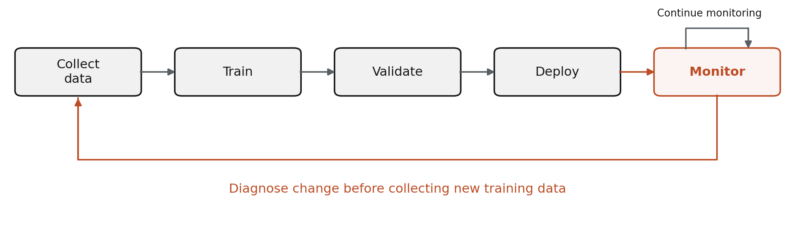

---

<!-- _class: concept image-right -->


## 1.3 Hidden technical debt

| Pattern | Meaning |
|---|---|
| **Entanglement** | Changing anything changes everything |
| **Data dependencies** | Upstream data changes without notice |
| **Feedback loops** | Outputs influence future training data |
| **Pipeline jungles** | Fragile, undocumented glue code |
| **Configuration debt** | Settings scattered across files and notebooks |

*Sculley et al., NeurIPS 2015*

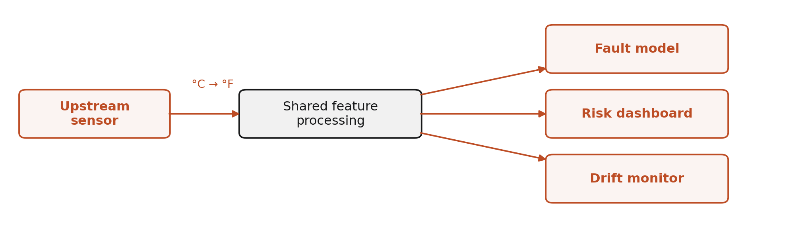

> None of these raises an error. They produce a model that is slightly, then noticeably, worse.

---

<!-- _class: concept image-right -->


## 1.4 Why models fail in production

| Failure | Example |
|---|---|
| **Training-serving skew** | Feature computed differently in production |
| **Data drift** | A sensor is recalibrated |
| **Concept drift** | A new maintenance policy changes what "failure" means |
| **Out-of-distribution inputs** | A machine type never seen in training |
| **Silent upstream change** | A column renamed, a unit changed |

> A high test score proves the model works on data **from the same distribution**. Production breaks that assumption.

---

<!-- _class: concept image-right dense -->


## 1.4 Hands-on: a silent failure

```python
X, y = make_classification(n_samples=5000, n_features=5,
        n_informative=3, n_redundant=0, shuffle=False, random_state=0)
X_train, X_test, y_train, y_test = train_test_split(X, y, test_size=0.3, random_state=0)
model = LogisticRegression(max_iter=1000).fit(X_train, y_train)

X_prod = X_test.copy()
X_prod[:, 0] += 3 * X_train[:, 0].std()      # sensor miscalibration
print(accuracy_score(y_test, model.predict(X_prod)))
```

No exception, the service keeps answering. In production, labels often arrive late: **monitor the inputs, not only the outputs.**

---

<!-- _class: concept image-right dense -->


## 1.5 The operating environment: ODD and ConOps

- **ConOps**: how the system is used, by whom, in what context
- **ODD** (Operational Design Domain): the conditions under which it is designed to work correctly

| Family | Example (predictive maintenance) |
|---|---|
| **Input conditions** | Vibration signals from types A and B, fixed sampling, ≤ 2% missing |
| **Resource constraints** | 200 ms per prediction, 512 MB, intermittent network |
| **Behavior outside the domain** | Reject, alert, fall back to a simple rule |

> A system with no defined behavior outside its domain will have an undefined one.

---

<!-- _class: concept image-right -->


## 1.5 The operating environment: ODD and ConOps

The operating domain sets the conditions under which the system is expected to work.

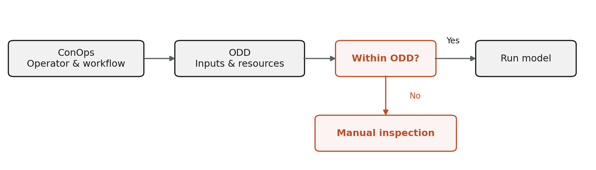

---

<!-- _class: concept image-right -->


## 1.5 Worked example: a latency budget

Requirement: **≤ 200 ms at p95**.

```text
Pre-processing        40 ms
Model inference      150 ms
Network round trip    30 ms
-----------------------------
Total                220 ms   >  200 ms budget
```

- No accuracy metric will reveal the 20 ms violation
- It is a **non-functional requirement** from the ODD: test it [4], watch it [8]
- Fixes come in [10]: lighter model, quantization, faster pre-processing

*Running example of the course: predictive maintenance on tabular sensor data, CPU only.*

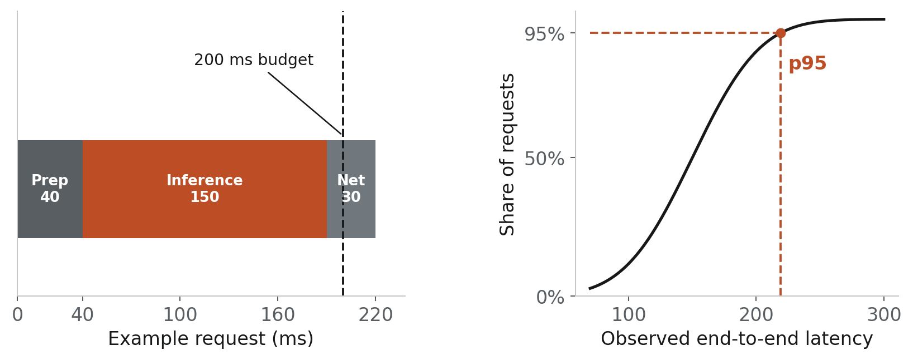


---

<!-- _class: concept image-right accent-band -->


## 1. Exercises

📝 **1.1** Write the ODD of one of your models in three paragraphs
📝 **1.2** Name the failure mode in four situations (unit change, imputation mismatch, new machine type, new definition of "critical")
📝 **1.3** Run the script; plot accuracy against the offset (0.5, 1, 2, 3 σ)
📝 **1.4** A 300 ms budget with 60 + 180 + 50 ms: does it fit? Propose two changes

<!-- Details: course [1], exercises 1.1 to 1.4 -->

---

<!-- _class: concept image-right takeaway -->


## [1] — Key Takeaways

- A model is only one component of a production ML system
- The ML lifecycle is a loop whose interfaces can fail silently
- Production invalidates assumptions through skew, drift and unfamiliar inputs
- Define the ODD, constraints and fallback behavior before building

---

<!-- _class: transition-chapitre -->
<!-- _paginate: false -->
<!-- _header: "" -->
<!-- _footer: "" -->


---

<!-- _class: full-width -->
<!-- header: '[2] — Reproducibility I' -->

# 2. Reproducibility I

### Versioning code, data and models

---

<!-- _class: concept image-right -->


## 2.1 Why reproducibility is an engineering requirement

**Audit · Debugging · Rollback · Fair comparison**

| Input | What changes it | Tool |
|---|---|---|
| **Code** | A developer edits it | Git |
| **Data** | New records, a fix, a filter | DVC, lakeFS, DataLad |
| **Configuration** | Hyperparameters, thresholds | `params.yaml` |
| **Environment** | A library upgrade, other OS | Pinned deps, containers |

> "reproducible" does not mean bit-for-bit identical: the same inputs give the same behavior within a stated tolerance.

---

<!-- _class: concept image-right -->


## 2.2 Versioning code and configuration

| In Git | Not in Git |
|---|---|
| Code, tests, lock files, docs | Datasets, trained models |
| `params.yaml`, pipeline definitions | Secrets, large generated artifacts |

```yaml
# params.yaml
train:
  seed: 42
  n_estimators: 200
  max_depth: 8
```

> Keep configuration out of the code, versioned with it. It fixes "configuration debt".

---

<!-- _class: concept image-right -->


## 2.3 Versioning data and models with DVC

```text
data/raw.csv ──dvc add──► data/raw.csv.dvc (pointer + hash) ──► git commit
                   └────► DVC cache ──dvc push──► remote (folder, S3...)
```

```bash
git init && dvc init
dvc remote add -d localremote /path/to/shared/folder
dvc add data/raw.csv
git add data/raw.csv.dvc data/.gitignore && git commit -m "raw data v1"
dvc push
git checkout <commit> && dvc pull        # restores the matching data
```

> Git holds the pointer, the remote holds the data. A commit plus `dvc pull` restores the exact dataset.

---

<!-- _class: concept image-right -->


## 2.3 Versioning data and models with DVC

Match each code revision to a specific data snapshot.

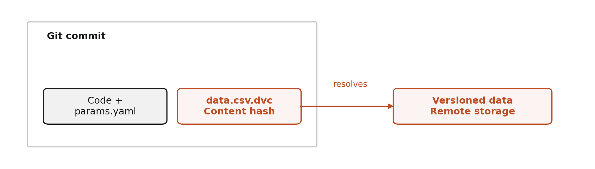

---

<!-- _class: concept image-right -->


## 2.3 DVC pipelines

```yaml
# dvc.yaml
stages:
  prepare:
    cmd: python src/prepare.py
    deps: [src/prepare.py, data/raw.csv]
    outs: [data/prepared.csv]
  train:
    cmd: python src/train.py
    deps: [src/train.py, data/prepared.csv]
    params: [train]
    outs: [models/model.joblib]
    metrics: [{metrics.json: {cache: false}}]
```

`dvc repro` re-runs only the stages whose dependencies changed · `dvc dag` · `dvc metrics show`

---

<!-- _class: concept image-right -->


## 2.4 Lineage and the environment

**Lineage**: the recorded chain from raw data to deployed model.

Three practices close the gaps:
1. **Pin dependencies** (`pip freeze > requirements.txt`)
2. **Fix random seeds** (`random`, `numpy`, `random_state=`)
3. **Build in a container** [6]

A model version is a **tuple**, not a filename:

| Code | Data | Configuration | Environment |
|---|---|---|---|
| Git commit | DVC pointer hash | `params.yaml` at commit | `requirements.txt`, image tag |

---

<!-- _class: concept image-right accent-band -->


## 2. Exercises

📝 **2.1** Name the responsible input for three incidents (data cleanup, two laptops, forgotten threshold)
📝 **2.2** Add, push, delete, `dvc pull`, change, checkout: explain each step
📝 **2.3** Write a two-stage `dvc.yaml`, change only `params.yaml`: which stages re-run?

---

<!-- _class: concept image-right takeaway -->


## [2] — Key Takeaways

- Reproducibility identifies code, data, configuration and environment
- Keep configuration with code and large artifacts behind versioned pointers
- A Git commit plus `dvc pull` restores the matching dataset
- Record lineage as the tuple of code, data, configuration and environment

---

<!-- _class: transition-chapitre -->
<!-- _paginate: false -->
<!-- _header: "" -->
<!-- _footer: "" -->


---

<!-- _class: full-width -->
<!-- header: '[3] — Reproducibility II' -->

# 3. Reproducibility II

### Experiment tracking and model registry

---

<!-- _class: concept image-right dense -->


## 3.1 Experiment tracking

Each run records **parameters**, **metrics**, **artifacts** and **provenance** (Git commit, data version).

```python
mlflow.set_tracking_uri("sqlite:///mlflow.db")   # local, no account
mlflow.set_experiment("predictive-maintenance")
with mlflow.start_run():
    mlflow.log_params({"n_estimators": 200, "max_depth": 8})
    mlflow.set_tag("git_commit", git_sha)
    mlflow.log_artifact("data/prepared.csv.dvc")
    mlflow.log_metrics({"f1": f1, "latency_ms_per_sample": latency_ms})
    mlflow.sklearn.log_model(model, "model")
```

*Alternatives: ClearML, Aim.*

---

<!-- _class: concept image-right -->


## 3.1 Experiment tracking

Compare runs under the same protocol before selecting a candidate.

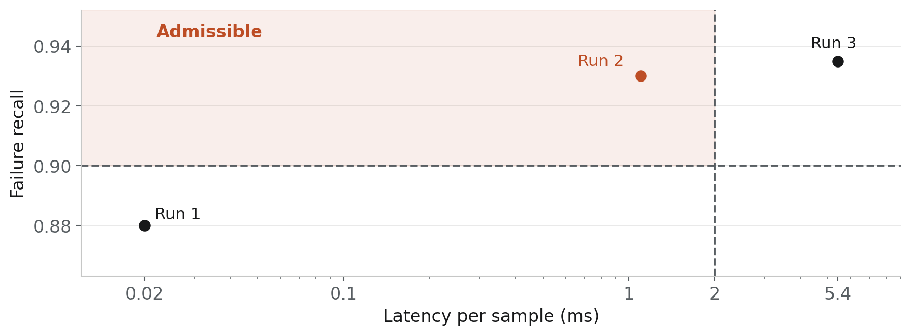

---

<!-- _class: concept image-right -->


## 3.2 Choosing a run

Criteria: **recall ≥ 0.90** on failures, **≤ 2 ms** per sample.

| Run | Model | Accuracy | Recall | Latency | OK? |
|---|---|---|---|---|---|
| 1 | Logistic regression | 0.91 | 0.88 | 0.02 ms | No (recall) |
| 2 | Random forest, 200 trees | 0.94 | 0.93 | 1.1 ms | **Yes** |
| 3 | Random forest, 1000 trees | 0.945 | 0.935 | 5.4 ms | No (latency) |

*(illustrative numbers)*

> Write the criteria **before** looking at the results. Accuracy alone is not the criterion.

---

<!-- _class: concept image-right dense -->


## 3.3 The model registry

A name, numbered versions, **aliases** (`candidate`, `champion`), a link back to the run.

```python
mv = mlflow.register_model(f"runs:/{run_id}/model", "predictive-maintenance")
client.set_registered_model_alias("predictive-maintenance", "candidate", mv.version)

# after the quality gate [5]: promote
client.set_registered_model_alias("predictive-maintenance", "champion", mv.version)

# serving loads by alias, never by path
model = mlflow.sklearn.load_model("models:/predictive-maintenance@champion")
```

> Rollback becomes one operation: point `champion` back to the previous version.

---

<!-- _class: concept image-right -->


## 3.3 The model registry

A registry links each released version to its evidence and serving alias.

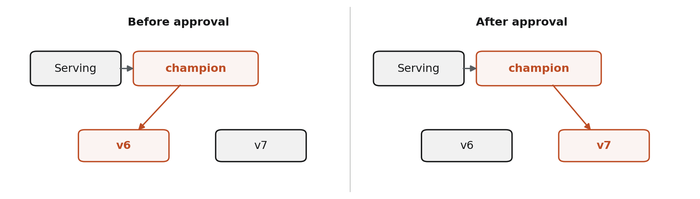

---

<!-- _class: concept image-right -->


## 3.4 From a prediction back to its origin

```text
Prediction (logged with model name + version)
   → Registry entry (version, alias)
      → Tracked run (params, metrics, tags)
         → Git commit (code, params.yaml)
         → DVC pointer (data version)
```

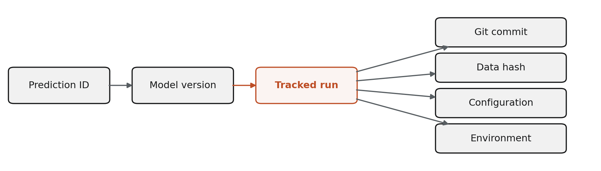

> For a model to be auditable, the service must report which version it runs, with every prediction.

---

<!-- _class: concept image-right accent-band -->


## 3. Exercises

📝 **3.1** Three runs with different parameters; compare in the MLflow UI, apply your pre-written criteria
📝 **3.2** Register, set `candidate` then `champion`, load by alias, roll back
📝 **3.3** Three problems with "the best model sits in a folder called `best_model`"

---

<!-- _class: concept image-right takeaway -->


## [3] — Key Takeaways

- Track every run's parameters, metrics, artifacts and provenance
- Select models against pre-written performance and resource criteria
- Register chosen runs as named versions and deploy by alias
- Make rollback an alias change to a previous model version
- Report the deployed model version so predictions remain auditable and reversible

---

<!-- _class: transition-chapitre -->
<!-- _paginate: false -->
<!-- _header: "" -->
<!-- _footer: "" -->


---

<!-- _class: full-width -->
<!-- header: '[4] — Testing ML Systems' -->

# 4. Testing ML Systems

### Code, data and model tests

---

<!-- _class: concept image-right -->


## 4.1 The three layers of testing

| Layer | What is tested | Catches |
|---|---|---|
| **Code** | Features, preprocessing, API logic | A bug in a transformation |
| **Data** | Schema, ranges, missing values, distributions | A silent upstream change |
| **Model** | Performance, behavior, robustness, resources | A regression, a bias, an ODD violation |

*Checklist: "The ML Test Score" (Breck et al., 2017)*

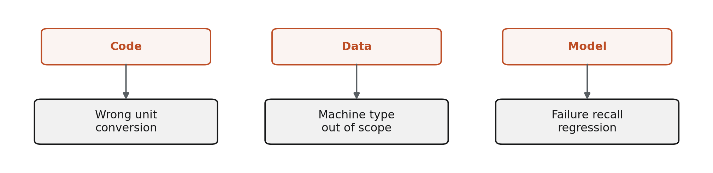

> Data can be wrong with no bug in the code, and a model can regress with no change in the code.

---

<!-- _class: concept image-right -->


## 4.2 Testing code

Keep feature logic in **plain importable functions**, reused in training **and** serving.

```python
# src/features.py
def rms(signal: np.ndarray) -> float:
    if signal.size == 0:
        raise ValueError("empty signal")
    return float(np.sqrt(np.mean(np.square(signal))))

# tests/test_features.py
def test_rms_of_constant_signal():
    assert rms(np.array([2.0, 2.0, 2.0])) == pytest.approx(2.0)
def test_rms_rejects_empty_signal():
    with pytest.raises(ValueError):
        rms(np.array([]))
```

---

<!-- _class: concept image-right -->


## 4.3 Testing data

The ODD input conditions, written as code.

```python
schema = pa.DataFrameSchema({
    "temperature":  pa.Column(float, pa.Check.in_range(-40, 150)),
    "vibration":    pa.Column(float, pa.Check.ge(0)),
    "machine_type": pa.Column(str,   pa.Check.isin(["A", "B"])),
    "failure":      pa.Column(int,   pa.Check.isin([0, 1])),
}, strict=True)

schema.validate(pd.read_csv("data/raw.csv"), lazy=True)
```

Also test: missing values, class balance, duplicates, **train/test overlap**.
*Alternatives: Great Expectations, Deepchecks.*

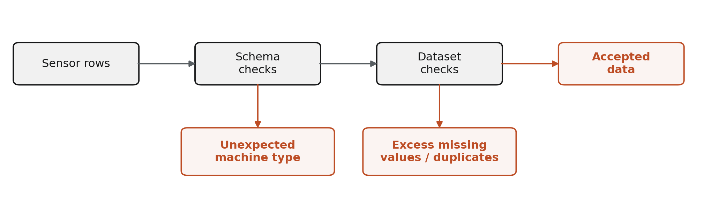


---

<!-- _class: concept image-right -->


## 4.4 Testing the model

| Test | Example |
|---|---|
| **Performance threshold** | Recall on failures ≥ 0.90 |
| **Regression vs champion** | F1 no more than 0.01 below |
| **Slice evaluation** | Recall ≥ 0.85 for both machine types |
| **Invariance** | Reordering rows does not change the output |
| **Directional** | More vibration never lowers the failure probability |
| **Resource** | p95 latency ≤ 200 ms, size ≤ 100 MB |

*Behavioral testing: Ribeiro et al., 2020 (CheckList)*

---

<!-- _class: concept image-right -->


## 4.5 Statistical caveats

Standard error of an accuracy on *n* samples: `sqrt(p(1−p)/n)`

```text
p = 0.90, n = 500
standard error = sqrt(0.9 × 0.1 / 500) ≈ 0.0134
95% interval  ≈ ± 0.026   →  between 0.874 and 0.926
```

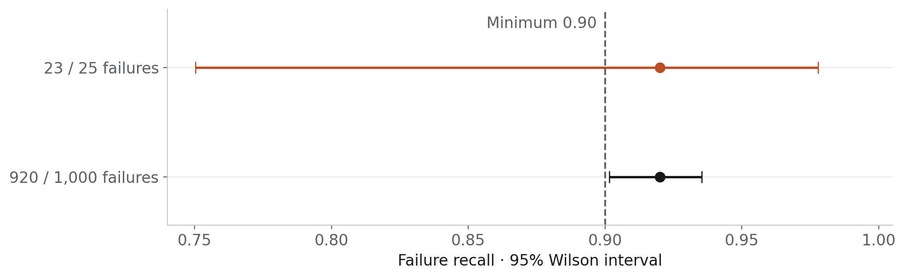

> Two models one point apart on this test set **cannot be told apart**. A threshold test with no tolerance fails or passes at random.

---

<!-- _class: concept image-right accent-band -->


## 4. Exercises

📝 **4.1** Test a feature function; introduce a deliberate train/serve difference and catch it
📝 **4.2** Pandera schema, three corrupted datasets (unit, missing column, out of range)
📝 **4.3** Performance, per-slice and directional tests on a weak and a normal model
📝 **4.4** 200 samples, 0.92 vs 0.935: can you conclude?

---

<!-- _class: concept image-right takeaway -->


## [4] — Key Takeaways

- Test code, data and model behavior as separate failure layers
- Reuse feature logic in training and serving to prevent skew
- Turn ODD input conditions into executable data checks
- Test performance, slices, behavior and resource limits
- Use statistical thresholds with tolerances supported by the sample size

---

<!-- _class: transition-chapitre -->
<!-- _paginate: false -->
<!-- _header: "" -->
<!-- _footer: "" -->


---

<!-- _class: full-width -->
<!-- header: '[5] — CI and CI/CD/CT Pipelines' -->

# 5. CI and CI/CD/CT Pipelines

### From CI to continuous training

---

<!-- _class: concept image-right -->


## 5.1 From CI to CI/CD/CT

| Practice | In an ML system |
|---|---|
| **CI** | On every commit: code tests, data checks, small training run |
| **CD** | Build the container, register the model, deploy after approval |
| **CT** | Retrain on new data, schedule or detected drift [9] |

A change can come from **code, data, or a schedule**. The pipeline must react to all three.

*Google, "MLOps: Continuous delivery and automation pipelines in machine learning"*

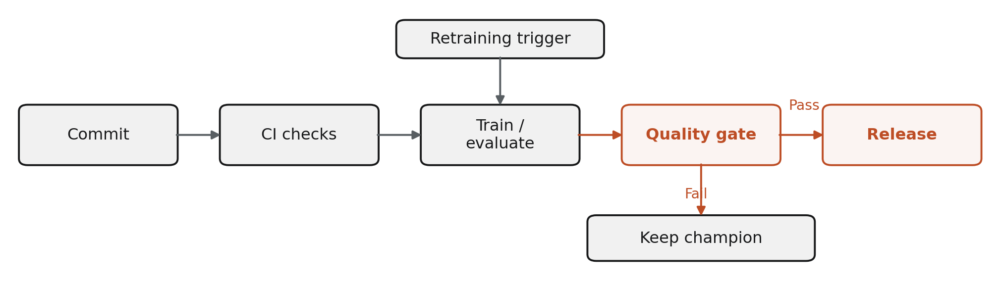


---

<!-- _class: concept image-right -->


## 5.2 Anatomy of an ML pipeline

```text
Commit → Lint + unit tests → Data validation → Train (small or full)
       → Evaluate → Quality gate ─ pass → Package (container + registry) → Deploy
                                 └ fail → Stop and report
```

> Order stages from fastest and cheapest to slowest, so a broken change **fails early**. Small training on each commit, full training on merge or schedule.

---

<!-- _class: concept image-right -->


## 5.3 A CI pipeline with GitLab CI

```yaml
stages: [test, train, gate]
default:
  image: python:3.11-slim
  before_script: [pip install --no-cache-dir -r requirements.txt]
unit-tests:
  stage: test
  script: [pytest tests/ -q]
data-validation:
  stage: test
  script: [python scripts/validate_data.py data/sample.csv]
train-sample:
  stage: train
  script: [python src/train.py --sample]
quality-gate:
  stage: gate
  script: [python scripts/check_metrics.py metrics.json]
```

*Alternatives: Forgejo/Gitea Actions, Woodpecker CI, Jenkins.*

---

<!-- _class: concept image-right dense -->


## 5.4 Quality gates: criteria as code

```python
CRITERIA = {
    "recall_failure":        ("min", 0.90),
    "f1":                    ("min", 0.85),
    "latency_ms_per_sample": ("max", 2.0),
}
for name, (kind, limit) in CRITERIA.items():
    value = metrics[name]
    ok = value >= limit if kind == "min" else value <= limit
    print(("PASS" if ok else "FAIL"), name, value)
    if not ok: failures.append(name)
sys.exit(1 if failures else 0)
```

> The gate exits non-zero if any criterion fails. The criteria are those of [3.2], in version control, with a tolerance for noise [4.5].

---

<!-- _class: concept image-right -->


## 5.5 Continuous training

| Trigger | Risk |
|---|---|
| **Schedule** | Wasted effort, or too slow |
| **New data** | New data may be low quality |
| **Drift or degradation** | Retraining on a faulty upstream change locks it in |
| **Manual** | Not continuous |

Safe loop: trigger → validate data → train → evaluate vs criteria **and** champion → register candidate → approval → deploy gradually [7]

> Retraining is only as safe as the validation after it.

---

<!-- _class: concept image-right -->


## 5.6 Release management

- Version the **container image** and the **model**, keep the mapping
- Keep the **previous champion** deployable at all times
- Record **release notes**: what changed (data, code, parameters) and the evaluation summary
- Define **rollback triggers** in advance [7.4]

> Rollback is a designed capability, not an emergency improvisation.

---

<!-- _class: concept image-right accent-band -->


## 5. Exercises

📝 **5.1** Write a CI file with tests, data validation, quality gate; make the gate fail on purpose
📝 **5.2** For four problems, which stage should catch each?
📝 **5.3** A drift-triggered CT with automatic deployment and no validation: describe a failing scenario, propose two safeguards

---

<!-- _class: concept image-right takeaway -->


## [5] — Key Takeaways

- Make pipelines react to code, data and scheduled changes
- Run cheap, fast pipeline stages first so broken changes fail early
- Block releases with versioned quality criteria
- Validate every retrained candidate against criteria and the champion
- Keep the previous champion deployable for rollback

---

<!-- _class: transition-chapitre -->
<!-- _paginate: false -->
<!-- _header: "" -->
<!-- _footer: "" -->

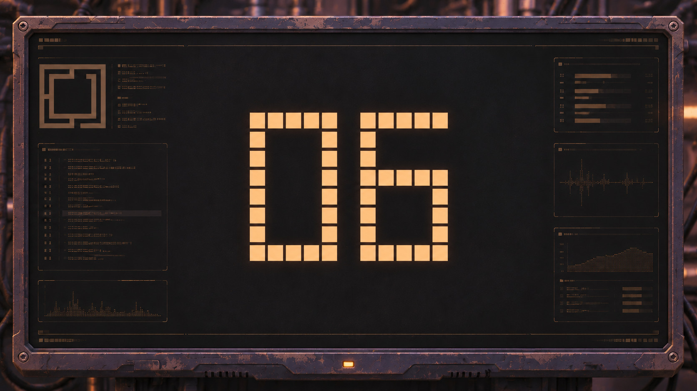

---

<!-- _class: full-width -->
<!-- header: '[6] — Packaging and Serving Models' -->

# 6. Packaging and Serving Models

### From a model file to a service

---

<!-- _class: concept image-right -->


## 6.1 Batch, online and streaming

| Mode | Latency | Typical use | Complexity |
|---|---|---|---|
| **Batch** | Minutes to hours | Nightly maintenance priority list | Low |
| **Online** (request/response) | ms to seconds | Decision during an operation | Medium |
| **Streaming** | Sub-second, continuous | Anomaly detection on sensor streams | High |

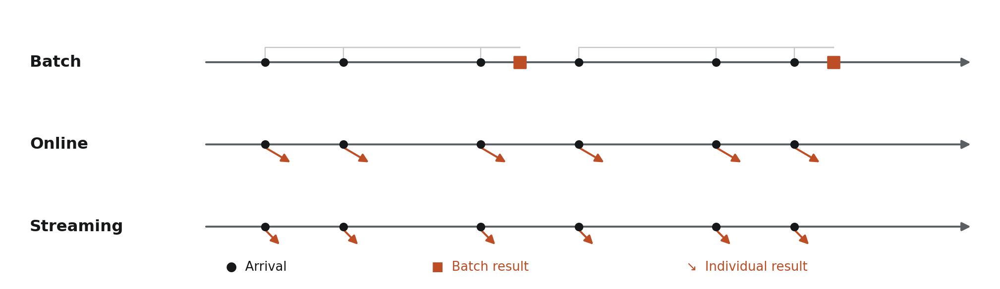

> Decide how predictions are **consumed** first. Many "real-time" needs are better served, more cheaply, by batch.

---

<!-- _class: concept image-right -->


## 6.2 Packaging the model

| Format | Strengths | Caution |
|---|---|---|
| **joblib / pickle** | Simple for scikit-learn | Loading **executes code**: never load an untrusted file |
| **MLflow model** | Model + environment + signature | Tied to MLflow |
| **ONNX** | Framework-independent [10] | Not every operator converts |

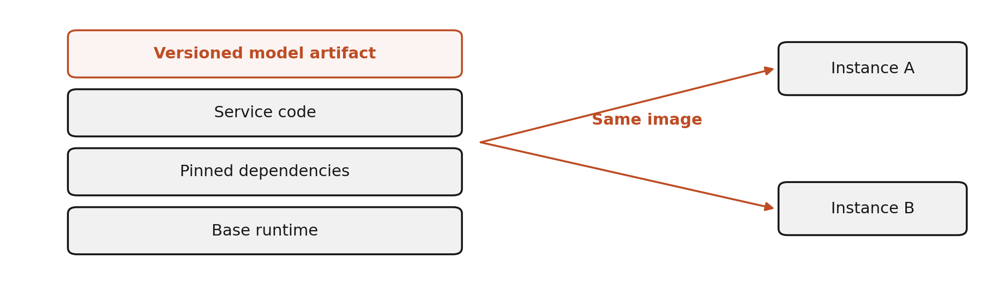

> Keep **preprocessing and model together** (a scikit-learn `Pipeline`) so serving applies exactly what training did.

---

<!-- _class: concept image-right dense -->


## 6.3 An inference API with FastAPI

```python
class Reading(BaseModel):                       # the ODD, enforced at the door
    temperature: float = Field(ge=-40, le=150)
    vibration:   float = Field(ge=0,  le=100)
    pressure:    float = Field(ge=0,  le=500)
    machine_type: int  = Field(ge=0,  le=1)

@app.get("/health")
def health(): return {"status": "ok", "model_version": MODEL_VERSION}

@app.post("/predict", response_model=Prediction)
def predict(r: Reading):
    p = float(model.predict_proba(np.array([[r.temperature, r.vibration,
                                             r.pressure, r.machine_type]]))[0, 1])
    return Prediction(failure_probability=p, failure_predicted=p >= 0.5,
                      model_version=MODEL_VERSION)
```

Out-of-range input → HTTP 422: the service **refuses rather than guesses**.

---

<!-- _class: concept image-right -->


## 6.3 An inference API with FastAPI

Validate the request before inference and return a versioned prediction.

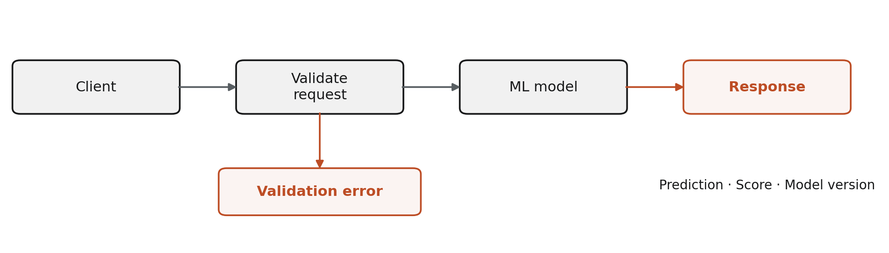

---

<!-- _class: concept image-right -->


## 6.4 Containerization

```dockerfile
FROM python:3.11-slim
WORKDIR /app
COPY requirements.txt .
RUN pip install --no-cache-dir -r requirements.txt     # cached layer
COPY app/ app/
COPY models/model.joblib models/model.joblib
ENV MODEL_VERSION=0.1.0
EXPOSE 8000
CMD ["uvicorn", "app.main:app", "--host", "0.0.0.0", "--port", "8000"]
```

```bash
podman build -t pm-model:0.1.0 . && podman run --rm -p 8000:8000 pm-model:0.1.0
```

> Same image on a laptop, in CI and in production. Put the model version **in the image**.

---

<!-- _class: concept image-right -->


## 6.5 Measuring the service, not only the model

```python
latencies = []
for _ in range(500):
    t0 = time.perf_counter()
    requests.post(URL, json=payload, timeout=5)
    latencies.append((time.perf_counter() - t0) * 1000)
print("p50 %.1f  p95 %.1f  p99 %.1f" % tuple(np.percentile(latencies, [50, 95, 99])))
```

> Report **percentiles**, through the real API, under realistic load. A mean hides the slow requests that SLOs are about. Compare p95 with the ODD budget.

---

<!-- _class: concept image-right accent-band -->


## 6. Exercises

📝 **6.1** Batch, online or streaming for three use cases
📝 **6.2** Build and run the container; send valid and invalid requests
📝 **6.3** Measure p50, p95, p99, then again under parallel load
📝 **6.4** Why is `pickle.load` on a downloaded file dangerous? Two mitigations

---

<!-- _class: concept image-right takeaway -->


## [6] — Key Takeaways

- Choose batch, online or streaming from how predictions are consumed
- Package preprocessing with the model to prevent training-serving skew
- Validate API inputs and refuse values outside the operating domain
- Use the same versioned container image across environments
- Measure latency percentiles through the real service under realistic load

---

<!-- _class: full-width -->

# One week
## Group project

Use case · ODD · first pipeline (versioning + CI + serving)

---

<!-- _class: full-width -->

# Day 2
## Deploy, operate, justify

---

<!-- _class: transition-chapitre -->
<!-- _paginate: false -->
<!-- _header: "" -->
<!-- _footer: "" -->


---

<!-- _class: full-width -->
<!-- header: '[7] — Deployment Strategies and Orchestration' -->

# 7. Deployment Strategies and Orchestration

### Release strategies, fallback, rollback

---

<!-- _class: concept image-right dense -->


## 7.1 Release strategies

| Strategy | How it works | Exposure |
|---|---|---|
| **Replace** | Stop old, start new | 100% at once |
| **Rolling update** | Replace instances one by one | Progressive |
| **Blue/green** | Old and new side by side, switch all traffic | 100% after switch, instant rollback |
| **Canary** | Small share of traffic, increase if healthy | Small, controlled |
| **Shadow** | Copy of real traffic, answers **not used** | **0%** |

> The costlier a wrong prediction, the less traffic a new model gets before it proves itself. **Shadow** is especially valuable for ML.

---

<!-- _class: concept image-right -->


## 7.1 Release strategies

Limit exposure while a candidate is being evaluated.

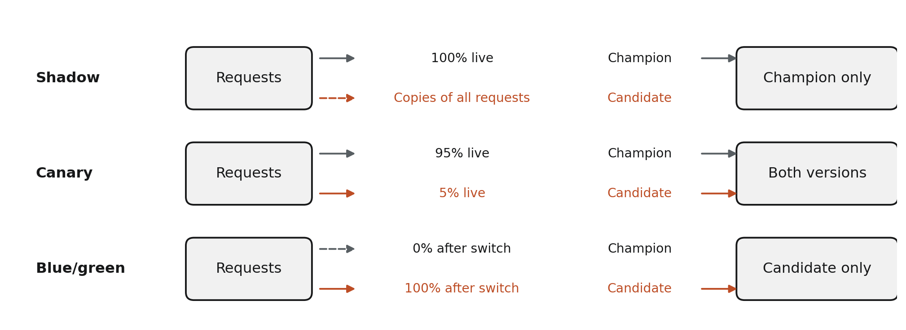

---

<!-- _class: concept image-right -->


## 7.1 Canary decision loop

```text
Requests ─► Split ─ 95% ─► Champion (v6) ─┐
                  └ 5%  ─► Candidate (v7) ─┴─► Monitoring and comparison
                                               ├ healthy → 25% → 50% → 100%
                                               └ not healthy → roll back to champion
```

Limit of shadow: you can only compare with the champion's outputs, or with **labels that arrive later** [9.4].

---

<!-- _class: concept image-right -->


## 7.2 Decision thresholds and fallback modes

Fallback, from simple to demanding:

- Return the **previous model's** answer
- Apply a **simple rule** (alert if vibration exceeds a fixed limit)
- Return **"unknown"** and route to a human
- **Degrade gracefully**: keep the safe subset of the function running

> The fallback and the decision threshold are part of the release, **versioned with the model**.

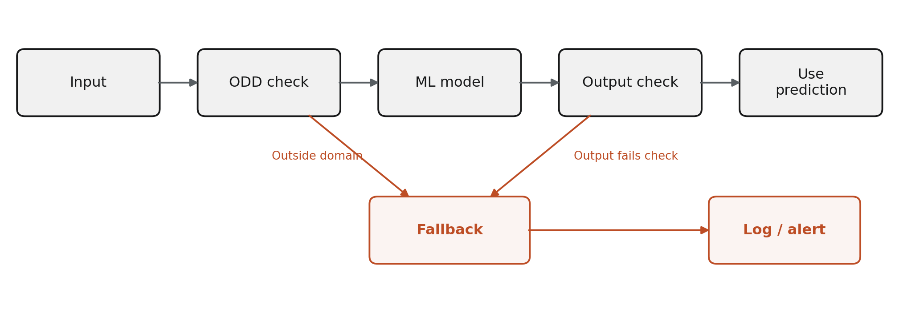

---

<!-- _class: concept image-right -->


## 7.3 Orchestration with Kubernetes

| Concept | Role |
|---|---|
| **Pod** | Smallest deployable unit |
| **Deployment** | Desired number of identical pods, rolling updates |
| **Service** | Stable address in front of pods |
| **Readiness / liveness probes** | Send traffic only to ready pods / restart stuck ones |
| **Horizontal autoscaling** | Add or remove pods with the load |

> Use an orchestrator when you need these properties, it adds operational complexity. In this course: a **demonstration** (kind, minikube, k3s), hands-on stays on a single container.

---

<!-- _class: concept image-right dense -->


## 7.4 When to roll back

Decide **before** the release, as measurable thresholds:

- Error rate above a threshold for a defined duration
- p95 latency above the ODD budget
- A drift or confidence indicator beyond its limit [9]
- A business or safety indicator degrading

**Worked example, how long does a canary take to tell you anything?**
20 000 requests/day, 2% baseline error, 5% canary = 1 000 requests/day

```text
± 1.96 × sqrt(0.02 × 0.98 / 1000) ≈ ± 0.9 points
```

After a day, 2.5% is **indistinguishable** from 2%: size the canary from the regression you need to detect.

---

<!-- _class: concept image-right -->


## 7.4 When to roll back

Restore the previous release when the agreed criteria are breached.

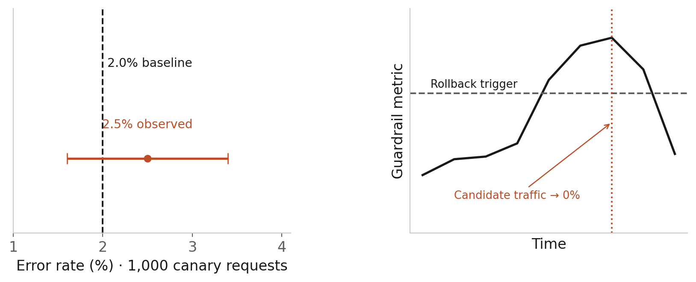

---

<!-- _class: concept image-right accent-band -->


## 7. Exercises

📝 **7.1** Choose a release strategy for three situations
📝 **7.2** Run two versions side by side, compare answers (shadow)
📝 **7.3** Write your rollback criteria; compute canary size to detect 2% → 3%

---

<!-- _class: concept image-right takeaway -->


## [7] — Key Takeaways

- Release strategies trade deployment speed against model exposure
- Reduce initial traffic as the cost of a wrong prediction rises
- Version thresholds and fallback behavior with the model
- Add orchestration only when its scaling and healing properties are needed
- Define measurable rollback criteria before release

---

<!-- _class: transition-chapitre -->
<!-- _paginate: false -->
<!-- _header: "" -->
<!-- _footer: "" -->


---

<!-- _class: full-width -->
<!-- header: '[8] — Observability and Monitoring' -->

# 8. Observability and Monitoring

### Metrics, logs, SLOs, alerting

---

<!-- _class: concept image-right -->


## 8.1 Monitoring vs observability

Monitoring tells you **that** something is wrong. Observability lets you find **why**.

| Signal | Example |
|---|---|
| **Metrics** | Requests per second, p95 latency, share of predicted failures |
| **Logs** | "Rejected input: vibration = -3.2" |
| **Traces** | Gateway → preprocessing → model → database |
| **+ the data itself** | Distribution of inputs and outputs over time |

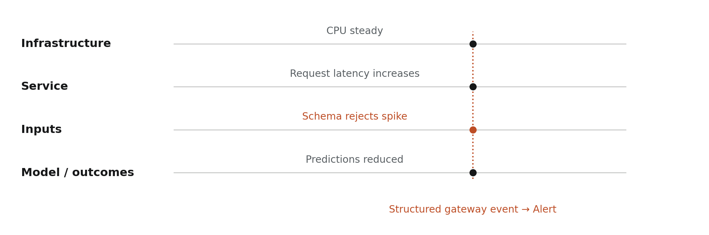


---

<!-- _class: concept image-right dense -->


## 8.2 What to monitor: four layers

| Layer | Signals | Reveals |
|---|---|---|
| **Infrastructure** | CPU, memory, restarts | Out-of-memory, saturated host |
| **Service** | Rate, errors, latency percentiles, saturation | Slowdown, failing dependency |
| **Data** | Ranges, missing values, distributions, share rejected by the ODD | Upstream change, drift |
| **Model** | Prediction distribution, confidence, recall when labels arrive | Concept drift, degradation |

> A healthy service with a degraded model, or a perfect model on a broken server, are both failures.

---

<!-- _class: concept image-right -->


## 8.3 SLIs, SLOs and SLAs

| Term | Example |
|---|---|
| **SLI** (indicator) | Share of requests under 200 ms |
| **SLO** (objective) | 99% under 200 ms over 30 days |
| **SLA** (agreement) | Credits if availability drops below 99.5% |

**Error budget:** SLO 99.5% over 30 days

```text
720 h × (1 − 0.995) = 3.6 h allowed downtime. An incident of 2 h leaves 1.6 h.
```

ML SLIs: **share of inputs inside the ODD**, drift score under a limit, recall on delayed labels.


---

<!-- _class: concept image-right dense -->


## 8.4 Instrumenting with Prometheus

```python
PREDICTIONS = Counter("predictions_total", "Predictions served", ["predicted_failure"])
REJECTED    = Counter("inputs_rejected_total", "Inputs rejected as outside the ODD")
LATENCY     = Histogram("prediction_latency_seconds", "Prediction time",
                        buckets=(0.005, 0.01, 0.025, 0.05, 0.1, 0.2, 0.5, 1.0))
app.mount("/metrics", make_asgi_app())
```

```text
# p95 over 5 minutes
histogram_quantile(0.95, sum(rate(prediction_latency_seconds_bucket[5m])) by (le))
```

> A sudden change in the **share of predicted failures**, with no code change, is a cheap hint of data drift, with no labels.

---

<!-- _class: concept image-right -->


## 8.5 Structured logging

```python
logger.info(json.dumps({
    "event": "prediction",
    "request_id": str(uuid.uuid4()),
    "model_version": version,
    "probability": round(p, 4),
    "inputs": features,        # only if not sensitive or personal
}))
```

> Log machine-readable records with the **model version** and a request id. Inputs and outputs also give the dataset for drift detection and retraining. Never log sensitive data.

---

<!-- _class: concept image-right -->


## 8.6 Alerting

- Alert on **symptoms** (latency above the SLO), not only causes (CPU at 80%)
- Use a **duration** (`for: 10m`) to avoid flapping
- Give every alert an **owner and a runbook**: what to check, how to roll back
- Review alerts that fire often without needing action

```yaml
- alert: HighLatencyP95
  expr: histogram_quantile(0.95, sum(rate(prediction_latency_seconds_bucket[5m])) by (le)) > 0.2
  for: 10m
```

---

<!-- _class: concept image-right accent-band -->


## 8. Exercises

📝 **8.1** One signal per layer; which ones stay normal under a miscalibrated sensor?
📝 **8.2** 99.9% over 30 days: downtime in minutes, remaining budget after 12 + 20 min
📝 **8.3** Instrument the service, Prometheus + Grafana dashboard, shift a feature
📝 **8.4** Two alert rules (service and data) with a three-step runbook

---

<!-- _class: concept image-right takeaway -->


## [8] — Key Takeaways

- Monitor infrastructure, service, data and model health together
- Define measurable SLIs and SLOs, including ML-specific indicators
- Instrument metrics, structured logs and traces with model and request context
- Alert on sustained symptoms that require action
- Give every actionable alert an owner and a runbook

---

<!-- _class: transition-chapitre -->
<!-- _paginate: false -->
<!-- _header: "" -->
<!-- _footer: "" -->


---

<!-- _class: full-width -->
<!-- header: '[9] — Drift, OOD Inputs and Retraining' -->

# 9. Drift, OOD Inputs and Retraining

### When the world changes

---

<!-- _class: concept image-right -->


## 9.1 Types of change

| Type | What changes | Without labels? |
|---|---|---|
| **Data drift** | Distribution of inputs P(x) | **Yes** |
| **Label / prior shift** | Class frequency P(y) | Partly |
| **Concept drift** | Relationship P(y given x) | **No** |
| **OOD inputs** | One input outside the training domain | Yes, per input |

Speed also matters: *sudden, gradual, recurring, incremental* (Gama et al., 2014).

> What you can detect without labels is not what hurts you most.

---

<!-- _class: concept image-right dense -->


## 9.2 Detecting data drift

Compare recent production inputs with a **reference**, feature by feature.

- **KS test**: largest distance between two cumulative distributions
- **PSI**: `Σ (aᵢ − eᵢ) · ln(aᵢ / eᵢ)` over bins. Rule of thumb: < 0.1 stable, 0.1–0.25 watch, > 0.25 major shift

```text
reference [0.5, 0.3, 0.2]   production [0.4, 0.3, 0.3]
PSI = 0.0223 + 0 + 0.0405 ≈ 0.063   → stable
```

> Significance is not importance. Large samples flag tiny shifts, so add an effect-size threshold and prioritize features the model relies on. *Tools: Evidently, NannyML, Alibi Detect, whylogs.*

---

<!-- _class: concept image-right -->


## 9.2 Detecting data drift

Compare recent input distributions with a reference period.

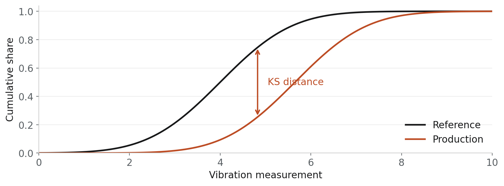

---

<!-- _class: concept image-right -->


## 9.3 Detecting out-of-distribution inputs

| Method | Limit |
|---|---|
| **Range and schema checks** | Catches only what you thought of |
| **Confidence threshold** | Models can be confidently wrong far from training data |
| **Distance-based** (Mahalanobis) | Assumes reasonable data geometry |
| **Anomaly detector** (Isolation Forest) | Needs tuning, false alarms |

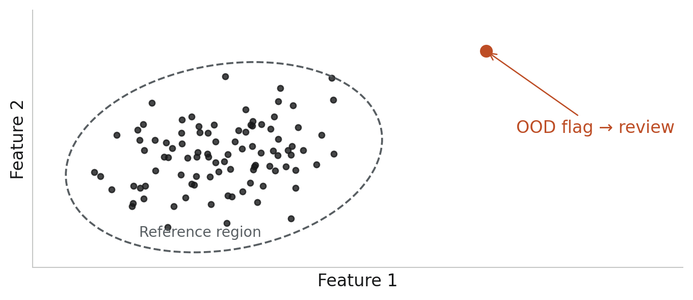

> Drift is about a **population**, OOD detection about a **single input**. When flagged, apply the fallback of [7.2] and count the events: their rate is itself a drift indicator.

---

<!-- _class: concept image-right -->


## 9.4 Concept drift and delayed labels

The label ("failed within 30 days?") arrives **a month later**.

- Measure performance on **delayed labels**, over the matching window
- Use **proxies** meanwhile: prediction distribution, OOD rate, drift scores
- **Sample** cases for expert review to get labels sooner
- Beware **feedback loops**: maintenance triggered by an alert prevents the failure, so the label no longer shows what would have happened

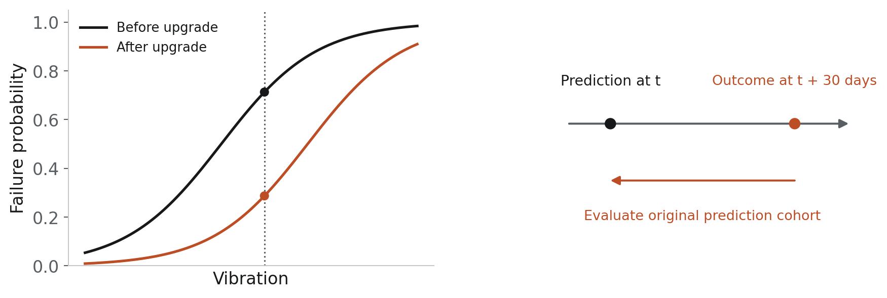


---

<!-- _class: concept image-right dense -->


## 9.5 Retraining policy

| Question | Options |
|---|---|
| **When?** | Schedule, drift threshold, degraded delayed-label performance, enough new data |
| **On what data?** | Sliding window (adapts fast) or expanding window (stable); check quality first |
| **How validated?** | Same gate as any candidate, comparison with champion, shadow or canary |
| **Who decides?** | Automatic if low risk, human approval if costly or regulated |
| **If it goes wrong?** | Roll back to the previous champion |

> First diagnose: **real change in the world, or a broken input?** Retraining on corrupted data makes things worse.

---

<!-- _class: concept image-right -->


## 9.5 Retraining policy

An alert initiates investigation. A retrained candidate must pass evaluation before release.

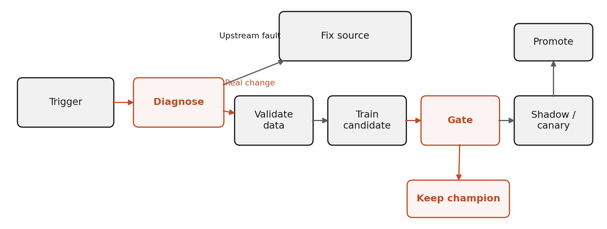

---

<!-- _class: concept image-right accent-band -->


## 9. Exercises

📝 **9.1** Classify four events (new machine model, failure rate halves, pump upgrade, unit change)
📝 **9.2** PSI by hand for `[0.6, 0.3, 0.1]` vs `[0.4, 0.3, 0.3]`
📝 **9.3** Simulate increasing offsets; compare KS, PSI and accuracy: who warns first?
📝 **9.4** Write your retraining policy; find a scenario where it retrains for nothing

---

<!-- _class: concept image-right takeaway -->


## [9] — Key Takeaways

- Distinguish population drift, concept drift and per-input OOD events
- Combine statistical significance with effect size and model relevance
- Use delayed labels for degradation and proxies while labels are unavailable
- Apply fallback to OOD inputs and monitor their rate
- Diagnose data quality before retraining and validate every candidate

---

<!-- _class: transition-chapitre -->
<!-- _paginate: false -->
<!-- _header: "" -->
<!-- _footer: "" -->


---

<!-- _class: full-width -->
<!-- header: '[10] — Operating Under Constraints' -->

# 10. Operating Under Constraints

### Efficiency and edge

---

<!-- _class: concept image-right dense -->


## 10.1 Why constraints matter

| Constraint | Example |
|---|---|
| **Latency** | 200 ms per prediction |
| **Throughput** | 500 per second at peak |
| **Memory** | 512 MB for the service |
| **Energy** | Battery-powered sensor node |
| **Connectivity** | Intermittent link, model must run locally |
| **SWaP** | Size, weight, power of the platform |

| | Cloud | Edge |
|---|---|---|
| Compute | Abundant | Limited |
| Latency | Network included | Local, predictable |
| Updating | Central, easy | Device by device |

---

<!-- _class: concept image-right -->


## 10.2 Measure before optimizing

Budget of [1.5]: pre-processing 40 ms · inference 150 ms · network 30 ms

- Halving inference → 75 ms, total **145 ms**: fits
- Pre-processing 40 → 20 ms alone → total **200 ms**: only just fits

> Profile the real pipeline on the real target. An optimization that does not reduce the dominant cost is wasted effort.


---

<!-- _class: concept image-right -->


## 10.3 Techniques to reduce inference cost

| Technique | Effect | Trade-off |
|---|---|---|
| **Simpler model** | Large savings | May lose accuracy |
| **Quantization** | About 4× smaller (32-bit float → 8-bit int) | Small accuracy loss, validate |
| **Pruning** | Smaller, sometimes faster | Needs runtime support |
| **Distillation** | Small student imitates a large teacher | Needs a training phase |

```text
s = (x_max − x_min)/(2^b − 1)   z = round(−x_min/s)   q = round(x/s) + z
weights in [−1, 1], 8 bits: s ≈ 0.00784,  x = 0.5 → q = 192 → x' ≈ 0.502
```

---

<!-- _class: concept image-right -->


## 10.3 Techniques to reduce inference cost

Compare accuracy, memory and latency before adopting lower-precision weights.

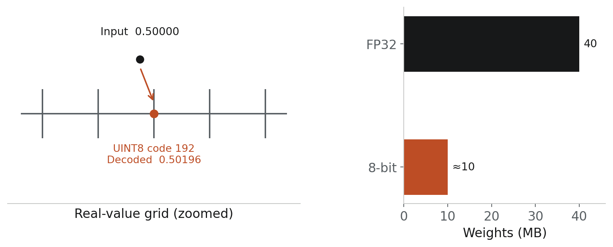

---

<!-- _class: concept image-right dense -->

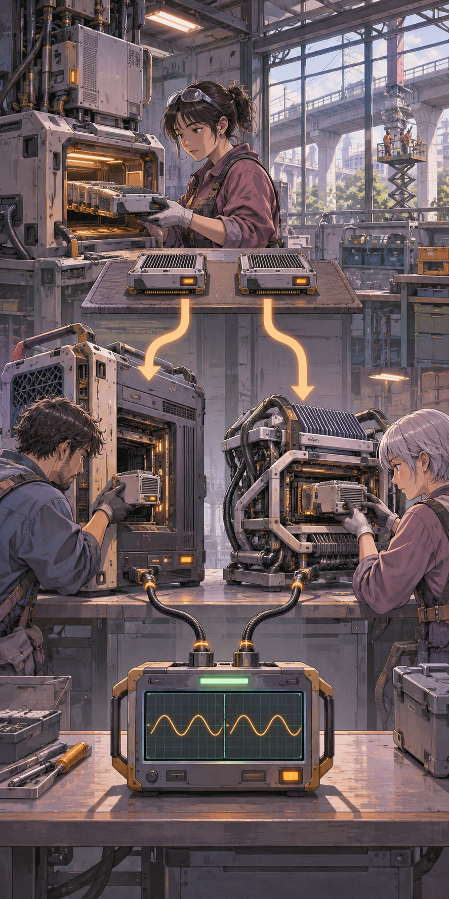

## 10.4 ONNX and ONNX Runtime

```python
onx = convert_sklearn(model, initial_types=[("input", FloatTensorType([None, 4]))],
                      options={id(model): {"zipmap": False}})
open("model.onnx", "wb").write(onx.SerializeToString())

sess = ort.InferenceSession("model.onnx", providers=["CPUExecutionProvider"])
labels, probs = sess.run(None, {"input": X_test.astype(np.float32)})

quantize_dynamic("mlp.onnx", "mlp.int8.onnx", weight_type=QuantType.QInt8)
```

> Compare original and quantized on **accuracy, latency and size**, with the same tests and gates as any release. *Alternatives: OpenVINO, Apache TVM, TensorFlow Lite.*

---

<!-- _class: concept image-right -->


## 10.4 ONNX and ONNX Runtime

Export the model, run inference and compare its outputs with the original implementation.

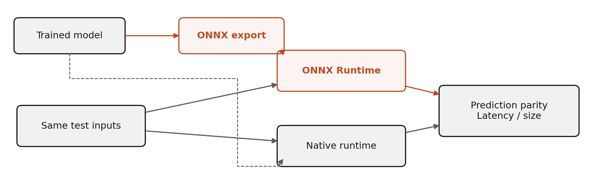

---

<!-- _class: concept image-right -->


## 10.5 Beyond the container: embedded targets

- **RTOS**: bounded, predictable response times (VxWorks, PikeOS)
- **Embedded Linux**: when its features are needed and timing is less strict
- **Hypervisor**: several virtual machines on one board, **isolation** between criticality levels

Questions for the platform team: worst-case execution time? memory and libraries? how is the model updated? how is a model failure kept from affecting critical functions [12.5]?

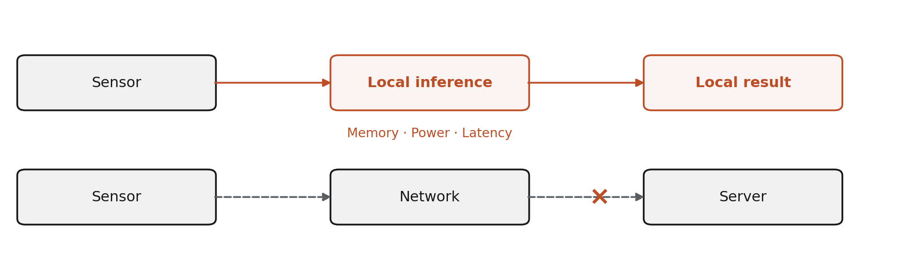


---

<!-- _class: concept image-right accent-band -->


## 10. Exercises

📝 **10.1** 120 ms budget with 25 + 85 + 15 + 20 ms: does it fit? where to act first?
📝 **10.2** Quantize five values by hand, 8 bits then 4 bits
📝 **10.3** Train a small MLP, export, quantize: size, p95, accuracy
📝 **10.4** Local vs server on a battery device: advantages and new problems

---

<!-- _class: concept image-right takeaway -->


## [10] — Key Takeaways

- Derive latency, memory, energy and connectivity limits from the ODD
- Profile the complete pipeline on its real target before optimizing
- Reduce the dominant cost with simpler models or compression techniques
- Treat quantization as a trade-off that requires validation
- Compare accuracy, latency and size through the normal release gates

---

<!-- _class: transition-chapitre -->
<!-- _paginate: false -->
<!-- _header: "" -->
<!-- _footer: "" -->


---

<!-- _class: full-width -->
<!-- header: '[11] — Software Architecture of AI Systems' -->

# 11. Software Architecture of AI Systems

### Components, modes, decisions

---

<!-- _class: concept image-right dense -->


## 11.1 A macro architecture for an AI system

```text
Data sources → Data pipeline (ingest, validate, store) → Data store
   → Training pipeline (train, evaluate, gate) → Model registry
   → Serving (batch or online) → API / gateway → Consumers
   Serving + Data store → Monitoring and logging → back to training
```

| Layer | Open-source examples |
|---|---|
| Data pipeline / store | Prefect, Airflow, Dagster · PostgreSQL, MinIO · Feast (features) |
| Training / registry | DVC, MLflow, CI engine |
| Serving / messaging | FastAPI, BentoML, Triton · Kafka |

> Start with the **smallest architecture** that meets the ODD.

---

<!-- _class: concept image-right -->


## 11.1 A macro architecture for an AI system

Record why the selected architecture meets the operating constraints.

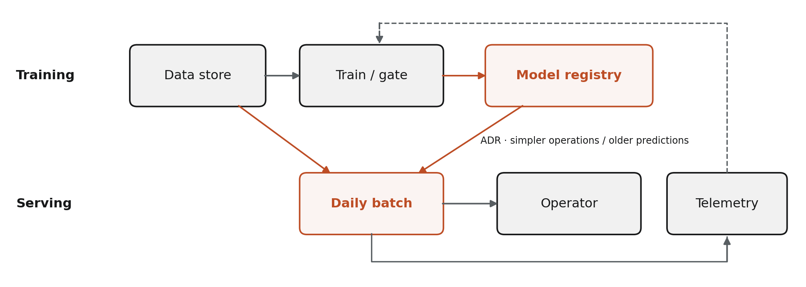

---

<!-- _class: concept image-right -->


## 11.2 Processing modes and consequences

| Mode | Strengths | Costs and risks |
|---|---|---|
| **Batch** | Simple, cheap, replayable | Stale by design |
| **Request/response** | Immediate answer | Latency budget, availability, load spikes |
| **Streaming / event-driven** | Decoupling, continuous, replay | Operational complexity, ordering guarantees |

> The decision that looks technical is a requirements question: **what latency does the business really need?**

---

<!-- _class: concept image-right -->


## 11.3 Qualities and trade-offs

| Quality | Typical question |
|---|---|
| **Latency** | Within the budget? |
| **Scalability** | Does it hold at 10× the load? |
| **Resilience** | What happens when a component fails? |
| **Coupling** | Can one part change without breaking others? |
| **Security / governance** | Who can call or change what? Where does the data live? |
| **Cost** | What does it cost to run? |

> Architecture is managing trade-offs. Name the qualities that matter, and state what you accept to lose.

---

<!-- _class: concept image-right dense -->


## 11.4 Architecture Decision Records

An ADR records **one** decision (Nygard, 2011): **Title · Status · Context · Decision · Consequences**

```markdown
# 3. Use batch scoring for maintenance priorities
## Status        Accepted
## Context       Planning is daily, ranked list needed by 06:00, data arrives hourly.
## Decision      Nightly batch job, results stored in the database. No online API yet.
## Consequences  + Simple, cheap, replayable   − Up to 24 h old, revisit if real-time needed
```

*Tools: adr-tools, Log4brains. A folder of ADRs in the repo is the memory of **why**.*

---

<!-- _class: concept image-right dense -->


## 11.5 Reviewing an architecture critically

1. **Flows**: where does data enter, get transformed, stored, consumed?
2. **ODD**: where are input conditions checked? What happens outside?
3. **Failure**: what happens when each component is slow, down or wrong? Fallback?
4. **Change**: how is a model released and rolled back? How is the pipeline tested?
5. **Observation**: what is measured, by whom, what triggers an action?
6. **Security and governance**: who can read data, call the service, change the model?
7. **Cost and capacity**: load assumptions, what at 10× the load?

---

<!-- _class: concept image-right accent-band -->


## 11. Exercises

📝 **11.1** Draw your project architecture; mark validation, gate, monitoring, fallback
📝 **11.2** Batch, request/response or streaming for three use cases, with the consequence you accept
📝 **11.3** Write an ADR with at least two alternatives
📝 **11.4** Review another group's diagram with the checklist: three questions

---

<!-- _class: concept image-right takeaway -->


## [11] — Key Takeaways

- Start with the smallest architecture that satisfies the ODD
- Choose processing modes from required latency and accepted consequences
- Make component interfaces, failure behavior and observation explicit
- Name the architectural qualities that matter and the trade-offs accepted
- Record important decisions, context and consequences in ADRs

---

<!-- _class: transition-chapitre -->
<!-- _paginate: false -->
<!-- _header: "" -->
<!-- _footer: "" -->


---

<!-- _class: full-width -->
<!-- header: '[12] — Trustworthy ML' -->

# 12. Trustworthy ML

### Validation, robustness, explainability, compliance

---

<!-- _class: concept image-right dense -->


## 12.1 What "trust" means

You trust a system **for a given use in a given domain**, based on evidence. The ODD makes the claim precise.

| Term | Question | ML example |
|---|---|---|
| **Verification** | Did we build the system **right**? (vs specification) | Meets the latency budget, passes its gates |
| **Validation** | Did we build the **right** system? (vs real need) | Operators find the alerts useful, failures decrease |

In critical settings: integration, verification, validation, qualification, often leading to a **certification**. Your practices [2–9] produce much of the evidence.

---

<!-- _class: concept image-right -->


## 12.2 Validation beyond one accuracy figure

| | Predicted: no failure | Predicted: failure |
|---|---|---|
| **Actual: no failure** | TN | FP (unnecessary inspection) |
| **Actual: failure** | **FN (missed failure)** | TP |

`precision = TP / (TP + FP)` · `recall = TP / (TP + FN)`

For critical equipment a missed failure usually costs more, so **recall** comes first and the threshold is chosen accordingly.

Also: **by slice**, **calibration**, **rare and edge cases**, **simulation** (state how faithful it is).

---

<!-- _class: concept image-right -->


## 12.3 Robustness under degraded conditions

```python
for noise_level in [0.0, 0.1, 0.25, 0.5, 1.0]:      # in units of each feature's std
    X_noisy = X_test + rng.normal(0, noise_level, X_test.shape) * X_train.std(axis=0)
    print(noise_level, round(recall_score(y_test, model.predict(X_noisy)), 3))
```

Same idea: remove values, shift a feature, drop a sensor → a **degradation curve**. The ODD states how much degradation is acceptable.

*Adversarial robustness: Adversarial Robustness Toolbox (ART).*

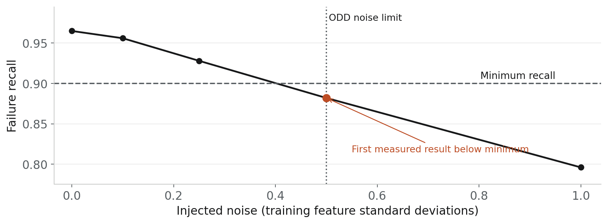


---

<!-- _class: concept image-right -->


## 12.4 Explainability

| Level | Methods |
|---|---|
| **Global** (what does the model rely on?) | Permutation importance, tree importances |
| **Local** (why this prediction?) | SHAP, LIME, Captum |

Limits: **correlated features** share or hide importance · importance is **not causality** · a **spurious shortcut** (a feature identifying the data source) shows as high importance.

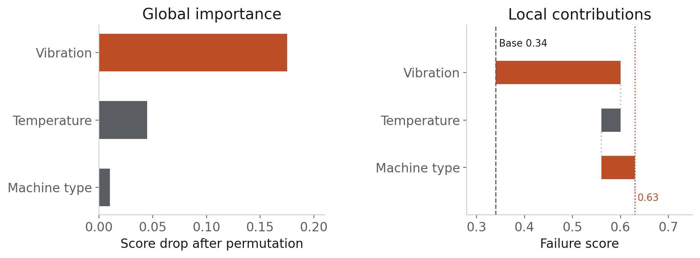

> Explanations describe what the model uses, not what causes the outcome. Use them to check it relies on sensible signals.

---

<!-- _class: concept image-right -->


## 12.5 Runtime assurance and graceful degradation

```text
Input → Inside the ODD? (range checks, OOD detector)
          ├ no  → Fallback (rule, human, safe default) → Log and alert
          └ yes → ML model → Output plausible and confident enough?
                               ├ no  → Fallback
                               └ yes → Use prediction → Log and alert
```


> Do not rely on the model alone. Which fallback is **safe** depends on the application and is decided with the people responsible for safety.

---

<!-- _class: concept image-right dense -->


## 12.6 Security and compliance

| Threat | Measures |
|---|---|
| **Unsafe model files** | Trusted sources, checksums, safer formats |
| **Data poisoning** | Validation, provenance, access control |
| **Evasion** | Robustness testing, input validation |
| **Model or data theft** | RBAC/IAM, encryption, rate limiting |
| **Vulnerable dependencies** | Pinned versions, scanning in CI |

**EU AI Act** (Regulation 2024/1689): risk-based. High-risk systems: risk management, data governance, documentation, record-keeping, human oversight, accuracy, robustness, cybersecurity. *Check the current text and your legal team: this is not legal advice.*

---

<!-- _class: concept image-right dense -->


## 12.7 The evidence package

| Evidence | From | Question answered |
|---|---|---|
| ODD and ConOps | [1.5] | What is it for, under which conditions? |
| Lineage and versions | [2] | What was it built from? |
| Experiments, registry | [3] | How was this model selected? |
| Test reports, gates | [4–5] | What was verified, with what thresholds? |
| Release and rollback plan | [7] | How is it deployed, how undone? |
| Monitoring, retraining plan | [8–9] | How will we know it still works? |
| Validation, robustness, explainability | [12.2–12.4] | Where does it work, where not? |
| Architecture decisions | [11] | Why this design? |
| Security and compliance | [12.6] | Protected and compliant? |

A **model card** is a convenient container for much of this.

---

<!-- _class: concept image-right accent-band -->


## 12. Exercises

📝 **12.1** Confusion matrix, precision, recall, two thresholds
📝 **12.2** Noise test: the maximum acceptable noise, as a sentence of your ODD
📝 **12.3** Permutation importance: one unexpected result, how to check?
📝 **12.4** Design the runtime-assurance wrapper and the fallback
📝 **12.5** Outline a model card using the evidence table

---

<!-- _class: concept image-right takeaway -->


## [12] — Key Takeaways

- Build trust from verification and validation evidence within a defined domain
- Validate metrics, slices, calibration and edge cases against the real need
- Test degraded conditions and state acceptable limits in the ODD
- Use explanations to inspect model behavior, not infer causality
- Design safe fallback behavior and maintain an evidence package

---

<!-- _class: transition-chapitre -->
<!-- _paginate: false -->
<!-- _header: "" -->
<!-- _footer: "" -->


---

<!-- _class: full-width -->
<!-- header: '[13] — Practical Ecosystem & Tools' -->

# 13. Practical Ecosystem & Tools

### Tools, setup, end-to-end sequence

---

<!-- _class: concept image-right dense -->


## 13. Tools by section

| Brick | Default | Alternatives | [] |
|---|---|---|---|
| Data versioning | **DVC** | lakeFS, DataLad | 2 |
| Tracking and registry | **MLflow** | ClearML, Aim | 3 |
| Tests, data validation | **pytest, Pandera** | Great Expectations, Deepchecks | 4 |
| CI | **GitLab CI** | Forgejo/Gitea Actions, Woodpecker, Jenkins | 5 |
| Containers | **Podman** | Docker Engine, Buildah | 6 |
| Serving | **FastAPI** | BentoML, MLServer, Triton | 6 |
| Monitoring | **Prometheus + Grafana** | OpenTelemetry, VictoriaMetrics, Loki | 8 |
| Drift | **Evidently** | NannyML, Alibi Detect, whylogs | 9 |
| Portable inference | **ONNX Runtime** | OpenVINO, Apache TVM | 10 |
| Explainability | **SHAP** | LIME, Captum | 12 |

---

<!-- _class: concept image-right -->


## 13. Day 0 setup

**Before Day 1**, with the verification script:

1. Python 3.10+, virtual environment, Git
2. Podman (or Docker Engine), WSL 2 on Windows when permitted
3. Python packages (scikit-learn, dvc, mlflow, fastapi, evidently, onnxruntime, shap...)
4. **One** free account: GitLab.com or Codeberg
5. Laptop: about 4 cores, 8 GB RAM, **no GPU**

> Installation problems are the most common way to lose the first hour. Check free-tier conditions of the CI service in advance, and keep a local runner as a fallback.

---

<!-- _class: concept image-right dense -->


## 13. The whole course in one sequence

```bash
dvc add data/raw.csv && git commit -m "data v1"     # [2]  version
dvc repro                                            #     pipeline
python src/train.py                                  # [3]  track and register
pytest tests/ -q && python scripts/check_metrics.py metrics.json   # [4-5] test and gate
podman build -t pm-model:0.1.0 . && podman run --rm -p 8000:8000 pm-model:0.1.0  # [6]
podman compose up -d                                 # [8]  Prometheus + Grafana
python scripts/drift_report.py data/prod_sample.csv  # [9] drift
python scripts/export_onnx.py && python scripts/quantize.py   # [10]
```

If you can explain every line and what it protects against, you have met the objectives.

---

<!-- _class: concept image-right takeaway -->


## [13] — Key Takeaways

- Use a minimal open-source stack that runs on a CPU laptop
- Match each MLOps capability to a default tool and viable alternatives
- Complete and verify the environment setup before Day 1
- Connect versioning, tracking, testing, serving, monitoring and optimization in one sequence

---

<!-- _class: transition-chapitre -->
<!-- _paginate: false -->
<!-- _header: "" -->
<!-- _footer: "" -->


---

<!-- _class: full-width -->
<!-- header: '[14] — Group Project' -->

# 14. Group Project

### Build and defend a complete MLOps loop

---

<!-- _class: concept image-right dense -->


## 14. Teams and timeline

| Role | Focus | [] |
|---|---|---|
| **Data Engineering** | Data strategy, validation, versioning | 2, 4.3 |
| **ML Engineer** | Train, track, choose against criteria | 3, 10 |
| **MLOps / Integration** | CI pipeline, container, deployment | 5–7 |
| **Quality & Validation** | Tests, robustness, monitoring, drift | 4, 8, 9, 12 |
| **Scrum master (WPM)** | Coordination, report, blockers | — |

| When | Expected progress |
|---|---|
| **End of Day 1** | Teams, use case, first ODD, repository |
| **During the week** | Versioned data, tracked runs, CI with gate, containerized service |
| **Day 2** | Monitoring, drift, retraining policy, robustness, report, pitch |

---

<!-- _class: concept image-right dense -->


## 14. Deliverables and assessment

**Deliverables**
1. **Repository**: code, tests, pipeline, container, docs. The pipeline runs from a clean checkout
2. **Short report** following the evidence package [12.7], with at least two ADRs and the compliance assessment
3. **5-minute pitch**: use case, value, approach, results, limits, next steps (WPM and team → Head of Innovation)

**Assessment grid**
ODD and requirements · Reproducibility · Automation and gates · Deployment · Monitoring and retraining · Trust and limits · Report and pitch

> Every choice is justified by an explicit criterion: an ODD requirement, a measured result, or a stated trade-off. Never by default.

---

<!-- _class: concept image-right takeaway -->


## [14] — Key Takeaways

- Build a complete loop from the ODD to a monitored service and retraining policy
- Divide ownership across data, modeling, integration, quality and coordination
- Deliver a reproducible repository, evidence-based report and concise pitch
- Justify every choice with a requirement, measured result or explicit trade-off

---

<!-- _class: transition-chapitre -->
<!-- _paginate: false -->
<!-- _header: "" -->
<!-- _footer: "" -->


---

<!-- _class: full-width -->
<!-- header: '[15] — Glossary' -->

# 15. Glossary

### Key terms to remember

---

<!-- _class: concept image-right dense -->


## 15. Key terms

| Term | Definition |
|---|---|
| **ODD** | Operational Design Domain: conditions under which a system is designed to work correctly |
| **Lineage** | Recorded chain from raw data to deployed model |
| **Quality gate** | Automatic check that blocks a release if criteria are not met |
| **Champion / candidate** | Model serving production / model under evaluation |
| **Data drift / concept drift** | Inputs change / input-to-target relationship changes |
| **OOD** | Out-of-distribution input |
| **SLI / SLO / SLA** | Indicator / objective / agreement |
| **Shadow, canary, blue/green** | Release strategies, from 0% exposure to instant switch |
| **Runtime assurance** | Monitoring at run time, switching to a safe behavior outside the domain |

*Full glossary in the course, [15].*

---

<!-- _class: transition-chapitre -->
<!-- _paginate: false -->
<!-- _header: "" -->
<!-- _footer: "" -->


---

<!-- _class: full-width -->
<!-- header: '[16] — References' -->

# 16. References

### Books, papers, regulation, resources

---

<!-- _class: concept image-right dense -->


## 16. References

**Books**
Huyen (2022) *Designing Machine Learning Systems* · Kleppmann (2017) *Designing Data-Intensive Applications* · Beyer et al. (2016) *Site Reliability Engineering*

**Papers**
Sculley et al. (2015) Hidden Technical Debt in ML Systems · Breck et al. (2017) The ML Test Score · Ribeiro et al. (2020) CheckList · Gama et al. (2014) Concept Drift Adaptation · Rabanser et al. (2019) Failing Loudly · Jacob et al. (2018) Integer-Arithmetic-Only Inference · Lundberg & Lee (2017) SHAP · Mitchell et al. (2019) Model Cards · Nygard (2011) Documenting Architecture Decisions

**Regulation**
Regulation (EU) 2024/1689 (AI Act)

*Full list with practical resources in the course, [16].*

---

<!-- _class: concept watermark takeaway -->
<!-- header: 'Machine Learning Engineering & MLOps' -->


## What to remember

- **Write the ODD** before building
- **If it is not versioned**, it is not reproducible
- **If it is not tested**, it will regress
- **If it is not observed**, you will not know it failed
- **Define the fallback** before the release
- **Trust is evidence**, within a domain

---

<!-- _class: full-width -->
<!-- _paginate: false -->

# Questions?


